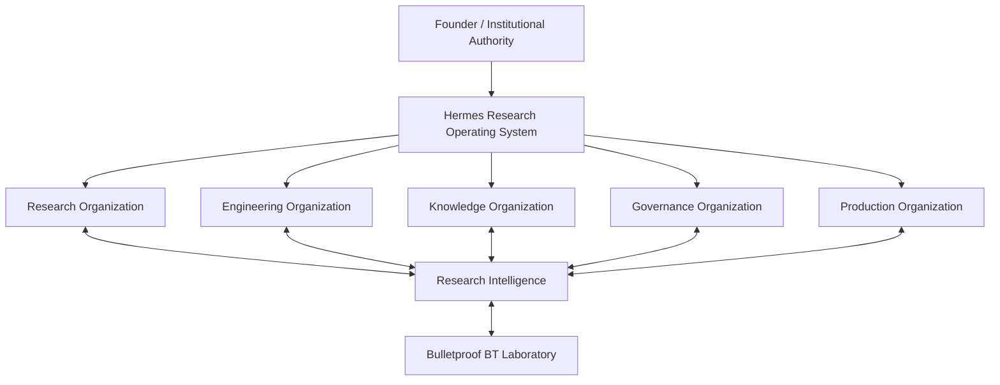
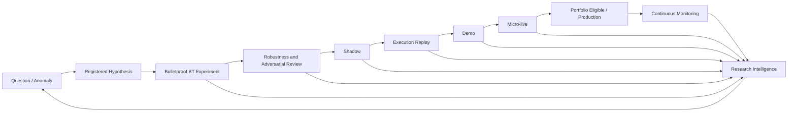

# Invariance Research Bible — Project Context for Codex

> **Status:** Repository bootstrap and authoring context  
> **Audience:** Codex and future human or agent contributors  
> **Document type:** Architectural context, continuity contract, and writing charter  
> **Canonical implementation reference for Book V:** [Chinedum-iwueke/bulletproof_bt](https://github.com/Chinedum-iwueke/bulletproof_bt)

## 1. Purpose of This Document

This document supplies the architectural context required to continue authoring the **Invariance Research Bible** as a long-running, repository-style Markdown project. It is not itself a replacement for Books I–III, and it must not be used to casually revise doctrines already established there. It is a continuity layer: it records the current system model, the revised ten-book roadmap, the relationship among major components, and the expectations governing future volumes.

The central architectural sentence is:

> **Research Intelligence is the institutional brain and long-term memory. Hermes is the operating system of the institution. Bulletproof BT is the experimental laboratory.**

The central strategic objective is:

> **Do not try to build a machine guaranteed to beat the market. Build a scientific institution that becomes progressively better at distinguishing genuine opportunities from illusions.**

Nothing in the architecture guarantees profitable alpha, persistent alpha, or returns comparable to Renaissance Technologies or any other firm. The architecture is intended to improve research discipline, reproducibility, falsification, institutional memory, engineering quality, adaptation, and the probability of finding and preserving genuine edges. It provides process advantages, not profit guarantees.

---

## 2. Project Vision: A Scientific Institution That Trades

Invariance Research is not merely a trading system, a backtester, an agent swarm, or a collection of machine-learning models. It is a **scientific institution that happens to trade**.

Its durable asset is not a single strategy. Strategies decay, regimes change, competitors adapt, and capacity constraints alter the economics of an edge. The durable asset is the institution's ability to:

1. observe markets;
2. construct useful representations;
3. identify anomalies and unanswered questions;
4. propose plausible mechanisms and registered hypotheses;
5. design controlled, reproducible experiments;
6. attack results through statistical and adversarial review;
7. validate prospectively in shadow and operational environments;
8. introduce real capital gradually;
9. monitor degradation and incidents;
10. return every result, failure, decision, and lesson to institutional memory.

The desired long-term result is a compounding library of modest, diverse, scientifically defensible edges—not dependence on one “holy grail” strategy. Smaller or capacity-constrained opportunities may be economically meaningful to Invariance even when they are irrelevant to very large firms. Different questions, representations, horizons, mechanisms, and capacity targets can reveal opportunity without assuming that major market participants are unsophisticated.

## 3. Current Canonical Status

**Operational continuity, 2026-11-16:** The ten-book constitutional series is
accompanied by non-normative Book XI. This bootstrap document's ten-book roadmap
does not exclude that living implementation companion. Before making current-state
claims, consult [Book XI's recovery and certification update](books/book-11-engineered-company-system/chapters/12-requirements-recovery-and-current-certification.md).
R14/R15 ended with zero trials; deployed recovery routing is not proof of successful
autonomous strategy engineering. Do not revive exhausted mandates or interpret
historical EXEC1/EXEC2 and provider assignments as current runtime inventory.

Books I–III have already been drafted. They are the **constitutional foundation** of the series and must be read before later books are authored or materially revised.

| Book | Canonical role | Governing question |
|---|---|---|
| **Book I — The Invariance Doctrine** | The Constitution | Why does the institution exist, and what does it believe? |
| **Book II — The Hermes Research Operating System** | The Organization | How does the institution operate and govern work? |
| **Book III — Research Intelligence** | The Scientific Brain and Memory | How does the institution think, learn, retrieve, synthesize, and remember? |

These books are not ordinary background sources. Within Research Intelligence they form the highest-priority **Constitutional Knowledge** layer. Later books extend them; they do not silently redefine them. If a later design appears to conflict with Books I–III, record the conflict, cite the relevant canonical section, and resolve it explicitly through an ADR or a deliberate canonical revision.

The three foundational distinctions must remain stable:

- Hermes is not “the AI.” It is the governed institutional operating system.
- Research Intelligence is not a model, chatbot, vector database, or thin RAG application. Models are replaceable runtimes; institutional memory is durable.
- Bulletproof BT is not merely a simulator. It is the deterministic experimental laboratory and evidence-producing instrument of the institution.

## 4. Revised Canonical Ten-Book Roadmap

The ordering below supersedes earlier eight-book, twelve-book, or differently ordered proposals.

1. **Book I — The Invariance Doctrine**  
   The Constitution: mission, scientific philosophy, doctrines, epistemic standards, and institutional principles.

2. **Book II — The Hermes Research Operating System**  
   The Organization: research lifecycle, governance, workflows, permissions, decision rights, promotion states, and human–agent coordination.

3. **Book III — Research Intelligence**  
   The Scientific Brain and Memory: corpus, ingestion, retrieval, synthesis, knowledge architecture, institutional memory, reasoning services, and representation foundations.

4. **Book IV — The Autonomous Alpha Discovery Laboratory**  
   How the institution discovers: anomaly detection, factor and hypothesis languages, search systems, specialized agents, opportunity graphs, autonomous research sessions, falsification, and discovery governance.

5. **Book V — Bulletproof BT Laboratory**  
   How the institution experiments: the deterministic event-driven laboratory, research contracts, schemas, run artifacts, execution and risk modeling, APIs, trial-registry integration, research-memory integration, prospective pipelines, and promotion evidence.

6. **Book VI — Machine Learning for Scientific Discovery**  
   How the institution learns: representation learning, meta-labeling, calibration, uncertainty, regime detection, cost prediction, sizing, feature construction, continuous learning, interpretability, offline reinforcement learning, and downstream execution or portfolio policies.

7. **Book VII — Capital Allocation, Portfolio Construction & Risk Engineering**  
   How the institution survives and allocates: risk-budget preservation, prop-firm constraints, signal combination, dependency and concentration control, portfolio construction, capacity, drawdown, and scaling. Early priority is survival: never blow up, never violate prop rules, and preserve the ability to trade tomorrow.

8. **Book VIII — Market Microstructure & Execution Science**  
   How the institution executes: crypto spot and perpetual mechanics, funding, basis, liquidations, queue position, latency, impact, venue behavior, exchange adapters, order management, and execution modeling.

9. **Book IX — Hermes Agent Architecture**  
   Who performs the work: the full agent ecosystem, roles, cognitive services, model runtimes, tools, permissions, memory, communication, evaluation, governance, prompt architecture, deployment, and self-improving engineering organization.

10. **Book X — The Builder's Manual**  
    How to build the institution: repositories, APIs, databases, milestones, tests, dependencies, MVPs, deployment targets, sequencing, operating runbooks, and the practical path from the current system to institutional scale.

The narrative dependency is: **why → operate → think → discover → experiment → learn → allocate → execute → staff → build**.

## 5. Hermes Research Operating System

Hermes is the institutional coordination and governance layer. It organizes people, agents, services, evidence, permissions, and decisions. It does not replace deterministic systems with language-model judgment, and it does not permit an agent to promote its own work without independent evidence and review.

Hermes contains five cooperating organizations:

### 5.1 Research Organization

Owns questions, hypotheses, representations, mechanisms, experiment specifications, statistical review, falsification, interpretation, and research promotion recommendations.

### 5.2 Engineering Organization

Owns implementation, deterministic services, data and execution adapters, tests, observability, infrastructure, reliability, security, deployment, and technical debt. It converts approved scientific specifications into verifiable systems.

### 5.3 Knowledge Organization

Owns Research Intelligence, ingestion, metadata, retrieval, the scientific canon, experiment memory, ADRs, provenance, citations, knowledge quality, and the distinction between library maintenance and canon selection.

### 5.4 Governance Organization

Owns constitutional checks, trial registration, permissions, separation of duties, research budgets, immutable holdouts, promotion gates, auditability, incident review, exceptions, and retirement decisions.

### 5.5 Production Organization

Owns shadow observation, execution replay, demo connectivity, micro-live and production operations, monitoring, risk controls, order and portfolio services, incident response, reconciliation, and the return of production evidence to Research Intelligence.



## 6. Research Intelligence: Institutional Brain, Corpus, and Memory

Research Intelligence is both the scientific brain and the durable memory of Invariance Research. It should know not only **what** happened, but **why** a hypothesis failed, a representation worked, a feature was removed, an architectural decision was made, or a live strategy degraded.

It combines multiple forms of memory:

- **Semantic memory:** books, papers, mathematics, statistics, finance, market microstructure, and concepts.
- **Episodic memory:** experiments, research sessions, deliberations, deployments, incidents, and observed outcomes.
- **Procedural memory:** SOPs, playbooks, engineering standards, promotion procedures, and operational runbooks.
- **Working memory:** active task dossiers, current hypotheses, open investigations, and bounded deliberations.
- **Executive cognition:** planning, prioritization, scheduling, governance, and resource allocation.
- **Reflective memory:** postmortems, contradictions, lessons learned, failure patterns, and self-improvement proposals.

Research Intelligence must contain and connect:

- the entire Invariance Research Bible;
- scientific books, papers, documentation, proofs, equations, tables, figures, and citations;
- every hypothesis, trial registration, experiment specification, run, grid, robustness test, and verdict;
- every failure, negative result, abandoned representation, and superseded design;
- market data provenance and dataset versions;
- Bulletproof BT artifacts and execution assumptions;
- shadow, replay, demo, micro-live, and production observations;
- RFCs, ADRs, engineering documentation, code lessons, benchmarks, and incidents;
- open questions, contradictions, mechanisms, and opportunity maps.

It is a living scientific organism, not a static library. Every experiment, engineering task, document, deployment, and failure should enrich it. A coding task is incomplete until relevant design reasoning, trade-offs, benchmarks, and lessons are returned to the corpus.

Model runtimes—OpenAI models, Codex, or future providers—sit beneath cognitive services and may be replaced. Deterministic services—Bulletproof BT, statistics, portfolio, risk, execution, and deployment—expose versioned interfaces and remain authoritative for calculation and state transition. The language model reasons over evidence; it does not silently become the evidence.

## 7. Corpus Organization and Authority

The corpus should be organized into four primary knowledge classes, with live market evidence treated as a high-value operational subset:

| Layer | Contents | Governing question |
|---|---|---|
| **Constitutional Knowledge** | Books I–X, doctrines, controlled glossary, canonical architectural rules | How does Invariance think and act? |
| **Scientific Knowledge** | Books, papers, methods, mathematics, empirical literature, standards | What does the scientific record say? |
| **Institutional Knowledge** | Hypotheses, trials, experiments, results, failures, postmortems, decisions | What has Invariance learned? |
| **Operational Knowledge** | RFCs, ADRs, code and system docs, runbooks, incidents, shadow/demo/live records | How is the institution built and operated? |

Authority is contextual rather than flat. Constitutional sources govern institutional policy; scientific sources govern external claims; reproducible experiment artifacts govern claims about Invariance results; production observations govern claims about live behavior. Contradictions must be stored and surfaced rather than blended into false consensus.

## 8. Scientific Document Ingestion Architecture

Do not build a simplistic “PDF to chunks to embeddings” pipeline. Build a **Scientific Knowledge Ingestion System** whose objective is to reconstruct trustworthy knowledge from heterogeneous source documents, including scanned and damaged PDFs.


### 8.1 Document Recovery

Detect born-digital versus scanned material; rotation, skew, bleed-through, cropping, missing margins, columns, headers, footers, page numbers, footnotes, equations, figures, captions, tables, and code. Combine high-quality OCR, layout analysis, and multimodal page understanding. Preserve page images and coordinates as provenance.

### 8.2 Structural Understanding

Reconstruct semantic hierarchy: work → edition → part → chapter → section → definition → theorem → proof → example → equation → figure → table → footnote → reference. Retrieval units should respect this hierarchy rather than arbitrary token windows.

### 8.3 Scientific Object Extraction

- Convert equations to searchable structured mathematics where confidence permits; retain source images and transcription confidence.
- Convert tables into structured data while preserving titles, notes, units, row and column meaning, and page provenance.
- Treat figures and architecture diagrams as knowledge objects with captions, component descriptions, relationships, and references.
- Preserve quotations and citations with exact location and edition metadata.
- Extract concepts, methods, assumptions, claims, mechanisms, evidence, contradictions, applications, and limitations.

### 8.4 Metadata, Provenance, and Quality

Every object should carry source ID, edition, author, publication date, document version, page or location, ingestion version, checksum, extraction method, and confidence. Track OCR, layout, equation, table, figure, citation, and metadata confidence separately. Foundational sources require targeted human verification. Low-confidence material must be recoverable for review and must not be presented as certain.

### 8.5 Graphs and Retrieval

Maintain knowledge, citation, mechanism, representation, experiment, and provenance relationships. Embeddings are one retrieval index, not the corpus itself. Services should support research search, concept search, paper search, experiment search, similar hypotheses, method recommendation, mechanism search, representation search, failure search, contradiction search, and citation retrieval.

### 8.6 Librarian and Canon Curator

- The **Librarian** owns ingestion, parsing, OCR, indexing, metadata, deduplication, versioning, retrieval, and quality remediation.
- The **Canon Curator** decides what deserves canonical status, compares editions, maintains reading lists and source rankings, identifies contradictions and obsolete sources, and recommends replacement or rescan.

These are separate responsibilities and should not be collapsed.

## 9. Anomaly-First, Representation-First Research

The research workflow begins before prediction. Raw OHLCV is not assumed to be the natural or sufficient representation of market state.

The default sequence is:

```text
Observe → Represent → Detect anomaly → Propose mechanism → Register hypothesis
→ Design experiment → Falsify → Validate prospectively → Learn
→ Improve representation → Repeat
```

**Representation first** means asking which transformation exposes the economically or statistically relevant state while preserving causality and information. Candidate work includes stationarity transforms, fractional differentiation, normalization, residualization, cross-sectional ranks, volatility scaling, market-relative states, regime representations, microstructure states, and learned embeddings.

**Anomaly first** means discovery begins with unexplained structure, conditional behavior, contradictions, residuals, market mechanisms, or differences between expectation and observation—not with indiscriminate optimization for backtest returns. A predictive model may estimate or exploit a validated conditional relationship, but it should not retroactively manufacture the research question.

Mechanism is not absolute proof, but plausible mechanism, falsifiable claims, causal discipline, and adversarial alternatives reduce the risk of discovering artifacts. Search methods must account for multiple testing, selection effects, search history, and untouched holdouts.

## 10. Autonomous Alpha Discovery Laboratory

Book IV defines a governed scientific discovery system, not an unconstrained swarm optimizing Sharpe ratios.

### 10.1 Core Architecture

- A versioned discovery language: factor DSL, symbolic expressions, representation specifications, atomic predictive statements, constraints, and hypothesis contracts.
- Search systems: random and structured search, grammar search, Bayesian methods, evolutionary search, genetic programming, symbolic regression, feature construction, and LLM-guided hypothesis generation.
- Graphs: Opportunity Graph, Knowledge Graph, Mechanism Graph, Representation Graph, Experiment Graph, and Search Graph.
- Bounded research sessions with explicit budget, scope, data access, stopping rules, expected information gain, and artifact requirements.
- Trial registration before privileged evaluation; complete search-history accounting; selection correction; immutable holdouts; adversarial review; promotion gates.

### 10.2 Specialized Agents

The mature laboratory includes, at minimum, the following separated roles:

- **Research Strategist:** sets questions and priorities.
- **Opportunity Mapper:** identifies unexplained or underexplored regions.
- **Explorer:** proposes candidate anomalies and hypotheses.
- **Representation Agent:** searches for causal, information-preserving state representations.
- **Mechanism Agent / Theory Builder:** proposes economic and market mechanisms and competing explanations.
- **Experiment Designer:** creates executable, registered experimental contracts.
- **Search Scheduler:** allocates compute and research budgets and records the full search path.
- **Statistical Auditor:** evaluates power, uncertainty, multiplicity, robustness, leakage, and calibration.
- **Falsifier / Adversarial Auditor:** attacks assumptions, data, labels, costs, parameters, and interpretations.
- **Research Governor:** enforces permissions, holdouts, evidence requirements, and promotion state.

Exploration, evaluation, and promotion authority must remain separated. Agents may propose; deterministic services execute; independent reviewers assess; governance controls promotion.

## 11. Bulletproof BT: Experimental Laboratory

Bulletproof BT is the **experimental physics laboratory of Invariance Research**. Book V must be the most implementation-grounded volume and must treat the current public repository as the factual starting point.

The current implementation describes itself as a deterministic, event-driven quantitative research engine governed by the invariant:

> **Same data + same configuration = identical outputs. No lookahead. No interpolation. No silent assumptions.**

The existing repository already demonstrates important foundations: explicit contracts among strategy, risk, execution, portfolio, data, benchmarks, and artifacts; schema-versioned run bundles; deterministic configuration resolution; no-lookahead rules; explicit cost modeling; risk normalization; instrument abstraction; data validation; experiment grids; pre-registered hypothesis structures; research orchestration; tests; and a canonical research-data workflow whose large data lake may be git-ignored.

### 11.1 Implementation Reference Rule for Book V

Before writing or revising Book V, Codex must inspect the current state of [Chinedum-iwueke/bulletproof_bt](https://github.com/Chinedum-iwueke/bulletproof_bt), including its README, source tree, schemas, tests, documentation, orchestration, research contracts, and public APIs. Repository behavior and tests outrank speculative descriptions of what the code currently does.

Book V must clearly label:

- **implemented current state**;
- **near-term extension**;
- **target architecture**;
- **explicitly deferred or out-of-scope capability**.

Do not rewrite the codebase from an idealized architecture. Explain the current laboratory faithfully, identify seams, and propose extensions through versioned contracts and ADRs. The git-ignored `research_data` data lake is part of the operating context even though its contents are not available in the public repository; never infer undocumented datasets or results.

### 11.2 Exact Integration Expectations

Bulletproof BT must evolve toward the following institutional interfaces while preserving determinism and auditability:

#### Research and Experiment Contracts

- Stable IDs for research question, hypothesis, trial registration, representation, dataset, strategy, experiment, run, model, and promotion candidate.
- Pre-test hypothesis and mechanism, scope, variables, labels, metrics, statistical plan, costs, stopping rule, search budget, exclusions, and holdout policy.
- Machine-readable experiment specifications that compile into deterministic runs.
- Parent–child lineage for grids, reruns, robustness tests, ablations, and replications.

#### Schemas and Artifact Contracts

- Version every schema and record producer version, code commit, dependency lock, configuration digest, dataset checksum, timezone policy, seeds where applicable, and environment fingerprint.
- Emit immutable or content-addressed run manifests, decisions, signals, orders, fills, positions, risk actions, costs, metrics, diagnostics, benchmark comparisons, label outputs, warnings, and final status.
- Preserve causal timestamps: observation time, event time, decision time, submission time, acknowledgement time, fill time, and ingestion time where applicable.
- Make missingness, fallbacks, proxies, rejected inputs, and assumptions explicit. No silent repair.

#### Logging and Observability

- Structured, correlated event logs with run, trial, strategy, symbol, venue, and order identifiers.
- Decision traces that explain inputs, representation version, model version, constraints, and risk verdict without relying on unverifiable narrative.
- Separate scientific diagnostics, engineering telemetry, and operational incidents while keeping cross-links.
- Redaction rules for secrets and venue credentials; immutable audit events for privileged actions.

#### Trial Registry and Research Intelligence

- Register before testing protected data or running privileged evaluation.
- Append all attempts, including failures, invalid runs, parameter sweeps, and abandoned branches.
- Publish signed/verifiable artifact manifests and summarized findings into Research Intelligence.
- Retrieve related hypotheses, prior failures, representations, mechanisms, and applicable constitutional rules before a new experiment is approved.
- Never allow a language model summary to replace primary run artifacts.

#### APIs

Provide versioned deterministic boundaries for dataset validation, representation materialization, experiment submission, run status, artifact retrieval, statistical evaluation, label generation, shadow signal emission, replay, order intent, risk verdicts, promotion evidence, and corpus publication. APIs should support idempotency, explicit error states, schema negotiation, and reproducible offline invocation.

#### ML Labels and Representation Layer

- Labels must be causal, versioned, reproducible, timestamp-aware, horizon-aware, cost-aware where relevant, and traceable to source events.
- Prevent leakage across resampling, universe formation, normalization, joins, event windows, and train/validation/test boundaries.
- Store label definitions separately from model outputs.
- The representation layer must expose deterministic transforms with fit/transform boundaries, state provenance, versioning, and compatibility checks.
- Support downstream uses such as meta-labeling, calibrated trade-quality estimation, regime state, cost/slippage prediction, sizing, and execution—not an assumption that ML directly discovers durable alpha.

#### Prospective and Production Pipeline

Use shared schemas and the same strategy, representation, risk, and decision contracts across backtest, shadow, replay, demo, micro-live, and production. Differences must be explicit adapters or environment policies, not divergent business logic. Build parity tests to compare expected versus observed events and to attribute divergence to research, data, execution, or operations.

#### Promotion Gates

Promotion is evidence-based and stateful. At minimum, require valid registration; reproducibility; data and leakage checks; appropriate baselines; cost stress; neighboring-parameter stability; out-of-sample and walk-forward evidence; multiplicity adjustment; adversarial review; prospective shadow evidence; replay and demo correctness; micro-live risk approval; and ongoing monitoring. A gate may reject, request more evidence, quarantine, demote, or retire. No agent, researcher, or backtest result promotes itself.

## 12. Production Loop and Feedback



Each stage removes a different class of uncertainty:

| Stage | Capital / venue interaction | Primary question |
|---|---|---|
| **Backtest** | Historical simulation | Could the idea have worked historically under explicit assumptions? |
| **Robustness** | Historical and synthetic attacks | Does the result survive scientific attacks and reasonable perturbations? |
| **Shadow** | No orders sent | Does live market behavior still resemble the registered research expectations? |
| **Execution Replay** | Recorded/live data through production stack; no external orders | Would the full internal execution path behave correctly? |
| **Demo** | Real API/order lifecycle on a simulated or paper venue; no real capital | Can the trading software interact with the venue correctly? |
| **Micro-live** | Real venue and deliberately tiny real capital | What changes under real liquidity, latency, fills, operational conditions, and money? |
| **Production** | Approved capital allocation | Can the strategy operate within risk, capacity, and degradation limits? |

### 12.1 Shadow Is Not Demo

Shadow validates the **scientific model prospectively**. It records signals, expected entries, costs, stops, targets, MFE/MAE, and calibration, then compares them with the market that actually unfolded. It submits no order and reveals no intent to a venue.

Demo validates **engineering integration and order lifecycle**. It sends orders to a testnet or paper endpoint and exercises authentication, rejections, partial fills, cancellation, retries, reconnection, OMS state, stops, and broker/exchange adapters.

### 12.2 Micro-live Is Not Production

Micro-live uses intentionally tiny real capital to expose real queue position, liquidity, slippage, latency, venue behavior, reconciliation, and operational failure modes. Its objective is information and safety, not return maximization. A micro-live strategy is not automatically portfolio eligible.

Production means the strategy has passed governance, has an assigned risk budget, participates in portfolio controls, and remains subject to monitoring, demotion, quarantine, and retirement.

## 13. Engineering Organization and Self-Improving Coding Agents

Engineering agents operate as a governed organization, not as stateless code generators. A typical task flow is:

```text
Task → Constitutional context → Relevant Bible sections → Scientific sources
→ Existing code and tests → Prior implementations and incidents → ADRs and standards
→ Implementation → Deterministic evaluation → Review → Documentation and lessons
→ Research Intelligence
```

Expected specialized capabilities include engineering direction, architecture, data engineering, simulation, statistics, ML/RL, execution, portfolio/risk, QA, reliability, security, documentation, and code review. Early implementation should use the smallest useful team rather than prematurely constructing the mature 52+ agent ecosystem.

Self-improvement is evidence-governed. Agents may propose better prompts, tools, tests, abstractions, or workflows, but changes require benchmark evidence, regression checks, permission boundaries, review, rollback, and an ADR when architecturally material. Agents must not silently modify their own governance, permissions, evaluators, promotion criteria, or constitutional sources.

Every meaningful engineering task should leave behind:

- code and tests;
- the decision and alternatives considered;
- benchmarks and regressions;
- compatibility and migration notes;
- operational consequences;
- lessons and unresolved risks;
- links back to the relevant requirement, experiment, or ADR.

## 14. Crypto-First, Market-Agnostic Architecture

The current strategic focus is cryptocurrency, especially liquid spot and perpetual-futures markets. Crypto is the initial **model organism**: a focused market in which the institution can learn rapidly through continuous trading, rich microstructure state, funding, basis, open interest, liquidations, venue fragmentation, and fast prospective feedback.

The operating principle is:

> **Master one market before expanding to many.**

Do not, however, build a permanently crypto-hardcoded research institution. Above venue and instrument adapters, systems should use generic concepts such as observations, events, instruments, representations, signals, orders, fills, positions, portfolios, costs, and risk. Crypto-specific mechanics belong in explicit instrument, venue, calendar, funding, and execution contracts.

Near-term research should prioritize liquid crypto instruments, perpetual mechanics, cross-sectional signals, multi-timeframe representations, regime detection, realistic costs, and execution. Traditional-market complexity—corporate actions, dividends, option surfaces, bond curves, and similar features—should be deferred until justified by an approved expansion.

## 15. MVP Roadmap from Current Bulletproof BT

The roadmap should put real prospective evidence into Research Intelligence early without waiting for the entire mature architecture.

### Phase 0 — Baseline and Contract Audit

- Pin and document the current Bulletproof BT implementation and tests.
- Inventory current schemas, run artifacts, data contracts, research orchestration, hypothesis structures, and APIs.
- Identify gaps between current state and the target laboratory through ADRs, not a wholesale rewrite.
- Establish stable IDs, provenance, and a minimal trial registry connection.

### Phase 1 — Scientific Loop and Shadow MVP

- Research Intelligence v1 with Constitutional, Scientific, Institutional, and Operational collections.
- Minimal registered experiment specification and artifact publication.
- Deterministic representation layer and causal label contracts.
- Live market ingestion with timestamp and dataset provenance.
- Shadow service that records prospective signals and expected outcomes without sending orders.
- Expected-versus-observed reports feeding Research Intelligence.

An effective initial agent team can remain small: Research Strategist, Research Intelligence service, Representation Agent, Experiment Specification Agent, Bulletproof Runner, Statistical Reviewer, Adversarial Auditor, and Trial Registry/Governor.

### Phase 2 — Execution Replay and Demo

- Feed recorded live events through production-equivalent decision, risk, OMS, and adapter boundaries.
- Build parity and divergence reports across backtest, shadow, and replay.
- Connect a demo/testnet venue and test the full order lifecycle, reconciliation, failure recovery, and risk controls.
- Record all engineering incidents and mismatches as institutional knowledge.

### Phase 3 — Micro-live

- Deploy only candidates that passed scientific and engineering gates.
- Use deliberately tiny real capital and hard loss, exposure, and operational limits.
- Measure real slippage, latency, fills, funding, rejection behavior, and expected-versus-real PnL.
- Treat the phase as data collection and operational validation, not proof of scalable alpha.

### Phase 4 — Prop-Firm Readiness and Deployment

- Encode prop-firm rules as versioned risk and eligibility contracts.
- Validate daily loss, total drawdown, leverage, instrument, session, consistency, and prohibited-behavior constraints.
- Run demo evaluations before a real evaluation.
- Use the earliest real evaluation as a governed learning event; do not assume a pass.
- Feed violations, near misses, and implementation degradation back into Research Intelligence and Book VII controls.

### Phase 5 — Portfolio Eligibility and Scaling

- Accumulate a library of validated signals.
- Measure dependency, capacity, turnover, cost, uncertainty, and regime concentration.
- Allocate capital only after survival controls and prospective evidence exist.
- Scale gradually and retain automatic demotion and retirement paths.

Advanced RL, synthetic markets, large agent swarms, enterprise dashboards, and exhaustive multi-asset support are not prerequisites for this MVP.

## 16. Repository Conventions for the Bible

The Bible is Markdown-first for version control, review, cross-referencing, and incremental maintenance. Suggested structure:

```text
invariance-research-bible/
├── README.md
├── PROJECT_CONTEXT_FOR_CODEX.md
├── books/
│   ├── book-01-invariance-doctrine/
│   │   ├── README.md
│   │   ├── chapters/
│   │   ├── diagrams/
│   │   └── appendices/
│   └── ...
├── architecture/
│   ├── adrs/
│   ├── rfcs/
│   └── diagrams/
├── glossary/
│   └── GLOSSARY.md
├── bibliography/
│   └── references.md
├── standards/
├── templates/
└── assets/
```

Repository rules:

1. Every book has a `README.md` that states its purpose, status, canonical dependencies, table of contents, notation, and key cross-references.
2. Prefer one Markdown file per chapter once a volume grows beyond comfortable review size.
3. Use stable, human-readable anchors and relative links for book, chapter, ADR, glossary, bibliography, diagram, and appendix references.
4. Use Mermaid for maintainable architecture, sequence, state, and data-flow diagrams where possible. Store non-Mermaid source assets alongside rendered outputs.
5. Record architecturally material decisions as numbered ADRs with context, decision, alternatives, consequences, status, and supersession links.
6. Maintain one controlled glossary. Do not introduce synonyms for canonical terms merely for stylistic variety.
7. Cite claims precisely. Separate doctrine, implementation fact, empirical result, external evidence, proposal, and informed inference.
8. Give diagrams titles, IDs, explanatory text, and cross-references; never rely on an image alone to carry a requirement.
9. Place extended schemas, equations, API contracts, checklists, and examples in appendices when they would interrupt the main argument.
10. Track document status explicitly: draft, review, canonical, deprecated, or superseded.
11. Preserve change history through version control and avoid generated binaries as the only canonical source.

## 17. Coding and Authoring Principles for Codex

Codex must follow these principles throughout the repository project:

### Preserve the Canon

- Read Books I–III before drafting Books IV–X.
- Do not rewrite established concepts merely to make prose sound new.
- Preserve exact terminology, capitalization, definitions, and doctrinal distinctions.
- Cross-reference earlier treatment instead of duplicating it unless a concise restatement is necessary.
- Surface contradictions and resolve them explicitly; never harmonize them silently.

### Architecture First

- Define responsibilities, boundaries, state, schemas, invariants, failure modes, and interfaces before implementation detail.
- Keep cognitive services, model runtimes, deterministic services, data, governance, and production responsibilities distinct.
- Prefer composable systems and explicit adapters over hidden coupling.
- Distinguish current state, target state, and migration path.

### Deterministic Interfaces

- Computation, simulation, state transitions, risk checks, and promotion evidence must be performed through deterministic, versioned, testable interfaces wherever possible.
- Language models may propose, explain, synthesize, and critique; they do not silently substitute for statistical engines, simulators, registries, risk services, or audit logs.
- Require explicit inputs, outputs, errors, versions, provenance, idempotency, and replayability.

### Evidence-Driven Writing

- Ground implementation claims in code, tests, schemas, run artifacts, or official documentation.
- Ground scientific claims in primary or authoritative sources and preserve citations.
- State uncertainty and inference. Do not fabricate results, datasets, benchmarks, repository capabilities, citations, or production experience.
- Treat negative findings and limitations as first-class knowledge.
- Never imply profitability is guaranteed by architecture, agents, ML, or research rigor.

### Engineering Discipline

- Preserve existing behavior unless a deliberate change is approved.
- Use tests as executable contracts and add regression coverage for material changes.
- Prefer incremental, reversible changes and migration paths.
- Protect secrets, protected holdouts, production credentials, and market-sensitive records through least privilege.
- Return implementation knowledge, not only code, to Research Intelligence.

## 18. Definition of Success for This Repository Project

The Bible succeeds when it functions simultaneously as:

- the constitution of Invariance Research;
- the operating manual for Hermes;
- the specification for Research Intelligence;
- the scientific and engineering blueprint for autonomous discovery;
- the authoritative design reference for Bulletproof BT and its institutional integration;
- the governance system for evidence, promotion, deployment, and retirement;
- the onboarding and coordination substrate for humans and agents;
- a living, cited, versioned component of the Research Intelligence corpus.

The series must remain ambitious without confusing ambition with evidence. The institution's advantage is its capacity to learn scientifically, remember completely, implement reliably, and update itself under governance. Profitability, if achieved, is an empirical consequence to be demonstrated—not a premise embedded in the documentation.

---

## 19. Bootstrap Instruction to Future Codex Sessions

Before continuing work:

1. Read this document and the root repository `README.md`.
2. Read the complete Books I–III Founder’s Edition source PDFs registered in [`canon/README.md`](canon/README.md), then consult their repository-native editions when those editions exist.
3. Inspect existing ADRs, bibliography rules, diagrams, and repository conventions.
4. For Book V or any Bulletproof BT claim, inspect the current [Bulletproof BT repository](https://github.com/Chinedum-iwueke/bulletproof_bt) and distinguish implemented behavior from planned architecture.
5. Identify the requested deliverable, its canonical dependencies, and any unresolved conflict.
6. Write architecture-first, preserve terminology, cite evidence, and update cross-references.
7. Record material new decisions in ADRs and return lessons to the corpus.

When uncertain, prefer an explicit open question, TODO, ADR proposal, or evidence gap over an invented answer.
