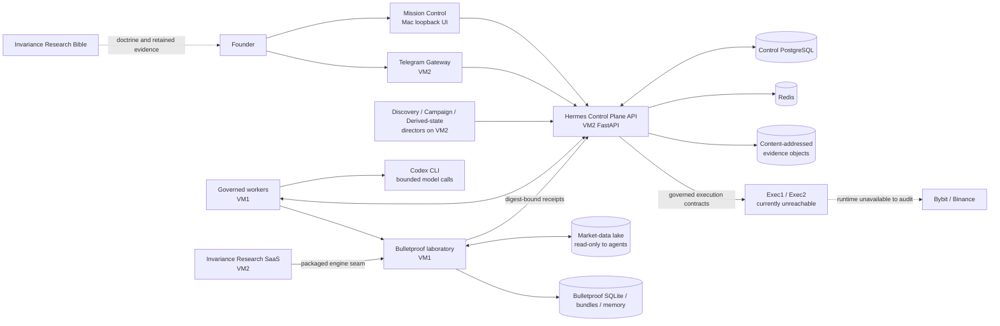
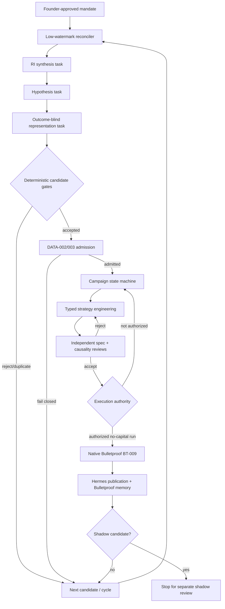
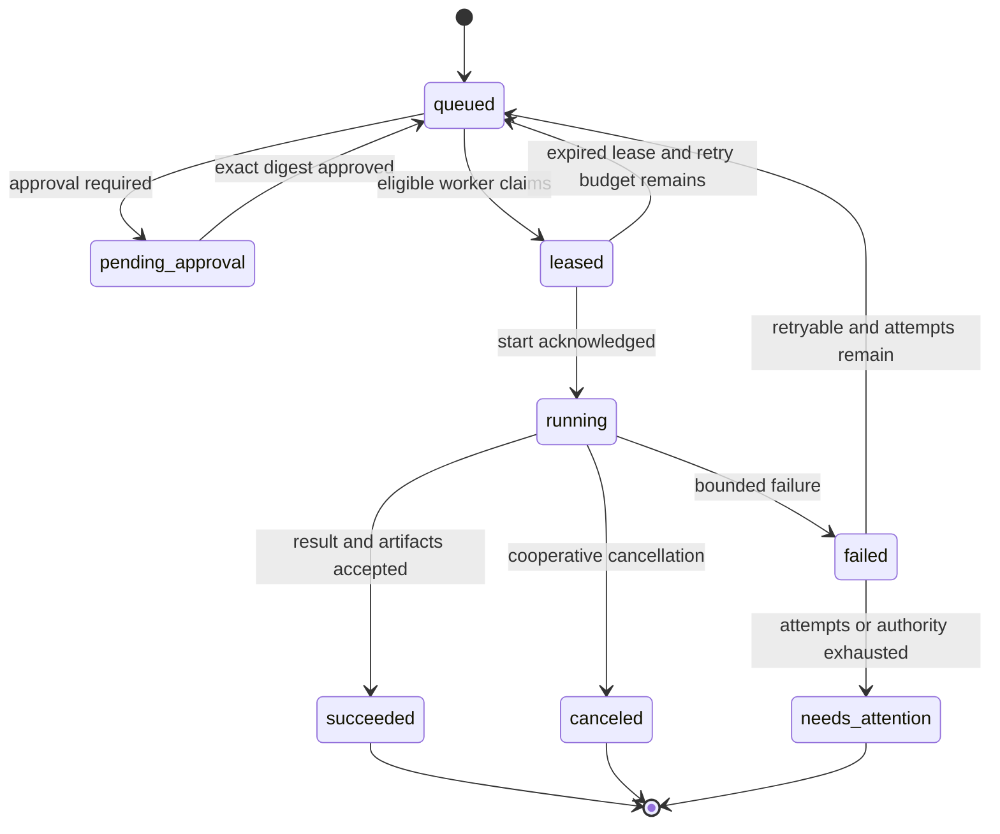
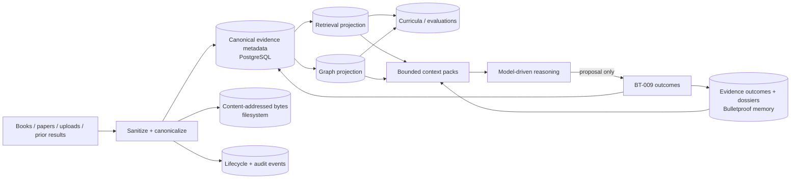
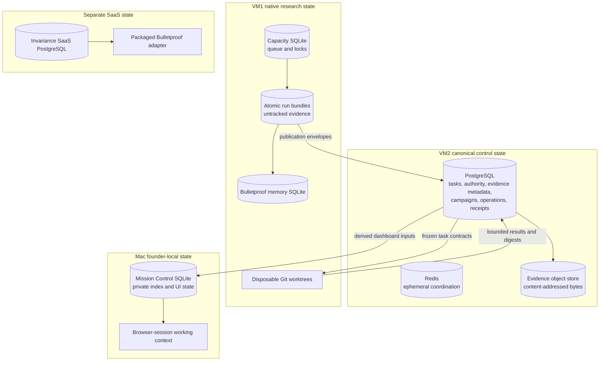
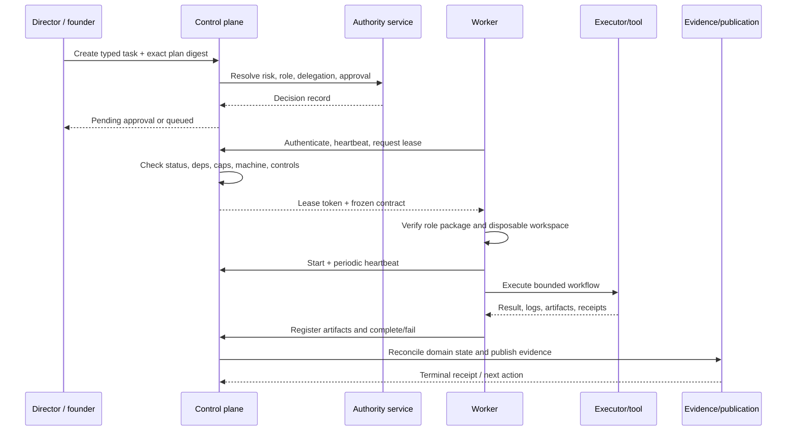
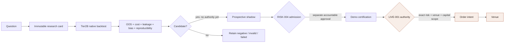

# Invariance Research Architectural Reconnaissance

**Audit date:** 2026-10-25 UTC  
**Phase:** Phase 1 only: discovery and reconstruction  
**Mode:** Read-only inspection plus publication of this report  
**Safety boundary:** No order placement, credential inspection, risk-limit change, database mutation, service restart, dependency installation, or production workflow execution occurred.

## 1. Executive summary

Invariance Research is not one application and it is not one uniformly autonomous agent. It is a distributed research, governance, validation, product, and execution ecosystem whose current center of gravity is a deterministic control plane on VM2, model-assisted research and engineering workers on VM1, a deterministic quantitative laboratory in `bulletproof_bt`, a Mac-local founder interface, and two currently unreachable execution VPSs.

The system's clearest architectural separation is:

1. **Hermes / swarm control plane owns governance and custody.** It stores tasks, approvals, authority decisions, agent registrations, leases, evidence metadata, discovery/campaign state, publication records, operations, and projections in PostgreSQL. The principal implementation is `swarm-control-plane/backend/app`, especially `main.py`, `models/task.py::Task`, `services/tasks.py`, `services/authority.py`, `services/alpha_discovery.py`, and `services/alpha_campaign.py`.
2. **VM1 workers own bounded model and tool execution.** `worker/src/swarm_worker/service.py::WorkerService.run_once` verifies identity, role package, capability, repository, risk, and machine before leasing work. Specialized executors invoke Codex for bounded reasoning or code authoring and invoke native Bulletproof commands for quantitative execution.
3. **Bulletproof owns quantitative truth.** `bulletproof_bt` owns market-data contracts, transformations, resampling, strategies, backtests, selection accounting, risk, portfolio, execution algorithms, and immutable producer receipts. Hermes validates and publishes Bulletproof evidence; it does not recompute backtest statistics.
4. **Mission Control and Telegram are oversight surfaces.** Mission Control runs as a loopback-only Mac launch agent. It aggregates canonical control-plane records into derived views and exposes founder actions. Telegram is a separate VM2 gateway. Neither is the system of record.
5. **The Invariance Research SaaS is an adjacent product system.** `invariance_research` provides upload, analysis, experiment, report, entitlement, and deployment workflows. It uses a packaged Bulletproof seam and is co-hosted on VM2, but source inspection did not establish it as the orchestrator of the Hermes autonomous-alpha loop.
6. **The Bible is the constitutional and historical corpus.** `invariance-research-bible` records intended doctrine, milestones, evidence, and Book XI's as-built account. It is valuable evidence, but runtime source and observed state supersede prose when they disagree.

The orchestration architecture is **hybrid**:

- centralized and deterministic for authority, durable task state, leasing, retries, approvals, reconciliation, and receipts;
- workflow/state-machine based for discovery and campaigns;
- event-driven through database records, polling workers, timers, and reconciliation loops;
- hierarchical for discovery-to-campaign-to-BT-009 progression;
- model-driven only at named reasoning and engineering boundaries;
- locally scheduled by Bulletproof's resource-aware capacity scheduler for native compute.

This is materially more than a scripted demo. The production record contains genuine one-year native BT-009 negative outcomes, independent review, complete publication/memory receipts, automatic successor scheduling, and a terminal multi-asset SOL-to-ETH evaluation. It still is not a fully healthy autonomous trading firm. During this audit:

- VM1 and VM2 core services were running, but fleet-probe and generic worker units were failed;
- exec1 and exec2 were offline on Tailscale, so their current service, venue, and credential posture could not be verified;
- Mission Control's fleet projection marked machines critical despite fresh VM1 research-agent heartbeats;
- the latest derived-state projection was current, but RI-015 was `not_demonstrated`, mathematics capability count was zero, and 20 scientific reviews were pending;
- the aggregate research record showed substantial activity but no shadow candidate;
- the task/operation inventory contained a large blocked historical tail;
- deployed checkouts and local development branches were not always identical.

The most important conceptual lesson is that **automation, agency, scientific validity, and financial authority are four different axes**. A systemd service can be active while no scientific work is progressing. A task can succeed while no backtest ran. A model can propose a representation while Bulletproof later rejects it. A valid negative BT-009 result is successful research but not a candidate. A candidate would still not possess order or capital authority.

## 2. Scope, evidence, and visibility

### 2.1 Repositories and revisions inspected

| Repository or checkout | Role | Revision observed | Interpretation |
| --- | --- | --- | --- |
| `/home/omenka/Projects/swarm-control-plane` | Hermes control/evidence plane, workers, Mission Control, Telegram | `ae933aee85a9076fbd256fdc06ec4109b1591c2d` | Same commit observed in VM2 and Mac production checkouts and on GitHub `main`; local branch name differs from deployment branch. |
| `/home/omenka/Projects/bulletproof_bt` | Quantitative laboratory and execution engine | `bb876bc7aa538c480ad368ebbec9ee3b0fc98175` | Local development branch. VM2 checkout was `d623dd127ca1dfe9864fecb4aa63f41b4a71a632`; task contracts bind exact commits, so local HEAD is not automatically production authority. |
| `/home/omenka/Projects/invariance_research` | User-facing validation/research SaaS | `234ebb0337a27166a81aa8727259bd00ce0d1614` | VM2 checkout was `dc5b041167b5ed6f06eab659c30e0c8ad8d3f062`; running web image was tagged independently. |
| `/home/omenka/Projects/invariance-research-bible` | Constitutional corpus, backlog, evidence, Book XI | report based on GitHub `main` at `a7ba88223654455afcffea98e4962d6bcb5def41` | Documentation evidence, not runtime authority. |
| `/srv/invariance/swarm/repositories/swarm-agent-profiles` | Version-controlled role definitions | `326c719f8acfdd630fc7236b72ab535d34b70884` | Currently a small policy/profile repository, not an agent runtime. |
| `/srv/invariance/swarm/repositories/swarm-infrastructure` | Infrastructure templates/inventory | VM2 `0c7ca04...`; Mac `430e0b3...` | Drift is present; Mac has a later tailnet verification change than VM2. Repository is sparse rather than a complete IaC representation of production. |

The many sibling directories named after milestones or fixes were treated as Git worktrees and implementation history, not as independent production subsystems.

### 2.2 Machines and services observed

| Environment | Observed role | Evidence | Audit status |
| --- | --- | --- | --- |
| `mac-founder` (`100.65.215.22`) | Founder UI and local private knowledge surface | `com.invariance.hermes-mission-control` launch agent active; `mission-control/README.md`; control-plane checkout at the same production commit | Reachable. Mission Control binds `127.0.0.1:8790`; its dashboard is a cached derived aggregate. |
| `vm1-developer` (`100.105.86.21`) | Model-assisted research/engineering and Bulletproof compute | Active ALPHA-004 agents, strategy engineers, independent reviewers, data admission, two capacity executors, capacity director, planner, research runner, memory steward, Codex auth watcher | Reachable. Core alpha services active. Fleet probe, generic workers, and DISC-010 publisher were failed at inspection time. |
| `vm2-deployment` (`100.112.117.59`) | Control plane, databases, directors, gateway, deployment services, SaaS hosting | Healthy `swarm-api`, PostgreSQL and Redis; active campaign/discovery/derived-state directors, Telegram, deployment architect, infrastructure broker, supervisor; two healthy SaaS web containers | Reachable. Several old one-shot/director containers remained unhealthy even while their systemd-managed replacements were active. |
| `exec1-execution` (`100.100.13.108`) | Registered fleet observer / intended execution support | Tailscale last seen five days before audit; role manifest and bootstrap docs only | Inaccessible. Runtime health, venue routing, and current services unknown. |
| `exec2-lagos` (`100.78.94.46`) | Intended Lagos demo/live execution host | Tailscale last seen eleven days before audit; role manifest and bootstrap docs only | Inaccessible. Live/demo credentials were not inspected. No claim about venue readiness is possible. |

### 2.3 External systems discovered

- **GitHub:** source remotes and CI workflows under `swarm-control-plane/.github/workflows`.
- **OpenAI Codex CLI:** bounded discovery, authoring, review, recovery advice, and Mission Control copilot calls. Exact invocation sites are documented in `swarm-control-plane/docs/book-xi-llm-runtime-register.md` and implemented in worker executors.
- **Telegram:** founder notifications and approvals through the VM2 gateway.
- **Tailscale:** private host connectivity and machine naming.
- **Bybit and Binance:** admitted market-data/venue identities; live venue access was not exercised.
- **Public research sources:** RI-017 allowlisted acquisition. External content is sanitized and enters as evidence or question-seed metadata, not executable instruction.
- **Stripe and product authentication services:** present in `invariance_research`; they support the SaaS product and are not established as alpha-loop dependencies.

### 2.4 Visibility gaps

1. Exec1 and exec2 could not be reached. Their installed services, routing, credentials, clock state, disk state, and demo/live posture are unknown.
2. Secrets and credential files were deliberately not read.
3. No live order, demo order, backtest, migration, restart, or mutation was performed.
4. Mission Control exposes only the latest 100 tasks in its aggregate; this audit did not extract the entire production database.
5. Repository documentation contains historical states. The report treats dated validation records as retained evidence, not necessarily present health.
6. The running Invariance SaaS image could not be mapped from its tag alone to the local checkout without a signed deployment manifest.

## 3. Implemented versus planned capability matrix

Status terms:

- **Implemented and observed:** source exists and a corresponding runtime or retained production receipt was observed.
- **Implemented, not currently verified:** source/tests exist, but current runtime closure was not observed.
- **Partial:** meaningful implementation exists, but a stated operational or scientific boundary remains open.
- **Planned:** documentation or contracts exist without a complete execution path.
- **Missing:** no adequate implementation was found.
- **Unknown:** access or evidence was insufficient.

| Capability | Status | Evidence and boundary |
| --- | --- | --- |
| Durable governed task execution | Implemented and observed | `models/task.py::Task`, `services/tasks.py::lease_next_task`, `worker/service.py::WorkerService.run_once`; production workers heartbeat and lease tasks. |
| Workload identity and role packages | Implemented and observed | `models/workload_identity.py`, `services/agent_governance.py`, `worker/role-packages/*/manifest.yaml`; active agents have scoped capabilities. |
| Risk-based approval and bounded delegation | Implemented and observed | `services/authority.py`, `services/governance.py`; approval records are digest-bound. Strategy-spec engineering is currently founder-exempt but remains scope/review constrained. |
| Founder conversational intake | Implemented and observed, partial intelligence | Conversation/task contracts and founder planner are active. Recent MCUX work improves work events and mandate handling, but conversational quality remains model/config dependent. |
| Canonical evidence ingestion and lifecycle | Implemented and observed | `models/evidence.py`, `services/evidence.py`, content-addressed `services/object_store.py`; lifecycle deletion can lawfully remove payload while preserving dossier metadata. |
| Retrieval and graph projections | Implemented and observed | `models/retrieval.py`, `models/graph.py`, `services/derived_state.py`; latest observed state was current at corpus epoch 577535. |
| Curriculum evaluation / RI-016 parity | Implemented and observed | Derived-state phases include retrieval, graph, curricula, verify; 13 domains were qualified in the latest observed run. |
| Whole-corpus mathematical fidelity | Partial | RI-014D supports source-bound just-in-time assurance. Zero current mathematics capabilities and pending reviews mean global fidelity is not demonstrated. |
| Independent reasoning qualification (RI-015) | Implemented evaluation contract, not demonstrated | Latest observed evaluation was `not_demonstrated` with `no_evaluation_suite`. |
| Continuous evidence-grounded discovery | Implemented and observed | `services/alpha_discovery.py`, ALPHA-004 worker services, low-watermark reconciliation, active discovery director. Activity does not imply every cycle reaches execution. |
| Outcome-blind representation selection | Implemented and production-observed, bounded | `AlphaDiscoveryExecutor` representation schema and `alpha-data-representation-scientist` role support baskets and transformations. One multi-asset terminal result exists; broad optimality is not demonstrated. |
| Lazy multi-panel DATA-002/003 admission | Implemented and observed | `executors/alpha_data_admission.py`, market-data catalog models/services, ALPHA-008/009 validation. Catalog visibility is not execution admission. |
| Native strategy authoring | Implemented and observed, high failure pressure | `EngineeringMissionExecutor`, five active strategy-engineer units, typed contracts and independent review. Production invalid/rejected attempts show this remains a bottleneck. |
| Independent strategy and causality review | Implemented and observed | `AlphaStrategyReviewExecutor`, evaluator routing, separate reviewer identities/homes, no action authority. |
| Native BT-009 execution and publication | Implemented and observed | `AlphaResearchExecutor`, Bulletproof `scripts/run_alpha_research_assignment.py::execute_registered`, `services/alpha_publication.py`; multiple negative one-year receipts exist. |
| Multi-asset BT-009 execution | Implemented and observed for one bounded case | SOLUSDT-to-ETHUSDT one-year terminal negative bridge `56341390-...`; this is a breadth proof, not universal basket support. |
| Continuous safe compute fallback / signal screens | Implemented and observed, currently degraded | ALPHA-010/DISC-010 capacity and publisher paths exist. DISC-010 publisher was failed during inspection. Screens are pre-OOS question seeds, not backtests. |
| Research memory feedback | Implemented and observed | Evidence outcomes, dossiers, Bulletproof memory confirmation, memory steward, later-cycle context consumption contracts. Consumption lineage is not uniformly visible for every result. |
| Supervised ML | Capability-only | ML registries/producers and documentation exist; no automatic eligibility router into the active loop was established. |
| Offline RL | Capability-only / planned routing | RL registries and off-policy services exist; active autonomous use was not observed. |
| Portfolio/risk services | Implemented as bounded producers; operational integration partial | PORT/RISK models, schemas, receipts and pilots exist. No current shadow candidate was observed. |
| Shadow monitoring | Implemented and previously certified | SHADOW-002 contracts/receipts exist, but no present candidate is at shadow. |
| OMS, execution scheduling, venue certification, demo telemetry | Implemented and previously certified | EXEC-003 through EXEC-011 and DEMO-001 receipts exist. Current exec-host reachability is unknown. |
| Live trading autonomy | Not established | Source includes guarded execution and LIVE-001 boundaries, but this audit observed no authorized live candidate and did not inspect or invoke venue credentials. |
| Fleet observability | Partial / degraded | Fleet models, probes, dashboard, and alerts exist. Both reachable Linux hosts had failed fleet-probe units and the dashboard projection contradicted fresh agent heartbeats. |
| Backup and restore | Implemented, partially observed | VM2 backup and restore-drill timers exist; latest dashboard showed healthy backup RPO but unknown restore time. |
| Full infrastructure-as-code | Missing | `swarm-infrastructure` is sparse and drifted between Mac and VM2. Production topology is encoded across scripts, systemd, Docker, machine state, and prose. |

## 4. High-level architecture

Supported source anchors: `swarm-control-plane/README.md`; `backend/app/main.py`; `backend/app/core/config.py::Settings`; `worker/src/swarm_worker/service.py`; `bulletproof_bt/README.md`; `invariance_research/README.md`.

## 5. Complete subsystem inventory

| Subsystem | Purpose | Inputs | Outputs/state | Dependencies | Status |
| --- | --- | --- | --- | --- | --- |
| Control-plane API | Canonical governance and evidence service | Authenticated founder, agent, director, and service requests | PostgreSQL records, signed/digested responses | FastAPI, SQLAlchemy, PostgreSQL, Redis | Active on VM2 |
| Authority engine | Resolves whether an actor may perform an exact action | Policy, accountable role, risk, environment, delegation, vetoes | Immutable authority/approval decision | `services/authority.py`, governance models | Active |
| Task service | Durable task lifecycle and leasing | Typed task, dependencies, approval, worker identity | Lease token, attempts, events, terminal result/failure | PostgreSQL row locks, agent governance | Active |
| Generic task graphs | DAG activation, dependency reconciliation, compensation | Frozen graph and nodes | Node/task states, graph events/messages | Task service | Implemented; alpha uses a specialized state machine more heavily |
| Founder conversations | Structured intake and work-event projection | Mission Control/Telegram messages | Conversation revisions, proposals, tasks, durable work events | Planner, mandate/authority services | Active, still evolving |
| Evidence ingestion | Canonicalizes scientific objects and provenance | PDF/text/Markdown, metadata, recovery decisions | Canonical object, edges, audit/lifecycle records, object bytes | Object store, PostgreSQL | Active |
| Retrieval projection | Hybrid lexical/vector/neighbor projection | Canonical evidence epoch | `evidence_retrieval_projections` and state | Deterministic projection builder | Active/current at audit |
| Knowledge graph projection | Accessible nodes and provenance-bearing edges | Canonical evidence and relationships | Node/edge projection plus manifest | Deterministic graph builder | Active/current at audit |
| Derived-state orchestrator | Reconciles retrieval, graph, curricula, parity | Corpus changes and current epochs | Phase receipts and terminal digest | Advisory lock, projection services | Active |
| Curriculum/intelligence evaluation | Evaluates domain readiness and reasoning suites | Evidence portfolios and hidden/evaluation suites | Domain curricula, brain evaluation | Retrieval/graph state | Curriculum active; RI-015 unqualified |
| Alpha mandate/discovery | Keeps bounded predictive questions flowing | Founder-approved mandate, evidence, failures, data catalog | Cycles, candidates, representation plans, campaigns | Codex discovery agents, data admission | Active |
| Data representation | Chooses pre-outcome assets, clocks, transformations | Exact question and catalog metadata, no outcomes | Typed representation plan and rejected alternatives | Codex read-only stage, native admission | Active, bounded evidence |
| Data admission/catalog | Verifies selected market panels | Catalog identity, files, lineage, requested window | DATA-001/002/003 receipts and admitted bindings | Bulletproof lake, native verifiers | Active |
| Campaign state machine | Advances one accepted question through engineering/review/execution/publication | Candidate, bindings, mandate, frozen commit | Stage tasks, attempts, bridge/publication/memory records | Task/approval/reviewer services, BT-009 | Active |
| Strategy engineering | Produces bounded YAML/card/strategy/tests | Typed engineering mission and frozen context | Patch, test evidence, review bundle | Codex, disposable worktree, Bulletproof venv | Active, bottleneck |
| Independent evaluator routing | Separates producer and reviewers | Frozen subject digest and evaluator profiles | Assignments, verdicts, supersession/conflict records | Separate identities and workspaces | Active |
| Bulletproof classic engine | Computes quantitative outcomes | Immutable data, strategy, grid, costs, splits | Trials, metrics, truth evidence | pandas/numpy/pyarrow and native code | Active |
| Capacity scheduler | Allocates native compute under CPU/RAM constraints | SQLite queue, host load/RAM, drain state | Child processes, queue locks, capacity state | VM1 OS process groups | Active |
| BT-009 bridge/publication | Enforces monotone research lifecycle and dual memory | Approved proposal, native bundle, independent reviews | Governed bridge, Hermes projection receipt, Bulletproof memory confirmation | Hermes + Bulletproof | Active |
| Institutional ML/RL services | Versioned model, inference, OPE and abstention contracts | Eligible immutable evidence | Producer receipts | Bulletproof institutional modules, Hermes registries | Capability-only in autonomous loop |
| Portfolio and risk | Capacity, budgets, candidate admission, deterministic risk | Candidate and market/risk receipts | Admission or abstention, risk decision | PORT/RISK producers | Implemented, no current candidate |
| Execution/OMS | Idempotent order lifecycle, scheduling, reconciliation, freeze/kill | Authorized intents and venue state | Order/fill/position/reconciliation events | Venue adapters, execution hosts | Source/certification exists; current hosts unknown |
| Mission Control | Founder observability and bounded mutation UI | Control-plane APIs plus local private index | Derived dashboard, approvals, conversations | Mac launch agent, loopback server | Active |
| Telegram gateway | Founder notifications and action links | Control-plane/channel events | Threaded notifications and decisions | Bot API, VM2 service | Active |
| Invariance SaaS | Product-facing analysis and research programs | User uploads/specs, entitlements | Analyses, experiment jobs, reports, deployments | Next.js, PostgreSQL, packaged Bulletproof | Active, adjacent system |
| Fleet/observability | Machine/service health and operational alerting | Probes, operations, heartbeats | Fleet snapshots, alerts, dashboard projections | Host probes, watchdog, Mission Control | Degraded |
| Bible | Doctrine, capability map, backlog, retained evidence | Engineering evidence and decisions | Books, plans, ADRs, evidence | Human/document process | Active documentation system |

## 6. Agent and tool topology

### 6.1 What counts as an agent here

The registry uses “agent” as an identity and authority abstraction. That does not mean every registered agent reasons with a model.

- **Model-driven agents:** construct bounded context, call a model, validate structured output, and make a constrained proposal or review judgment.
- **Deterministic autonomous workers:** repeatedly lease typed tasks and execute code under a role package. Their autonomy is scheduling/recovery autonomy, not open-ended reasoning.
- **Service identities:** publish observations, synchronize memory, or execute infrastructure tickets. Calling them agents is useful for custody and permissions, but an ordinary service could implement the same computation.
- **Legacy registrations:** retained identity history without a current healthy runtime.

```mermaid
flowchart TB
    CP[Control plane<br/>tasks + authority + evidence]

    subgraph Reasoning[Model-driven roles]
      FP[Founder planner]
      RI[RI director]
      SR[Senior researcher]
      DR[Representation scientist]
      SE[Strategy engineer]
      R1[Spec reviewer]
      R2[Causality reviewer]
      RC[Research copilot]
      PRA[PDF recovery adviser]
    end

    subgraph Deterministic[Deterministic workers/services]
      DA[Data admission]
      EX[Alpha executor]
      MEM[Memory steward]
      CAP[Capacity scheduler]
      DEP[Deployment architect]
      INF[Infrastructure broker]
      FLEET[Fleet observers]
      DER[Derived-state director]
    end

    subgraph Tools[Bounded tools]
      C[Codex CLI]
      G[Git worktrees]
      P[Python / pytest]
      B[Bulletproof engine]
      Q[PostgreSQL / APIs]
    end

    CP <--> Reasoning
    CP <--> Deterministic
    FP --> C
    RI --> C
    SR --> C
    DR --> C
    SE --> C
    R1 --> C
    R2 --> C
    SE --> G
    SE --> P
    EX --> B
    DA --> B
    CAP --> B
    Deterministic --> Q
```

### 6.2 Detailed active-role inventory

| Role | Entry point and mechanism | Inputs / outputs | Tools and memory | Authority / termination / recovery | Why agent rather than function? |
| --- | --- | --- | --- | --- | --- |
| Founder intake planner | `worker/src/swarm_worker/planner/service.py` and `invariance-swarm-founder-planner` | Conversation context to structured plan/proposal | Codex, bounded workspace, control-plane APIs | No direct execution; proposal is separately governed; daemon retries temporary failure | Reasonable: ambiguity resolution and decomposition benefit from model reasoning. Materialization should remain deterministic. |
| RI discovery director | `AlphaDiscoveryExecutor`, stage `intelligence` | Bounded canonical context to mechanisms, contradictions, failures, observations, gaps, cited evidence pairs | Codex read-only/ephemeral; no raw lake | Structured schema, timeout, heartbeat, retry; no calculation authority | Reasonable: abductive synthesis over heterogeneous evidence is model-suitable. |
| Senior predictive researcher | `AlphaDiscoveryExecutor`, stage `hypothesis` | Research brief and admitted context to falsifiable predictive questions | Codex read-only/ephemeral | Candidate schema and deterministic rejection gates; no execution authority | Reasonable if evaluated against simpler retrieval/templates; current RI-015 qualification remains open. |
| Data representation scientist | `AlphaDiscoveryExecutor`, stage `representation` | Exact question and catalog metadata to assets, clocks, transforms, alternatives | Codex read-only; outcomes and raw bytes excluded | Output is only a plan; native DATA and Bulletproof validation decide executability | Reasonable for hypothesis-specific choice, provided the outcome-blind boundary is enforced. |
| Native strategy engineer | `EngineeringMissionExecutor` via five systemd units | Typed mission, frozen evidence, allowed paths to card/YAML/strategy/tests | Codex workspace-write, Git worktree, Bulletproof venv; network off | File/diff/time limits, focused/full tests, independent reviews; no push/merge/trade | Reasonable for novel code, but deterministic scaffolding should continue minimizing model scope. |
| Strategy-spec reviewer | `AlphaStrategyReviewExecutor` | Frozen bundle and subject digest to typed verdict | Separate Codex home, read-only repo, network off | Review-only authority; route can supersede/retry; no execution | Reasonable for semantic contract review; must be benchmarked for consistency. |
| Causality/leakage reviewer | Same executor with distinct profile | Frozen code/data semantics to leakage/causality findings | Separate identity/context | Independent assignment and digest; no action authority | Reasonable for adversarial semantic review, but deterministic leakage tests remain primary. |
| Alpha research executor | `AlphaResearchExecutor` | Approved exact assignment to native runner | Bulletproof CLI, capacity lock, bundle directory | Bounded timeout, heartbeats, retry, terminal receipt; no model decides metrics | Mostly a deterministic worker, not a reasoning agent. Identity is justified for custody and least privilege. |
| Selected-panel data admission | `AlphaDataAdmissionExecutor` | Exact panel request to native content/lineage validation | Read-only lake, Bulletproof verifier, recovery store | Fails closed on bytes/schema/lineage/window drift | Deterministic service; “agent” is an authority identity, not intelligence. |
| Research memory steward | `ResearchMemorySyncExecutor` | Terminal bundles/receipts to digest-bound memory export | Read-only Bulletproof memory and control-plane publication | Idempotent sync and receipt validation | Deterministic service identity. |
| Research runner | `ResearchExperimentExecutor` / restricted workflow | Immutable manifest to offline research result | Bulletproof, disposable workspace | Workflow timeout, artifact contract, terminal result | Deterministic executor; separate role is useful for privilege isolation. |
| Capacity director | `bulletproof_bt/orchestrator/global_capacity_scheduler.py::CapacityScheduler` | Queue, RAM, CPU, drain state | SQLite, OS process groups | Single leader lock, orphan reconciliation, pause/resume, conservative admission | Not an LLM agent. A deterministic scheduler is the correct design. |
| Deployment architect | Restricted deployment workflow on VM2 | Approved runbook/package to deployment evidence | Git, container/system inspection through brokered paths | Cannot bypass package/approval; post-deploy evidence required | Mostly deterministic orchestration; model use, if any, should not own mutation authority. |
| Infrastructure broker/operator | `worker/src/swarm_worker/infrastructure/broker.py` | Signed bounded ticket to allowlisted operation | OS/container commands through fixed handlers | Root boundary, ticket digest, allowlist, result evidence | Deterministic privileged service; should not be anthropomorphized. |
| Fleet observers | Host probe services | Allowlisted CPU/RAM/disk/service observations | Host APIs and control-plane publish | No remediation authority; timer/retry | Deterministic probes. Current failure shows why they need SRE ownership rather than “agent intelligence.” |
| Derived-state orchestrator | `services/derived_state.py` plus VM2 service | Corpus epochs and change ledger to retrieval/graph/curriculum parity | PostgreSQL projections | Advisory lock, phase receipts, max attempts, currentness verification | Deterministic reconciliation service. |
| Ingestion recovery steward | Recovery task worker; optional recovery adviser | Quarantined source and bounded evidence to recovery decision | Deterministic sanitizer plus optional Codex advice | Advice cannot override deterministic safety checks | Hybrid is justified only for diagnosis; remediation gates must remain deterministic. |
| Mission Control research copilot | Mac-local copilot path | Authorized bounded canonical context to cited answer | Codex with no repo tools; raw sources/secrets excluded | Answer-only, citation validation, no canonical mutation | Reasonable interactive agent; unavailable model configuration is an operational dependency. |
| Codex auth watcher | `worker/src/swarm_worker/codex_auth_watcher.py` | Real minimal probe to auth incident/recovery state | Codex device-login flow, Telegram/MC notification | No research attempt or approval authority | Deterministic continuity service, not an intelligent agent. |

### 6.3 Complete live registry inventory

The Mission Control snapshot exposed 28 registered identities. “Fresh” means a current heartbeat was visible during audit; it does not prove useful work was progressing.

| Registered identity | Machine | Observed state | Current architectural interpretation |
| --- | --- | --- | --- |
| `vm1-developer-coder` | VM1 | Stale | Legacy/general engineering identity; corresponding generic units failed. |
| `vm2-lifecycle-validator` | VM2 | Offline | Legacy validation identity. |
| `vm2-infrastructure-operator` | VM2 | Stale | Broker/operator identity exists; current heartbeat was old. |
| `vm1-research-runner` | VM1 | Fresh | Active deterministic research worker. |
| `vm1-founder-intake-planner` | VM1 | Fresh | Active model-driven planning role. |
| `vm2-deployment-architect` | VM2 | Fresh | Active deployment role. |
| `m13-senior-research-specialist` | VM1 | Offline | Superseded/legacy research role. |
| `m13-experiment-specification` | VM1 | Offline | Legacy specification role. |
| `m13-research-execution` | VM1 | Stale | Legacy execution role. |
| `m13-statistical-reviewer` | VM1 | Offline | Legacy reviewer. |
| `m13-adversarial-auditor` | VM1 | Offline | Legacy reviewer. |
| original `vm1-research-intelligence-director` | VM1 | Offline | Superseded by ALPHA-004 role. |
| `vm1-research-memory-steward` | VM1 | Fresh | Active deterministic memory synchronizer. |
| `vm1-operational-memory-steward` | VM1 | Offline | Registered but not active. |
| `vm1-fleet-observer` | VM1 | Offline | Probe unit failed during inspection. |
| `vm2-fleet-observer` | VM2 | Offline | Probe unit failed during inspection. |
| `vm1-alpha-research-executor` | VM1 | Stale | Retired v1 executor. |
| `vm1-alpha-research-executor-v2` | VM1 | Fresh | Active governed scientific executor identity. |
| `exec1-fleet-observer` | Exec1 | Offline | Host unreachable. |
| `exec2-lagos-fleet-observer` | Exec2 | Offline | Host unreachable. |
| `vm1-alpha004-research-intelligence-director` | VM1 | Fresh | Active model-driven intelligence stage. |
| `vm1-alpha004-senior-researcher` | VM1 | Fresh | Active model-driven hypothesis stage. |
| `vm1-alpha-research-executor-capacity-2` | VM1 | Fresh | Active capacity-governed scientific executor. |
| `vm1-alpha-data-admission` | VM1 | Fresh | Active deterministic panel admission. |
| `vm1-alpha-spec-reviewer` | VM1 | Fresh | Active independent model reviewer. |
| `vm1-alpha-causality-reviewer` | VM1 | Fresh | Active independent model reviewer. |
| `vm1-alpha-strategy-engineer` | VM1 | Fresh | Active Codex authoring identity with replicas. |
| `vm1-alpha-data-representation-scientist` | VM1 | Fresh | Active model-driven outcome-blind representation stage. |

The registry needs lifecycle hygiene: retired and stale identities are valuable audit evidence, but operational views should distinguish historical registration from deployable/current capacity.

## 7. Orchestration brain and control flow

There is no single LLM “brain.” Coordination is produced by five layers:

1. **Control-plane state machines** decide which stage is next. `services/alpha_discovery.py::reconcile_mandate/reconcile_all` and `services/alpha_campaign.py::reconcile_campaign` are the alpha loop's primary deterministic brains.
2. **Task and authority services** decide whether work is eligible. `services/tasks.py` checks status, approval, dependencies, capability, machine, leases, and controls. `services/authority.py` resolves policy and delegation.
3. **Polling workers** select only tasks matching their signed role package. `WorkerService.run_once` validates the task/workflow/repository boundary before execution.
4. **Model-driven stages** answer bounded questions inside a schema; they do not select their own financial authority or rewrite the workflow.
5. **Bulletproof capacity scheduling** decides when native compute fits current CPU/RAM and drain policy.

### 7.1 Objective decomposition

- Founder prose becomes a conversation/proposal/task contract through the planner.
- A weekly mandate freezes allowed data, time window, native commit, budgets, and authority.
- Discovery decomposition is fixed: intelligence, hypothesis, representation, data admission, campaign.
- Campaign decomposition is fixed: card/draft, engineering if needed, independent reviews, execution approval/delegation, native run, publication, memory, next action.
- The LLM fills typed semantic products inside those stages; it does not invent the state graph.

### 7.2 Scheduling and agent selection

- PostgreSQL task leasing uses row-level coordination and skips locked rows.
- Tasks declare `required_capabilities`, `allowed_machines`, `risk_level`, repository, and workflow.
- Workers present an authenticated identity plus signed role package.
- The Bulletproof scheduler separately allocates native worker slots based on RAM, CPU headroom, queue priority, max jobs, and drain state.

### 7.3 Shared state

- Canonical governance state: control-plane PostgreSQL.
- Short-lived coordination/cache: Redis, although the critical task state remains PostgreSQL.
- Binary evidence: content-addressed filesystem object store; metadata and digests in PostgreSQL.
- Native research state: Bulletproof SQLite databases, atomic bundles, output directories, and memory database on VM1.
- Local founder state: Mission Control SQLite/private index on Mac plus browser-session working context.
- Product state: separate Invariance SaaS PostgreSQL/PgBouncer stack.

### 7.4 Failure recovery

Recovery mechanisms include lease expiry/reaping, attempt budgets, heartbeat extension, successor tasks, superseded reviewer routes, campaign reconciliation, bounded result-handoff recovery, orphaned capacity-lock recovery, idempotent publication, derived-state phase receipts, backups, and explicit human recovery gates. A notable weakness is that recovery code is distributed across task services, domain controllers, systemd, local SQLite, and operator runbooks rather than represented in one executable platform model.

## 8. Data, memory, and persistent-state architecture

### 8.1 Scientific data flow

### 8.2 Persistent state and memory topology

### 8.3 Canonical evidence

`backend/app/models/evidence.py` stores canonical object metadata, edges, audit events, lifecycle state/events, consolidation receipts, deletion requests, and impact reports. `services/object_store.py::FilesystemEvidenceObjectStore` stores bytes by SHA-256 under a protected root and verifies them on read. Lawful deletion can therefore make a payload unavailable while a lifecycle dossier remains; a 410 response is a deliberate lifecycle state, not necessarily corruption.

### 8.4 Derived retrieval and graph

`EvidenceRetrievalProjection` stores content text, aliases, lexical terms, a numeric vector, and graph neighbors. `EvidenceGraphProjectionNode/Edge` stores accessible graph structure. `services/derived_state.py` advances a source epoch through retrieval, graph, curriculum, and verification phases under an advisory lock. Derived state is disposable/rebuildable; canonical evidence is authoritative.

### 8.5 Working memory and institutional memory

- Agent context/working-memory receipts live in `models/agent_context.py` and are bounded per task.
- Scientific outcomes and opposition records live in `models/memory.py`.
- Bulletproof retains native bundles and its own memory confirmation.
- Campaign publication requires the complete bridge and both projection and memory receipts.
- Negative, invalid, failed, and duplicate outcomes are intended inputs to later novelty and reasoning. A retained outcome is not proof of learning unless a later context pack records that it consumed the digest.

### 8.6 Market data

The market-data lake is outside model context. Models see catalog/admission metadata, not raw outcomes. DATA-002/003 resolution and native admission bind exact path, bytes, schema, lineage, availability, and requested window. `bulletproof_bt/src/bt/data/resample.py::TimeframeResampler` and adaptive-representation modules perform actual transformations. This preserves the distinction between a model's proposed representation and an executable, causal materialization.

## 9. Task lifecycle

Source anchors: `models/task.py::Task`; `services/tasks.py::build_task`, `lease_next_task`, `reap_expired_leases`; `worker/service.py::WorkerService.run_once`; `worker/daemon.py::WorkerDaemon.run`.

## 10. Representative end-to-end task trace

### 10.1 Selected trace

This is a **static trace corroborated by retained production receipts**, not a new execution. It follows the first published one-year BTCUSDT Tier2B negative result, campaign `c2fa962a-4f56-41ad-aaae-d01263fa62a6`, through BT-009 and into successor scheduling. Exact evidence is retained in `swarm-control-plane/docs/backtest-activity-validation.md` and `docs/alpha-008-validation.md`.

### 10.2 Trace

1. **Mandate and question scope were frozen.**  
   The mandate bound an admitted Bybit BTCUSDT panel, one-year 2023 window, exact native commit, Tier2B, and finite eight-variant budget. `services/alpha_discovery.py` represents the mandate/cycle; it cannot silently widen instruments or commit.

2. **Discovery produced an exact predictive question.**  
   The intelligence and hypothesis workers received bounded canonical context. `AlphaDiscoveryExecutor` invoked Codex read-only with a strict output schema. Deterministic validation rejected vague, duplicate, unavailable, or non-predictive material before campaign creation.

3. **Representation and data authority were resolved.**  
   The representation stage proposed clocks/transforms without outcome data. Native DATA-002/003 evidence established the content-bound panel. A catalog record alone would not have been sufficient.

4. **A campaign was created.**  
   `services/alpha_campaign.py::reconcile_campaign` advanced the candidate. The campaign digest, question digest, dataset binding, source commit, window, grid, costs, and authority boundary became immutable inputs.

5. **Strategy engineering or exact reuse occurred.**  
   `_create_strategy_engineering_task` created a bounded `engineering_mission` when the exact strategy did not already exist. The contract allowed only named Bulletproof paths, at most 12 files and 2,400 diff lines, with no network, push, merge, order, capital, or self-approval authority.

6. **Independent review completed.**  
   Spec and causality/leakage assignments were routed to separate evaluator profiles. `services/evaluator_routing.py` enforced producer/evaluator separation. Rejection would create a corrected successor or terminate honestly; it could not be converted into approval by the producer.

7. **Execution authority was checked.**  
   The execution task bound the reviewed bundle. Approval/delegation authorized only the bounded no-capital experiment. Authority did not certify the science.

8. **The native run executed in Bulletproof.**  
   `AlphaResearchExecutor` invoked `bulletproof_bt/scripts/run_alpha_research_assignment.py::execute_registered`. The classic engine consumed 525,600 one-minute rows and eight preregistered variants. Capacity ownership and heartbeat evidence bounded the run.

9. **Truth gates produced a valid negative.**  
   Reproducibility, point-in-time validity, held-out evaluation, cost stress, selection-bias audit, independent review, and logging passed. The preregistered alpha-performance gates failed: mean held-out net R was approximately `-0.6131`, and doubled-cost mean was approximately `-0.9045`. The correct scientific result was therefore negative, not “task failed” and not “candidate.”

10. **Atomic evidence was retained.**  
    Assignment digest `a647d005...` and native execution receipt `601573ae...` bound the run. Full artifacts stayed in the untracked/native evidence store; bounded digest-linked projections crossed the worker API.

11. **Hermes published the result.**  
    `services/alpha_publication.py::publish_execution` validated the envelope, current derived state, independent reviews, and complete bridge. Campaign attempt digest `7dfdf62c...` and bridge `f801d5eb-8b58-51b1-aa6d-bae405ddf928` record the approved-to-published chain.

12. **Memory was confirmed and authority stayed closed.**  
    The negative result entered Hermes publication and Bulletproof memory. It acquired no shadow, order, production, or capital authority.

13. **The next action was deterministic.**  
    Mandate counters were later reconstructed after an idempotency defect had applied 29,706 duplicate terminal events. The immutable events were preserved, the projection was repaired, and successor cycle `43672446-c939-4a70-b7ee-155322a85e1b` was created exactly once. This demonstrates why event immutability and projection correctness are separate concerns.

### 10.3 Success proof and failure behavior

- Success was a complete terminal receipt and memory confirmation, not positive PnL.
- Any digest drift, unavailable panel, unreviewed code, missing approval, stale projection, incomplete bundle, or failed gate would stop or retain a non-candidate outcome.
- Retriable infrastructure failures consume bounded attempts; scientific negatives do not retry merely to seek a better answer.
- The controller continued only after terminal evidence.

### 10.4 Later breadth evidence

A later one-year SOLUSDT-to-ETHUSDT evaluation produced a terminal negative with two variants, complete point-in-time/OOS/cost/bias/reproducibility/review gates, BT-009 bridge `56341390-6d9c-5f9b-8ab3-71e2ccf93a9f`, publication `fb139449-...`, and memory receipt `327c0aaf...`. That proves one bounded multi-asset path. It does not prove that arbitrary baskets or transformations are correct.

## 11. Research-to-execution boundary

The audit observed no current shadow candidate. Research sophistication does not collapse this boundary. Source anchors include `services/alpha_campaign.py`, `bulletproof_bt/docs/governed_research_bridge.md`, `src/bt/institutional/candidate_admission.py`, `src/bt/institutional/realtime_risk.py`, and `src/bt/exec/services/execution_router.py`.

## 12. Existing reliability, testing, and observability

### 12.1 Reliability mechanisms

- PostgreSQL transactions, unique constraints, row locks, `SKIP LOCKED`, digests, and idempotent service methods.
- Lease tokens stored as digests, lease expiry, heartbeats, attempt budgets, and cancellation fields.
- Signed role packages and workload identities.
- Exact repository commit and plan-digest binding.
- Disposable Git worktrees and allowed-path/file/diff limits.
- Separate producer and evaluator identities.
- Atomic native bundles and producer receipts.
- Derived-state epochs and phase receipts.
- Capacity leader lock, orphan-lock reconciliation, process-group control, RAM/CPU backpressure, and drain mode.
- Content-addressed evidence bytes with digest verification.
- Scheduled backups and restore-drill timers.
- Fail-closed missing data, authority, review, and currentness behavior.

### 12.2 Testing

The control-plane repository contains approximately 778 test/spec files across backend, worker, Mission Control, and related packages. CI workflows cover implementation baseline, governance authority/lifecycles/consequences, platform observability/workload identity, alpha discovery, and security assurance. Bulletproof has extensive native tests around data contracts, strategy semantics, backtest truth, receipts, execution, and capacity.

Dated validation documents report passing full suites, but those counts are revision-specific and should not be treated as the current branch's test result without rerunning CI. No full suite was run during this read-only reconnaissance.

### 12.3 Observability

- Structured JSON journald events from daemons and workers.
- Task events, operations, heartbeats, artifacts, approvals, receipts, and failures in PostgreSQL.
- Mission Control activity, workflow, agent, fleet, approval, research, backtest, and venue projections.
- Telegram alerts and approval links.
- Capacity scheduler state and child logs.
- Venue telemetry and canonical replay contracts.

### 12.4 Observability gaps observed

1. Fleet projection and actual reachable services disagreed.
2. Failed generic worker and fleet-probe units coexist with healthy specialized workers.
3. Old unhealthy Docker containers remain visible beside active systemd services, obscuring ownership.
4. Parent states such as `phase=campaign` do not prove compute is running; the current leaf task and heartbeat are required.
5. Mission Control aggregates can misclassify task success as backtest success unless a native terminal receipt is required.
6. The dashboard's latest-100 task window is insufficient for complete historical analysis.
7. Operation backlog contained 184 blocked records, suggesting historical debt and noisy operational truth.
8. Infrastructure revision drift is not automatically surfaced.

## 13. Major architectural strengths

1. **Strong separation of authority and calculation.** Hermes governs; Bulletproof calculates.
2. **Typed, digest-bound work.** Tasks, plans, data, commits, approvals, reviews, and receipts have explicit identities.
3. **Fail-closed scientific boundaries.** Unsupported questions are not silently mapped to approximate strategies.
4. **Negative-result retention.** The system treats a valid negative as scientific completion.
5. **Outcome-blind representation contract.** The model proposes data shape before outcome inspection; native code validates it.
6. **Independent evaluator routing.** Producer and evaluator identities are separate, and routes can be superseded without rewriting history.
7. **Resource-aware native scheduling.** The scheduler uses RAM and CPU headroom rather than assuming “more workers” is safe.
8. **Durable recovery primitives.** Leases, retries, idempotency, receipts, and reconciliation exist at several critical boundaries.
9. **Explicit no-capital boundary.** Research completion does not confer execution authority.
10. **Substantial retained evidence.** The system can explain not just what completed, but which exact artifacts and gates supported it.

## 14. Major weaknesses and unknowns

### 14.1 Architectural weaknesses

1. **Operational topology is fragmented.** Real deployment knowledge is spread across five repositories, systemd units, Docker state, machine-local environments, scripts, and prose. `swarm-infrastructure` is not a complete source of truth.
2. **Service ownership is ambiguous.** Unhealthy legacy containers and failed generic units remain beside healthy replacements.
3. **Registry lifecycle is noisy.** Twenty-eight agent registrations include active, stale, retired, and offline identities without a crisp lifecycle projection.
4. **Model-quality qualification lags model use.** RI-015 remains not demonstrated while model outputs are used in production discovery.
5. **Strategy engineering is expensive and failure-prone.** Long contracts and broad semantic obligations create repeated code/review loops. Typed intent and scaffolding help, but the unresolved signal logic is still a difficult model task.
6. **Feedback consumption is not uniformly proven.** Retaining evidence is easier than proving later decisions used it correctly.
7. **Observability can overstate or misstate liveness.** Parent workflow phases, cached aggregates, and stale fleet data can conflict.
8. **Recovery logic is duplicated across layers.** Task, campaign, capacity, systemd, container, and runbook recovery are not represented as one coherent failure model.
9. **Separate product and research planes may drift.** The SaaS uses a packaged/tagged Bulletproof seam while autonomous research binds other exact commits.
10. **The control-plane API is broad.** `backend/app/main.py` mounts a very large number of routers, increasing coupling and blast radius.
11. **Historical blocked work is large.** A blocked tail of 184 operations is not a clean operating surface even if much is retained history.
12. **Execution-host evidence is unavailable.** A system intended for venue operation cannot currently demonstrate both execution hosts online.

### 14.2 Scientific unknowns

- Whether RI synthesis consistently outperforms a simpler retrieval/template baseline.
- Whether representation choices improve validity or power without inducing selection bias.
- Whether independent model reviewers are calibrated and reproducible across hidden cases.
- Whether feedback memory measurably reduces duplicates or invalid hypotheses.
- Whether current pre-OOS screens increase good-question yield without contaminating held-out evidence.
- Whether the broad data catalog has uniform quality across the long tail of assets.

### 14.3 Trading/execution unknowns

- Current exec1/exec2 service state and network route.
- Current demo/live credential validity and venue permissions; deliberately not inspected.
- Current reconciliation, clock synchronization, and flat-position state.
- Whether the previously certified demo path still matches current venue APIs and instrument rules.
- Whether any candidate can pass shadow admission; none currently has.

## 15. Preliminary knowledge areas to master

This is not the Phase 3 personal assessment; it is the minimum map needed to understand the present system.

| Area | Why it matters now | Codebase anchors | First diagnostic exercise |
| --- | --- | --- | --- |
| Python typing and data modeling | Contracts are the safety boundary | Pydantic schemas, SQLAlchemy models, worker contracts | Explain how a task input becomes immutable and where validation can still drift. |
| Transactions and idempotency | Reconciliation previously multiplied counters | `services/tasks.py`, `services/alpha_discovery.py`, unique constraints | Design an idempotency test for a terminal cycle replay. |
| Async processes and cancellation | Workers manage long model/test/backtest subprocesses | `worker/daemon.py`, executors | Trace SIGTERM from systemd to child process and lease release. |
| Distributed leases | Work must survive crashes without duplicate authority | task leasing and Bulletproof capacity locks | Compare at-least-once execution with exactly-once effects. |
| State machines and sagas | Discovery/campaign/publication are monotone workflows | alpha services, task graphs, publication | Draw every legal transition for one campaign and identify compensations. |
| LLM tool boundaries | Models reason but must not become truth authorities | discovery/engineering/review executors | Identify which outputs require deterministic validation and why. |
| Retrieval and provenance | Research claims must be source-bound | evidence, retrieval, graph, context packs | Follow one citation from object bytes to model context and answer. |
| Backtest validity | Native success is not scientific success | Bulletproof engine, truth certification, selection ledger | Explain leakage, purge/embargo, cost stress, and sealed OOS in one retained run. |
| Resource scheduling | Backtests can crash VM1 if workers exceed memory | capacity scheduler | Compute a safe allocation from RAM, worker estimate, and headroom. |
| Security and authority | Same codebase spans research and capital-adjacent controls | authority, identities, role packages, systemd sandboxing | Prove why a strategy engineer cannot place an order. |
| Observability | Cached views can contradict leaf truth | operations, fleet, Mission Control freshness | Diagnose a “running” parent with no active child compute. |
| Deployment and configuration drift | Revisions differ across hosts | deployment architect, Git checkouts, containers | Produce a signed desired-versus-observed revision table. |

## 16. Recommended next investigations

These are investigations, not implementation commitments.

1. **Reconstruct the exact durable task protocol.** Read `Task`, `lease_next_task`, `WorkerService.run_once`, and one role manifest together. Deliverable: you explain the invariants without notes.
2. **Model the alpha campaign as a formal state machine.** Enumerate states, guards, retries, successors, and terminal evidence from `services/alpha_campaign.py` and tests.
3. **Trace one native result inside Bulletproof.** Start from an assignment contract, follow `execute_registered`, engine execution, truth gates, bundle finalization, and receipt construction.
4. **Reconcile deployment truth.** Compare Git revisions, systemd units, Docker containers, role registrations, and fleet projections. This should remain read-only until a change plan is approved.
5. **Study evidence and memory semantics.** Distinguish canonical object, derived projection, dossier, working memory, outcome record, and Bulletproof memory.
6. **Evaluate model necessity.** For RI synthesis, representation, and review, define deterministic/single-agent baselines before discussing more agents.
7. **Audit the product boundary.** Determine exactly when `invariance_research` consumes the same engine contracts versus maintaining a separate product workflow.
8. **Recover visibility into execution hosts.** Only after explicit operational approval, restore host telemetry and perform read-only verification before considering demo/live work.
9. **Define reliability benchmarks.** Compare deterministic, single-agent, centralized multi-agent, hierarchical, and event-driven implementations under controlled task/model/tool budgets.
10. **Begin the apprenticeship with the task lifecycle.** It has the highest architectural leverage and touches contracts, state, concurrency, authority, failure, and observability.

## 17. Five difficult diagnostic questions

1. A campaign is displayed as `running` and `await_bounded_bulletproof_results`, but no CPU is being consumed. Which records and heartbeats must you inspect to determine whether the system is healthy, queued, approval-blocked, lease-stalled, or merely showing a parent state?
2. Why is an immutable event log insufficient to guarantee correct state? Use the 29,706 duplicate mandate-counter applications to distinguish event preservation, idempotent consumption, and projection reconstruction.
3. The representation scientist proposes fractional differentiation with `d=0.35` on a cross-asset basket. Explain every independent condition that must hold before this proposal can affect a BT-009 result, and identify which checks belong to the model, Hermes, DATA-002/003, and Bulletproof.
4. Suppose the strategy author and both independent reviewers use the same model family. Under what conditions is their review meaningfully independent, where is it only procedurally separate, and how would you design an evaluation to measure correlated failure?
5. Design a simpler deterministic or single-agent baseline for the current intelligence → hypothesis → representation chain. What metrics and controls would demonstrate that the multi-agent chain creates enough scientific value to justify its latency, cost, and failure surface?

## 18. Inspection completeness statement

This reconnaissance examined the principal source, documentation, test, deployment, and runtime surfaces of the four canonical repositories; the two auxiliary repositories; VM1 and VM2 services; Mac repository/launch-agent state; live Tailscale presence; and retained production evidence. It did not line-read every one of the thousands of source files, inspect secrets, query the complete production database, access the two offline VPSs, or execute a research/trading workflow.

The architecture diagrams include only source-supported paths. Dotted paths and explicit “unknown” labels mark visibility gaps. Phase 2 should not begin by refactoring; it should first validate this reconstruction with the founder and then deepen one subsystem at a time.

Architectural reconnaissance complete. Awaiting your review before proceeding to the evaluation and apprenticeship phases.
