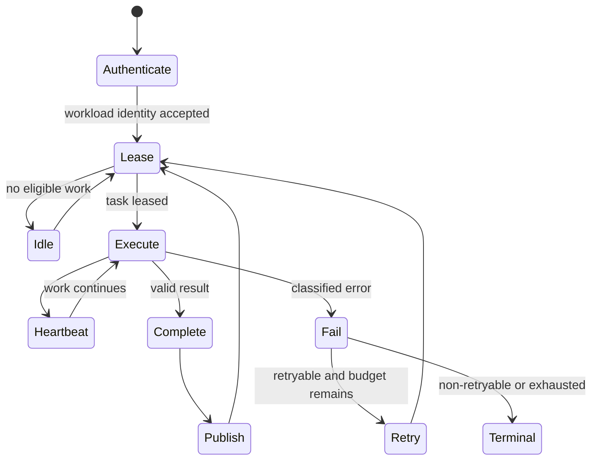

# Agent Inventory

## Definition

In this system, an *agent* should mean a runtime identity that uses observations,
policy or model reasoning, and tools to select bounded actions over time. Registration
alone does not prove agency. Deterministic reconcilers, executors, workers, and LLM
roles are identified separately even when product language calls all of them agents.

The dated, complete live registry is in the
[reconnaissance](ARCHITECTURAL_RECONNAISSANCE_2026-10-25.md#63-complete-live-registry-inventory).

## Functional role families

| Family | Purpose | Mechanism | Representative source | Authority boundary |
|---|---|---|---|---|
| Research intelligence director | Select and coordinate research synthesis | Model-assisted task execution plus deterministic lifecycle | `AlphaDiscoveryExecutor`; role package instructions | Research artifacts only |
| Senior researcher | Form evidence-grounded predictive questions | Model reasoning over bounded context/tools | research role package and executor | No capital/order authority |
| Representation specialist | Select point-in-time universe and transforms | Model proposal plus deterministic data checks | representation executor and `TimeframeResampler` | Cannot expand data scope unilaterally |
| Strategy engineer | Materialize typed intent and native strategy | Coding model/tool runtime plus tests | `EngineeringMissionExecutor`; Bulletproof authoring modules | New code governed separately |
| Strategy reviewer | Review implementation semantics | Independent review route | `AlphaStrategyReviewExecutor` | Review only |
| Causality reviewer | Review timing, leakage, and target semantics | Independent review route | `AlphaStrategyReviewExecutor` profiles | Review only |
| Capacity director/executors | Allocate bounded compute and run eligible work | Deterministic scheduling plus workers | capacity services and Bulletproof scheduler | Resource/task authority only |
| Discovery/campaign directors | Advance durable lifecycle | Deterministic reconcilers | `alpha_discovery.py`; `alpha_campaign.py` | State transition owner, not scientific author |
| Conversation planner | Interpret requests and propose/materialize work | Model reasoning constrained by task/mandate policy | conversation services and worker role | Materialization gates apply |
| Fleet observers | Publish machine/service observations | Deterministic probe | fleet probe scripts/services | Observation only |

## Common runtime loop

**Diagram AGT-001 — Common worker execution loop**

The concrete loop is rooted in
`worker/src/swarm_worker/daemon.py::WorkerDaemon.run` and
`worker/src/swarm_worker/service.py::WorkerService.run_once`.

## Required capability contract

Future inventory entries should bind:

- role and agency justification;
- entry point and package digest;
- model family/version or deterministic policy;
- instruction digest;
- typed tools and side effects;
- context-selection policy and budget;
- state read/write surfaces;
- scopes, authority, and forbidden actions;
- termination and retry behavior;
- verification suite and deterministic baseline;
- owner, deployment, and retirement condition.

## Simplification rule

If a role merely applies enumerable policy, it should be a deterministic function or
reconciler. If one well-tooled agent matches several specialists under controlled
evaluation, the simpler architecture should be preferred. Independent roles remain
justified where separation of information, authority, or verification is demonstrably
valuable.
