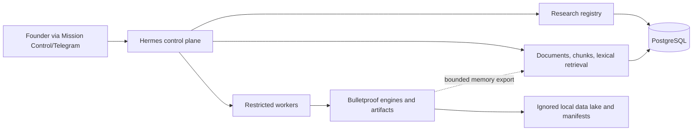
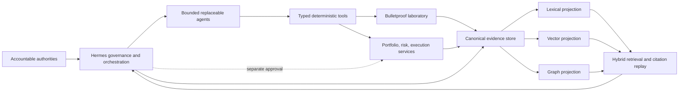
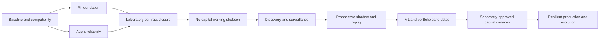

# Current, Target, and Migration Architecture

**Diagram ID:** SERIES-F03
**Status:** Controlled implementation map as of 2026-08-10

## Current verified/partial state

The current system has real governed task and registry slices. Research Intelligence is partial: canonical research lineage and document retrieval exist, but comprehensive scientific objects, hybrid retrieval, citation replay, beliefs, corpus defenses, and recovery proof do not. Bulletproof has substantial tested components, but universal data/run identity and full regression closure do not.

## Target state

Canonical evidence owns truth; indexes and graphs are rebuildable. Research success does not imply portfolio admission, allocation, execution, or production promotion.

## Migration sequence

Migration is additive and compatibility-preserving. Each transition requires the evidence gate in the [System Acceptance Matrix](../../registers/SYSTEM_ACCEPTANCE_EVIDENCE.md) and may be rolled back without deleting canonical history.
