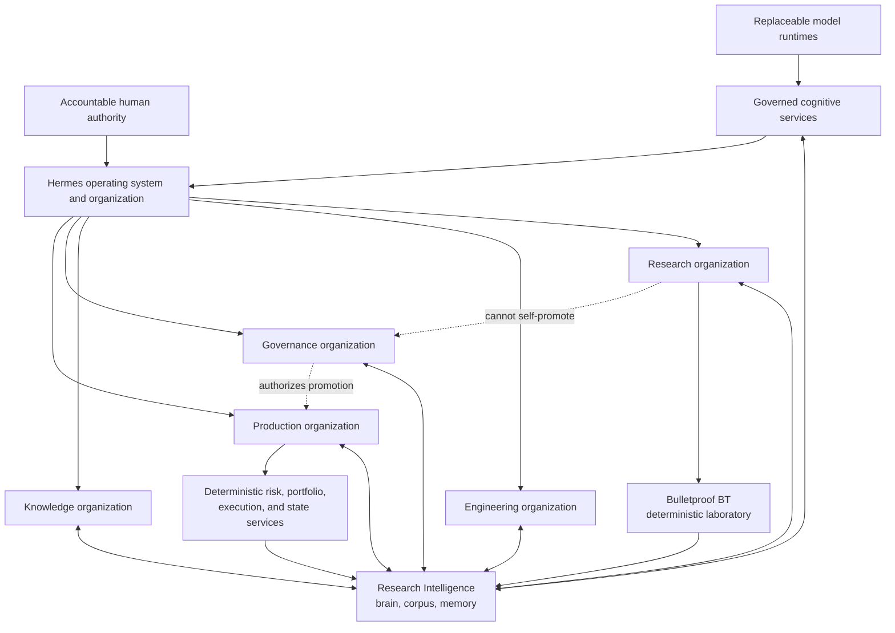

# Institutional Authority Boundaries

**Diagram ID:** SERIES-F02  
**Status:** Canonical source

Research Intelligence is not the model runtime, Hermes is not the language model, and Bulletproof BT is not the production trading system. Deterministic services remain authoritative for calculation and state transitions; governance authorizes promotion independently of proposal and execution.

