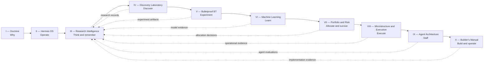

# Series Dependency Architecture

**Diagram ID:** SERIES-F01  
**Status:** Canonical source

The solid path is the reading and requirement dependency. The dotted paths show the institutional feedback rule: every material activity returns evidence and lessons to Research Intelligence.

