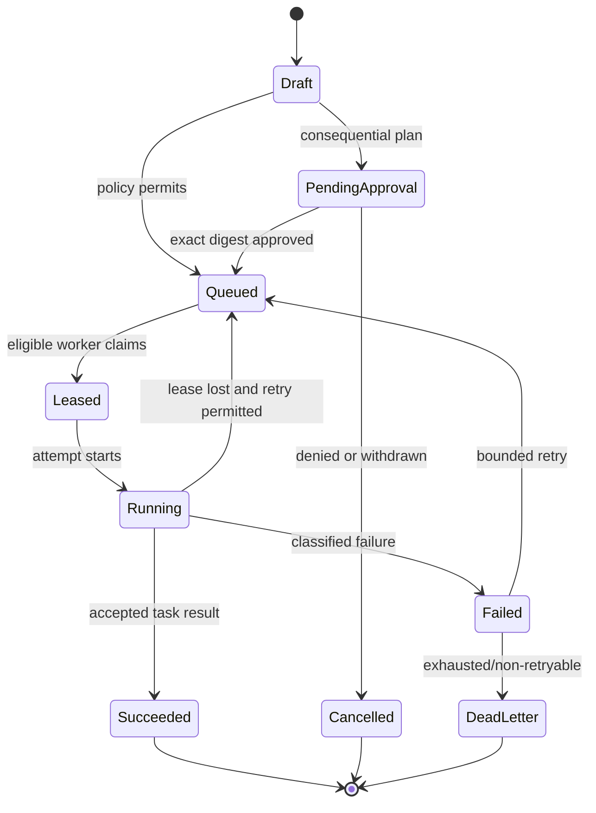
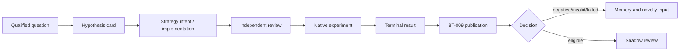

# Execution Lifecycle

## Task lifecycle

**Diagram EXE-001 — Durable task lifecycle**

Exact status names vary by task type; the canonical model and service behavior live in
`backend/app/models/task.py` and `backend/app/services/tasks.py`.

## Scientific lifecycle

Task completion is nested inside a larger evidence lifecycle:

**Diagram EXE-002 — Scientific execution lifecycle**

## Success semantics

Different layers prove different things:

| Evidence | What it proves | What it does not prove |
|---|---|---|
| Task `succeeded` | Its task-specific output contract was accepted | A backtest ran |
| Native run result | The laboratory executed a bound configuration | Independent review or publication |
| BT-009 terminal receipt | Institutional terminal result was published | Future profitability |
| Shadow admission | Candidate passed defined historical/admission gates | Capital authority |
| Demo certification | Execution mechanics passed a specified environment drill | Live readiness elsewhere or profitability |
| Capital approval | A bounded action is authorized | That action will profit |

## Representative implementation anchors

- Task materialization: `backend/app/services/tasks.py::build_task`
- Lease and recovery: `lease_next_task`, `reap_expired_leases`
- Campaign transition: `backend/app/services/alpha_campaign.py::reconcile_campaign`
- Engineering task: `_create_strategy_engineering_task`
- Native execution: `bulletproof_bt/scripts/run_alpha_research_assignment.py`
- Publication: `backend/app/services/alpha_publication.py::publish_execution`
- Receipt: `bulletproof_bt/src/bt/institutional/receipt.py::ProducerReceipt`

## Approval boundary

Approval binds an exact plan digest, scope, prerequisites, and effect. A later successor
or changed artifact needs policy evaluation of its own. A mandate may permit bounded
risk-zero research materialization; it never implies shadow or capital authority.
