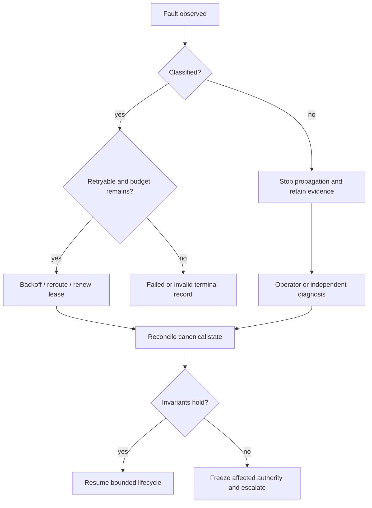

# Failure and Recovery Architecture

**Targeted update, 2026-11-16:** Six typed dispositions and bounded requirements correction are deployed. The existing general diagram below remains an architectural pattern, not universal recovery certification. Review-rejected methods are eligible for correction; feasibility-only repair and post-cap diagnostic escalation remain incomplete. R15 ended with zero trials. See [current recovery evidence](../books/book-11-engineered-company-system/chapters/12-requirements-recovery-and-current-certification.md).

## Principle

Autonomy is demonstrated when the system reaches a correct bounded state after
failure. Continuous process uptime alone is not autonomy.

## Failure classes

| Class | Example | Expected response |
|---|---|---|
| Transient dependency | temporary API/Redis/network failure | bounded retry with jitter |
| Worker loss | process dies with active lease | lease expiry, orphan reconciliation, safe successor |
| Deterministic contract | schema or semantic preflight fails | terminal invalid or repair task; no blind retry |
| Model/tool failure | malformed output, unavailable runtime | classify, circuit-break repeated signature, retain logs |
| Scientific invalidity | leakage or target mismatch | retain invalid result and feed novelty/failure memory |
| Approval failure | expired, denied, stale digest | remain non-executable; renew exact review path |
| Capacity failure | insufficient memory or capability | defer/reroute without oversubscription |
| Publication partial | native result exists, institutional state missing | idempotent reconciliation from immutable artifacts |
| Security/authority | scope or policy violation | fail closed, alert, revoke/contain, preserve evidence |
| Execution divergence | venue/order/position mismatch | freeze, reconcile, escalate; capital policy remains separate |

## Recovery flow

**Diagram REC-001 — Failure classification and bounded recovery**

## Existing mechanisms

- PostgreSQL transactions and uniqueness constraints
- leases, heartbeats, and expired-lease reaping
- bounded attempts and error categories
- campaign/discovery reconciliation
- immutable artifacts and receipts
- successor tasks instead of mutating approved plans
- systemd/container restart policy
- pause/drain and execution freeze/kill concepts
- OMS idempotency and reconciliation mechanisms

These mechanisms are not uniformly recovery-certified across all task families.

## Recovery invariants

1. At most one authoritative terminal outcome exists for one immutable attempt.
2. Retry does not expand scope, authority, data, variants, or plan meaning.
3. An expired lease cannot silently overwrite a valid successor.
4. Counters derive from immutable attempts and receipts, not retry notifications.
5. Invalid and failed scientific work remains searchable.
6. Projection disagreement does not overwrite canonical evidence.
7. Capital/order authority fails closed under uncertain state.

## Required game-day evidence

For worker, API, database, Redis, network, and host failures, record:

- predicted state;
- injection and timestamps;
- detection latency;
- affected work and authority;
- retries, duplicates, and data loss;
- recovery time and operator actions;
- final invariant checks; and
- durable corrective action.

The current platform has selective recovery evidence. It does not yet have one current
system-wide disaster-recovery certification.
