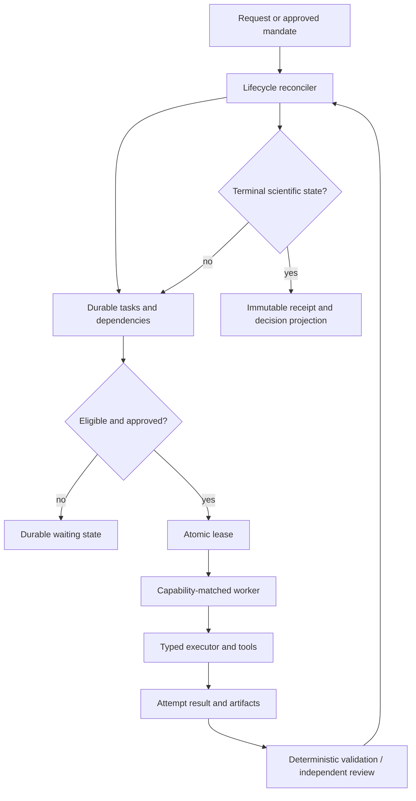

# Orchestration Architecture

## Classification

The current orchestration is **hybrid, durable, and mostly centralized in lifecycle
state, but distributed in execution**:

- PostgreSQL is the durable coordination point.
- deterministic reconcilers decide many lifecycle transitions;
- database leases route eligible work to capable workers;
- model-driven agents produce bounded scientific or engineering artifacts;
- Bulletproof has a domain-specific capacity scheduler;
- events, heartbeats, receipts, and Mission Control projections expose consequences.

There is no single LLM “brain.”

## Control flow

**Diagram ORC-001 — Hybrid orchestration control flow**

## Objective decomposition

At present, decomposition is spread among API services, discovery/campaign
reconcilers, task builders, role prompts, and engineering executors. A model may
propose scientific content, but durable work is represented through typed tasks and
plans. The recommended boundary is a typed `ResearchPlan` compiled by deterministic
code into an idempotent graph.

## Scheduling and selection

Workers are selected through required capabilities, allowed machines, scopes,
availability, and lease semantics. Bulletproof additionally considers execution
capacity. A future scheduler may consider value of information and repeated-failure
risk, but utilization alone must not be the objective.

## Shared state

Canonical lifecycle state belongs in PostgreSQL. Repository files, native artifacts,
and receipts are content-addressed evidence. Redis supports runtime services but is not
the sole canonical record. Mission Control is a projection and must disclose
freshness.

## Orchestration design risks

- competing writers for the same conceptual transition;
- task/campaign/native-run divergence;
- duplicate successor materialization;
- unavailable capabilities stranding work;
- retries amplifying a systematic failure;
- parallel work exceeding host memory;
- approval or mandate state not matching effective action.

## Target rule

One component must own each lifecycle transition. Events communicate evidence of a
transition; they do not create a second truth. Model reasoning may propose content but
does not directly grant authority or mutate safety-critical state.
