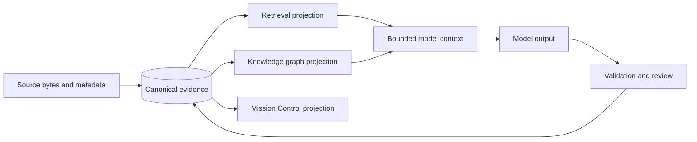

# State and Memory Architecture

**Targeted update, 2026-11-16:** Requirements dispositions persist evidence digests, owners and recovery conditions in campaign records and deduplicated mandate events. Candidate/source identities remain distinct; immutable rejection subjects bind method successors. No historical counters, approvals or scientific results are overwritten. See [the current contracts](../books/book-11-engineered-company-system/chapters/12-requirements-recovery-and-current-certification.md).

## State classes

The word *memory* is too broad unless divided into explicit layers.

| Layer | Examples | Canonical? | Rebuildable? |
|---|---|---:|---:|
| Institutional evidence | sources, cards, attempts, reviews, receipts, decisions | Yes | No; history is retained or lifecycle-marked |
| Operational control state | tasks, leases, campaigns, approvals, grants | Yes for current control | Derivable only where explicitly designed |
| Native laboratory artifacts | strategies, manifests, logs, result bundles | Canonical in producer scope | Some can be rerun, but originals remain evidence |
| Retrieval projection | index and retrieval epoch | No | Yes from available canonical evidence |
| Knowledge graph projection | entities/relations and graph epoch | No | Yes from canonical evidence |
| Model context | selected source snippets and instructions | No | Reconstructable only with a bound selection receipt |
| UI projection | Mission Control summaries and counts | No | Yes from APIs/evidence |

## Memory flow

**Diagram MEM-001 — Canonical evidence, derived memory, and context**

## Canonical evidence

Canonical records preserve identity, producer, schema version, digest, lineage, and
lifecycle. Corrections create successors or events instead of silent mutation. Lawful
payload deletion does not delete the lifecycle dossier and does not permit a client to
pretend the bytes remain retrievable.

## Derived state

Retrieval and graph state are current only when their source epochs match the corpus
and affected curriculum/campaign work has a terminal receipt. Derived-state freshness
is not source truth.

## Context engineering

Every consequential reasoning receipt should identify:

- selected object IDs and versions;
- retrieval and ranking policy;
- opposing evidence included;
- token budget and truncation;
- unavailable/restricted/deleted content;
- prompt and model identity; and
- output validation.

An LLM may locate, transcribe, or explain an equation. It cannot independently verify
its own transcription. Calculation authority requires deterministic or genuinely
independent assurance.

## Current limitation

RI-015 reasoning quality and corpus-wide mathematical fidelity were not demonstrated
at audit time. The architecture can retain provenance, but that does not prove that a
particular context selection or reasoning result is scientifically adequate.
