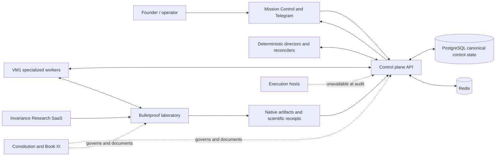

# System Overview

## Purpose

Invariance Research is intended to continuously turn evidence and market observations
into falsifiable research questions, bounded experiments, retained scientific results,
prospective candidates, and eventually authorized execution under deterministic risk
controls. Its institutional objective is reproducible knowledge production; profitable
alpha is a hypothesis, not an architectural property.

## Repository topology

| Repository | Primary responsibility | Observed boundary |
|---|---|---|
| `swarm-control-plane` | Durable tasks, authority, agents, discovery/campaign lifecycle, evidence, UI projection | Institutional control and coordination |
| `bulletproof_bt` | Market-data interpretation, native strategies, backtests, scientific gates, receipts | Experimental execution laboratory |
| `invariance_research` | Product-facing research programs and packaged experiment execution | SaaS/product boundary |
| `invariance-research-bible` | Constitutional rules, architecture, as-built evidence, roadmap | Institutional specification and knowledge transfer |
| `swarm-agent-profiles` | Versioned role/profile material | Auxiliary deployment input |
| `swarm-infrastructure` | Partial infrastructure definitions | Incomplete deployment evidence |

The exact revisions and visibility limits are recorded in the
[reconnaissance](ARCHITECTURAL_RECONNAISSANCE_2026-10-25.md#21-repositories-and-revisions-inspected).

## Machine topology at audit time

| Machine | Observed role | Evidence status |
|---|---|---|
| Mac | Mission Control client/server and operator access | Runtime-evidenced |
| VM1 | Research, representation, strategy engineering, review, and capacity workers | Runtime-evidenced with failed legacy services |
| VM2 | API, PostgreSQL, Redis, campaign/discovery/derived-state directors, messaging | Runtime-evidenced |
| Exec1 | Intended observer/watchdog | Offline/inaccessible |
| Exec2 Lagos | Intended demo/live execution host | Offline/inaccessible |

## High-level architecture

**Diagram SYS-001 — Distributed repository and runtime topology**

**Interpretation.** PostgreSQL-backed control-plane state coordinates work. Model and
non-model workers execute typed tasks. Bulletproof owns native experimental execution.
Mission Control projects state; it is not itself canonical scientific evidence.

## End-to-end research shape

**Diagram SYS-002 — Research-to-execution evidence path**

```mermaid
flowchart LR
    Evidence[Corpus, prior results, market observations] --> Question[Predictive question]
    Question --> Qualify[Feasibility and representation qualification]
    Qualify --> Card[Hypothesis card]
    Card --> Intent[Typed strategy intent and native implementation]
    Intent --> Review[Independent strategy and causality review]
    Review --> BT[Bounded Bulletproof execution]
    BT --> Receipt[Terminal BT-009 evidence]
    Receipt --> Admission{Admission gates}
    Admission -->|fail/invalid/negative| Memory[Retained institutional memory]
    Admission -->|survive| Shadow[Prospective shadow monitoring]
    Shadow --> Risk[Separate risk and execution authority]
```

## Current claim boundary

The audited system has produced genuine terminal negative experiments and has
substantial demo/risk/OMS mechanisms. It has not demonstrated corpus-wide mathematical
fidelity, uniformly reliable autonomous completion, a current admitted shadow
candidate, or live readiness on the offline execution hosts.

For the complete capability matrix and unknowns, see Sections 3, 13, and 14 of the
[reconnaissance](ARCHITECTURAL_RECONNAISSANCE_2026-10-25.md).
