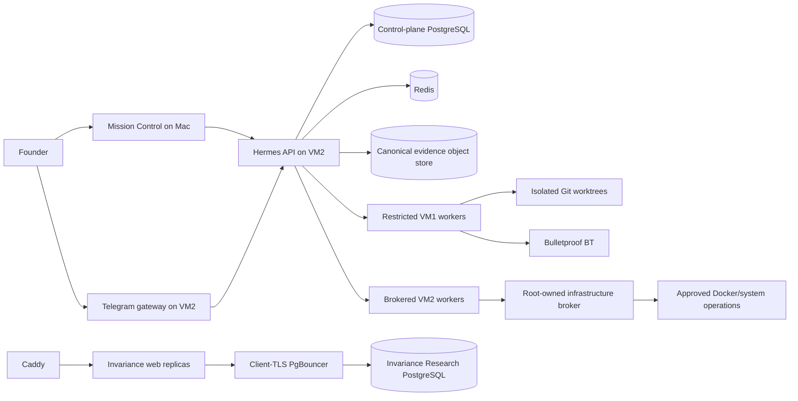
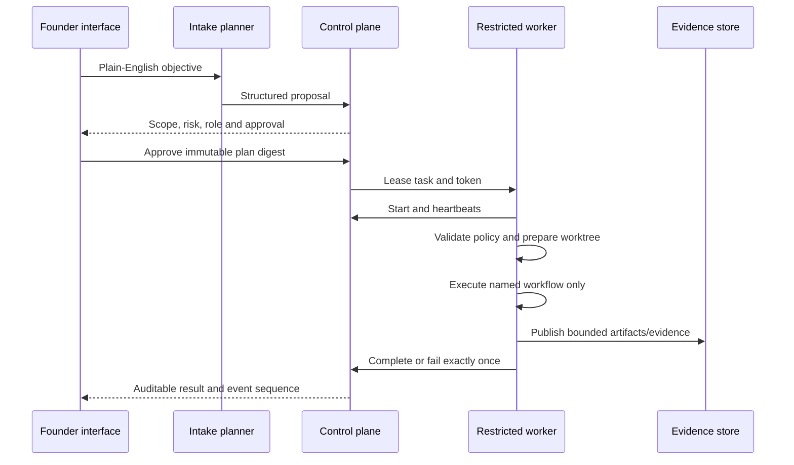

# 1. System Topology and Authority

**Targeted update, 2026-11-16:** EXEC1 and EXEC2 are retired historical hosts; the configured replacement execution role is VPS1. This documentation pass does not establish current VPS1 venue certification or an independent watchdog. VM2 API/director image alignment was observed; other host health remains separately evidenced.
See [the current recovery evidence](12-requirements-recovery-and-current-certification.md).
Older observations below retain their original evidence dates.

## 1.1 Physical and logical placement

### VM1 — engineering and research execution

- Source repositories are direct children of `/home/omenka/Projects`.
- Restricted task workspaces live below the configured workspace root, historically
  `/home/omenka/Projects/swarm-agent-workspaces`.
- Engineering and research workers never execute inside primary checkouts.
- VM1 hosts Codex-authenticated engineering missions, reproducible research execution,
  Bulletproof memory projection, operational-memory recording and research roles.
- VM1 is the only authoring environment in the operating model. Changes flow through
  GitHub before VM2 or the Mac consumes them.

### VM2 — control plane and deployment runtime

- The production control-plane repository is
  `/srv/invariance/swarm/repositories/swarm-control-plane`.
- Its Compose runtime is `/srv/invariance/swarm/control-plane-runtime`.
- The API, control-plane PostgreSQL and Redis run as containers.
- Root-required infrastructure mutations are not granted to agents. An unprivileged
  deployment/infrastructure worker obtains a signed, one-use broker ticket; a
  root-owned broker validates the typed operation and performs only compiled runbook
  actions.
- VM2 also hosts the private Invariance Research database and the on-prem application
  stack described in Chapter 7.

### Mac — founder command center

- Mission Control runs as user `ice`, loopback-only, from
  `~/Library/Application Support/Hermes Mission Control`.
- Its token and environment remain outside Git with mode `0600`.
- The founder research inbox is under Mission Control's protected data directory.
- The Mac submits proposals and approvals; it is not an infrastructure shell or a
  source-of-truth database.

## 1.2 Authority layers

| Layer | May do | May not do |
|---|---|---|
| Founder | Approve bounded plans, risk gates, deployments and research progression | Turn a chat message into an unreviewed privileged command |
| Control plane | Authenticate, validate, lease, record, route and enforce state transitions | Execute arbitrary task-provided shell commands |
| Role package | Declare task types, capabilities, machines, repositories, risk and permissions | Grant itself authority or exceed an active deployment attestation |
| Worker | Execute a named local workflow in an isolated workspace | Write a primary checkout, push, modify remotes, or inherit secrets |
| Infrastructure broker | Execute allowlisted typed operations after ticket validation | Accept free-form commands or reusable tickets |
| Research Intelligence | Store evidence, retrieve, assemble context and retain institutional memory | Approve trials, promote findings or allocate capital |
| Bulletproof BT | Validate strategies and produce research artifacts | Decide production admission or place live orders by research result alone |

## 1.3 End-to-end task lifecycle

Lease ownership is checked at lifecycle calls. Conflict or lease loss terminates local
execution and forbids stale completion. Policy rejection occurs before start and
releases the lease where the API state machine permits it.

## 1.4 Institutional authority graph

Control-plane PR #117 (`12afe1afa46dda81bfbc35ed14428cb8ee9bed64`) adds the
first machine-enforced institutional authority graph. A policy snapshot binds a
semantic version and canonical SHA-256 manifest digest to:

- canonical principals, role bindings and identity aliases;
- named decision types, allowed actions, environments and maximum risk;
- accountable roles, veto roles and separation-of-duty rules;
- whether a right is delegable or constitutional; and
- constitutional boundaries that no operating exception may waive.

The runtime stores four additive PostgreSQL object families introduced by migration
`e6b1a4d82f90`: policy snapshots, delegations, exceptions and immutable decision
records. A partial unique database index permits only one active policy. Each
resolution binds actor, effective roles, action, object identity and digest, scope,
risk, policy digest, delegation/exception references, outcome, reason and timestamp.
Denied decisions are committed before the API returns `403`, so denial evidence is
not lost with the rejected mutation.

Delegation is a bounded grant rather than a role mutation. It cannot exceed the
grantor's accountable right, decision types, risk or environment and expires within
30 days. More than one applicable grant is ambiguous and therefore fails closed.
Exceptions expire within 24 hours, declare reason, scope, risk and compensating
controls, and require a governance approver distinct from requester and independent
reviewer. Constitutional rules remain unwaivable. Emergency authority admits only
containment verbs: halt, isolate, revoke, quarantine and reduce.

Both `/v1/approvals` and `/v1/founder-channel/approvals` resolve the current authority
policy before approve, reject or revoke changes task state. The Telegram alias maps to
the founder's canonical principal, preventing channel changes from manufacturing
independence. Mission Control's approval surface displays the active policy version,
digest, decision-right count and active delegation/exception counts.

The merged source passed 333 backend and 71 Mission Control tests plus focused policy,
OpenAPI, lint, JavaScript and CI checks. On 2026-08-25 VM2 applied migration
`e6b1a4d82f90`, started the rebuilt healthy API and activated policy version `1.0.0`
with digest `4c3d868fc93d6f33b8d1197cd7b89d303a622a14770c2243ff2f02cb417bfacf`.
Mission Control was reinstalled and independently read that active policy. A live
replay committed authorized decision `83d483cc-d6f6-44ee-b330-4a4bf2eff5ba` and denied
decision `467f5f4a-6534-4c54-9ff1-ba0a6b00aa37`; the latter retained
`action-not-authorized` rather than mutating state. A prior retired snapshot is the
rollback unit, and reactivation itself requires an authorized digest-bound
`policy-activation` decision under the current policy.

## 1.5 Orthogonal institutional lifecycles

Control-plane PRs #118 and #119, ending at
`caa9163af9033df903521858ca534f827c06dc39`, add the GOV-002 lifecycle kernel.
Migration `f7c2a9d41e80` stores four independent projections for every explicitly
registered governed subject:

| Dimension | Initial state | Meaning |
|---|---|---|
| Research | `proposed` | Scientific work and its execution outcome |
| Evidence | `unassessed` | Admissibility, dispute, invalidity, retraction or retirement |
| Operations | `not-considered` | Candidate, approval, shadow, demo or live operating maturity |
| Capital | `no-authority` | Eligibility and bounded allocation authority |

Each transition is an explicit typed command against exactly one projection. It binds
the immutable subject digest, expected projection version, actor, reason, evidence
digests, effective time and a GOV-001 authority-decision record. PostgreSQL row locking
and optimistic versions reject stale concurrent writers. Command IDs are idempotent
only for identical command identity; reuse with changed content fails closed. Events
chain the prior event digest per dimension, and every dossier read replays all four
histories before returning their projections.

Cross-dimension facts are prerequisites, never triggers. Operations progression checks
for succeeded research and admissible evidence but cannot cause either state. Capital
progression checks for live operations and admissible evidence but cannot cause those
states. A research success therefore cannot become deployment or capital authority by
implication. Mission Control displays the four state/version pairs without collapsing
them into a single maturity badge.

The production pilot on 2026-08-25 registered subject
`research-candidate:gov002-orthogonality-pilot-v1` with digest
`2c29d45820e4da3c7b43dc6ec0384eca1c49178adefcd9e257a276fec3f14f51`.
After research reached `succeeded` and evidence `admissible`, operations remained
`not-considered` and capital `no-authority`. A fifth, separately authorized `nominate`
command moved only operations to `candidate`. The replayed dossier digest is
`c8d305c59298b2fb2ef00a502e704a27335a1070f3460c27b434aff1a9a6829c`.
This kernel governs newly registered subjects; it does not silently backfill legacy
status columns, promote an artifact, allocate capital or place an order.

## 1.6 Consequence-specific governance

GOV-003, merged through control-plane PRs #120 through #122 at
`f63ea4f07f3b8e50595256fffdd577bff29af9ab`, makes promotion, demotion,
quarantine, retirement and reinstatement explicit institutional decisions. Migration
`a8d3f1c52b90` stores the source lifecycle event, command identity, action, effective
status, prior/resulting/rollback states, approvers, affected descendants, evidence
epoch, expiry, reason and canonical digest. Bidirectional `reversed_by` and
`reversal_of` links preserve exact rollback lineage. Migration `b9e4c2d63a10` adds
`superseded` as a first-class effective status and reconciles already retained rows.

The service accepts only declared action/state pairs. Evidence must be a current
SHA-256 reference and cannot be older than seven days. Consequences expire within 30
days. Promotion and reinstatement require an accountable actor plus distinct originator
and evaluator participation under the active GOV-001 policy. Each write locks and
version-checks one GOV-002 projection. Cross-dimension prerequisites remain checks, not
side effects. A later consequence that replaces the currently effective consequence
marks its predecessor `superseded` and links both records; explicit reversal or expiry
restores the recorded rollback state through another authority-bound event.
Successor records are flushed before predecessor links are written, so the database
foreign-key boundary is satisfied atomically; a failed linkage attempt rolls back the
entire transaction and cannot leave a partially applied projection or consequence.

The 2026-08-25 production pilot retained eight consequence records. It promoted and
reversed operations, quarantined and reinstated evidence, retired and reinstated
operations, then proved bounded expiry by promoting operations and restoring its exact
prior state through a linked reversal. The final states were research `succeeded`,
evidence `admissible`, operations `candidate` and capital `no-authority`. Dossier digest
`ed1208a8afd4aa0e69ef00923f35d946846af8165491a08aeed02f35774ae827`
proves the complete replay boundary. These decisions govern lifecycle consequences
only; they do not allocate capital, route orders or certify market performance.

## 1.7 Portable governance audit evidence

GOV-004, merged in control-plane PR #123 at
`dbed5adfb598d2ea74c6617b9e424a0e5a17370e`, makes the institutional audit
chain independently exportable. It collects canonical founder proposals, tasks,
approval events, operational-control events, operation-ledger events, GOV-001 policy,
delegation, exception and decision records, and GOV-002/003 lifecycle transitions and
consequences. The export is a projection over those authorities, not a replacement for
their PostgreSQL source histories.

Schema `governance-audit-export-v1.0.0` gives every normalized event a stable sequence,
source identity and time, actor, action, object identity and digest, policy identity and
digest, evidence references, redacted payload and redaction receipts. Every record
hashes its predecessor. The terminal digest binds the complete ordered chain, and an
Ed25519 signature binds the unsigned bundle digest. Its public key and SHA-256 key
identity travel with the bundle, so a fresh verifier needs neither a database nor a
shared signing secret. Referential closure checks connect proposals, tasks, approvals,
operations, authority decisions, policies, lifecycle events and reversal records.

Migration `c1f4a7d92e60` retains each export as a new append-only record. The live
2026-08-25 export contained 2,204 events and reconstructed six lifecycle projections.
Bundle digest `0131f5db507c0f86f7b1399ad13069efc8ae0850929d91fb36da576b3d3fd6f9`
verified against key identity
`5f25132b5c88f6f76b3b453331526765f1418e1b8c9f481b654cd5bf8664852a`,
matched the persisted copy and rejected an actor mutation. No matching sensitive field
was present in the live corpus; unit tests separately prove path-bound digest receipts
replace secret-bearing values. The export is compliance evidence only and grants no
execution, deployment, capital or order authority.
