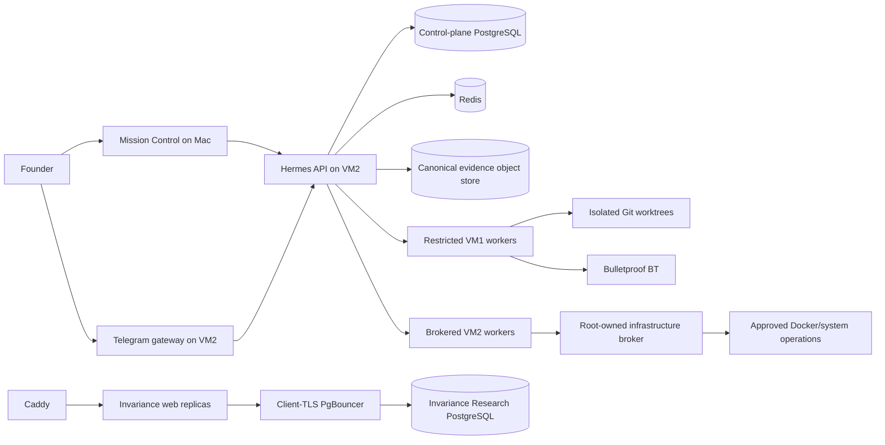
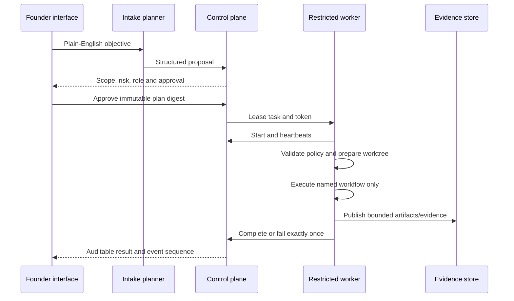

# 1. System Topology and Authority

## 1.1 Physical and logical placement

### VM1 — engineering and research execution

- Source repositories are direct children of `/home/omenka/Projects`.
- Restricted task workspaces live below the configured workspace root, historically
  `/home/omenka/Projects/swarm-agent-workspaces`.
- Engineering and research workers never execute inside primary checkouts.
- VM1 hosts Codex-authenticated engineering missions, reproducible research execution,
  Bulletproof memory projection, operational-memory recording and research roles.
- VM1 is the only authoring environment in the operating model. Changes flow through
  GitHub before VM2 or the Mac consumes them.

### VM2 — control plane and deployment runtime

- The production control-plane repository is
  `/srv/invariance/swarm/repositories/swarm-control-plane`.
- Its Compose runtime is `/srv/invariance/swarm/control-plane-runtime`.
- The API, control-plane PostgreSQL and Redis run as containers.
- Root-required infrastructure mutations are not granted to agents. An unprivileged
  deployment/infrastructure worker obtains a signed, one-use broker ticket; a
  root-owned broker validates the typed operation and performs only compiled runbook
  actions.
- VM2 also hosts the private Invariance Research database and the on-prem application
  stack described in Chapter 7.

### Mac — founder command center

- Mission Control runs as user `ice`, loopback-only, from
  `~/Library/Application Support/Hermes Mission Control`.
- Its token and environment remain outside Git with mode `0600`.
- The founder research inbox is under Mission Control's protected data directory.
- The Mac submits proposals and approvals; it is not an infrastructure shell or a
  source-of-truth database.

## 1.2 Authority layers

| Layer | May do | May not do |
|---|---|---|
| Founder | Approve bounded plans, risk gates, deployments and research progression | Turn a chat message into an unreviewed privileged command |
| Control plane | Authenticate, validate, lease, record, route and enforce state transitions | Execute arbitrary task-provided shell commands |
| Role package | Declare task types, capabilities, machines, repositories, risk and permissions | Grant itself authority or exceed an active deployment attestation |
| Worker | Execute a named local workflow in an isolated workspace | Write a primary checkout, push, modify remotes, or inherit secrets |
| Infrastructure broker | Execute allowlisted typed operations after ticket validation | Accept free-form commands or reusable tickets |
| Research Intelligence | Store evidence, retrieve, assemble context and retain institutional memory | Approve trials, promote findings or allocate capital |
| Bulletproof BT | Validate strategies and produce research artifacts | Decide production admission or place live orders by research result alone |

## 1.3 End-to-end task lifecycle

Lease ownership is checked at lifecycle calls. Conflict or lease loss terminates local
execution and forbids stale completion. Policy rejection occurs before start and
releases the lease where the API state machine permits it.

## 1.4 Institutional authority graph

Control-plane PR #117 (`12afe1afa46dda81bfbc35ed14428cb8ee9bed64`) adds the
first machine-enforced institutional authority graph. A policy snapshot binds a
semantic version and canonical SHA-256 manifest digest to:

- canonical principals, role bindings and identity aliases;
- named decision types, allowed actions, environments and maximum risk;
- accountable roles, veto roles and separation-of-duty rules;
- whether a right is delegable or constitutional; and
- constitutional boundaries that no operating exception may waive.

The runtime stores four additive PostgreSQL object families introduced by migration
`e6b1a4d82f90`: policy snapshots, delegations, exceptions and immutable decision
records. A partial unique database index permits only one active policy. Each
resolution binds actor, effective roles, action, object identity and digest, scope,
risk, policy digest, delegation/exception references, outcome, reason and timestamp.
Denied decisions are committed before the API returns `403`, so denial evidence is
not lost with the rejected mutation.

Delegation is a bounded grant rather than a role mutation. It cannot exceed the
grantor's accountable right, decision types, risk or environment and expires within
30 days. More than one applicable grant is ambiguous and therefore fails closed.
Exceptions expire within 24 hours, declare reason, scope, risk and compensating
controls, and require a governance approver distinct from requester and independent
reviewer. Constitutional rules remain unwaivable. Emergency authority admits only
containment verbs: halt, isolate, revoke, quarantine and reduce.

Both `/v1/approvals` and `/v1/founder-channel/approvals` resolve the current authority
policy before approve, reject or revoke changes task state. The Telegram alias maps to
the founder's canonical principal, preventing channel changes from manufacturing
independence. Mission Control's approval surface displays the active policy version,
digest, decision-right count and active delegation/exception counts.

The merged source passed 333 backend and 71 Mission Control tests plus focused policy,
OpenAPI, lint, JavaScript and CI checks. Production activation is not yet claimed:
VM2 must apply migration `e6b1a4d82f90`, rebuild the API and run the idempotent
`worker/scripts/gov001_bootstrap.py` in the same maintenance operation, because the
approval surfaces intentionally fail closed while no active policy exists. A prior
retired snapshot is the rollback unit, and reactivation itself requires an authorized
digest-bound `policy-activation` decision under the current policy.
