
# 4. Research Intelligence

## 4.1 Purpose and non-authority

Research Intelligence is the institutional evidence and memory layer. PostgreSQL and
the object store hold canonical records; retrieval and graph tables are disposable
projections. RI can recover, classify, retrieve, compare, assemble and preserve
evidence. It cannot approve a hypothesis, start an experiment, promote a result or
allocate capital.

## 4.2 Ingestion pipeline

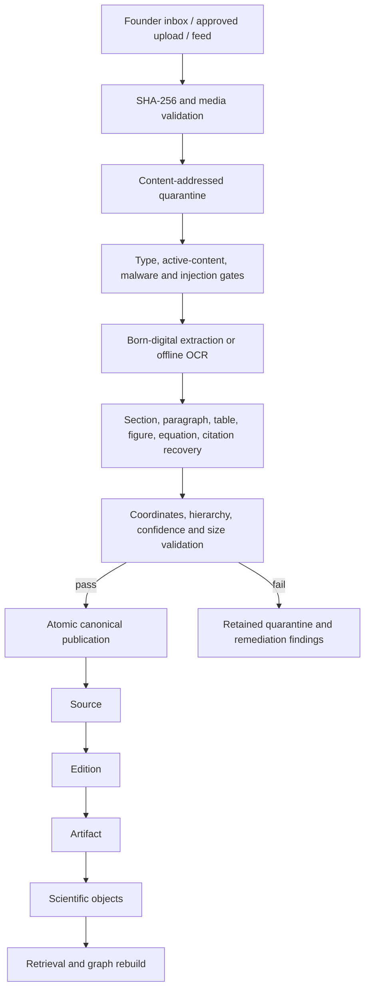

Files are never executed. Archives, active PDF content, instruction-like text,
oversized payloads, malformed structures and low-confidence extraction are bounded or
rejected. Original artifacts are retained for exact coordinate replay. PR 33 adds
offline Tesseract/PDFium recovery and raises the bounded scientific-ingestion limit to
100 MiB. The reconciled 2026-08-22 founder-inbox ledger covers 269 files: 267 are usable
canonical or duplicate-backed evidence and two remain explicitly quarantined. One
Cartea edition is structurally unreadable and requires replacement. Paper
`2505.22954v3.pdf` contains a genuine Bash-tool instruction and remains security-blocked.
No scanner rule was weakened to improve the count.

The Research Ingestion Recovery Steward is a fixed-authority service. Its bounded
controller attempts structural inert repair, independent PDFium extraction and offline
OCR at most once each, preserves original evidence, records an attempt-and-digest
ledger, reconciles the inbox, and rebuilds projections after a settled batch. Optional
Codex advice is schema-constrained to choosing an untried method or recommending a
terminal classification. Codex receives no artifact bytes or publication authority;
deterministic scanner, validation and publication gates remain binding. Terminal
outcomes are recovered, replacement required, security blocked, unsupported format,
corrupt unrecoverable or manual review required. Security-blocked material may produce
a provenance-preserving redacted-edition proposal, but cannot execute it without
founder approval.

Mission Control exposes a read-only blocked-artifact register derived from canonical
ingestion jobs and their immutable recovery receipts. It records the artifact digest,
terminal classification, exact founder action, retry eligibility, attempted methods and
redacted-edition proposal state. It is not a second mutable recovery ledger. Rejected
derived editions remain subordinate evidence of their original recovery and are
excluded from both the founder-action register and new recovery queue, preventing
recovery loops and duplicate decisions. At the 2026-08-22 observation the register had
exactly two terminal originals: the Cartea edition was `replacement_required` after
structural repair, independent parsing and OCR failed; `2505.22954v3.pdf` was
`security_blocked` with a non-executable redaction proposal.

## 4.3 Canonical object kernel

Implemented object types are source, edition, artifact, scientific object, claim,
method, assumption, dataset, run, result, review, decision, belief and episode.
Identity includes canonical UUID, content version/digest, producer identity and aliases,
project, access class, authority class and typed payload. References become canonical
lineage edges. Immutable identity conflicts fail rather than overwrite history.

## 4.4 Retrieval

The `canonical-scientific` projection supports:

- exact UUID, digest, alias and exact-text matching;
- lexical term-frequency similarity;
- deterministic network-free hashed-vector similarity with a small declared synonym
  map;
- graph-assisted expansion over canonical neighbors;
- deterministic reciprocal-rank fusion (`rrf-v1`);
- project, scientific type, access class and schema compatibility filters;
- stale-corpus detection and fail-closed projection version checks;
- reauthorization against the canonical object before returning content;
- exact source-coordinate replay.

The vector channel is a reproducible baseline, not a learned domain embedding model.
RI-011 adds a transactional `canonical-scientific` freshness row. Statement-level
database triggers advance its epoch and rolling digest after canonical object, edge or
alias changes; online status and query requests compare this snapshot with the
projection source epoch in constant time. Content digest, authorization scope, alias
and PostgreSQL full-text indexes support candidate selection. Every query first applies
project, access, schema and scientific-type policy, then hydrates at most 100 ranked
conjunctive candidates, 500 bounded partial-match candidates and 100 graph neighbors.
An eight-request admission semaphore rejects overload rather than allowing unbounded
concurrent work. Responses expose stage timings and candidate counts without exposing
protected content.

The 2026-08-22 post-recovery `hybrid-retrieval-v1.1.0` projection contains 761,444
scientific objects under corpus digest
`e97aef87ad687e670087dd44c99e4e9366287ec0ee860b06e3d4fa48507d0db0`.
Its retained RI-011 benchmark at the earlier 623,375-object corpus measured
564.253 ms warm p95 and 1,228.084 ms concurrent
p95, below declared 2,000 ms and 5,000 ms SLOs. Evaluation `1.0.2` preserved complete
recall, citation, opposition, abstention and topic-coverage measures with zero measured
cross-domain leakage. Full projection rebuild remains an offline deployment operation;
it is not part of request latency.

### 4.4.1 Governed RAG and model boundary

Hermes implements governed, citation-bound, graph-assisted retrieval-augmented
generation rather than a general document chatbot. The control plane performs
authorization, hybrid retrieval, graph-neighbor expansion, ranking, bounded context
assembly and citation replay. An authorized research role or model may reason only over
the returned context pack and must identify uncited synthesis as agent inference or
abstain when evidence is insufficient.

The LLM does not receive unrestricted source files, database credentials, scanner
controls or publication authority. It cannot mutate canonical evidence, approve a
hypothesis, start an experiment, promote a result or allocate capital. The retrieval
vector channel is deterministic, network-free hashed-vector similarity; it is not an
OpenAI embedding service or an external vector database. Model generation is therefore
replaceable above the canonical retrieval/context boundary.

## 4.5 Institutional memory

RI-004 implements supporting and opposing evidence, comparability review, valid
negative results versus invalid attempts, belief revisions, episodes and immutable
frozen dossiers. A dossier binds its query, evidence identities, citations, opposing
evidence and digest. Protected evidence can be represented as redacted existence and
access reason without disclosing content.

Operational memory is separate. It records system observations and lifecycle actions
such as assign, defer, resolve and reopen. It does not execute the noted work.

RI-010 adds an orthogonal evidence-memory lifecycle. The canonical object remains
the historical identity; `evidence_lifecycle_states` is the current materialized
view, and immutable event, consolidation, deletion and impact tables prove how it
changed. Its states are `active`, `consolidated`, `superseded`, `retracted`,
`expired` and terminal `deleted`. Explicit decay is an expiry transition, not a
score silently chosen by a model.

Consolidation requires equal content digests. A corrected object must identify a
compatible predecessor, and registration supersedes that predecessor in the same
transaction. Retraction and expiry are reversible by an authorized restore;
consolidation, supersession and lawful deletion are not. A deletion request names
its legal basis and requester, a different authority must decide it, and an active
retention hold blocks approval. Approved deletion scrubs the protected JSON payload
to a non-sensitive tombstone while retaining canonical and payload digests,
identity, edges, audit events and dependency impact evidence.

Active retrieval and graph builders exclude every non-active state. Lifecycle
changes advance the canonical freshness epoch, so stale projections fail closed
until rebuilt. Frozen dossiers never mutate; replay reports the later lifecycle
state and successor. Corpus backup schema `corpus-backup-v1.1.0` preserves states,
events, consolidation receipts, deletion decisions and impact reports so disaster
restore cannot silently reactivate invalid evidence. Mission Control lists
non-active objects and opens their digest-bound lifecycle dossiers.

## 4.6 Corpus operations and synchronization

RI-005 provides content-free security findings, aggregate metrics/SLO state,
digest-bound metadata backup, empty-target restore, stale queue repair and projection
rebuild. RI-007 adds a durable sync run and item ledger for:

- the founder's Mac inbox;
- legacy Hermes research records;
- `imported-prior-results`;
- a bounded Bulletproof research-memory export.

Each eligible item must end as canonical, quarantined, duplicate, superseded, excluded
or failed with a reason. Raw Bulletproof memory and its multi-gigabyte lake are not
copied into Hermes; only a bounded digest-bound projection is registered.

RI-012 removes a client-side scaling defect in founder-inbox synchronization. Earlier
Mission Control releases reread, rehashed, base64-encoded and submitted every eligible
historical file on every refresh, even though the API correctly prevented duplicate
publication. The incremental client instead maintains a derived private
`research-inbox-sync-v1.json` index under the Mission Control data root. Its fast path
compares relative path, byte size and nanosecond modification/change times; unchanged
canonical files require no content read, hash or ingestion request. A changed or new path is
hashed, and a renamed canonical file reuses its digest-bound ingestion receipt without
uploading the payload again.

The index is not evidence authority. It contains metadata, content digests, ingestion
identifiers, dispositions and projection evidence, is written atomically with mode
`0600`, and is checkpointed after every file. Projection invalidation is also durable,
so an interruption after publication cannot reuse an older projection. An exclusive lock prevents overlapping
refreshes. Canonical entries are terminal in the local fast path; quarantined, failed
and remediation-required content remains retryable through the governed recovery
pipeline. Reconciliation still receives the complete current inbox inventory from
cached and new receipts. Retrieval and graph projections rebuild once after a settled
batch only when the batch publishes new canonical content; a no-change refresh reuses
the last projection evidence. The `sync-status` command exposes scanned, remaining and
outcome counts while work is active.

This implementation is locally tested but is not production-qualified in this
snapshot. Mac deployment, first-index bootstrap, interruption/resume evidence and a
measured warm no-change refresh remain RI-012 acceptance gates. The synchronizer stays
serial across expensive extraction work until explicit API capacity admission exists;
unbounded parallel OCR is not an accepted latency shortcut.

## 4.7 Surveillance

RI-006 has allowlisted HTTPS feeds, rights/access metadata, fetch success/failure
receipts, duplicate/correction/retraction history, abstract poisoning rejection,
corpus-grounded novelty, technique briefs, proposal-only routing and weekly digest
freezing. It does not auto-adopt a paper or auto-create a live research trial.

## 4.7.1 Evidence-grounded daily direction

DISC-001 extends the existing deterministic daily research scheduler instead of
creating another orchestration path. It considers only current, non-retracted Research
Intelligence candidates with an attributable `propose_question` disposition. Each
candidate is ranked from declared priority, corpus-grounded novelty, evidence quality,
freshness and similarity to prior hypothesis questions. Previously selected
publications, stale evidence and near-duplicate search families are excluded. Ties are
resolved deterministically from the normalized question digest, and the existing weekly
program budget remains authoritative. If nothing qualifies, the scheduler records why
and selects the next approved static mandate.

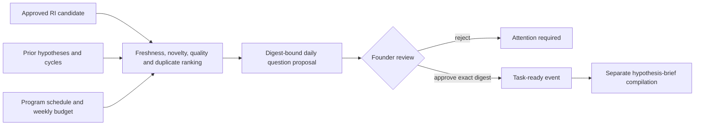

The cycle retains publication and routing-event identities and digests, citation
provenance, score components, fallback reason and question digest. Its append-only event
stream records proposal creation, founder approval or rejection and task readiness.
Mission Control displays this evidence and exposes explicit decisions. Approval has no
execution authority: it cannot create a trial, lease a worker, promote research or
touch capital. Deployment migration, Mission Control installation and a live replay
remain the operational acceptance boundary for the source-complete implementation.

## 4.7.2 Observation, anomaly and opportunity maps

DISC-002 provides the typed bridge from a governed daily question to later hypothesis
work without pretending that every unusual estimate is investable. It reuses the
DISC-001 cycle, RI canonical evidence and DATA-002/003 data contracts. It does not run
a backtest, generate a strategy, select a portfolio or acquire trading authority.

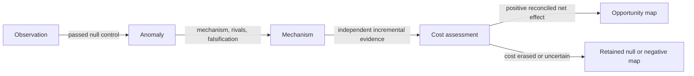

Every immutable map binds its source daily cycle, exact point-in-time population,
catalog digest, successful lake-admission event, baseline, estimate, uncertainty,
regime controls and canonical evidence identities and digests. An anomaly requires a
passed permutation, placebo, negative or time-shift control. A mechanism requires a
causal story, rival explanations and explicit falsification outcomes. An opportunity
additionally requires at least two differently produced evidence objects, a non-zero
incremental effect and arithmetic reconciliation of gross effect less transaction,
financing and impact costs to a positive net effect.

Semantic duplicates are conflicts, not extra discoveries. Revisions use
`supersedes_map_id`; registration and supersession enter an append-only digest chain.
Protected market payload cannot enter the strict contract. A cost-erased candidate
fails admission and remains evidence rather than being promoted by wording.

Production runs migration `b5d8e2f41a70`. The live pilot registered map
`358f8ec0-700e-4c39-af52-b2515b54cf7c`, rejected the cost-erased fixture and retained
the superseded original. Its report digest is
`fa46dcb44d1a913b72193f114cc69148dbf0a5f1e0bb4a832a60fb70cfa8db9d`.
The service grants no source-write, strategy-execution, order or capital authority.

## 4.7.3 Mechanism and falsification

DISC-006 turns a qualified mechanism map into a prospective test contract. It reuses
the canonical hypothesis, frozen evidence dossier, explicit opposition records and
DISC-002 map; it does not create another evidence store or infer that a mapped anomaly
is causal.

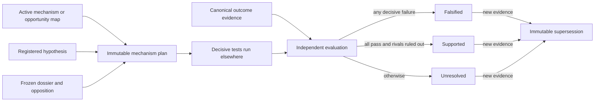

A plan records the mechanism, scope, assumptions, competing explanations,
confounders, evidence cutoff and exact decisive tests before outcomes exist. Each test
has distinct prediction, null and falsification statements, a frozen analysis digest
and explicit rival targets. Registration fails if any rival is uncovered or if the
plan lacks its dossier/opposition provenance.

An evaluation must postdate registration and bind the unchanged plan digest. It covers
every preregistered test exactly once, cites an existing canonical evidence object by
both identity and digest and reports the disposition of every targeted rival. A failed
decisive test dominates supportive language and yields `falsified`. `Supported` is
reserved for all tests passing with every rival ruled out; incomplete or inconclusive
evidence remains `unresolved`. Later judgments supersede prior evaluations while
retaining both records and their digests.

Production runs migration `c6e9f3a52b80`. The live no-capital replay retained
falsified evaluation `64195922-e004-4ae9-a091-8236a89cdb22` and then an unresolved
supersession `65e61ffe-9fcf-46dd-bb51-7bc1fb02e2ee`. The pilot report digest is
`264960712733bbec083fa443e85930a5dcc38ecaac1a330faddd48fc68f59a7b`.
The service has no source-write, strategy-execution, order or capital authority.

## 4.7.4 Selection-bias and research-overfitting audit

DISC-007 evaluates the research process, not merely its reported winner. It imports the
digest-bound complete BT-006 family ledger and binds the audit to a retained DISC-006
mechanism evaluation. Every planned variant remains present, including failed and
cancelled attempts.

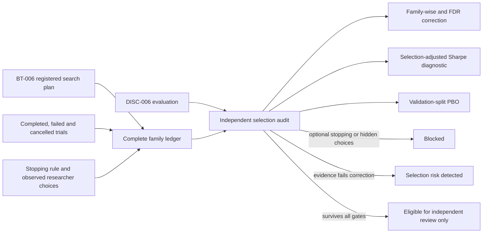

The auditor rejects winner-only summaries, omitted trials, changed digests, reduced
multiplicity and validation splits that rank a favorable subset. Institutional bounds
prevent a caller from loosening alpha above 0.05 or PBO tolerance above 0.5. Optional
stopping and observed-but-undeclared parameter, metric, seed or transformation choices
are blocking process findings. A `selection_adjusted` conclusion is evidence for the
next independent review; it is not promotion and cannot authorize execution.

Production runs migration `d7f1a4b63c90`. The live replay retained a four-member family
with two completed, one failed and one cancelled trial. The nominal winner's p-value
of `0.02` corrected to family-wise `0.08`, producing `selection_risk_detected` instead
of allowing the winner to pass by presentation. Audit digest
`f8bf5a21bf539e0b4e46cf4b54405d0cd4e0fcaa9d0a1c47950d43ec487dd62f` and report
digest `bad4c9db76f3aceec9a06cc8652519707c517e5e223e3434f56a9867b71ed8a0`
retain that decision. The service has no promotion, strategy-execution, order or
capital authority.

## 4.7.5 Representation and factor experiment language

DISC-003 makes representation search explicit before a trial reaches Bulletproof. A
factor program is an immutable typed source document bound to a registered hypothesis,
a DATA point-in-time manifest and a BT-007 representation contract. Fields declare
units, domains, observation clocks and availability lags. Feature formulas are closed
expression trees, not Python: the language has no imports, file paths, network calls or
dynamic evaluation.

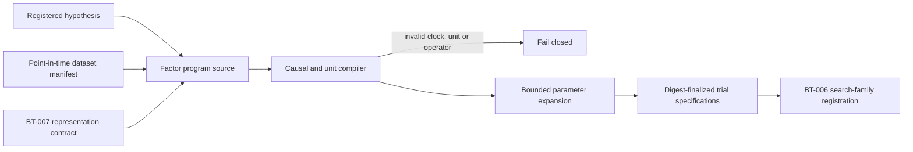

Every feature read must be available at least one decision interval before use. Forward
observation is represented only by the evaluation label. The compiler checks unit
compatibility, allowlisted operators, expression depth, finite distinct parameter values
and maximum Cartesian trial count. It produces canonical source, semantic, compiled and
per-trial digests; changing only a display key cannot disguise a semantic duplicate.

Production runs migration `e8a2b5c74d10`. Live program
`096bdcf9-4325-48e7-a699-5b1f86ba494a` bound a registered WS-001 dataset and retained
BT-007 representation contract, rejected an unsafe current-bar control and compiled four
deterministic variants under digest
`09c91fd6710454f1a10acca4d9fc63cc91290495d7bbdac0619c40fb5b3de95e`.
The compiler creates specifications only and has no trial-execution, selection,
promotion, order or capital authority.

## 4.7.6 Budgeted statistical search

DISC-004 searches only the finite trial universe already compiled by DISC-003. Each
campaign freezes the factor-program digest, objective, direction, seed, exploration
weight and evaluation/batch budgets. Exhaustive, structured, seeded random, Bayesian
surrogate and evolutionary-neighborhood planners differ only in proposal ordering; none
can change the registered universe or execution truth.

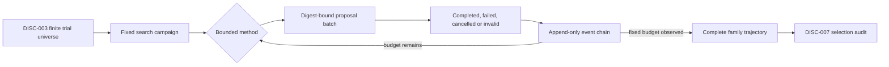

Every proposal in a batch must be observed before the next batch. Failed, cancelled and
invalid trials consume budget and remain visible; they cannot carry objective values.
Completed values must be finite. Completion is fixed-budget exhaustion, never a favorable
outcome trigger. An operator may cancel a campaign, but the cancellation is terminal and
records all remaining candidates as non-results.

Production runs migration `f9b3c6d85e20`. Live Bayesian campaign
`64fa4499-4728-4db8-a1fd-570e503b075b` retained a completed, failed and completed sequence,
then completed exactly at its three-evaluation boundary. Its replay verified event head
`010acf94e119f18bf67ae7d9683465886bf2d210ab6c73013f40af224d28cef8`.
The service has no trial-execution, result-mutation, selection, promotion, order or
capital authority.

## 4.7.7 Constrained symbolic and program search

DISC-005 proposes new factor expressions only inside the closed DISC-003 language. A
search run binds the exact base factor-program digest, active AGT-004 prompt-policy
bundle and a canonical constraints digest. Candidate, node, depth and constant budgets,
plus operator, field and parameter allowlists, are frozen before generation begins.

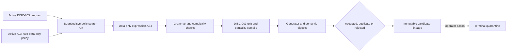

Generated output is never imported, evaluated or executed. The only permitted tool is
read-only `research.retrieve`; paths, network calls and action-bearing tools fail closed.
Provider, model, version, seed and candidate index form a deterministic generator
identity. Reusing that identity with different output is rejected as nondeterministic.
Commutative expression normalization detects reordered duplicates, and the service also
rejects candidates semantically identical to the base program. Accepted, duplicate and
rejected attempts all consume budget and remain replayable.

Production runs migration `a0c4d7e96f30`. Live run
`f5270d24-15de-4f19-abe0-30f2a38fc7de` retained four candidates: one accepted, one
duplicate and two rejected. It proved forbidden-code, missing-field, duplicate-semantic
and nondeterministic-output paths under constraints digest
`469e41074848fe9b81a0b2b5db6636574228e51f5b3b4ab7197f554d243fc70f`.
The service has no execution, result-mutation, selection, promotion, order or capital
authority.

## 4.7.8 Bounded autonomous research sessions

DISC-008 permits unattended research coordination only inside an immutable AGT-003 task
graph. Registration freezes the graph digest, exact ordered agenda, allowed scope and
task, attempt, duration, reconciliation, stall and worker-loss budgets. Every task must
be risk zero. The authority contract is structurally no-capital and cannot set approval,
scope-expansion or promotion authority to true.

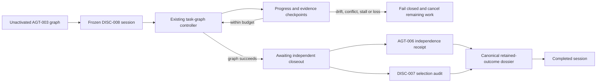

Graph success is not session success. Closeout recomputes the dossier digest and requires
it to bind the exact session, graph, agenda, budget, active selection-audit digest and all
observed positive, negative, invalid, failed and cancelled outcomes. An omitted non-result
fails closed. The session event chain records registration, activation, progress,
escalation, cancellation and completion. Cancellation reuses graph cancellation and
declared compensation; it never deletes session, task or evidence lineage.

Production runs migration `b1d5e8f20a40`. Live session
`be033159-bc20-4c82-b81f-fbf016027033` retained negative, failed and invalid outcomes,
then closed under AGT-006 receipt
`153cf0ea907329c97aaf5728507dc3806b42548b94e4d213acde032b47683104`
and DISC-007 audit
`f8bf5a21bf539e0b4e46cf4b54405d0cd4e0fcaa9d0a1c47950d43ec487dd62f`.
It has no self-approval, scope expansion, promotion, order or capital authority.

## 4.7.9 Discovery portfolio and information-gain scheduler

DISC-009 converts the institution's eligible discovery inventory into an immutable,
diversified research-attention portfolio. Eligible inputs are current curricula, active
DISC-002 opportunity maps, active DISC-006 mechanism evaluations, current DISC-007
selection audits whose upstream lineage is still active, and completed DISC-008 sessions.
The service verifies every source against its canonical record before it scores anything.

Callers provide bounded relevance, feasibility and attention-cost estimates, but not
epistemic confidence. Uncertainty is derived by the server from the source record.
Novelty is computed against both the candidate set and prior completed sessions. The
allocator first satisfies the declared domain-diversity floor and then fills remaining
capacity by expected information gain per attention unit, subject to total-attention,
selection-count, per-domain and per-cluster caps. Every candidate retains its normalized
score inputs, digest, deterministic rank, selection state and either a selection rationale
or a counterfactual exclusion reason. No excluded alternative disappears from history.

Migrations `c2e6f9a31b50` and `d3f7a2b41c60` add the portfolio ledger and the typed
`ResearchProgram.project` compatibility boundary. The existing M14 research program is
explicitly bound to `bulletproof-bt`; unknown legacy programs remain `unbound` rather than
being assigned by inference. Live portfolio `18fe8f06-ff9a-45f5-8d1c-6d8a5b41419e`
selected two domains from three candidates and retained the third with reason
`attention_budget`. Allocation digest
`a86537d6ea9c4dede83f5054789298b9c41fa7002d4e758fb8209f337b42a309`
replayed exactly. The scheduler has no task-creation, execution, promotion, order or
capital authority.

## 4.8 Typed knowledge graph and cognitive services

RI-008, implemented in PR 34 and deployed on VM2 at this snapshot, adds:

- allowlisted predicates: `derived_from`, `supersedes`, `supports`, `contradicts`,
  `uses_method`, `uses_dataset`, `produced_result`, `reviews`, `decides_on`,
  `belongs_to_trial_family`, `depends_on` and `cites`;
- endpoint-type direction validation;
- half-open validity intervals and explicit provenance objects;
- edge access classes that cannot underclassify protected endpoints/provenance;
- digest-bound projection manifests;
- bounded neighborhood, simple-path and subgraph traversal with cycle protection;
- access filtering before traversal and stale-projection failure;
- citation-bearing context packs;
- deterministic decimal mean, sample standard deviation, Sharpe and maximum drawdown;
- persisted idempotent receipts binding tool/version/input/output/context/actor;
- a canonical Mission Control graph explorer.

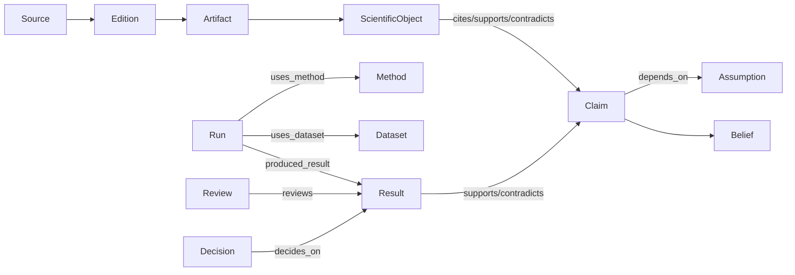

The graph is not a graph database source of truth. Canonical IDs and edges remain in
the evidence kernel; the graph projection can be dropped and deterministically rebuilt.

The post-recovery projection observed on 2026-08-22 contains 762,232 nodes and
1,331,231 edges under manifest digest
`bc83c19679c84782cc315d40e37bd00be51d18f54a06776988e979a1c5541569`.
That observation proves migration and rebuild, not domain expertise. Citation/context
replay, curriculum evaluation and cognitive-tool receipts remain separate acceptance
evidence.

## 4.9 Readiness boundary

The inbox reconciliation, graph freeze and first systematic-research curriculum gates
are satisfied. Upload count is not domain expertise, and retained quarantines remain
visible coverage facts rather than silent omissions. RI-009B now qualifies twelve
Research Bible domains independently. Strong performance in one domain cannot make a
failing domain available because portfolio readiness is an all-domain conjunction.

## 4.10 Domain curriculum and institutional-brain evaluation

RI-009 source at control-plane commit `e9b3db4` introduces a qualification layer above
the legacy domain profile. Each curriculum version binds to exact retrieval-corpus and
graph-manifest digests and declares:

- an acyclic ontology of topics and prerequisites;
- canonical evidence anchors and separate canonical source anchors, preventing many
  paragraphs from one book from masquerading as source diversity;
- required opposing evidence;
- allowed authority classes and a maximum quarantine fraction;
- qualified roles and a bounded review cadence.

Evaluation sets contain answerable, adversarial, cross-domain and mandatory abstention
cases. The service runs those cases through canonical hybrid retrieval and measures
retrieval recall, citation fidelity, opposing-evidence recall, abstention accuracy,
cross-domain leakage and topic coverage. Every threshold must pass. A changed corpus or
graph digest makes the qualification stale; source uploads do not silently preserve an
expertise claim.

RI-008 and RI-009 are production-qualified. RI-011 retained two failed benchmark
observations before qualification: corpus-wide hydration produced a 10.29-second warm
p95, and bounding hydration alone still produced 8.90 seconds because PostgreSQL ranked
the broad match set before limiting it. The final indexed two-tier candidate plan
closed that measured defect without weakening confidence or abstention thresholds.

RI-009B adds `research_curriculum_portfolios` as the immutable breadth dossier. The
qualified `1.0.1` portfolio contains exactly one curriculum and latest evaluation for
each of twelve required domains under one corpus and graph manifest. Each domain has
two distinct source anchors, supporting and opposing evidence, separate held-out
queries and an unknown-case abstention fixture. The retained `1.0.0` gap record proves
that aggregate qualification failed when regime and risk retrieval missed their
anchors. Recalibration changed query wording, not evidence identities.

Graph readiness no longer streams the full canonical graph for each gate. Canonical
object/edge mutations increment the existing database freshness epoch. Graph state
stores its build epoch and compares it in constant time; pre-epoch states perform one
exact digest comparison and adopt the current epoch only when the digest matches.

## 4.11 Institutional intelligence truth evaluation

RI-015 separates a working retrieval or graph service from demonstrated institutional
reasoning. Migration `c1d7e4a92f60` introduces three immutable record classes:

- an evaluation suite binds a public item manifest and protected independent gold to
  exact corpus and projection digests;
- an evaluation run binds exact structured responses, model/runtime identity,
  evaluator identity, thresholds, limitations and an evaluation digest;
- item results retain domain, task class, applicable scores, failure reasons and the
  response evidence needed for replay.

The task taxonomy covers direct citation, formula and table use, symbol
disambiguation, cross-document synthesis, contradiction, temporal supersession,
negative results, multi-hop graph reasoning and no-answer cases. Scoring covers
citation entailment, answer completeness, unsupported-claim control, abstention,
formula and table accuracy, ordered graph-path validity and latency. Aggregate scores
include only applicable items: a citation question cannot acquire free formula or
table credit. A stale corpus/projection digest, an absolute threshold miss or a metric
regression beyond the suite tolerance fails readiness closed. Suite authors cannot
evaluate their own hidden items, and API suite views omit the protected gold payload.

Mission Control reads the canonical readiness endpoint and presents the overall claim
boundary, exact evaluation digest, per-domain pass counts, limitations and
representative-failure count. It does not derive a second readiness opinion in the
browser.

The source pilot contains 130 deterministic contract items across all thirteen Bible
domains. This proves the registry and scoring contract, not the intelligence of the
live corpus or an LLM. Contract runs always report `contract_validated` with an explicit
limitation. Only an independently authored `live_corpus` suite, executed against its
exact corpus, graph projection and named model runtime, may report `qualified`. At this
snapshot VM2 activation and that independent live evaluation are pending, so live
institutional intelligence remains `not_demonstrated`.

## 4.12 Incremental derived-state orchestration

RI-016 turns corpus freshness from a collection of manual rebuild commands into one
durable dependency graph. PostgreSQL records every canonical object, edge and identity
alias mutation with its target corpus epoch, affected object identities, project and
transaction identifier. The orchestrator takes an advisory lock and coalesces all
unclaimed changes into one reconciliation window.

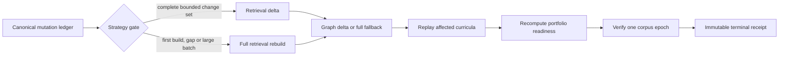

Incremental execution is permitted only when both prior projections exist, ledger
history begins at the next expected epoch and at most 5,000 object identities are
affected. Alias and edge mutations invalidate their endpoints; graph provenance
objects are included as dependencies. Any missing history, first build, explicit
parity check or oversized batch uses the established full builders. Both paths compute
complete content digests so a clean full rebuild can prove delta equivalence.

Retrieval, graph, curricula and terminal verification are separately receipted. A
restart skips completed phases. If the canonical epoch moves during a phase, the old
run fails closed and a later poll claims the newer epoch. Canonical evidence remains
available throughout; only derived readiness is stale. Curriculum evaluations now
retain exact query cases. A legacy evaluation without those cases becomes
`awaiting_rebaseline`, never silently current; after a one-time RI-009B v1.1 baseline,
the orchestrator can version and replay it after later corpus changes.

Mission Control and the fleet operation ledger show the target epoch, strategy,
current phase, pending changes, projection status, retry state and any rebaseline
requirement. A fully current, no-change poll performs zero projection work. Source
implementation is complete; migration `d2e8f5b13a70`, the v1.1 curriculum baseline,
the VM2 service and live delta/no-change/parity receipts remain the production proof.
