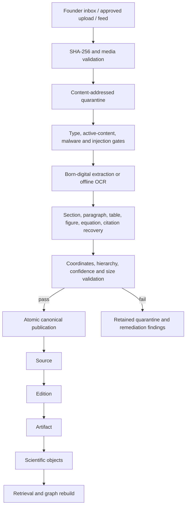
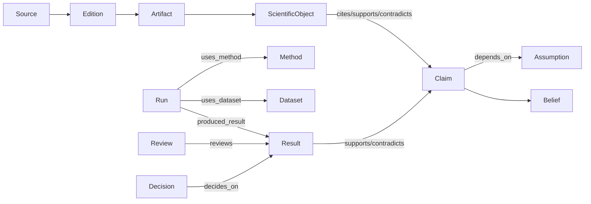

# 4. Research Intelligence

## 4.1 Purpose and non-authority

Research Intelligence is the institutional evidence and memory layer. PostgreSQL and
the object store hold canonical records; retrieval and graph tables are disposable
projections. RI can recover, classify, retrieve, compare, assemble and preserve
evidence. It cannot approve a hypothesis, start an experiment, promote a result or
allocate capital.

## 4.2 Ingestion pipeline

Files are never executed. Archives, active PDF content, instruction-like text,
oversized payloads, malformed structures and low-confidence extraction are bounded or
rejected. Original artifacts are retained for exact coordinate replay. PR 33 adds
offline Tesseract/PDFium recovery and raises the bounded scientific-ingestion limit to
100 MiB. The settled 2026-08-14 founder-inbox ledger covers 120 files: 117 are usable
canonical or duplicate-backed evidence and three remain explicitly quarantined. Of the
last twelve exceptions, governed recovery safely resolved nine. One PDF is structurally
unreadable by both parsers; two extract successfully but contain instruction-like text
that cannot cross the current evidence trust boundary without explicit quoted-evidence
semantics. No scanner rule was weakened to improve the count.

The Research Ingestion Recovery Steward is a deterministic fixed-command service. It
claims bounded recovery work, preserves original evidence, creates inert recovered
editions, enforces attempt ceilings, reconciles the inbox, and rebuilds retrieval and
graph projections after a settled batch. Its source and tests exist; activation on VM2
is a separate privileged systemd installation and must be observed before it is called
active.

## 4.3 Canonical object kernel

Implemented object types are source, edition, artifact, scientific object, claim,
method, assumption, dataset, run, result, review, decision, belief and episode.
Identity includes canonical UUID, content version/digest, producer identity and aliases,
project, access class, authority class and typed payload. References become canonical
lineage edges. Immutable identity conflicts fail rather than overwrite history.

## 4.4 Retrieval

The `canonical-scientific` projection supports:

- exact UUID, digest, alias and exact-text matching;
- lexical term-frequency similarity;
- deterministic network-free hashed-vector similarity with a small declared synonym
  map;
- graph-assisted expansion over canonical neighbors;
- deterministic reciprocal-rank fusion (`rrf-v1`);
- project, scientific type, access class and schema compatibility filters;
- stale-corpus detection and fail-closed projection version checks;
- reauthorization against the canonical object before returning content;
- exact source-coordinate replay.

The vector channel is a reproducible baseline, not a learned domain embedding model.
RI-011 adds a transactional `canonical-scientific` freshness row. Statement-level
database triggers advance its epoch and rolling digest after canonical object, edge or
alias changes; online status and query requests compare this snapshot with the
projection source epoch in constant time. Content digest, authorization scope, alias
and PostgreSQL full-text indexes support candidate selection. Every query first applies
project, access, schema and scientific-type policy, then hydrates at most 100 ranked
conjunctive candidates, 500 bounded partial-match candidates and 100 graph neighbors.
An eight-request admission semaphore rejects overload rather than allowing unbounded
concurrent work. Responses expose stage timings and candidate counts without exposing
protected content.

The production `hybrid-retrieval-v1.1.0` projection contains 623,375 scientific
objects. Its live benchmark measured 564.253 ms warm p95 and 1,228.084 ms concurrent
p95, below declared 2,000 ms and 5,000 ms SLOs. Evaluation `1.0.2` preserved complete
recall, citation, opposition, abstention and topic-coverage measures with zero measured
cross-domain leakage. Full projection rebuild remains an offline deployment operation;
it is not part of request latency.

## 4.5 Institutional memory

RI-004 implements supporting and opposing evidence, comparability review, valid
negative results versus invalid attempts, belief revisions, episodes and immutable
frozen dossiers. A dossier binds its query, evidence identities, citations, opposing
evidence and digest. Protected evidence can be represented as redacted existence and
access reason without disclosing content.

Operational memory is separate. It records system observations and lifecycle actions
such as assign, defer, resolve and reopen. It does not execute the noted work.

## 4.6 Corpus operations and synchronization

RI-005 provides content-free security findings, aggregate metrics/SLO state,
digest-bound metadata backup, empty-target restore, stale queue repair and projection
rebuild. RI-007 adds a durable sync run and item ledger for:

- the founder's Mac inbox;
- legacy Hermes research records;
- `imported-prior-results`;
- a bounded Bulletproof research-memory export.

Each eligible item must end as canonical, quarantined, duplicate, superseded, excluded
or failed with a reason. Raw Bulletproof memory and its multi-gigabyte lake are not
copied into Hermes; only a bounded digest-bound projection is registered.

## 4.7 Surveillance

RI-006 has allowlisted HTTPS feeds, rights/access metadata, fetch success/failure
receipts, duplicate/correction/retraction history, abstract poisoning rejection,
corpus-grounded novelty, technique briefs, proposal-only routing and weekly digest
freezing. It does not auto-adopt a paper or auto-create a live research trial.

## 4.8 Typed knowledge graph and cognitive services

RI-008, implemented in PR 34 and deployed on VM2 at this snapshot, adds:

- allowlisted predicates: `derived_from`, `supersedes`, `supports`, `contradicts`,
  `uses_method`, `uses_dataset`, `produced_result`, `reviews`, `decides_on`,
  `belongs_to_trial_family`, `depends_on` and `cites`;
- endpoint-type direction validation;
- half-open validity intervals and explicit provenance objects;
- edge access classes that cannot underclassify protected endpoints/provenance;
- digest-bound projection manifests;
- bounded neighborhood, simple-path and subgraph traversal with cycle protection;
- access filtering before traversal and stale-projection failure;
- citation-bearing context packs;
- deterministic decimal mean, sample standard deviation, Sharpe and maximum drawdown;
- persisted idempotent receipts binding tool/version/input/output/context/actor;
- a canonical Mission Control graph explorer.

The graph is not a graph database source of truth. Canonical IDs and edges remain in
the evidence kernel; the graph projection can be dropped and deterministically rebuilt.

The live projection observed on 2026-08-14 contains 623,729 nodes and 1,097,688 edges
under manifest digest
`e44e13f0c955cddcd09f1cb5054914ace1e79f4514116b6f15ac0654028cfeb9`.
That observation proves migration and rebuild, not domain expertise. A retained live
citation/context replay and cognitive-tool receipt remain the final RI-008 acceptance
evidence at this point in the snapshot.

## 4.9 Readiness boundary

The inbox reconciliation, graph freeze and first systematic-research curriculum gates
are satisfied. Upload count is not domain expertise, and retained quarantines remain
visible coverage facts rather than silent omissions. RI-009B now qualifies twelve
Research Bible domains independently. Strong performance in one domain cannot make a
failing domain available because portfolio readiness is an all-domain conjunction.

## 4.10 Domain curriculum and institutional-brain evaluation

RI-009 source at control-plane commit `e9b3db4` introduces a qualification layer above
the legacy domain profile. Each curriculum version binds to exact retrieval-corpus and
graph-manifest digests and declares:

- an acyclic ontology of topics and prerequisites;
- canonical evidence anchors and separate canonical source anchors, preventing many
  paragraphs from one book from masquerading as source diversity;
- required opposing evidence;
- allowed authority classes and a maximum quarantine fraction;
- qualified roles and a bounded review cadence.

Evaluation sets contain answerable, adversarial, cross-domain and mandatory abstention
cases. The service runs those cases through canonical hybrid retrieval and measures
retrieval recall, citation fidelity, opposing-evidence recall, abstention accuracy,
cross-domain leakage and topic coverage. Every threshold must pass. A changed corpus or
graph digest makes the qualification stale; source uploads do not silently preserve an
expertise claim.

RI-008 and RI-009 are production-qualified. RI-011 retained two failed benchmark
observations before qualification: corpus-wide hydration produced a 10.29-second warm
p95, and bounding hydration alone still produced 8.90 seconds because PostgreSQL ranked
the broad match set before limiting it. The final indexed two-tier candidate plan
closed that measured defect without weakening confidence or abstention thresholds.

RI-009B adds `research_curriculum_portfolios` as the immutable breadth dossier. The
qualified `1.0.1` portfolio contains exactly one curriculum and latest evaluation for
each of twelve required domains under one corpus and graph manifest. Each domain has
two distinct source anchors, supporting and opposing evidence, separate held-out
queries and an unknown-case abstention fixture. The retained `1.0.0` gap record proves
that aggregate qualification failed when regime and risk retrieval missed their
anchors. Recalibration changed query wording, not evidence identities.

Graph readiness no longer streams the full canonical graph for each gate. Canonical
object/edge mutations increment the existing database freshness epoch. Graph state
stores its build epoch and compares it in constant time; pre-epoch states perform one
exact digest comparison and adopt the current epoch only when the digest matches.
