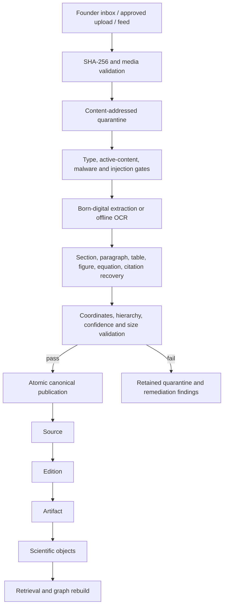
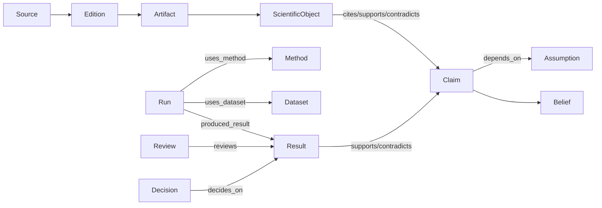

# 4. Research Intelligence

## 4.1 Purpose and non-authority

Research Intelligence is the institutional evidence and memory layer. PostgreSQL and
the object store hold canonical records; retrieval and graph tables are disposable
projections. RI can recover, classify, retrieve, compare, assemble and preserve
evidence. It cannot approve a hypothesis, start an experiment, promote a result or
allocate capital.

## 4.2 Ingestion pipeline

Files are never executed. Archives, active PDF content, instruction-like text,
oversized payloads, malformed structures and low-confidence extraction are bounded or
rejected. Original artifacts are retained for exact coordinate replay. PR 33 adds
offline Tesseract/PDFium recovery and raises the bounded scientific-ingestion limit to
100 MiB; the live 122-file inbox reconciliation is still running at this snapshot.

## 4.3 Canonical object kernel

Implemented object types are source, edition, artifact, scientific object, claim,
method, assumption, dataset, run, result, review, decision, belief and episode.
Identity includes canonical UUID, content version/digest, producer identity and aliases,
project, access class, authority class and typed payload. References become canonical
lineage edges. Immutable identity conflicts fail rather than overwrite history.

## 4.4 Retrieval

The `canonical-scientific` projection supports:

- exact UUID, digest, alias and exact-text matching;
- lexical term-frequency similarity;
- deterministic network-free hashed-vector similarity with a small declared synonym
  map;
- graph-assisted expansion over canonical neighbors;
- deterministic reciprocal-rank fusion (`rrf-v1`);
- project, scientific type, access class and schema compatibility filters;
- stale-corpus detection and fail-closed projection version checks;
- reauthorization against the canonical object before returning content;
- exact source-coordinate replay.

The vector channel is a reproducible baseline, not a learned domain embedding model.
Production relevance at full-corpus scale remains an evaluation obligation.

## 4.5 Institutional memory

RI-004 implements supporting and opposing evidence, comparability review, valid
negative results versus invalid attempts, belief revisions, episodes and immutable
frozen dossiers. A dossier binds its query, evidence identities, citations, opposing
evidence and digest. Protected evidence can be represented as redacted existence and
access reason without disclosing content.

Operational memory is separate. It records system observations and lifecycle actions
such as assign, defer, resolve and reopen. It does not execute the noted work.

## 4.6 Corpus operations and synchronization

RI-005 provides content-free security findings, aggregate metrics/SLO state,
digest-bound metadata backup, empty-target restore, stale queue repair and projection
rebuild. RI-007 adds a durable sync run and item ledger for:

- the founder's Mac inbox;
- legacy Hermes research records;
- `imported-prior-results`;
- a bounded Bulletproof research-memory export.

Each eligible item must end as canonical, quarantined, duplicate, superseded, excluded
or failed with a reason. Raw Bulletproof memory and its multi-gigabyte lake are not
copied into Hermes; only a bounded digest-bound projection is registered.

## 4.7 Surveillance

RI-006 has allowlisted HTTPS feeds, rights/access metadata, fetch success/failure
receipts, duplicate/correction/retraction history, abstract poisoning rejection,
corpus-grounded novelty, technique briefs, proposal-only routing and weekly digest
freezing. It does not auto-adopt a paper or auto-create a live research trial.

## 4.8 Typed knowledge graph and cognitive services

RI-008, implemented in PR 34 and awaiting deployment at this snapshot, adds:

- allowlisted predicates: `derived_from`, `supersedes`, `supports`, `contradicts`,
  `uses_method`, `uses_dataset`, `produced_result`, `reviews`, `decides_on`,
  `belongs_to_trial_family`, `depends_on` and `cites`;
- endpoint-type direction validation;
- half-open validity intervals and explicit provenance objects;
- edge access classes that cannot underclassify protected endpoints/provenance;
- digest-bound projection manifests;
- bounded neighborhood, simple-path and subgraph traversal with cycle protection;
- access filtering before traversal and stale-projection failure;
- citation-bearing context packs;
- deterministic decimal mean, sample standard deviation, Sharpe and maximum drawdown;
- persisted idempotent receipts binding tool/version/input/output/context/actor;
- a canonical Mission Control graph explorer.

The graph is not a graph database source of truth. Canonical IDs and edges remain in
the evidence kernel; the graph projection can be dropped and deterministically rebuilt.

## 4.9 Readiness boundary

RI-009 cannot be completed until the current inbox reconciliation finishes, unexplained
failures are resolved, RI-008 is deployed, and a stable corpus/graph snapshot is frozen.
RI-009 will then measure domain curricula, coverage, held-out retrieval, citation
fidelity, contradiction recall, calibration and abstention. Upload count is not domain
expertise.
