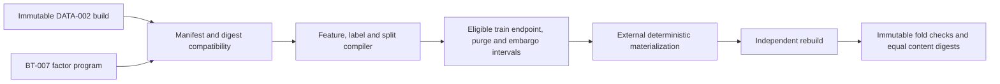
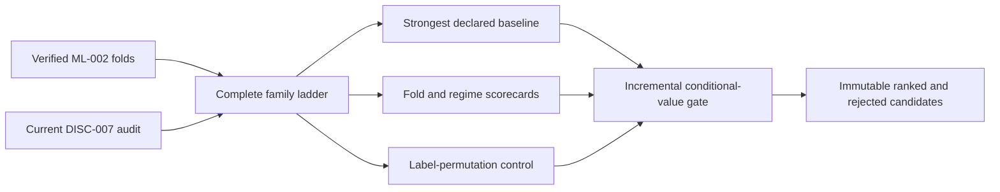

# 5. Bulletproof BT Laboratory

## 5.1 Engine purpose

Bulletproof BT is a deterministic, event-driven quantitative research engine. Its
declared invariant is same data plus same configuration yields semantically identical
outputs, with closed-bar strategy visibility, no interpolation and no silent cost or
risk assumptions. The latest exhaustive audit pin and dirty-tree boundary remain in the
implementation reference register; this chapter summarizes inspected capability, not
profitability or live certification.

## 5.2 Core engine composition

The classic run loop connects a historical feed, instrument/universe abstraction,
strategy, risk engine, execution model, portfolio accounting, metrics, benchmark and
artifact writers. Strategies receive a read-only context and emit typed `Signal`
objects; they do not mutate portfolio or execution internals.

### Data contracts

- UTC timezone-aware, monotonic timestamps;
- required OHLCV columns and OHLC consistency;
- duplicate detection and explicit missing-bar behavior;
- closed-bucket higher-timeframe resampling;
- market modes for 24/7 crypto, 24x5 FX and equity sessions;
- single-file data or manifest-backed dataset directories;
- no implicit interpolation.

### Execution and cost model

- maker/taker fees, spread, slippage and delayed execution;
- tiered or complete custom execution profiles;
- deterministic intrabar pricing;
- FX commission-per-lot and lot rounding;
- equity commission and cash-account behavior;
- basic futures/contract abstraction;
- explicit margin usage and rejection reasons.

### Risk and portfolio accounting

- stop-intent contract via explicit stop price/specification;
- stop-distance and percentage-equity sizing;
- tick/lot rounding and instrument contract size;
- margin-aware reservation and execution constraints;
- cash, positions, liquidation and R-multiple normalization;
- a separate portfolio engine for isolated strategy sleeves, allocation/coordinator
  checks and aggregated artifacts.

The separate portfolio engine is not yet evidence of a unified, certified same-clock
multi-strategy matching engine or production order router.

PORT-001 adds an evidence-only service beside this engine. It evaluates registered
research and prospective-shadow candidates jointly, but cannot admit a candidate,
allocate capital, mutate positions or submit orders.

## 5.3 Market and indicator capability

The documented V1 surface supports crypto, FX and equities with basic futures
abstraction. Streaming indicators include moving averages; RSI/Stochastic/CCI/ROC and
other oscillators; ATR, Bollinger, Keltner, Donchian and volatility measures; ADX,
MACD/PPO/TRIX and directional indicators; OBV/CMF/MFI and volume flows; Supertrend,
Parabolic SAR, pivots, Heikin-Ashi and candle/range features. Every indicator has an
explicit warmup and bar-by-bar update path.

## 5.4 Research data library

`bt.research_data` contains adapters and workflows for Binance, Bybit and OKX perpetual
futures, backfills, instrument refresh, stable/volatile universe manifests, causal
research panels, validation reports and forward-collected liquidation events.

BT-002 adds an immutable derived contract around explicit bounded Parquet partitions.
It records each partition's SHA-256, size, schema, row count, event and availability
ranges, duplicate count and gap count; binds those records to the BASE-002 canonical
identity; declares UTC/bar-clock semantics and a knowledge cutoff; validates
point-in-time membership; and retains append-only correction lineage. Missing bars
remain missing. Replaying the manifest against the source root detects changed bytes.
The builder writes only a JSON manifest outside source partitions and never repairs or
rewrites the lake.

This is a snapshot qualification boundary, not lake-wide certification. DATA-002 and
DATA-003 still own historical membership population, vendor correction ingestion,
entitlement policy, quality SLOs and recovery.

### 5.4.1 Point-in-time reference identity

DATA-001 supplies the canonical identity layer consumed beside Bulletproof dataset
manifests. An immutable, content-digested snapshot contains effective-dated venues,
stable instruments, venue listings, session calendars and corporate actions. Instrument
identity remains stable when a venue symbol changes; listing identity and revision
history retain the venue-specific representation.

Every temporal record has two clocks. `valid_from` and exclusive `valid_to` describe
when the fact applied in the market. `observed_at` and `available_at` describe when the
company could have known it. Resolution binds venue, symbol, effective time, knowledge
cutoff and optional snapshot digest, returning the exact instrument, listing, venue,
calendar, session state and then-known corporate actions. Unknown, overlapping or
conflicting identity fails closed rather than guessing from the present-day symbol map.

Snapshots cannot be mutated. A correction is a new revision with explicit ancestry;
snapshot replacement is an ordered supersession with a later knowledge clock. Dataset
manifests may bind the snapshot digest and must map every requested instrument to its
stable instrument, venue and listing identifiers. Consumers roll back by pinning a
prior digest.

The production proof runs on VM2 at migration `e2d7a4c91b60`. Snapshot
`16c689717341872f0b15d0324122ddbc749d2174197d8f3f4ea7faadf75e3871`
replayed both sides of a BTC venue-symbol change without changing stable identity,
replayed only the corporate action known by the cutoff, closed an explicit holiday and
rejected an unknown venue. The service is reference evidence only and has no order or
capital authority.

### 5.4.2 Immutable market-data catalog

DATA-002 promotes BT-002's bounded manifest primitives into the canonical catalog for
raw and curated laboratory inputs. Each immutable catalog snapshot binds an exact
DATA-001 reference digest and contains content-addressed partitions, universe
membership and source-availability records. It stores metadata and read-only URIs; it
does not copy, repair or mutate lake objects.

A partition binds dataset and layer, source, venue, stable instrument, listing,
timeframe, event interval, row count, schema and content digests, duplicate and gap
counts, observation and availability timestamps, revision ancestry and an explicit
read-only access mode. Registration proves the identity edges against DATA-001 and
rejects correction ancestry that changes the logical partition. Membership and source
availability carry their own effective and knowledge clocks.

Point-in-time resolution begins with DATA-001 symbol resolution, then requires a unique
covering partition, effective optional universe membership and an available source at
the requested knowledge cutoff. It selects only the latest correction known inside the
pinned catalog. A partition with duplicates or coverage gaps remains retainable as
evidence but cannot become a laboratory input. Unknown coverage, delayed/unavailable
sources, ambiguity, identity conflicts and lookahead all fail closed.

Production runs migration `f3e8b2c61d90`. The live proof bound catalog
`3c5352526ef607d02502144cf8623dc53098322c4bf84f8395e0650384aa2e07`
to DATA-001, replayed its corrected partition, and replayed the original revision by
pinning prior digest
`981c671b9959461804701c9b9661398b2b68b873f837f5762549f16a5ab233e4`.
The catalog grants no source-write, execution, order or capital authority. DATA-003
still owns continuous quality SLOs, entitlements, retention, storage and recovery.

### 5.4.3 Governed lake operations

DATA-003 completes the operational boundary around the immutable DATA-002 catalog. An
immutable governance snapshot binds one exact catalog digest to quality SLOs, lineage
edges, entitlement rules, storage budgets, retention holds, recovery manifests and
derived-publication records. This is metadata governance: protected source payload is
forbidden by the strict API schemas, source objects stay read-only, and no prompt or
evidence export receives their contents.

Admission is default-deny. A requested read or deletion must name an entitled
principal, action and purpose and pass schema, duplicate, gap, freshness and capacity
checks. A retention hold blocks deletion while preserving governed read access.
Lineage closes over declared upstream objects, and unknown principals, objects or
recovery members fail closed. Capacity warnings are observable before exhaustion;
exhaustion denies admission rather than silently degrading the lake.

Every decision and operation enters an append-only, digest-chained event ledger. A
derived publication can be disabled without mutating its source partitions. Restore
then requires the disabled state, an integrity-verified backup, the same catalog
digest and the exact declared object set. This makes rollback a replayable recovery
operation rather than an informal file copy.

Production runs migration `a4f9c3d72e10`. Snapshot
`0acbf36c-29d4-427d-a83b-f943b004d3ba` bound catalog
`3c5352526ef607d02502144cf8623dc53098322c4bf84f8395e0650384aa2e07`;
the live pilot passed nine admission, denial, retention, capacity, disable, restore,
visibility and protected-payload checks and retained six events. DATA-003 grants no
source-write, execution, order or capital authority.

### 5.4.4 BT-004 classic-engine certification

BT-004 preserves the existing classic event-driven engine and certifies its causal,
accounting and replay boundary rather than creating another simulator. Canonical events
carry UTC `event_time` and `available_at` clocks for market, session, funding, borrow,
valuation, decision, order, fill and liquidation paths. They sort deterministically by
availability, occurrence, kind, source, source sequence and identity. A decision may
bind only evidence available at its timestamp; the retained negative fixture rejects a
future funding observation.

Portfolio snapshots enforce `equity = cash + realized_pnl + unrealized_pnl` and
`free_margin = equity - used_margin`, with finite values and non-negative used margin.
Negative free margin remains a valid liquidation condition. State transitions bind the
prior digest, canonical event and resulting state. Checkpoints bind the contract
version, immutable dataset and configuration digests, last event key and state digest;
changed pins or state fail closed. Equal-timestamp historical bars now emit in stable
symbol order, and a quantile boundary uses a narrowly bounded equality tolerance so
platform floating-point noise cannot change a logically equal gate decision.

The retained pinned Python 3.11 validation reports 1,231 passing tests and 27 explicit
skips across the full repository.

### 5.4.5 BT-005 market-model qualification

BT-005 keeps the classic fee, spread, slippage/impact, bar-delay, market-fill,
reconciliation and diagnostic implementations as the sole authority. A versioned
market-model bundle describes each model's implementation, applicability, timestamp
semantics, parameters, uncertainty, stress range, calibration provenance, fallback
and incompatibilities. Declared Tier profiles are policy assumptions, not mislabeled
empirical estimates. An empirical replacement must bind an immutable calibration
dataset and preserve fit and holdout diagnostics.

Rebates, funding observations as cashflows, borrow availability/cost and
capacity-constrained fills are explicitly unsupported in the classic engine. A run
requiring them is rejected rather than treating an absent cost as zero. Atomic run
finalization requires `market_model_bundle.json`, verifies every card and bundle
digest, and matches it to lineage. Pessimistic stress cannot reduce modeled cost. The
retained pinned suite reports 1,237 passing tests and 27 explicit skips. BT-006 through
BT-008 retain their search, feature-lineage and publication boundaries.

### 5.4.6 BT-006 prospective search accounting

BT-006 preserves the existing hypothesis contract, constraint filtering, grid runner,
parallel execution, strict resume and worker resource controls. A prospective search
plan now binds the hypothesis, dataset snapshot, repository and code, BT-005 market
models, declared parameter values, exact included variants, tiers, seeds, resources,
budget, stopping rule and search family before evaluation. It records the raw
Cartesian size and exclusions rather than losing filtered combinations.

Each trial has a deterministic identity derived from the immutable plan, parameters,
tier and seed. Grid expansion creates a new plan and new trial identities. A SQLite
execution ledger registers trials exactly once, preserves identity across bounded
attempts, refuses terminal replay and cancels only unleased work. Registered manifests
carry plan, family, trial, seed and attempt fields; the runner validates and snapshots
the plan before launch. BT-003 run bundles now retain the same lineage.

Hermes remains the institutional Trial Registry and approval authority; the local
ledger is Bulletproof's execution projection. The pinned Python 3.11 suite reports
1,245 passes and 27 explicit skips. BT-007 owns feature and fit-boundary lineage, and
BT-008 owns canonical dual-memory publication.

### 5.4.7 BT-007 representation and fit-boundary certification

BT-007 preserves the immutable dataset snapshot, canonical research panel, classic
state-feature builders, hypothesis schemas and strategy implementations as the only
calculation authorities. A representation contract now binds the dataset and code,
decision and entity clocks, point-in-time universe membership and every representation,
feature and label's sources, transformation identity, implementation digest,
observation/availability clocks, warm-up, missingness, completeness, fitted state and
label horizon. It also fixes the train, validation, test, fit, purge and embargo
boundaries before evaluation.

The causal auditor replays a materialized frame and rejects future observations or
joins, revised information unavailable at decision time, premature labels, incomplete
higher-timeframe values, output during warm-up, undeclared missing values, duplicate
decision identities, point-in-time universe leakage, expired membership, rows outside
the registered evaluation range, overlapping splits, insufficient purge/embargo and
fit state learned outside training. Its certified report is deterministic and
digest-bound. A standalone CLI proves that a fresh process can rebuild the manifest
and audit from JSON plus Parquet rather than relying on hidden in-memory state.

BT-006 search plans now bind the representation digest. BT-003 finalization requires
both `representation_contract.json` and `representation_leakage_report.json`, verifies
their digests and refuses an uncertified report. Rollback stops new certification and
pins a previous transform while immutable failed audits remain available and dependent
descendants become stale. BT-008 still owns canonical Research Intelligence and
Bulletproof memory publication. The pinned Python 3.11 suite passes 1,258 tests with
27 explicit skips.

## 5.5 Experimentation and artifacts

Experiment support includes configuration layering, hypothesis contracts, grid
expansion, parallel hypothesis execution, resume/skip-completed behavior, dataset
extraction, cleanup and truth validation. A normal run emits resolved configuration,
performance, equity, trades, fills, decisions, bucket performance, cost breakdown,
summary, manifest, run status and optional benchmarks.

Truth checks cover missing evidence, duplicate truth fields, source timestamps after
entry, notional/risk consistency and artifact completeness. Selected JSON outputs have
deterministic serialization; timestamps and absolute run paths mean byte-for-byte
identity is not claimed for every file.

BT-003 adds the immutable publication boundary without replacing those artifacts. A
finalizer copies canonical textual artifacts into a same-filesystem staging directory,
assigns source-byte, publishable-byte and semantic SHA-256 digests, records media type
and structural schema identity, binds repository/code, BT-002 dataset, specification,
environment and attempt lineage, validates the bundle, and atomically renames it to a
content-addressed final directory. A failure or interruption leaves no partial bundle
and retains a redacted failed-attempt record.

Supported volatile run IDs, generated timestamps and output paths are excluded from
semantic identity while exact published bytes remain independently digest-bound. The
legacy run manifest is copied with stable runtime/data aliases and retains its original
source digest. Other absolute protected paths, likely secrets, symlinks, corrupt files,
unsupported binaries and unknown schemas fail closed. Repeated semantic publication is
idempotent and returns the existing receipt.

Hermes' canonical run payload now optionally carries the bundle digest, manifest
digest and `bundle://sha256/...` URI as an all-or-none reference. Bulletproof publishes
that record through the existing idempotent canonical-evidence endpoint; it does not
create another registry or store authorization material in artifacts.

BT-008 completes the next publication boundary. A finalized run now also carries its
market-model, representation and prospective search-plan digests. Hermes joins that
run to the existing registered trial, result, two independent reviews and institutional
decision, then atomically writes canonical result, review, decision and replay-dossier
objects plus an ordered publication event. It does not create another laboratory
registry. Negative, null, invalid and inconclusive outcomes are published by the same
path as positive outcomes.

Derived consumers advance in an explicit order. Current graph and retrieval projection
digests and epochs must be confirmed before Bulletproof writes the local
`research_memory_publications` row. That row is an idempotent consumer projection, not
institutional truth. A projection or memory outage records a retryable stage failure;
repeating the original request resumes the same publication identity and cannot delete
or replace its canonical evidence. The replay endpoint returns the canonical object
identities, both consumer receipts and the exact event transcript.

### 5.5.1 Classic execution authority and fast-path deprecation

The experimental backtest fast path is deprecated at Bulletproof merge
`e47f9f210c862a311f2e8b691f8148c393fb5ed0`. The default is `classic`. Legacy
configuration values `auto` and `fast_path` remain readable for compatibility, but
both deterministically select the classic event-driven engine and write
`fast_path_status.json` with the requested value, actual engine, deprecation state and
reason. New hypothesis/strategy generation is forbidden from adding compiled family
kernels or sparse candidate-event execution shortcuts.

This decision is an epistemic control, not merely a performance trade-off. The prior
work did not establish a universal, materially faster path that preserved exact
strategy visibility, volatile-universe membership, stop handling, fills, fees,
slippage, risk sizing, accounting and rich artifacts without excessive family-specific
complexity. Backtest accuracy therefore wins unconditionally. Reference modules remain
available for audit and historical compatibility, but they are not production
execution authority.

Semantics-neutral optimization remains allowed. Bounded-memory Parquet materialization,
streaming artifact writes, download concurrency and post-run analysis batching may
improve throughput when they preserve input bytes, ordering, causal timestamps and
canonical outputs. A filename containing `fast` does not grant backtest execution
authority.

### 5.5.2 Lagos demo execution activation

The Lagos EXEC2 host is the isolated venue-facing execution machine. On 2026-09-13,
Bulletproof commit `50c383e3caf24dcbe3a21275f26699316be5aa8b` ran the bounded
DEMO-001 mutation suite against Bybit's demo endpoint. Current instrument rules selected
the smallest permitted BTCUSDT order within a USD 250 demo-notional ceiling. The suite
observed submit, amend, cancel, rejection, entry fill, reduce-only exit, private-stream
reconnect and restart reconciliation, then proved zero open orders and a flat terminal
position. Replay-only drills covered partial-fill state, duplicate suppression, stale
data, incident retention and an independently journaled runtime kill. No live credential
or capital-bearing endpoint was consumed.

This is operational evidence, not a profitability result and not live authority. The
secret-free dossier has SHA-256
`a33139834e8372bd3ac99c2a36eb156c551cec80e3e796d49951f4788bac4483`.
The closure subsequently bound every exact upstream receipt and emitted qualified
DEMO-001 receipt `19750e4734a40ddda7d600a0fbc6eb96a5b2c8dc818ab5b718b0e078fba6b17f`.
EXEC-011 converted the protected venue history into 18 canonical events, six orders,
four fills and two trade episodes. Hermes admitted the exact receipt and Mission Control
reproduced the flat projection under digest
`bf8c4aa08145afc03c1810098503be3bf62f5384c23f264a624cff66871061ac`.

## 5.6 Research memory and Hermes bridge

The intended BT-009 founder path begins with an unrestricted plain-English scientific
question, not a fixed hypothesis enum. A dedicated hypothesis-creation role uses
read-only catalog and coverage interfaces over the locally available Binance and Bybit
perpetual lakes, plus Research Intelligence context and prior negative results, to draft
a causal, falsifiable hypothesis card. The founder approves that card before any code is
generated. Approval then permits a bounded engineering worktree to apply Bulletproof's
hypothesis/strategy-generation instructions and create or reuse the typed hypothesis
YAML, native `strategy.py`, feature adapters, logging declarations, tests and docs.

Independent schema, point-in-time, lookahead, timestamp, code-review and truth gates
must pass before a second immutable execution approval. Native classic Bulletproof then
runs the approved tier and finite grid, retains full decisions/state/trades/equity and
negative results, finalizes a digest-bound run bundle, and publishes receipts into both
Bulletproof memory and Hermes. Full lake availability is scientific read access, never
permission to expose raw data or credentials to an LLM or bypass coverage and provenance
checks. BT-004 through BT-008 qualified the component contracts, and BT-009 then
replayed this composition on VM2 with a bounded deterministic BTC perpetual fixture.
That replay registered and natively executed all 16 approved Tier2B variants, retained
the negative selected result, completed separate statistical and adversarial reviews,
published canonical run/result/review/decision/episode evidence, refreshed graph and
retrieval projections, and confirmed one idempotent Bulletproof-memory row. It proves
the governed lifecycle, not market performance or production eligibility.

The SQLite research memory stores completed trades, state buckets, verdicts,
recommendations and alpha candidates. Enriched derivative state includes funding, open
interest, basis, premium, crowding and constraint-stress fields. Similar-state queries
can use those dimensions. Recommendations remain proposed-only.

Hermes does not ingest the raw memory database. The VM1 memory steward opens the fixed
source read-only, exports bounded counts/candidates/summary text, binds it to a digest
and registers canonical evidence plus an RI-007 synchronization receipt.

## 5.7 Known engineering gaps

- BT-001 closes the recorded collection/dependency/fixture drift for the locked Python
  3.11 matrix using deterministic shards and restored canonical contracts. The engine
  and strategy catalog remain the existing Bulletproof implementation.
- Atomic run bundles, canonical result/review/decision/dossier publication and
  dual-memory receipts are complete under BT-003 and BT-008. BT-009 completed the
  composed founder-intake-to-native-execution VM2 replay; WS-001 owns the broader
  company walking skeleton.
- BT-002 point-in-time and correction proofs apply to selected snapshots; universal
  lake population remains DATA-001 through DATA-003 work.
- The deprecated fast path cannot satisfy or bypass BT-004 through BT-009 acceptance;
  all governed research execution uses the classic native engine unless a future,
  separately approved architecture proves exact semantic equivalence.
- SHADOW-001 establishes immutable no-capital prospective/replay evidence, but its
  bounded fixture rehearsal is not continuous public-feed operation and does not
  constitute venue-certified demo or live execution.
- Portfolio admission, allocation and capital mutation remain separately governed and
  cannot be inferred from a successful backtest.

### 5.8 Exchange execution readiness and telemetry boundary

Bulletproof includes meaningful execution foundations for Binance and Bybit: signed
REST adapters, public and private stream clients, instrument mapping, order and fill
lifecycle models, reconciliation, SQLite checkpoints, JSONL execution artifacts,
session summaries, kill controls, demo profiles, bounded live-canary profiles and a
simulated shadow runtime. The public Binance and Bybit perpetual research lakes are
separate from authenticated account execution telemetry.

These components do **not** make live or demo operation a keys-only setup. A venue
profile is usable only after least-privilege secret installation, environment and
account verification, clock and instrument-filter checks, public/private stream
readiness, restart recovery, REST-to-stream reconciliation, kill-switch rehearsal
and a current certification dossier. Bybit demo is now the first completed bounded
venue path. Binance private-stream parity and continuous compiled-strategy market
data execution remain release gates; live profiles are canaries, not general capital
authority.

Shadow execution belongs on VM1 initially. It consumes public/read-only venue feeds,
records prospective decisions and simulated fills, and cannot submit orders. Demo and
capital-bearing collectors/order services belong on the hardened EXEC2 venue host.
The production-activated `EXEC-011` bridge preserves only digests of protected raw venue
records while projecting normalized decision, intent, order, fill, position, cash,
fee, funding, margin, incident and reconciliation events into immutable trade episodes
compatible with classic-backtest reporting. Bulletproof owns normalization and replay;
Hermes verifies the exact producer receipt and retains a bounded sanitized projection.
Mission Control exposes explicit shadow/demo/live state, freshness, positions, cash,
orders, fills, completed episodes, incidents, reconciliation breaks and receipt,
projection and event-head lineage. Bybit demo has passed the authenticated and
in-session replay drills on EXEC2; Binance demo and every live environment still require
their own current qualification. The first EXEC1 allocation remains suitable for
independent fleet observation but failed the venue-egress boundary.

### 5.8.1 SHADOW-001 prospective journal and replay

SHADOW-001 extends the existing execution artifact boundary rather than adding another
strategy, fill, risk or accounting engine. An admitted shadow configuration must pin
SHA-256 identities for the candidate, immutable dataset snapshot, strategy
implementation and cost model, plus the exact repository commit, before the first
observation. Missing or malformed pins prevent the journal from opening. Its genesis
record permanently prohibits capital, live orders and venue mutation.

Every accepted decision, order intent, simulated fill, heartbeat, reconciliation and
incident is canonicalized into `prospective_journal.jsonl`. Each record carries a
monotonic sequence, stable event identity, timezone-aware observation time, payload
digest, prior-record digest and its own record digest. The append is flushed and
fsynced. Duplicate event identities are idempotently ignored. An unsealed chain can
resume after interruption by replaying and validating its prefix; a terminally sealed
chain rejects later appends.

The replay verifier independently checks schema, authority, bindings, sequences,
duplicate identities, payload hashes and the complete digest chain, and reproduces
event counts plus fee, slippage and spread totals. It fails closed on naive timestamps,
tampering, sequence gaps, changed bindings or post-seal records. Normal JSONL artifacts,
SQLite recovery state, reconciliation and incident outputs remain available and are
included with the journal and replay report in execution exports.

The retained 2026-08-25 pilot pins source commit
`58cbc5ac974080f572d58c1990558ca47043d984`, uses the explicitly non-alpha pipeline
smoke candidate and a deterministic market fixture, forces a disconnect/restart,
suppresses a redelivered decision, reconciles, seals, replays and rejects a modified
copy. Report digest
`745862c57511dacc02278fd6ec8a7243e28dea36c3389df653ab4c7b937d991f` binds sealed
journal digest `3a4dc409783061fae9e6aeb735dea96be4bb408fe084f916541e4514a66a4c46`.
The full pinned Python 3.11 suite passed 1,279 tests with 27 expected skips.

This proves the journal and replay contract, restart behavior and no-capital authority.
It does not prove a continuously running public-feed shadow, exchange connectivity,
execution-model calibration against venue observations, Hermes publication or Mission
Control session visibility. Those require separately retained operational evidence.

### 5.8.2 ML-001 reproducible model and calibration registry

ML-001 introduces an additive `bt.ml` boundary for predictive artifacts. It does not
replace BT-007 feature and fit-boundary authority or create a second research registry.
Every model bundle binds the scientific problem, immutable dataset snapshot, BT-007
representation, temporal split and source revision by SHA-256. Training, calibration
and protected evaluation windows are explicit timezone-aware intervals and must be
strictly ordered and disjoint; their canonical contract must reproduce the registered
split digest before fitting begins.

The first certified estimator is intentionally modest: a deterministic logistic
baseline implemented with NumPy, frozen training-set means and scales, fixed seed and
optimizer settings, and environment provenance. A separate held-out partition fits a
Platt calibrator. Evaluation retains raw and calibrated log loss and Brier score rather
than calling an in-sample score calibrated. The artifact also records feature order,
training support, coefficients, calibration parameters, uncertainty semantics,
abstention threshold and distribution-shift policy.

Model JSON is written atomically beneath its content digest. An SQLite registry stores
immutable family versions and append-only registration and activation events. Exactly
one model per family can be active. An independently attributed activation supersedes
the prior active version without deleting it; rollback is another attributed
activation of a retained digest. A deterministic, secret-free snapshot makes version
and event history independently reviewable.

Each inference receipt binds the model and input digests, observation timestamp,
calibration method, probability, uncertainty, applicability, abstention decision and
reason. Missing or extra features, naive timestamps, non-finite values, corrupt model
bytes and lineage drift fail closed. Inputs outside the registered normalized support
threshold abstain. Bundle and receipt JSON schemas are public repository contracts.

The retained 2026-08-25 fixture reproduced model digest
`5e3b8c80a494aaedb33dd61c8484fb59ed1f89254dec52724ebae82193e175a3`
from source commit `8dbfc4eaf9c2243ed5e035df68a4ae1dff05413d`. Registry snapshot digest
`1d738ee40118551ccfbeb3edabfea609b09a4319958fa55a3ee5772d78c3d605`
records two versions, challenger activation and rollback. Report digest
`7e3f250ffb54d5d6e194ad07cee4a065b2bb614ac8ce52f708b99f398bb5cd69`
retains held-out calibration, supported inference and shifted-input abstention.

This is contract and lifecycle evidence only. The fixture does not establish predictive
value, market transport, production latency, RI publication, strategy admission,
position sizing or capital authority. ML-002 through ML-005 own causal pipeline
construction, baselines, uncertainty/interpretability and monitoring before any later
consumer may seek separate authorization.

### 5.8.3 ML-002 causal feature, label and split pipelines

ML-002 adds the causal dataset boundary between immutable market data, the BT-007 factor
language and the ML-001 model registry. It does not copy source observations or define a
second feature language. A pipeline binds one DATA-002 dataset-build ID and content
digest to one active factor-program ID and compiled digest over the same dataset
manifest. Manifest drift fails closed.

Every feature declares its compiled factor, availability lag and missingness policy.
Every label declares its kind, horizon and `label_end_offset_bars`. Fitted transforms
have only one legal fit scope: `train_only`. The split contract supports explicit
half-open expanding walk-forward intervals with contiguous fold identity, a purge at
least as large as the maximum label end offset, a positive embargo between validation
folds and either uniform or inverse-label-overlap sample weights.

The compiler writes the latest eligible training observation and the exact purged and
embargoed intervals into each fold. Materialization cannot succeed by asserting a
boolean alone: its measured maximum training-label end and minimum validation-feature
time are checked against those compiled bounds. Every fold must also prove train-only
fit and point-in-time joins, and the independent rebuild digest must equal the original.

VM2 runs migration `e4a8c2d61f90`. The first live attempt stopped because the existing
factor program had a valid immutable manifest but no DATA-002 build receipt. The repair
registered the existing 1,200-row canonical source object, its digest, declared quality
checks and identical rebuild digest; it did not synthesize another dataset or weaken
lineage. Live pipeline `632fd11d-2bc9-4891-8eaa-e9269a080fd0` compiled two expanding
folds with two-bar purge and embargo and inverse-overlap weighting. Materialization
`86247c0e-04dc-4e52-85de-3ae60aff04a4` independently reproduced its content. ML-002
has no training, inference, promotion, order or capital authority.

### 5.8.4 ML-003 model-family and regime evaluation

ML-003 is the comparative evidence layer above ML-001 model bundles and an ML-002
causal materialization. It does not fit models or activate them. Registration requires
a current non-blocked DISC-007 audit and a complete ladder containing unconditional and
linear baselines plus supervised, unsupervised, regime and meta-label candidates. Every
candidate binds its model-bundle and prediction digests.

Each candidate covers the same causal folds in order and the exact required regime set.
Fold evidence retains the primary score, log loss and Brier score. Regime evidence
retains observation and positive/negative-label counts, making class-support claims
auditable. Qualification requires value above the strongest baseline, a minimum score
in every regime, bounded cross-regime dispersion, sufficient minority support and a
passing label-permutation control. Ranking does not override a failed gate, and failed
or merely weak families remain in the scorecard.

VM2 runs migration `e5b9d3f72a10`. Live evaluation
`25e3afbc-d0dd-4008-bdc0-9777fd8bb6b8` bound ML-002 materialization
`86247c0e-04dc-4e52-85de-3ae60aff04a4` and DISC-007 audit
`45b83a75-8831-4ced-a0f3-93a5d78e981e`. It retained six candidates. The strongest
baseline scored `0.54`; the regime specialist, supervised logistic and meta-label
families qualified, while the unsupervised family remained retained but below the
incremental-value gate. Scorecard digest
`2718faf445876f79d21443c5fa06ffd7203a5e487b53117bc66ee312426a9835`
replayed exactly. ML-003 has no training, activation, promotion, order or capital
authority.

### 5.8.5 ML-004 calibration, uncertainty and abstention

ML-004 is the institutional uncertainty gate above ML-001 model bundles and ML-003
comparative qualification. It deliberately reuses ML-001's held-out Platt calibration,
applicability and inference-receipt concepts rather than fitting or registering models a
second time. An immutable assessment binds one qualified ML-003 candidate and scorecard
digest to one RI-004 evidence dossier and digest.

The submitted contract contains ordered reliability bins spanning zero through one, a
held-out calibration method and version, split-conformal or block-bootstrap coverage,
regime applicability slices, a fidelity-scored interpretability receipt that prohibits
causal claims, and explicit abstention thresholds. The service independently recomputes
expected calibration error and checks that slice support labels agree with observation,
calibration and distribution-shift limits.

Four scenario receipts are mandatory: supported input, miscalibration, distribution
shift and low support. The latter three must abstain with the exact policy-derived reason;
excess uncertainty is also an abstention condition. Miscalibration, undercoverage,
misleading explanation fidelity, incorrect applicability or an incorrect abstention
receipt changes the result to `demotion_required`. Uncertainty therefore removes
authority instead of becoming decorative metadata.

Control-plane PR #185 merged at `dd367ac64c1f6dc4b7882a9265fa864f38334cfa` after
569 backend tests and all seven CI suites passed. VM2 runs migration `e6c1a4f83b20`.
Live assessment `5560e515-7ad5-4a92-80c2-e3b1482a502b` bound evaluation
`25e3afbc-d0dd-4008-bdc0-9777fd8bb6b8` and dossier
`af32b7a6-74c9-48c4-bb87-bc7433bdc07f`, recomputed expected calibration error
`0.01`, retained empirical coverage `0.91`, verified all mandatory abstention scenarios
and exactly replayed assessment digest
`0b79ef0dee22b7d26f0f79baf209a3d0733274a9310621d6cdd8c79d3e58b928`.
This deterministic live fixture proves the control path, not predictive skill. ML-004
has no training, activation, promotion, order or capital authority.

### 5.8.6 RL-001 offline-RL dataset and evaluation contract

RL-001 establishes whether historical behavior data is admissible for later conservative
off-policy evaluation. It does not estimate a learned policy. The control plane retains
an immutable contract and audit while canonical transitions remain in the DATA-002 data
layer and prospective execution evidence remains in Bulletproof's sealed, hash-chained
SHADOW-001 journal.

Each contract binds the DATA-002 build and record digest, sealed shadow-journal and exact
replay digests, behavior-policy identity, version and propensity source, causally
available state features, the complete bounded action space, per-action observations and
overlap, a reward formula with horizon and independent rebuild, episode definition and
termination counts, known confounders, and the permitted later evaluation estimators.
Unsupported actions must abstain and model selection data must remain separate from the
final evaluation sample.

The server independently checks source-build reproducibility and quality, transition
counts, timestamp ordering, duplicate transitions, state and reward availability,
propensity completeness, action support, propensity floors and importance-weight caps.
Any hard failure yields `quarantined`. Proxy and unobserved confounders are not erased by
qualification; they remain named limitations and prevent causal identification claims.

Control-plane PR #186 merged at `8a9c3ca65cf592fca0f4ef593ce95e4a2918c5cf`
after 580 backend tests and all seven CI suites passed. VM2 runs migration
`e7d2b5a94c30`. Live contract `807c244c-7574-43c2-a80a-4c6c6ea11d25` bound
DATA-002 build `72fba926-a6c3-49d5-8120-f301ba6ce9ea`, 1,000 transitions, 40
episodes and the retained SHADOW-001 evidence. Audit digest
`cc8f51b2df32316019f14592cac2d5b034987b155f6e88bcb6200ffee32f6989`
replayed exactly. Market impact remains a proxy and latent liquidity remains unobserved.
RL-001 has no policy-improvement, deployment, order or capital authority.

### 5.8.7 RL-002 conservative off-policy proposal evaluation

RL-002 evaluates whether a target-policy proposal has enough conservative evidence to
enter further shadow study. It does not train or deploy a policy. Registration requires
a qualified RL-001 dataset, a current non-blocked DISC-007 selection audit and a
qualified ML-004 calibration assessment whose candidate identity matches the proposal.

Each immutable proposal retains multiple digest-bound estimator receipts with point and
confidence estimates, effective sample sizes and maximum importance weights. It also
retains action overlap, extrapolation and unsupported actions, an independently rebuilt
reward model, and adversarial-reward, support-trimming, importance-weight-clipping and
cost-expansion stresses. Every estimator must have been permitted by the bound RL-001
contract.

The server derives the conservative value as the worst lower bound across every
estimator and required stress. It rejects values below the floor, estimator disagreement,
weak effective sample size, unsafe weights, weak overlap, excess extrapolation,
unsupported actions or any stress below the declared floor. A pass means only
`shadow_eligible`; it is neither causal identification nor promotion.

Control-plane PRs #187-#188 merged through
`78d4be17835b07fe8530b23768f5d2ca74d69656` after 596 backend tests and all
CI suites passed. VM2 runs migration `e8c3b6a05d40`. Live evaluation
`77bda11b-e6cc-4c00-a76d-6261ffbb73a1` bound RL-001 dataset
`807c244c-7574-43c2-a80a-4c6c6ea11d25`, DISC-007 audit
`45b83a75-8831-4ced-a0f3-93a5d78e981e` and ML-004 assessment
`5560e515-7ad5-4a92-80c2-e3b1482a502b`. Its worst lower bound was `0.016`,
estimator spread was `0.007`, and evaluation digest
`b14150114e7247e06a27952496cb2ad26f03d517341486093bdddbbe2c856938`
replayed exactly. RL-002 has no causal-policy, deployment, order or capital authority.

### 5.8.8 RISK-001 drawdown, tail and reverse-stress engine

RISK-001 is the immutable risk-admission layer between an evidence-only portfolio
candidate and later construction or capital decisions. It deliberately reuses the
classic Bulletproof laboratory: historical drawdown paths, Monte Carlo drawdown
distributions, ruin estimates and cost stress remain computed there. The control plane
binds those results through the BT-004 run digest, BT-005 cost-model digest, PORT-001
candidate digest, portfolio-state digest and a versioned scenario-pack digest.

Each request must include drawdown depth, duration, recovery and underwater-path
identity; VaR and expected shortfall with a conservative uncertainty upper bound; and
exactly five attributable failure mechanisms: price gap, correlation break, liquidity
freeze, model failure and prolonged drawdown. Each mechanism also carries a bounded
reverse-stress bracket identifying the first tested shock that crosses the declared
loss limit. The server independently derives the worst scenario, breached scenarios,
tail envelope, reverse thresholds and final decision.

Evidence age and upper uncertainty envelopes govern admission. Stale evidence, excess
drawdown, excess tail loss or any scenario breach produces `blocked`; callers cannot
submit their own decision. The persisted dossier is digest-addressed and replayable.
The production pilot registered assessment
`b7713035-e37d-4841-8ecc-acd809409de8` with dossier digest
`1860339b7bded1a112f5579b35a985260919502c4ee4ee1c0a2884f73afeeed4`.
Its deterministic fixture was admissible, included model failure, and replayed exactly.
That proves the control path, not the economic validity of a portfolio. RISK-001 has no
allocation, order or capital authority.

### 5.8.9 RISK-002 leverage, margin, liquidation and rule engine

RISK-002 converts venue constraints into immutable, point-in-time decision evidence.
It reuses DATA-001 to resolve the one listing revision effective and known at the
evaluation clock, binds an admissible RISK-001 dossier, and retains Bulletproof's
existing position, leverage, funding and forced-liquidation telemetry. It does not
replace the engine, size positions or communicate with an exchange.

A rule pack identifies its source and digest, observed and available clocks, effective
interval, lifecycle transition, predecessor, and active/suspended/retired state. Its
margin tiers must start at zero, remain contiguous and carry maximum leverage,
maintenance rate and maintenance amount. The pack also defines exact price and
quantity increments, maximum mark/index deviation, funding bound and minimum
liquidation buffer.

For each digest-bound position state the server selects the applicable tier and derives
notional, initial margin, maintenance margin, long/short unrealized PnL, equity after
funding and fees, mark deviation, effective funding rate and liquidation buffer. It
then produces `allowed` only when every hard constraint passes. Unknown, future,
stale, inactive, expired, ambiguous or malformed rule state fails closed. Historical
listing revisions remain retained but are filtered by effective and knowledge clocks.

The VM2 pilot registered evaluation `8ed31a3e-8dae-469b-b636-79dd68bdf682`
against live DATA-001 and RISK-001 records and replayed receipt
`10d5294738b2188e3d5a221ee0d96cacee2c7e4d94abe3db58bf82b231164d1b`
exactly. Its limits are deterministic test fixtures, not current Binance rules. The
receipt has no allocation, order or capital authority.

### 5.8.10 PORT-001 portfolio-candidate risk service

PORT-001 adds `bt.portfolio_engine.candidate_service` without replacing the classic
engine, the sleeve runner, `PortfolioRiskCoordinator`, or execution adapters. Its input
contract requires a portfolio-eligible candidate identity; registered research and
prospective-shadow evidence digests; one forecast horizon; expected net return and
uncertainty; turnover and cost; stressed capacity; named market scenarios; common
instrument, venue, data, model and infrastructure dependencies; and timezone-aware net
returns on an identical observation set. Missing overlap is unknown dependence and
fails closed rather than receiving diversification credit.

The service estimates exact-overlap sample covariance and correlation, then forms a
conservative joint-dependency matrix by taking the larger of absolute statistical
dependence and shared operational/economic dependence for each pair. The transparent
benchmark scales inverse volatility after adding declared forecast uncertainty. A
deterministic water-filling step respects stressed-capacity, candidate and family caps.
It does not relax an infeasible problem.

Hard checks cover unit weight, candidate and family concentration, Herfindahl
concentration, weighted joint dependency and the worst of cost expansion and named
regime scenarios. Every check and binding rejection is retained. Equal canonical
inputs, including evaluation time and registry snapshot, reproduce the same dossier
digest. The public JSON schema requires `allocated: false` and prohibits portfolio
allocation, capital, orders and self-promotion.

The retained fixture at source commit
`4eaf836d2b0f9a1de4730b2141847cc7d073e40a` reproduced candidate-set digest
`43a0bd21e8c1286b13e1c4de9010c19580e543cd9b2402cdfc0bb31b2e43b325` and dossier
digest `3ab51287d89cfdc02a04b4ba1014a85a6716b1a55a086da43d74d4867a3378bd`.
Its report digest is
`98964cfa2fd0afd65208330bf50f6b25c3eff99d9e0faa9723efca0a6843e555`.
The full Python 3.11 suite passed 1,294 tests with 27 declared skips. Separate dossiers
prove rejection of missing overlap, infeasible stressed capacity and excessive scenario
loss. These are deterministic fixtures, not market-performance or production-allocation
evidence. PORT-002 now owns the richer dependence model. PORT-003 through PORT-004
and later risk packets own optimization, allocation registry, path stress and governed
admission.

### 5.8.11 PORT-002 dependency, diversification and concentration service

PORT-002 is implemented in `bt.institutional.portfolio`, not in Hermes. It binds an
admitted PORT-001 dossier to an exact common observation window, state labels, shared
economic and operational exposures, dataset and source commits, freshness limits and
concentration policy. It measures overall and state-conditioned correlation with
confidence intervals, empirical lower-tail dependence and shared-exposure dependence.
The maximum of these channels forms a conservative joint-dependency score.

Deterministic connected components turn the joint-dependency matrix into clusters.
The dossier reports cluster and shared-exposure weights, HHI, effective candidate count,
portfolio volatility, weighted standalone volatility, diversification ratio and a
correlation-convergence stress. Missing overlap earns no diversification credit. Sparse
state histories, stale windows, inconsistent state labels, undefined dependence and
limit breaches are retained as failures.

Bulletproof merge `79caf1d` produced immutable receipt `70f4ff80...`. The full suite
passed 1,319 tests with 27 declared skips. Hermes merge `3a2a38b` adds only receipt
validation and registration, and VM2 replayed the receipt exactly as record
`5c55f791-227a-4c40-a86a-301eec866b9e`. The deterministic fixture proves the service
and ownership boundary, not portfolio fitness or alpha. PORT-002 never changes weights
and grants no allocation, capital, order or promotion authority.

### 5.8.12 PORT-003 construction benchmarks and robust optimizer registry

PORT-003 keeps construction mathematics in `bt.institutional.construction`. The
producer binds qualified PORT-002 dependency and RISK-001 risk receipts to expected
returns, uncertainty, covariance, prior weights, explicit bounds, turnover and
sensitivity limits, rounding increment and an exact versioned solver specification.
It regularizes covariance with declared shrinkage and retains equal-weight and
inverse-volatility risk-budget portfolios as its benchmark ladder.

The projected-gradient robust mean-variance candidate is accepted only when it is
feasible, deterministic, within turnover and perturbation-sensitivity limits, exactly
rounded to the configured increment and better than the strongest qualified benchmark
under the declared robust objective. Otherwise Bulletproof selects the deterministic
benchmark and records why. Impossible bounds and materially indefinite covariance fail
closed rather than producing a portfolio.

Bulletproof merge `866e1c1c` produced source-bound receipt `c196ca8f...`; 1,326 tests
passed with 27 declared skips. Hermes merge `ffbb9bc5` adds the versioned solver
identity and receipt verifier only. VM2 registered solver `902a8423...` and replayed
the receipt exactly as record `63ef6757-137c-4712-9d13-1b4e2b15a4cf`. This is
construction evidence, not permission to allocate capital or send orders. PORT-004
and the later live gates retain those separate decision rights.

### 5.8.13 EXEC-001 canonical market/order event and clock service

EXEC-001 extends Bulletproof's typed runtime events, lifecycle journal and checkpoints
with one immutable canonical envelope. Source and stream epoch, event identity, kind,
instrument identity, event and receive clocks, source sequence, payload digest,
correction lineage and event digest travel together. Receive time is the knowledge
boundary: a point-in-time replay cannot include an event that had not yet arrived.

The SQLite journal is append-only. Exact duplicates are idempotent, while reuse of an
identity with different content is rejected. Sequence gaps and late arrivals remain
explicit evidence. Corrections append a new event and supersede the prior event only
in the derived projection; history is never rewritten. Replay ordering is deterministic
and does not silently substitute database insertion order for source chronology.

Bulletproof merge `22e0bda5` produced receipt `63e1a21d...`; 1,334 tests passed with
27 declared skips. Hermes merge `8e53f935` registers schema `b3355f73...` and verifies
the receipt without reconstructing state. VM2 stored schema `c596717e...` and receipt
record `5cab237f-bc51-4a13-b8ef-c8426fd3da5d`. The retained fixture proves a late
`1,3,2` stream can reconstruct deterministically after its gap closes. It is not an
authenticated venue-stream certification and grants no permission to send orders.

### 5.8.14 EXEC-002 market-microstructure state models

EXEC-002 keeps market-state mathematics in `bt.institutional.microstructure`. It
consumes the canonical EXEC-001 journal only through a declared receive-time cutoff
and reconstructs best bid and ask, spread, depth and trade imbalance, mark-index
basis, funding, open interest and liquidation evidence. The producer also binds its
valid EXEC-001 and DATA-003 receipts, exact source-event digests and model identity.

Each field is independently `observed`, `inferred` or `unavailable`. Source event IDs,
limitations and uncertainty travel with the value. A crossed book fails closed;
missing levels do not become zero; a venue reset clears earlier state; delayed funding
and open interest expire; and a liquidation proxy remains explicitly model-dependent
rather than masquerading as an exchange-reported liquidation.

Bulletproof merge `adcbc093` produced receipt `19881008...`; 1,343 tests passed with
27 declared skips. Hermes merge `6c913021` adds model identity and receipt verification
only. VM2 registered model `59a5d26a...` and replayed the exact receipt as record
`708a844a-5023-4123-b934-8471acd01a70`, preserving state digest `808b035c...`.
This proves deterministic fixture reconstruction and cross-repository replay. It does
not prove live exchange continuity, microstructure alpha or authority to send orders.

### 5.8.15 EXEC-003 venue identity and fragmentation service

EXEC-003 keeps cross-venue identity mathematics in `bt.institutional.venue`. It
consumes the admitted DATA-001, EXEC-001 and EXEC-002 receipts and produces an
effective-dated view of venue-specific instruments, explicitly declared equivalence
groups and directional comparison routes. A shared symbol is never evidence of
fungibility. Base, instrument type, quote, settlement, margin asset, inverse/linear
form and expiry must agree before a relationship can be economically equivalent.

Every identity retains contract size, price tick, quantity step, minimum quantity and
minimum notional. Directional routes preserve the target venue's constraints and an
explicit contract conversion ratio. Delisted or future-effective instruments,
incompatible settlement, ambiguous active relationships, naive clocks and stale or
unavailable venue observations fail closed or remain quarantined. Outage handling can
remove a venue from comparison without rewriting historical identity evidence.

Bulletproof source commit `ef842db13d2775c2edbf8c372224d4ad9a964814` is locally
qualified by fourteen focused tests, the 1,366-test full suite with 28 declared skips,
and Ruff, and merged through PR #285 as `6ea7656aa744d4a9356d71854b9727535dec1230`.
Its deterministic two-venue pilot
produced mapping-schema digest `ae6a8354...`, mapping digest `605c8ae3...` and receipt
`082e20bd...`, while marking both routes `order_route_eligible: false`. Hermes commit
`1d01d461208d7cbbfcc3b9d31102a42f2114f965` adds migration `e4f8b2d05c30`, the
immutable schema registry and receipt verifier; its 730-test backend suite and Ruff
pass, and PR #224 merged as `6477a0bc2b162d8142b6108ae804ecf1bf1ed012`.
Hermes does not calculate mappings. This is identity and analytical-fragmentation
evidence, not connector certification, routing advice, capital authority or permission
to submit an order. On 2026-09-12 VM2 reached migration `e4f8b2d05c30` on healthy
rebuilt image `sha256:efe6afd82de5...`; schema record `e498a6cc...` and quantitative
receipt record `f9322c93...` replayed the exact native digests. Terminal report digest
`419af247...` retained two comparison routes and `capital_or_order_authority: false`.
EXEC-003 is therefore production-replayed for its declared no-order boundary.

### 5.8.16 EXEC-004 idempotent order management and reconciliation

EXEC-004 keeps order-state truth in `bt.institutional.oms`. A command receives a
deterministic client identity derived from its immutable contents. Replaying that
command returns the prior result; reusing the identity with different contents fails
closed. The append-only journal records commands, acknowledgements, partial and final
fills, cancel intent, cancellation, rejection and reconciliation without allowing a
terminal order to regress into an active state.

Recovery never assumes that a timeout means an order was not accepted. Unknown
submissions are resolved only against a fresh independent venue snapshot. Orders,
fills, positions and balances are reconciled as separate domains; duplicate venue
events are suppressed, while missing, conflicting or stale evidence causes
`freeze_and_investigate`. That freeze prevents a second submission until ambiguity is
removed. This is the core invariant behind the milestone: uncertain state cannot
silently become another order.

Bulletproof source commit `b0865ca1d2aa57acac1015d8ba088c34bf0fb2c4` merged through
PR #286 as `e7100d9345ef419d0deccdee49bc1c6e4896e610`. Eighteen new native tests,
28 combined focused tests, the 1,379-test full suite with 28 declared skips and Ruff
passed. Its pilot suppressed one duplicate command, recovered one ambiguous
submission and froze on a stale adversarial snapshot. Producer receipt `4a35c722...`
binds specification `4b102ffd...`, journal `7d510e21...` and reconciliation
`ef6435f3...`; the report SHA-256 is `2080397b...`.

Hermes commit `c2604a76bffa271e44630dedbbcea751aa74767c` merged through PR #225 as
`cdd6179291ee5acbf3fc08b69a830061a905c398`. It adds migration `e5a9c3f16d40`, an
immutable OMS-schema registry and exact producer-receipt admission. Its 15 focused
and 734 full backend tests passed. Hermes does not calculate order state and has no
submission, cancellation or capital authority. On 2026-09-12 VM2 reached migration
`e5a9c3f16d40` on healthy rebuilt image `sha256:63eb575d2329...`. The live replay
registered OMS schema `2f823ef3...` and quantitative receipt `9e572f47...`, reproduced
the native specification, journal, reconciliation and receipt digests, and retained
terminal report digest `d2346e63...`. It returned `submission_allowed: true` only
after qualified reconciliation and still reported `capital_or_order_authority:
false`. EXEC-004 is therefore production-replayed for its declared no-order boundary;
adapter certification and permissioned execution remain later gates.

### 5.8.17 EXEC-005 execution-quality calibration

EXEC-005 keeps execution-calibration truth inside
`bt.institutional.execution_calibration`. It consumes immutable execution observations
through a declared knowledge cutoff and estimates fill and partial-fill behavior,
acknowledgement and fill latency, signed implementation shortfall, model error and
post-fill adverse selection. Results are stratified by venue, order type, size bucket
and regime. Calibration and holdout observations cannot overlap, future-available
evidence is excluded, and every source event is digest-bound.

Qualification is prospective rather than an acceptance-rate shortcut. Each stratum
must meet declared calibration and holdout sample minima, censoring limits and holdout
cost-shift tolerance. A sparse, heavily censored, shifted or unavailable stratum emits
an explicit pessimistic fallback. It cannot silently inherit an optimistic empirical
cost. The resulting empirical bundle reuses the BT-005 market-model contract and
remains an input to later portfolio, risk and execution gates; it has no order,
capital, allocation, promotion, routing or cancellation authority.

Bulletproof source commit `d6cde7665385732d0f49deafbaac324161da33d9` merged through
PR #287 as `97d20db19b81054b729c0fb11a2ca1657aa4c632`. Fifteen focused tests,
all CI collection/lint/contract shards and Ruff passed. The supported local suite
passed 1,394 tests with 28 declared skips; five volatile-panel failures were reproduced
unchanged in the untouched EXEC-004 checkout under the shared local environment. The
native pilot excluded one future observation and selected a 5 bps pessimistic fallback
for a sparse stratum. Receipt `fc819372...` binds calibration `e1aa6787...` and
empirical market-model bundle `e46c1ea0...`.

Hermes source commit `7bd40a980d93c22c800f26ed0d217e00798d3385` merged through
PR #226 as `5906127939090b30a114efdf1d9d243d85fdebde`. It adds only migration
`f6b2d8a47e50`, immutable schema registration, exact authoritative-producer receipt
admission and replay tooling. Its 738-test backend suite and all required CI gates
passed. On 2026-09-12 VM2 reached that migration on healthy rebuilt image
`sha256:6e2199467f35...`; the route is present in the live OpenAPI surface. The exact
credentialed replay registered schema `88d60d24...` and quantitative receipt
`a08d562a...`, reproduced every native digest and retained terminal report digest
`f061249f...`. It still does not claim that current venue observations qualify any
live execution stratum; the admitted fixture proves the governed calibration path.

### 5.8.18 PORT-004 turnover, cost, capacity and liquidity service

PORT-004 keeps portfolio feasibility calculations in `bt.institutional.capacity`.
It composes the selected PORT-003 construction with the exact EXEC-005 execution
calibration and point-in-time liquidity snapshots. The service calculates gross-L1
and one-way turnover, candidate participation/depth/cost/liquidation constraints,
base and stressed cost-capacity curves, and expected return net of rebalance costs.

Every snapshot names the candidate, venue, listing, order type, size bucket and regime
and binds observed and available clocks plus its source digest. Future-only, stale,
missing, duplicated-conflicting or calibration-mismatched evidence cannot inherit a
capacity estimate. The service then returns `abstain_zero_executable_capacity` and
zero `capacity_supported_notional`. Stress costs cannot improve on base costs and
stressed capacity cannot exceed base capacity. These outputs are analytical evidence,
not permission to allocate or trade.

Bulletproof source commit `159a79b7ee1bbf19e6208c8b5216fb0046178d44` merged through
PR #288 as `ccddacee049dbc97d6bba5912f623a4d8345a8bd`. Fourteen focused tests,
all required CI shards and Ruff passed. The supported local suite passed 1,408 tests
with 28 declared skips; five volatile-panel failures remain independently reproduced
in the untouched EXEC-004 checkout. Native receipt `8c2dc060...` binds schema
`4f2d3384...` and capacity dossier `ef30b343...`. The deterministic fixture reports
`$230,000` base capacity, `$140,000` stressed capacity, `$20,000` turnover and
`$100,000` supported analytical notional; stale evidence returns zero.

Hermes source commit `75ed1eb9cbdae2d128e011d83aae3484747b59b7` merged through
PR #227 as `6097eb39a02ad1f6ca0849783d3731d4fc29480d`. It adds only migration
`a7c3e9b58f60`, an immutable schema registry, exact receipt admission and replay
tooling. Its 742-test backend suite and required CI gates passed. VM2 runs the healthy
rebuilt image `sha256:5b9d598d6fa1...`, and the live OpenAPI route is installed. The
credentialed replay registered schema `1ceb8bc7-49ff-4627-ba15-0a25d978cbe5` and
quantitative receipt `b4999dba-e29d-44d9-9a27-19c3be0bf0c6`, reproduced the native
digests and retained terminal report digest `de5d0965038cca501fd15477951a0e9af1e6f4d8605dccced8ffcb483c8e9edd`.
No live Bybit or Binance capacity is inferred from the deterministic fixture.

### 5.8.19 RISK-003 dynamic risk budgets and regime scaling

RISK-003 keeps every dynamic risk calculation in
`bt.institutional.risk_budget`. It consumes exact qualified receipts from RISK-001,
RISK-002, ML-004 and PORT-004, then applies causal volatility, regime, confidence,
uncertainty, hysteresis, recovery-delay, expiry and capacity controls. Each state binds
its source digest and observed/available clocks. Future-only state is excluded.
Missing, stale, unknown-regime or zero-capacity evidence selects a static conservative
fallback instead of borrowing confidence from an earlier regime.

Risk reductions take effect immediately. Risk increases require consecutive recovery
observations and cannot exceed the declared upward step. Thus volatility shocks,
regime deterioration, lower confidence or higher uncertainty cannot increase the
recommended budget. PORT-004 caps the capital base before the risk fraction becomes a
risk notional. The producer emits a complete immutable trajectory and grants no
allocation, capital, order or promotion authority.

Bulletproof source commit `f5d80f97b318ba14f84863595cc8e0740dca0de6` merged through
PR #289 as `24ea8c5d44a76ed85097a14aacdfdadfb6fc97a6`. Seventeen focused
tests, all CI shards and the full 1,430-test suite with 28 declared skips passed. The
native pilot produced receipt `e21533c0fa1a2242c16005f4daba206134af5aadb13ea69107789cc4643fde61`,
policy-schema digest `bd876f5de05e0a90a06f29ae3db1a29b1e16c736af4dcc5f897afdf31d05b367`
and budget digest `6c27f2da9713157cc58ad45f9bda4f4519b24703ff68c74201fdb1d5cf752f0b`.
The deterministic shock path cut risk immediately, delayed and bounded its recovery,
and ended at `0.3%`, or `$300` against `$100,000` supported capacity. Expired state
selected the `0.25%` static fallback.

Hermes source commit `a987a9f` merged through PR #228 as
`3d0535787e434837fd8fdcda0049e460401e970d`. It adds only migration
`b8d4f0c69a71`, an immutable schema registry, exact native-receipt admission and replay
tooling. Its 746-test backend suite, focused tests, Ruff and single-head migration
check passed. VM2 runs that migration and healthy rebuilt image
`sha256:b9dd898a560585c6179217f05175c5a6cb7a5491a77d19291637f3ef392939cc`.
The credentialed replay registered schema `e16641dc-8267-4f0f-9610-99433cc66f83`
and quantitative receipt `261a8c36-2126-4c80-9e52-f8429b15acb1`, reproduced the
native schema, budget and receipt digests, confirmed uncertainty monotonicity and
retained report digest `475d6bcbf40da4a3307c84b0e4f2b88cb01dec6882eea3cc018e208ac4485d9b`.
The replay's `0.3%` recommendation and `$300` fixture notional remain evidence of
deterministic mechanics, not capital or order authority.

### 5.8.20 SHADOW-002 prospective monitoring and re-evaluation

SHADOW-002 keeps candidate-health calculation in
`bt.institutional.shadow_monitoring`. The producer consumes an exact candidate digest,
a sealed SHADOW-001 journal replay, causal observations, a fixed monitoring policy and
prior monitoring or review state. Every observation carries observed and available
clocks; future evidence is excluded. The policy evaluates data lag, monitored-service
availability, prediction drift, execution-cost drift, drawdown, repeated breaches and
scheduled review without looking ahead or mutating prior evidence.

Failure is deliberately asymmetric. One breach freezes the candidate and requests
review. Repeated breach requests demotion even if a later sample in the same batch
looks healthy. Recovery after a freeze requests independent reactivation review; it
never restores eligibility automatically. Missing or stale evidence also freezes.
The output is an immutable monitoring receipt with no allocation, capital, order,
promotion, demotion or reactivation authority. RISK-004 remains the separate lifecycle
decision boundary.

Bulletproof source commit `8524f95f2fdebdac361c40ce0e990ba26ef35491`
merged through PR #290 as `87645886038ba8803d9540cf602e79da894182ce`.
Twenty-five focused tests, all CI shards and the full 1,451-test suite with 28 declared
skips passed. Native receipt `3a967a39f60b5d36f77645ecfd333b60252a2d50d887534035ab42cf15e071df`
binds policy digest `1676a85b16c310f8b117c30618e99d0791c7ca8472c9069b008a1b9abf559d4a`,
monitoring digest `0068cd261e651fa8a290998d669bc7e5a8b16402ee2baf334c11e591a5b09e56`
and sealed SHADOW-001 replay digest
`7b56e39a83529c6a7c1f9be00f8ef583975060b52d9401d4d28eea2454a778d1`.

Hermes source commit `b4bb884f8107258b6d1cb43aac0dced9785f24fc` merged through PR
#229 as `6891a1261bb80c1e1fd5c94572a34da7ccc188a4`. It adds only migration
`c9f5a1d72b80`, immutable schema registration, exact native-receipt admission and replay
tooling. Its 750-test backend suite and required CI gates passed. VM2 runs the healthy
rebuilt image `sha256:af2cb3734af40a1d9c39841df42e24e035d903bfe939340f97b97515179f0f87`.
The credentialed replay registered schema `2d5ca3f3-333f-4317-ab73-80c74cd4ae36`
and quantitative receipt `4073a8a1-b652-4edd-b7d0-a61445b95537`, reproduced the
native digests and retained report digest
`8aaa934cc04e40a371966588717790dd3828dddce8cdac881b0e86227dc7e87e`.
This proves the deployed monitoring machinery and its fail-closed transitions. It does
not claim that a genuine candidate has yet completed a sustained live-feed shadow
interval.

### 5.8.21 RISK-004 candidate admission and lifecycle authority

RISK-004 separates scientific recommendation from institutional authority. Bulletproof's
`bt.institutional.candidate_admission` producer verifies the PORT-001 dossier plus exact
PORT-002 through PORT-004, RISK-001 through RISK-003 and SHADOW-002 receipts. Candidate
and dataset bindings must agree, evidence must be causal and unexpired, positive
requests must remain within the current risk budget, and admission, allocation,
scaling, demotion and retirement remain distinct immutable recommendations.

The Bulletproof receipt has no transition, allocation, capital, order or promotion
authority. Hermes admits it only against an active digest-exact schema, then requires
one fresh receipt matching the candidate, action and expiry before a portfolio-candidate
promotion or capital qualification/allocation can reach GOV-003. GOV-003 still resolves
the accountable actor, separation of duties, vetoes, optimistic lifecycle version and
immutable consequence chain. Thus neither research success nor monitoring output can
silently become money.

Bulletproof source `ecad17a36167845c7035b1302847b4455130e045` merged through PR
#291 as `24c25839bcc22178cee1c1bb06153bf1e12c06f8`; 28 focused tests, every
CI shard and the full 1,458-test suite with 28 declared skips passed. Hermes source
`17ceffc` merged through PR #230 as `9b1d68991dfec574769aa54b7ccbf43eddeb75b9`;
34 focused and 754 full backend tests passed. VM2 runs migration `d1a6b4e83c90`, healthy
image `sha256:060e7cd322a923c168b5f30dca4ee446dd816a63aa84f8ea1447054844e445e6`
and active schema `2b4748c2-3052-4e3b-a706-e17698216324`. Deployment registered the
policy boundary only. The first real receipt and lifecycle decision must come from a
genuine eligible candidate and independent approval.

### 5.8.22 RISK-005 real-time deterministic risk service

RISK-005 turns the existing hard controls into a per-order, deterministic decision
boundary without moving quantitative ownership into Hermes. Bulletproof requires exact
RISK-002 venue rules, RISK-003 budgets, RISK-004 candidate admission, EXEC-001 causal
event state and EXEC-004 reconciled OMS receipts. It binds their dataset identity to one
candidate, one order shape and one state version whose observed and available clocks are
no later than the decision clock.

The result is `allow`, `deny`, or a narrowly scoped `reduce_only_exit`. Stale state,
missed latency deadlines, state-version races, partitions, unresolved incidents,
reconciliation failure, expired admission and symbol, quantity, notional, open-order,
gross-exposure and loss-limit breaches deny new exposure. Degraded mode can authorize
only an order that actually reduces the signed current position. Cancellation and the
independent emergency freeze/close path do not depend on the service.

Both Bulletproof external submission surfaces verify the exact receipt again immediately
before invoking a broker adapter. Changed quantity, side, symbol, reference price, reduce
flag, state version, receipt bytes or decision age fails closed. Hermes stores the active
schema and exact producer receipt but cannot calculate an alternate decision. The
qualification fixture proves deterministic allow, deny and reduce-only behavior; it does
not claim a real candidate, a venue order or capital authority. EXEC-006 must attach a
fresh genuine receipt to every scheduled demo/live order.

Bulletproof PR #292 merged as `14596cbab85fb2df7be24985d8dd5f51dbb0e53d`;
its full suite passed 1,475 tests with 28 declared skips. Hermes PRs #231-#232 merged
through `f3a6af861297e4b3dd967557f185bf1d31123eb5`; 757 backend tests and all CI gates
passed. VM2 runs migration `e2b7c5f94d10`, healthy image
`sha256:c9e606135c52856ddccca61be2188cfb5185c6cf0d28409308f28c0d8b6eb6a2`
and active schema `f5b47f51-f0cb-4681-989e-4664db917e9f`. A bounded correction fixed
an activation-time source-hash transcription before any dependent receipt existed; the
deployed follow-up rejects same-version provenance drift. Zero production RISK-005
decision receipts exist until a genuine candidate reaches this boundary.

### 5.8.23 EXEC-006 baseline execution algorithms and scheduler

EXEC-006 gives the execution spine deterministic market, limit, TWAP and causal-profile
VWAP schedules without granting a scheduler permission to trade. Bulletproof remains the
authoritative quantitative producer. Hermes only registers the active schedule schema
and preserves exact receipts.

A schedule binds its parent intent, candidate, side, quantity, reference price, urgency,
window, projected interval volumes, participation limits, child deadlines and volume
profile. VWAP rejects profiles unavailable at schedule creation. Thin-book conflicts,
undersized slices, invalid or overly aggressive limits, excessive horizon, unknown child
state, clock drift and digest changes fail closed. Partial fills carry toward the next
cumulative target only inside that child's participation cap. EXEC-005 supplies the
pessimistic cost basis used to compare all four baselines.

The scheduler's terminal boundary is deliberately two-step. It can emit an immutable
`propose_submit`, but the child becomes `submit` only if a fresh exact RISK-005 receipt
matches its order fields and current state version. Cancellation does not depend on an
exposure-increasing authorization. The local qualification replay and dependency suites
prove these mechanics, but do not claim a real venue fill or capital authority;
production identifiers are recorded only after deployment.

Bulletproof PR #293 merged as `abd40ef81d812e9d600de187606766d238b4b638`;
the full suite passed 1,483 tests with 28 declared skips. Hermes PR #233 merged as
`21bc3857ed844f1e0f44539180c9d3fdfff1e926`; 761 backend tests passed. VM2 runs
migration `f3c8d6a15e20`, healthy image
`sha256:2d41566521dc9747faa5284ccf34fc004d4085d29dd3eacde4454a3d5f1b01cb`
and active schema `fd9d7e1b-7e14-41e3-ba2d-aa67502dc8da`. The exact deployed
qualification receipt is `1b7713a7-58f8-49cc-b8e7-86599fb86f7b`; it carries no
capital or order authority. Real exchange behavior remains separately qualified by
DEMO-001.

### 5.8.24 EXEC-007 runtime freeze, kill and human recovery

EXEC-007 replaces process-local safety intent with a durable execution interlock. The
Bulletproof runtime reads a digest-valid local state and its hash-chained journal before
live startup and before every connector submission. Missing state, corruption, journal
divergence, `frozen` or `killed` all block exposure-increasing work. A running process
therefore observes an operator kill without needing a restart or a reachable control
plane. Emergency cancellation remains available without normal live approval; closing
positions is separately constrained to authorized reduce-only perpetual orders.

Recovery is not a service restart. The operator must present a qualified exact EXEC-004
receipt whose reconciliation permits submission and a fresh GOV-001
`execution-recovery/resume` decision bound to the current state digest and human actor.
The operator then performs an explicit recovery transition. A reconcile-only, incomplete
or corrupt prior runtime state remains blocked, while EXEC-006 and fresh per-child
RISK-005 decisions still apply after recovery.

Bulletproof PR #294 merged as `b3980eb9d433d1ac7381988c005fc412f06b6484` and
passed 1,488 tests with 28 declared skips. Hermes PR #234 merged as
`9e50aa7525de826bbc66df42f466bf541097d0c3`; the authority activation race found during
deployment was corrected by PR #235, `8d5d851ef37f4f96dddaaae3f14eafcd6dc975f6`.
VM2 runs migration `a4d9e7c26b30`, healthy image
`sha256:31e572c969f6d015150680fff07e62748b0d34d97f2495f8e45e639b52bcb03d`,
active safety schema `4d426d8b-1aca-4779-99c8-cb09aff75c1f` and exact receipt
`5088ec6d-a852-4684-b669-c829f65efc46`. All four required no-network drills passed.
VM1's installed safety state remains deliberately frozen; no order or capital authority
was exercised. DEMO-001 later supplied the separate real demo-venue recovery evidence
without changing this no-network qualification receipt.

### 5.8.25 EXEC-008 venue adapter certification and demo parity

EXEC-008 makes adapter support and qualification explicit instead of trusting a venue
name or a `certified` label. Bulletproof owns separate Binance-perpetual and
Bybit-perpetual capability matrices covering orders, precision, clocks, private events,
errors and REST reconciliation. A certification receipt binds exact EXEC-003, EXEC-004
and EXEC-007 dependencies on one dataset identity, all required drill outcomes, the
venue, product, environment, endpoint, adapter source commit, observation time and
expiry. Hermes stores the schema and exact receipts but does not decide adapter parity.

Evidence classes do not collapse into one another. Deterministic scripted responses can
prove contract conformance, but cannot prove that a venue demo or live environment
behaved correctly. Demo admission requires a current venue-observed demo receipt.
Micro-live additionally requires an exact, unexpired live-environment receipt; a claimed
status and arbitrary digest no longer satisfy the live authorization bundle. EXEC-008
itself grants no order, capital, allocation, promotion or profitability authority.

Bulletproof PRs #295 and #296 merged as `03ec779dd489ddd8498406405cd208f94ba8cd14`
and `bacfcd4f6334cd40f8e36ba9460fcf1ead326cb9`; the latter adds tested Binance
private-stream reconnect and fresh listen-key acquisition. Hermes PR #236 merged as
`f4eec14bbe0b7137c88517dce63b457da4b5186c`. VM2 runs
migration `b5e1f8d37c40`, healthy image
`sha256:9babb9566d96c43c0cf11c7c53bd39a0094d6310d9fd13877be277ec0dd80d5e`
and schema `b9bf1690-90c4-41ba-8fe5-3bb818ca5270`. The first Bybit and Binance
receipts replayed exactly, but both are deliberately `conformance_only`, not qualified,
and ineligible for demo or micro-live. This is the honest handoff to DEMO-001, which must
collect real demo-venue order, fill, reconnect, rejection, restart and kill evidence.

### 5.8.26 EXEC-009 execution-degradation feedback

EXEC-009 closes the feedback path from prospective execution evidence to bounded
operational review. Bulletproof compares point-in-time observations with immutable
thresholds and preserves venue, environment, strategy, listing, order type, size and
regime strata. Fill rate, acknowledgement and fill latency, implementation shortfall,
adverse selection, queue-model error, rejection rate, reconciliation breaks, service
availability and venue-rule freshness remain explicit rather than being collapsed into
one health score.

The producer diagnoses venue, model, strategy and infrastructure degradation separately.
One current noncritical breach requests observation and recalibration; consecutive
breaches request restriction, shadow fallback or demotion review according to cause.
Stale evidence, an outage or stale venue rules fail closed. Exact duplicate observations
cannot manufacture confirmation, and healthy recovery only establishes evidence for an
independent restore review. It never restores execution automatically.

Every receipt binds exact same-dataset EXEC-005, EXEC-008 and SHADOW-002 receipts from
their allowlisted producers, the same candidate identity, a matching qualified adapter
venue/environment, and the active GOV-003 policy and PLAT-005 observability digests.
This prevents a valid degradation calculation from being replayed against a different
candidate, venue or detached operational context.

This is a measurement and recommendation boundary, not an adaptive trading authority.
EXEC-009 cannot tune a strategy, alter routing, place orders, expose capital, promote a
candidate or suppress an incident. Later CAD-001 and GOV-003 policy consumes its immutable
incidents and recommendations. The deterministic source replay and contract tests are
complete. EXEC2 now supplies measured Lagos egress, while live continuity claims still
await current venue-observed DEMO-001, EXEC-005 and EXEC-008 evidence.

### 5.9 Quantitative computation ownership correction

The 2026-08-28 cross-repository audit makes Bulletproof the sole authoritative
producer of market-data-derived, statistical, ML, RL, portfolio, risk and execution
calculations. Hermes owns identity, authorization, lifecycle, immutable registration,
policy gates, orchestration, audit and replay. Workers invoke a pinned Bulletproof
producer and transport its receipt; they do not reproduce the calculation.

This correction preserves the deployed Hermes schemas, migrations, registries and
fail-closed gates. It changes what those components prove. A control-plane fixture,
server-side score or exact API replay proves governance behavior, not completion of a
quantitative capability. Small deterministic recomputations may remain as independent
validators, but disagreement with the Bulletproof receipt fails closed and the Hermes
result never becomes an alternate scientific truth.

The audit keeps BT-001 through BT-009, SHADOW-001, ML-001, PORT-001 and WS-001
complete because their authoritative native producers exist in Bulletproof and their
boundaries are evidenced. It reopens DATA-001 through DATA-003, DISC-002 through
DISC-005, DISC-007, ML-002 through ML-004, RL-001 through RL-002 and RISK-001 through
RISK-002. Their deployed Hermes portions remain completed governance slices, but each
packet now needs its missing Bulletproof producer, native tests, a digest-bound receipt
and a live no-capital cross-repository replay before it can close again. DISC-001,
DISC-006, DISC-008 and DISC-009 remain complete as orchestration or institutional
governance capabilities; any quantitative evidence they consume must reference a
qualified Bulletproof receipt.

The binding register is
[Quantitative computation ownership](../../../registers/QUANTITATIVE_COMPUTATION_OWNERSHIP.md),
and the milestone verdicts are retained in the
[quantitative ownership audit](../../../plans/QUANTITATIVE_OWNERSHIP_AUDIT.md).

The correction closed on 2026-08-28. Bulletproof merge `80db509` added the 15
authoritative producer receipts, while control-plane merge `54c4447` added only
validation, immutable registration and exact replay. A live VM2 replay
registered and read back all 15 receipts; its retained file digest is
`c77c865342facd8f6b2c15bbe94a6c6243b5b6e88e452920fb21c83c54ec7aff`.
The fixtures validate ownership, contracts, causal gates and replay. They do
not assert alpha, production readiness or trading authority.

### 5.10 No-capital company walking skeleton

WS-001 composes the governed laboratory path instead of creating parallel research
machinery. Its valid-negative leg replays the completed BT-009 publication from a
fresh API client and requires one run object, one result, two distinct review objects,
one attributable decision, one episode, contiguous publication events and current
projection and Bulletproof-memory receipts. A separate forward-join fixture must be
classified `invalid_attempt`, never a valid negative. An injected partial-publication
failure must recover to `publication_completed` before the compensation proof passes.
The verifier emits a digest-bound report and has no order, allocation or
production-promotion authority.

The production replay completed on 2026-08-24. Its report digest is
`7e91e1219a6f764a2cb0c6b07b39fdd2cd27e770117a4f1c7452ea543eb807ce`;
the valid-negative bundle is
`293424d8e8923568bb2150dfaea2cdfaf1153ba3d5b87925aa99fd3999688720`.
The forward-join fixture was retained as invalid outcome
`f54be6e2-24ce-4dbf-a4b0-7c64cf19ed0f`, and the injected memory-publication
failure recovered without granting capital or order authority.

### 5.11 LIVE-001 pre-capital canary boundary

Bulletproof commit `e6ce17ed9b8e14e23ea54f121f1f448387ae2ecf` closes a
dangerous gap in the existing live runtime without declaring it production-ready.
`live_broker` now refuses to construct a venue adapter or resolve exchange credentials
until a root-owned mode-`0600` authorization bundle passes content-digest, scope,
evidence, approval and expiry checks. The signed plan names one venue and symbol set,
an exact execution window, hard order and position limits, gross exposure, daily and
session loss, maximum duration, market-data freshness and the canonical
cancel/flatten/reconcile rollback. It also binds a PORT-001 non-allocated candidate,
demo qualification, live-connector certification, operational readiness and a tested
kill path. Runtime configuration may tighten those limits but cannot widen them.

The canary guard now compares every prospective order with wall-clock market-data
freshness, session duration, current loss and gross exposure as well as the earlier
quantity, notional, order-count and position controls. This prevents a historical CSV
whose internal timestamps appear self-consistent from silently becoming live order
input. Binance and Bybit live configurations both require a ready private stream.
Authorization receipts retain only identities, digests, scope and expiry; credentials
are forbidden from the bundle and evidence.

The focused adversarial suite and full Python 3.11 matrix passed, with 1,304 tests and
27 declared skips. The retained validation explicitly records `blocked_before_capital`.
No demo or live order was placed. Before LIVE-001 can become operationally complete,
DEMO-001 must certify the chosen venue, outage/partial-fill/stale-stream/key-rotation/
restart/kill drills must pass, M8 readiness and least-privilege no-withdrawal
credentials must exist, and founder/risk authorities must separately approve the exact
short-lived plan. The resulting micro-live session must then flatten and reconcile and
publish its signed dossier. It grants no scaling authority.

The 2026-09-14 readiness audit tightened this boundary after finding that a generic
PORT-001 `candidate` label could satisfy the source gate without the later lifecycle
decision. Authorization bundle v1.1.0 now requires the complete immutable RISK-004
producer receipt, verifies its receipt digest, binds it to the same candidate digest,
requires an eligible `admit` recommendation, rejects automatic transition, and checks
its expiry. This is a recommendation input to the separate founder/risk approval, not
an allocation or order authorization. The focused live-control, startup, admission and
authorization suite passes 26 tests.

Production state remains honestly blocked. The first ALPHA-003 real-data experiment
was reproducible and truth-certified but negative: it failed held-out trade support,
positive net edge and doubled-cost net edge. No campaign has a candidate attempt and
no RISK-004 admission receipt exists. Bybit demo mechanics and Mission Control replay
are proven, but that short-lived certificate must be renewed before use; live EXEC-008
certification, PLAT-007 off-host recovery and SEC-002 host/network hardening also remain
open. Therefore no live authorization bundle can currently validate and no capital
operation is permitted.

### 5.11.1 DEMO-001 production-like venue boundary

DEMO-001 now has a Bulletproof-native certification contract rather than treating the
existing paper-broker runner as exchange evidence. It records evidence origin per
drill and requires direct Bybit demo observation for authentication, clock,
instrument constraints, submission, fills, cancellation, amendment, typed rejection,
private-stream reconnection, restart reconciliation and final flattening. Local
partial-fill, duplicate, stale-data, kill and incident drills qualify only when run
inside the same authenticated demo session and bound to its immutable journal.

Hermes does not execute or recompute these operations. It registers the immutable
schema and exact Bulletproof receipt. Qualification requires exact upstream execution
and risk receipts, current PLAT-005 observability, a one-way credential fingerprint,
an explicit no-withdrawal boundary, expiration and a final state with no open orders
and zero position. It grants no live-order, capital, allocation, promotion, scaling or
profitability authority.

The first production attempt on 2026-09-12 stopped honestly before credentials or
orders: both VM1 and VM2 received HTTP 403 from Bybit's demo server-time endpoint. No
fixture was substituted. That failure remains evidence of the location boundary rather
than being overwritten by the later successful run.
The first EXEC1 VPS was provisioned and hardened on 2026-09-13, but independent egress
checks identified Oregon, United States. It is retained as the external fleet observer
and receives no venue credentials or order authority. A distinct hardened EXEC2 host
now has measured Lagos, Nigeria egress and HTTP 200 reachability to Bybit main/demo and
Binance spot/futures public time endpoints. This removes the location preflight blocker,
and later received dedicated demo credentials under the root-owned execution boundary.
All 16 required drills then passed against Bybit demo, including minimum-size entry,
immediate reduce-only flatten, reconnect, restart reconciliation and kill behavior.
VM2 runs migrations through `e8b4c2d60f31`. Hermes registered DEMO-001 receipt
`9c231639-9797-4824-be69-e3e809d22776` and EXEC-011 replay
`c2107e96-4c87-4ca0-a09e-d1bb244cf338`; publication report
`e886e6bae0a47c2a69ef487900d1bfeceb63f1a501b0e0e8322dfe7c4190d5e0`
proves qualification and Mission Control visibility. This remains demo evidence only:
it grants no live endpoint, capital, allocation, scaling or profitability authority.

### 5.12 ALPHA-001 real-data campaign

ALPHA-001 joins the already separate institutional components without moving
quantitative computation into Hermes. Bulletproof emits the authoritative real-data
admission receipt after resolving a panel beneath its configured canonical root,
hashing the retained bytes, inspecting Parquet identity and schema, checking strict
timestamp order and duplicates, and binding the acquisition coverage and fetch-state
manifests. Hermes accepts the campaign only when that receipt's dataset digest agrees
with one immutable DATA-002 build and curated catalog partition and when DATA-003
provides the named runner a current read-for-research entitlement.

The campaign freezes its Bulletproof commit, venues, instruments, dataset partitions,
DISC-009 allocation, ordered selected questions and hypothesis, trial, duration and
failure budgets. Founder activation is digest-bound and grants no capital, orders,
self-approval or live promotion. Attempts must answer an exact selected question and
retain the hypothesis, dataset, source, evidence and gate digests. One selected
question cannot be quietly rerun until it produces a favorable answer. Negative,
invalid and failed results remain first-class evidence.

Hermes' continuous campaign controller reconciles active campaign budgets and heartbeats; Mission
Control displays the campaign, next action, real-data bindings, progress and terminal
reason. A candidate requires truth certification, point-in-time validity,
reproducibility, out-of-sample and cost-stress evaluation, selection-bias audit,
independent review and a complete BT-009 publication. Even then its only consequence
is founder review for prospective shadow. It cannot order, allocate money or promote
itself.

The first source preflight inspected the locally retained Bybit BTCUSDT perpetual
1-minute research panel: 2,827,851 rows passed canonical-path, required-field,
identity, strict-order, duplicate, coverage-manifest, fetch-manifest and fetch-success
checks. The receipt proves those local bytes and declared lineage; it is not
cryptographic exchange attestation and says nothing about alpha. On 2026-09-09, VM2
deployed migration `e3f7a1c94b20`, registered the exact panel through a real Bybit
reference identity and DATA-002/003, digest-activated campaign
`0d6453e5-7274-4807-8027-10bd9ec2c666`, and enabled its continuous director. The
director was active with zero observed restarts.

The first selected question reached a terminal BT-009 compilation failure because no
registered strategy exactly implements the weekend-liquidity by short-horizon-momentum
interaction. The system retained the failure, ran zero trials and made no performance
claim. That is successful fail-closed orchestration, not a backtest result. The next
required layer is a continuous Bulletproof scientific executor that can consume the
campaign lease, reuse an exact strategy or enter bounded strategy engineering, run the
classic engine and publish terminal evidence without an operator manually driving the
handoff.

There is also a material capability boundary: BT-009 can reuse supported registered
strategies and govern bounded strategy engineering, while its generic contract runner
does not itself perform market-data execution. An unsupported new question therefore
becomes an explicit failed or blocked attempt until its strategy is safely engineered;
contract materialization is never mislabeled as a backtest. This is the next breadth
constraint, not permission to weaken the classic engine or scientific gates.

### 5.13 ALPHA-002 continuous scientific executor

ALPHA-002 closes the manual handoff identified by ALPHA-001 without making Hermes a
quantitative engine. The campaign director materializes one ordinary, digest-bound
`alpha_research_execution` task for the next selected DISC-009 question. The task
contains the exact question/candidate identities, frozen Bulletproof commit,
DATA-002/003-admitted panel identity, finite variant budget and a replayable Research
Intelligence context pack. The existing Hermes lease supplies crash recovery,
heartbeats, attempt accounting and cancellation.

A dedicated unprivileged VM1 agent can lease only this risk-zero task type against
`bulletproof_bt`. It creates an isolated worktree at the frozen commit and invokes a
fixed Bulletproof-owned executor. That executor verifies the checkout, input bytes and
question digest before resolution. Resolution is deliberately exact: a typed
`hypothesis_id:`/`strategy:` marker or the full registered title may select a
hypothesis. Semantic similarity cannot. A missing implementation yields a cited
strategy-engineering artifact, zero trials and an honest terminal failure.

For an exact registered hypothesis, Bulletproof reduces the approved grid
prospectively to one declared variant for this initial campaign, records a 60/20/20
temporal representation contract, runs the classic engine and emits the standard
market model, search plan, truth report and digest-finalized bundle. The final 20% of
decision time is evaluated as held out. The candidate gate requires at least 50
held-out trades, positive held-out mean net R and positive mean net R after charging
the observed cost drag a second time. These are minimum operational gates, not a
claim that the thresholds prove future profitability.

Bundles move to a content-addressed durable directory before the task workspace can
be discarded. A small Bulletproof-native SQLite ledger precommits the campaign,
question, data and bundle identities. Hermes then idempotently registers source,
snapshot, hypothesis, experiment, trial, result, reviews and decision; creates
canonical source/dataset/run evidence; and advances the BT-009 bridge through current
retrieval/graph projection and native-memory confirmation. Any mismatch or stale
projection stops publication.

Mission Control and Telegram show the task number, queued/leased/running/terminal
state, attempt count, heartbeat, disposition and failure. Native failures can retry
only three times and the fixed workflow stops after six hours. Exhaustion becomes a
visible campaign `needs_attention` state. Campaign cancellation immediately cancels
queued work or requests cooperative cancellation from a running native process.

The publication coordinator currently performs two distinct deterministic
research-registry checks, statistical and adversarial. This establishes the existing
BT-009 registry contract but is not represented as provider-, package- or
context-independent AGT-006 evaluation. No result may cross a later promotion boundary
without a genuine AGT-006 independence receipt. ALPHA-002 itself grants no capital,
order, shadow-promotion, demo, live or self-approval authority.

### 5.14 ALPHA-003 governed hypothesis-to-strategy bridge

ALPHA-003 replaces ALPHA-002's zero-trial dead end with a typed state machine while
preserving repository ownership. Hermes freezes a selected Research Intelligence
question, DISC-009 candidate identity, DATA-002/003 panel digest, Bulletproof commit,
UTC window, Tier2B policy and finite search budget. Bulletproof, not Hermes, returns
the citation-bearing hypothesis card and owns every market-data-derived calculation.

The founder first approves only the hypothesis semantics. Bulletproof then generates
or reuses the native hypothesis YAML and strategy implementation and emits a separate
qualification receipt covering schema, point-in-time causality, backward auxiliary
joins, leakage review and independent specification review. Hermes presents the
qualified dataset digest, window, tier and complete parameter grid for a second
digest-bound founder approval. Therefore a plausible idea cannot silently acquire
execution authority, and card approval cannot be reused as execution approval.

The first implementation maps the genuine weekend-liquidity/momentum question to a
closed-bar BTC perpetual strategy. It uses the sign of trailing 60-minute return,
UTC weekend gating, next-bar execution, ATR risk, time exit and constant-R sizing.
The prospective grid contains exactly eight combinations. Bulletproof runs all rows
through the classic event-driven engine, selects on validation mean net R only, and
opens the test partition only after selection. It records realistic fees, spread,
slippage and delay plus doubled-cost stress, a selection-bias audit, a descriptive
weekend-versus-weekday association receipt, standard truth artifacts and one
digest-finalized bundle per variant.

Unknown questions are not mapped by similarity. Hermes instead creates a founder-
approved `engineering_mission` restricted to Bulletproof hypothesis, strategy and
test paths. The engineering result must be merged and rebound to a new immutable
source commit before scientific execution can resume. Positive, negative, invalid
and failed outcomes all remain durable; a terminal BT-009 publication advances the
campaign automatically to the next question unless every candidate gate passes, in
which case it stops at prospective shadow review. No part of ALPHA-003 grants capital,
orders, demo/live execution, production promotion or self-approval.

The first automatically generated engineering mission exposed a deployment defect,
not a quantitative result: Node/V8 could not start under the coding worker's
`MemoryDenyWriteExecute=true` sandbox. The worker now supplies
`NODE_OPTIONS=--jitless`, retaining write-xor-execute protection while allowing Codex
to run. The original failed attempt and logs remain evidence; retry still requires the
updated unit to be installed and restarted on VM1.

### 5.15 ALPHA-004 continuous evidence-grounded discovery

ALPHA-004 turns the research laboratory into a supervised, renewable operating
loop. Two distinct VM1 workloads, the Research Intelligence director and senior
researcher, consume bounded context assembled from cited literature, retained
terminal research outcomes, market observations, execution degradation and
portfolio gaps. A VM2 director records heartbeats and immutable cycle events,
rejects instruction-like or non-predictive output, checks DATA-002/003 admission,
deduplicates questions, replenishes DISC-009 and opens the next no-capital campaign
when the prior queue is exhausted.

The active operating contract keeps one canonical weekly mandate. Explicit thematic
children must bind its digest; older overlapping general mandates are superseded, not
deleted. The controller replenishes before exhaustion: when accepted or awaiting-data
questions fall below the approved low watermark and parallel capacity remains, it
starts another bounded cycle immediately. The cadence is an idle fallback, and the
cycle, hypothesis and trial ceilings always dominate replenishment.

The loop is delegated by a founder-approved mandate lasting no more than seven
days. The mandate freezes venue, dataset, instrument, point-in-time, liquidity,
cycle, candidate and campaign limits. Within that exact envelope, risk-zero card
and bounded scientific-execution approvals may proceed overnight. New strategy
code, wider data access, shadow admission, production promotion, orders and capital
remain separately approval-bound. The proposer cannot serve as its evaluator, and
an AGT-006 independence receipt remains mandatory at the promotion boundary.

Hermes does not become a quantitative engine in this loop. It selects, validates,
schedules and records. Bulletproof continues to own strategy implementations,
market-data-derived calculations, causal and leakage gates, walk-forward execution,
cost stress and terminal BT-009 evidence. Point-in-time Binance and Bybit universe
eligibility is the intersection of the mandate with current admitted DATA-002/003
bindings; unavailable, stale or insufficient-liquidity instruments cause abstention.

Primary work uses 365 UTC days ending after the newest gap-free DATA-002 cataloged
minute. A separate survivor contract may extend to 1,095 days after independent
review. A representation proposal may contain 1-100 instruments by default, including
cross-label baskets, when breadth is causal to the question; deterministic overlap,
liquidity, admission and compute checks decide whether it can run. The reasoning
context also carries native mechanism primitives, including declared CSI components,
indexes and proxies. They remain falsifiable prior designs, not proven signal gates.

Mission Control exposes mandate expiry, both worker heartbeats, cycle phase, stalls
and counts for generated, rejected, duplicated, accepted, compiled, tested,
falsified, invalid, failed, awaiting-engineering and shadow-reaching work. Disabling
the services or allowing the mandate to expire stops replenishment without deleting
the accumulated negative evidence that improves novelty and abductive selection.

### 5.16 ALPHA-005 conversational founder hypothesis intake

ALPHA-005 joins founder conversation to the same governed laboratory rather than a
second chat-only research path. When the founder asks Hermes to challenge or test an
idea, the planner may propose a `founder_hypothesis_intake` operation bound to an
active weekly mandate. Approval writes a digest-bound queue item. It neither validates
the premise nor starts a backtest.

The Research Intelligence director handles evidence retrieval first. The separately
chartered senior researcher then contests predictive meaning, causal timing, novelty,
falsifiability and admitted data availability. A surviving typed card enters the same
DISC-009 and ALPHA/BT-009 route as autonomously discovered work; a rejection is retained
as useful institutional evidence.

Founder-submitted work defaults to at least 365 days of historical evidence and at
most eight preregistered variants. Stable, volatile and eligible universe slices are
selected point in time before outcome evaluation. The system records rejected universe
alternatives and never calls the best-performing ex-post slice the chosen universe.
Mission Control shows the queue and its exact constraints, while background polling
preserves the founder's reading position. No conversational action grants code, shadow,
order, capital or self-evaluation authority.

### Representation-aware intake correction (2026-09-15)

The native follow-up generalizes fixed durations to positive integer m/h/d units,
with 7m, 12m and 2h classic-engine regression coverage. Seconds remain unsupported.
Strict epoch-anchored UTC buckets, actual emission timestamps, no fabricated
minutes and per-symbol strictly increasing input preserve causal semantics.
Strategy-specific cadence and auxiliary-field qualifications are not bypassed.
These source changes are not yet deployed; the earlier pinned intake capability
snapshot remains historical evidence until refreshed against the new native commit.

Conversational reasoning distinguishes downstream qualification blockers from
clarification fields. Compile/respond outputs must not carry clarification-only
fields; one bounded regeneration may correct an invalid output and persistent
failure stops without execution. Prior recovery results remain immutable.

Intake uses admitted catalog partitions, universe memberships, coverage and
transformations, not an assumption that all local files are authorized. Reuse
Bulletproof's strict UTC closed-bucket resampler and separate signal/execution
clocks. The reviewed native snapshot supports 5m and 1h but not 10m. Auxiliary
funding/OI/mark/index transformations need their own causal contracts. The current
production snapshot proves Bybit BTCUSDT coverage, not full multi-venue universe
admission. Source tests pass; refreshed production replay remains pending.

ML branches from causal signal/state evidence through ML-002 projections and
ML-001/003/004 model, evaluation and calibration receipts, then returns through
the common portfolio/promotion gates. RL needs RL-001 transition, behavior-policy,
propensity, action-support and reward lineage plus RL-002 off-policy evaluation.
Neither a signal episode nor a registry entry grants training or trading authority.

### Native capacity-governed laboratory (ALPHA-006)

The laboratory reuses Bulletproof's global capacity scheduler rather than adding a
Hermes compute engine. Each experiment freezes no more than eight informative grid
combinations before results and uses up to eight spawned classic-engine workers.
Two separately registered no-capital consumers can queue separate campaigns; one
shared native database governs aggregate CPU/load/RAM and process-group pause/resume.
Startup reservations and orphan locked jobs remain accounted for. Memory estimates
must be calibrated on the actual universe, not advertised as measured capacity.

Scheduling does not alter strategy, data, execution timing, financial risk or promotion
gates. Assignment bytes and living lease-owner process identity are bound before
execution; cancellation stops native groups and retains evidence. Capacity metadata
travels with idle agent and active task heartbeats. Local tests reproduce classic
trade/equity values exactly in serial and parallel. Deployment, fleet monitoring and
two concurrent terminal BT-009 receipts remain required for operational completion.

Control-plane PR #260 is merged and the rebuilt VM2 API is verified healthy with
matching image identities and unchanged migration head `b1e7f9a03c62`. Its advisory
representation snapshot now binds native `6b3c068` and accepts the shared integer
duration contract; earlier statements about a fixed allowlist are historical.
The VM1 worker package is reinstalled; privileged registration/restart and concurrent
terminal publication remain operational gates. No old approval is expanded.

Bulletproof PR #306 passed every CI shard and merged at
`a864ac0910890f98f457eb4140b28ede9921e91d`. VM1's native checkout is clean
at that merge and the resampler bytes match the deployed advisory snapshot.
Privileged service activation and two concurrent terminal publications remain
pending; source deployment alone is not operational qualification.

#### September 23: Initial Autonomous Laboratory Certification

The manifest-first path is now deployed. Its production DATA-002 receipt exposes
689 assets, 3,441 availability records and 123 one-year coverage candidates while
keeping raw lake bytes outside routine discovery prompts. This is broad catalog
visibility, not broad execution authority: the active mandate still permits one
content-bound Bybit BTCUSDT panel. Stable and volatile memberships are descriptive
metadata, and future researchers may propose different assets or baskets only before
outcomes and only through fresh DATA-002/003 admission.

Hermes' mandate projection was rebuilt from immutable evidence after a terminal
cycle had been counted repeatedly. The repair preserved all 29,706 duplicate events,
restored authoritative counters to 11 cycles / one hypothesis / zero trials, and
made repeated reconciliation idempotent. The director then created cycle 12 exactly
once, generated its next campaign and paused novel strategy code at the founder G3
gate. Autonomy continues inside the mandate without erasing code approval.

Two genuine one-year jobs overlapped under the shared Bulletproof scheduler. The
impact-proxy job terminalized as a retained negative with eight trials, complete
scientific gates and BT-009 bridge `f801d5eb-8b58-51b1-aa6d-bae405ddf928`;
bundle `5b82fd5223a8b8298a8c1da4d88a5670f02ba9862fe445f32f85e29a99ab5f26`
is present in publication and memory. The funding-basis job outlived the original
six-hour bound, and measured classic-engine throughput also showed that its unchanged
retry would miss the reviewed eight-hour ceiling. The worker cooperatively retained
and requeued that attempt before timeout. PR #351 then rotated only the signed
executor package to a tested 12-hour ceiling while preserving the same question,
data, window, tier, grid and risk-zero plan digest.

The final funding-basis attempt completed four trials and terminalized negative on
inadequate matched-control support. Its 77,605,586-byte native receipt is preserved
in bundle `103cf716d7e079755b3e2963a1c338428ead1c4de2e8162078268edfbf84710a`.
Because that receipt could not fit the bounded worker-result contract, PR #352 added
a compact digest-addressed handoff and identity-bound recovery path instead of
discarding evidence or enlarging the control-plane payload. BT-009 bridge
`596171f2-2e8b-57e8-a405-186552478300` now contains approval, execution, truth,
independent-review, publication and memory receipts. RI-016 is current at source
epoch 577480 with incremental/full digest parity.

The initial certificate is therefore BTC-scoped and no-capital. It demonstrates
catalog-grounded discovery, approval-bound engineering, two terminal one-year native
executions, retained negative evidence, BT-009 publication and exactly-once
autonomous replenishment. It does not
demonstrate alpha, shadow eligibility, live profitability, adaptive mixed-basket
execution, whole-corpus mathematical fidelity or RI-015 reasoning qualification.

#### September 28: Adaptive multi-asset boundary

ALPHA-009 subsequently closed its declared no-capital adaptive-representation boundary
with a terminal one-year SOLUSDT-to-ETHUSDT native run. The outcome-blind representation
plan selected a two-asset causal relation and rejected unnecessary transformations;
Bulletproof materialized and evaluated the exact plan. The result was a retained
negative with completed point-in-time, OOS, cost-stress, selection-bias, logging,
reproducibility and independent-review gates. This demonstrates that the loop can choose
and evaluate a mixed basket. It does not make every catalog asset executable, certify
arbitrary transforms or establish alpha.

#### September 29: Continuous utilization boundary

The autonomous certificate did not imply permanent research throughput. The latest
audit found both VM1 capacity consumers online but returning `no_work`; the native queue
contained no pending or running jobs. The latest two successful capacity jobs ended on
September 28 at 19:43 and 20:44 UTC. VM2's discovery director remained active, but its
active mandate summaries exposed no new hypotheses or trials. The system was
operationally alive and scientifically idle.

ALPHA-010 introduces a deterministic queue-depth and resource policy. Approved
backtests have first priority. When they are absent, eligible native signal screens,
representation/data-quality replays, governed evidence acquisition and held-out skill
evaluation can consume useful capacity. No fallback may invent approval, change a grid,
open final OOS, broaden data/code authority or trade. With about 66 GiB available RAM,
the measured 4.5 GiB estimate and an 8 GiB floor permit 12 workers: initially two jobs
at six workers, not two eight-worker jobs. Production installation and observation
remain open. Bulletproof PR #353 now implements the first fallback: a native DISC-010
receipt producer, content-bound runner, priority-10 capacity adapter, metadata-only
replenisher and exact per-trial contracts. Control-plane PR #400 validates and publishes
completed receipts, runs separate hardened replenishment and publication timers,
supplies recent retained outcomes to ALPHA-004 and exposes a Mission Control
signal-surveillance ledger. Neither PR is production evidence until merged and deployed.

DISC-010 owns the missing universe-wide OHLCV surveillance producer. It begins with
transparent preregistered statistical families, complete search accounting and strict
exploration/validation/final-OOS separation. Its output is an observation and
falsifiable question, not a strategy. Existing native discovery, state, representation,
correlation and alpha-zoo modules are reused by the new producer. The source contract
freezes a three-asset basket from coverage metadata, supports safe arbitrary aggregation
above one minute, evaluates eight cross-asset trials with train-only thresholds,
empirical circular-shift nulls and family correction, and never opens final OOS. It
retains invalid and null trials. Thirty-eight focused native tests and a synthetic CLI
smoke pass; the full native root-4 suite passes 360 tests. Hermes validation, projection,
publisher and UI suites also pass locally. Real-lake terminal receipts and production
Mission Control observation remain open.

The production audit at 2026-09-29 19:02 UTC found both VM1 capacity executors active
but repeatedly returning `no_work`, no pending or locked native assignments and no new
completion after 2026-09-28 20:44 UTC. The two latest one-year outcomes were the retained
negative SOL-to-ETH result described above and an invalid replacement stopped for
insufficient chronological rows. Neither reached demo admission. Thus the loop was
certified for bounded autonomous behavior but was not continuously utilizing available
compute; ALPHA-010 and DISC-010 exist to close that operational distinction.

ML and RL do not form mandatory steps in every campaign. ML begins after a causal
signal/state contract when nonlinear or conditional prediction is justified: ML-002
materializes causal folds, ML-003 compares families with simple baselines and ML-004
calibrates uncertainty/abstention. RL begins only after sufficient immutable state,
action, reward, behavior-policy propensity, support, fill and cost evidence exists;
RL-001 audits the offline dataset and RL-002 evaluates conservatively. No online
capital exploration exists, and learned actions remain subordinate to deterministic
risk and kill controls. A typed eligibility router for continuous-loop use remains
planned.

RI-017 reuses the immutable RI-006 surveillance registry rather than giving reasoning
agents a browser session. Its initial source worker admits public statistical-finance and
ML-method arXiv metadata plus Jane Street's public feed through exact HTTPS host,
rights, digest, injection and replay controls. Only sanitized titles, provenance and
deterministic assessments can enter ALPHA-004 as question seeds. They cannot support a
claim or authorize a trial. Public YouTube transcripts, social observations,
NeurIPS/ICML proceedings and full text remain unimplemented until each has an exact
identity, rights, correction and parser contract.
