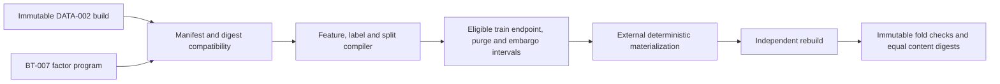
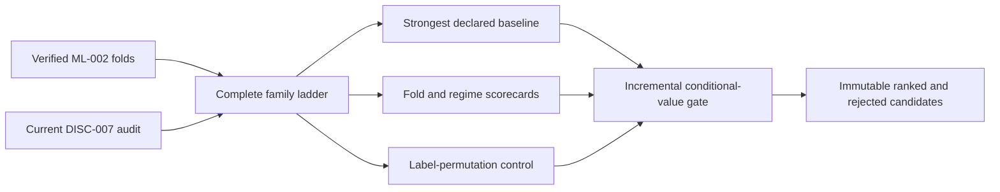

# 5. Bulletproof BT Laboratory

## 5.1 Engine purpose

Bulletproof BT is a deterministic, event-driven quantitative research engine. Its
declared invariant is same data plus same configuration yields semantically identical
outputs, with closed-bar strategy visibility, no interpolation and no silent cost or
risk assumptions. The latest exhaustive audit pin and dirty-tree boundary remain in the
implementation reference register; this chapter summarizes inspected capability, not
profitability or live certification.

## 5.2 Core engine composition

The classic run loop connects a historical feed, instrument/universe abstraction,
strategy, risk engine, execution model, portfolio accounting, metrics, benchmark and
artifact writers. Strategies receive a read-only context and emit typed `Signal`
objects; they do not mutate portfolio or execution internals.

### Data contracts

- UTC timezone-aware, monotonic timestamps;
- required OHLCV columns and OHLC consistency;
- duplicate detection and explicit missing-bar behavior;
- closed-bucket higher-timeframe resampling;
- market modes for 24/7 crypto, 24x5 FX and equity sessions;
- single-file data or manifest-backed dataset directories;
- no implicit interpolation.

### Execution and cost model

- maker/taker fees, spread, slippage and delayed execution;
- tiered or complete custom execution profiles;
- deterministic intrabar pricing;
- FX commission-per-lot and lot rounding;
- equity commission and cash-account behavior;
- basic futures/contract abstraction;
- explicit margin usage and rejection reasons.

### Risk and portfolio accounting

- stop-intent contract via explicit stop price/specification;
- stop-distance and percentage-equity sizing;
- tick/lot rounding and instrument contract size;
- margin-aware reservation and execution constraints;
- cash, positions, liquidation and R-multiple normalization;
- a separate portfolio engine for isolated strategy sleeves, allocation/coordinator
  checks and aggregated artifacts.

The separate portfolio engine is not yet evidence of a unified, certified same-clock
multi-strategy matching engine or production order router.

PORT-001 adds an evidence-only service beside this engine. It evaluates registered
research and prospective-shadow candidates jointly, but cannot admit a candidate,
allocate capital, mutate positions or submit orders.

## 5.3 Market and indicator capability

The documented V1 surface supports crypto, FX and equities with basic futures
abstraction. Streaming indicators include moving averages; RSI/Stochastic/CCI/ROC and
other oscillators; ATR, Bollinger, Keltner, Donchian and volatility measures; ADX,
MACD/PPO/TRIX and directional indicators; OBV/CMF/MFI and volume flows; Supertrend,
Parabolic SAR, pivots, Heikin-Ashi and candle/range features. Every indicator has an
explicit warmup and bar-by-bar update path.

## 5.4 Research data library

`bt.research_data` contains adapters and workflows for Binance, Bybit and OKX perpetual
futures, backfills, instrument refresh, stable/volatile universe manifests, causal
research panels, validation reports and forward-collected liquidation events.

BT-002 adds an immutable derived contract around explicit bounded Parquet partitions.
It records each partition's SHA-256, size, schema, row count, event and availability
ranges, duplicate count and gap count; binds those records to the BASE-002 canonical
identity; declares UTC/bar-clock semantics and a knowledge cutoff; validates
point-in-time membership; and retains append-only correction lineage. Missing bars
remain missing. Replaying the manifest against the source root detects changed bytes.
The builder writes only a JSON manifest outside source partitions and never repairs or
rewrites the lake.

This is a snapshot qualification boundary, not lake-wide certification. DATA-002 and
DATA-003 still own historical membership population, vendor correction ingestion,
entitlement policy, quality SLOs and recovery.

### 5.4.1 Point-in-time reference identity

DATA-001 supplies the canonical identity layer consumed beside Bulletproof dataset
manifests. An immutable, content-digested snapshot contains effective-dated venues,
stable instruments, venue listings, session calendars and corporate actions. Instrument
identity remains stable when a venue symbol changes; listing identity and revision
history retain the venue-specific representation.

Every temporal record has two clocks. `valid_from` and exclusive `valid_to` describe
when the fact applied in the market. `observed_at` and `available_at` describe when the
company could have known it. Resolution binds venue, symbol, effective time, knowledge
cutoff and optional snapshot digest, returning the exact instrument, listing, venue,
calendar, session state and then-known corporate actions. Unknown, overlapping or
conflicting identity fails closed rather than guessing from the present-day symbol map.

Snapshots cannot be mutated. A correction is a new revision with explicit ancestry;
snapshot replacement is an ordered supersession with a later knowledge clock. Dataset
manifests may bind the snapshot digest and must map every requested instrument to its
stable instrument, venue and listing identifiers. Consumers roll back by pinning a
prior digest.

The production proof runs on VM2 at migration `e2d7a4c91b60`. Snapshot
`16c689717341872f0b15d0324122ddbc749d2174197d8f3f4ea7faadf75e3871`
replayed both sides of a BTC venue-symbol change without changing stable identity,
replayed only the corporate action known by the cutoff, closed an explicit holiday and
rejected an unknown venue. The service is reference evidence only and has no order or
capital authority.

### 5.4.2 Immutable market-data catalog

DATA-002 promotes BT-002's bounded manifest primitives into the canonical catalog for
raw and curated laboratory inputs. Each immutable catalog snapshot binds an exact
DATA-001 reference digest and contains content-addressed partitions, universe
membership and source-availability records. It stores metadata and read-only URIs; it
does not copy, repair or mutate lake objects.

A partition binds dataset and layer, source, venue, stable instrument, listing,
timeframe, event interval, row count, schema and content digests, duplicate and gap
counts, observation and availability timestamps, revision ancestry and an explicit
read-only access mode. Registration proves the identity edges against DATA-001 and
rejects correction ancestry that changes the logical partition. Membership and source
availability carry their own effective and knowledge clocks.

Point-in-time resolution begins with DATA-001 symbol resolution, then requires a unique
covering partition, effective optional universe membership and an available source at
the requested knowledge cutoff. It selects only the latest correction known inside the
pinned catalog. A partition with duplicates or coverage gaps remains retainable as
evidence but cannot become a laboratory input. Unknown coverage, delayed/unavailable
sources, ambiguity, identity conflicts and lookahead all fail closed.

Production runs migration `f3e8b2c61d90`. The live proof bound catalog
`3c5352526ef607d02502144cf8623dc53098322c4bf84f8395e0650384aa2e07`
to DATA-001, replayed its corrected partition, and replayed the original revision by
pinning prior digest
`981c671b9959461804701c9b9661398b2b68b873f837f5762549f16a5ab233e4`.
The catalog grants no source-write, execution, order or capital authority. DATA-003
still owns continuous quality SLOs, entitlements, retention, storage and recovery.

### 5.4.3 Governed lake operations

DATA-003 completes the operational boundary around the immutable DATA-002 catalog. An
immutable governance snapshot binds one exact catalog digest to quality SLOs, lineage
edges, entitlement rules, storage budgets, retention holds, recovery manifests and
derived-publication records. This is metadata governance: protected source payload is
forbidden by the strict API schemas, source objects stay read-only, and no prompt or
evidence export receives their contents.

Admission is default-deny. A requested read or deletion must name an entitled
principal, action and purpose and pass schema, duplicate, gap, freshness and capacity
checks. A retention hold blocks deletion while preserving governed read access.
Lineage closes over declared upstream objects, and unknown principals, objects or
recovery members fail closed. Capacity warnings are observable before exhaustion;
exhaustion denies admission rather than silently degrading the lake.

Every decision and operation enters an append-only, digest-chained event ledger. A
derived publication can be disabled without mutating its source partitions. Restore
then requires the disabled state, an integrity-verified backup, the same catalog
digest and the exact declared object set. This makes rollback a replayable recovery
operation rather than an informal file copy.

Production runs migration `a4f9c3d72e10`. Snapshot
`0acbf36c-29d4-427d-a83b-f943b004d3ba` bound catalog
`3c5352526ef607d02502144cf8623dc53098322c4bf84f8395e0650384aa2e07`;
the live pilot passed nine admission, denial, retention, capacity, disable, restore,
visibility and protected-payload checks and retained six events. DATA-003 grants no
source-write, execution, order or capital authority.

### 5.4.4 BT-004 classic-engine certification

BT-004 preserves the existing classic event-driven engine and certifies its causal,
accounting and replay boundary rather than creating another simulator. Canonical events
carry UTC `event_time` and `available_at` clocks for market, session, funding, borrow,
valuation, decision, order, fill and liquidation paths. They sort deterministically by
availability, occurrence, kind, source, source sequence and identity. A decision may
bind only evidence available at its timestamp; the retained negative fixture rejects a
future funding observation.

Portfolio snapshots enforce `equity = cash + realized_pnl + unrealized_pnl` and
`free_margin = equity - used_margin`, with finite values and non-negative used margin.
Negative free margin remains a valid liquidation condition. State transitions bind the
prior digest, canonical event and resulting state. Checkpoints bind the contract
version, immutable dataset and configuration digests, last event key and state digest;
changed pins or state fail closed. Equal-timestamp historical bars now emit in stable
symbol order, and a quantile boundary uses a narrowly bounded equality tolerance so
platform floating-point noise cannot change a logically equal gate decision.

The retained pinned Python 3.11 validation reports 1,231 passing tests and 27 explicit
skips across the full repository.

### 5.4.5 BT-005 market-model qualification

BT-005 keeps the classic fee, spread, slippage/impact, bar-delay, market-fill,
reconciliation and diagnostic implementations as the sole authority. A versioned
market-model bundle describes each model's implementation, applicability, timestamp
semantics, parameters, uncertainty, stress range, calibration provenance, fallback
and incompatibilities. Declared Tier profiles are policy assumptions, not mislabeled
empirical estimates. An empirical replacement must bind an immutable calibration
dataset and preserve fit and holdout diagnostics.

Rebates, funding observations as cashflows, borrow availability/cost and
capacity-constrained fills are explicitly unsupported in the classic engine. A run
requiring them is rejected rather than treating an absent cost as zero. Atomic run
finalization requires `market_model_bundle.json`, verifies every card and bundle
digest, and matches it to lineage. Pessimistic stress cannot reduce modeled cost. The
retained pinned suite reports 1,237 passing tests and 27 explicit skips. BT-006 through
BT-008 retain their search, feature-lineage and publication boundaries.

### 5.4.6 BT-006 prospective search accounting

BT-006 preserves the existing hypothesis contract, constraint filtering, grid runner,
parallel execution, strict resume and worker resource controls. A prospective search
plan now binds the hypothesis, dataset snapshot, repository and code, BT-005 market
models, declared parameter values, exact included variants, tiers, seeds, resources,
budget, stopping rule and search family before evaluation. It records the raw
Cartesian size and exclusions rather than losing filtered combinations.

Each trial has a deterministic identity derived from the immutable plan, parameters,
tier and seed. Grid expansion creates a new plan and new trial identities. A SQLite
execution ledger registers trials exactly once, preserves identity across bounded
attempts, refuses terminal replay and cancels only unleased work. Registered manifests
carry plan, family, trial, seed and attempt fields; the runner validates and snapshots
the plan before launch. BT-003 run bundles now retain the same lineage.

Hermes remains the institutional Trial Registry and approval authority; the local
ledger is Bulletproof's execution projection. The pinned Python 3.11 suite reports
1,245 passes and 27 explicit skips. BT-007 owns feature and fit-boundary lineage, and
BT-008 owns canonical dual-memory publication.

### 5.4.7 BT-007 representation and fit-boundary certification

BT-007 preserves the immutable dataset snapshot, canonical research panel, classic
state-feature builders, hypothesis schemas and strategy implementations as the only
calculation authorities. A representation contract now binds the dataset and code,
decision and entity clocks, point-in-time universe membership and every representation,
feature and label's sources, transformation identity, implementation digest,
observation/availability clocks, warm-up, missingness, completeness, fitted state and
label horizon. It also fixes the train, validation, test, fit, purge and embargo
boundaries before evaluation.

The causal auditor replays a materialized frame and rejects future observations or
joins, revised information unavailable at decision time, premature labels, incomplete
higher-timeframe values, output during warm-up, undeclared missing values, duplicate
decision identities, point-in-time universe leakage, expired membership, rows outside
the registered evaluation range, overlapping splits, insufficient purge/embargo and
fit state learned outside training. Its certified report is deterministic and
digest-bound. A standalone CLI proves that a fresh process can rebuild the manifest
and audit from JSON plus Parquet rather than relying on hidden in-memory state.

BT-006 search plans now bind the representation digest. BT-003 finalization requires
both `representation_contract.json` and `representation_leakage_report.json`, verifies
their digests and refuses an uncertified report. Rollback stops new certification and
pins a previous transform while immutable failed audits remain available and dependent
descendants become stale. BT-008 still owns canonical Research Intelligence and
Bulletproof memory publication. The pinned Python 3.11 suite passes 1,258 tests with
27 explicit skips.

## 5.5 Experimentation and artifacts

Experiment support includes configuration layering, hypothesis contracts, grid
expansion, parallel hypothesis execution, resume/skip-completed behavior, dataset
extraction, cleanup and truth validation. A normal run emits resolved configuration,
performance, equity, trades, fills, decisions, bucket performance, cost breakdown,
summary, manifest, run status and optional benchmarks.

Truth checks cover missing evidence, duplicate truth fields, source timestamps after
entry, notional/risk consistency and artifact completeness. Selected JSON outputs have
deterministic serialization; timestamps and absolute run paths mean byte-for-byte
identity is not claimed for every file.

BT-003 adds the immutable publication boundary without replacing those artifacts. A
finalizer copies canonical textual artifacts into a same-filesystem staging directory,
assigns source-byte, publishable-byte and semantic SHA-256 digests, records media type
and structural schema identity, binds repository/code, BT-002 dataset, specification,
environment and attempt lineage, validates the bundle, and atomically renames it to a
content-addressed final directory. A failure or interruption leaves no partial bundle
and retains a redacted failed-attempt record.

Supported volatile run IDs, generated timestamps and output paths are excluded from
semantic identity while exact published bytes remain independently digest-bound. The
legacy run manifest is copied with stable runtime/data aliases and retains its original
source digest. Other absolute protected paths, likely secrets, symlinks, corrupt files,
unsupported binaries and unknown schemas fail closed. Repeated semantic publication is
idempotent and returns the existing receipt.

Hermes' canonical run payload now optionally carries the bundle digest, manifest
digest and `bundle://sha256/...` URI as an all-or-none reference. Bulletproof publishes
that record through the existing idempotent canonical-evidence endpoint; it does not
create another registry or store authorization material in artifacts.

BT-008 completes the next publication boundary. A finalized run now also carries its
market-model, representation and prospective search-plan digests. Hermes joins that
run to the existing registered trial, result, two independent reviews and institutional
decision, then atomically writes canonical result, review, decision and replay-dossier
objects plus an ordered publication event. It does not create another laboratory
registry. Negative, null, invalid and inconclusive outcomes are published by the same
path as positive outcomes.

Derived consumers advance in an explicit order. Current graph and retrieval projection
digests and epochs must be confirmed before Bulletproof writes the local
`research_memory_publications` row. That row is an idempotent consumer projection, not
institutional truth. A projection or memory outage records a retryable stage failure;
repeating the original request resumes the same publication identity and cannot delete
or replace its canonical evidence. The replay endpoint returns the canonical object
identities, both consumer receipts and the exact event transcript.

### 5.5.1 Classic execution authority and fast-path deprecation

The experimental backtest fast path is deprecated at Bulletproof merge
`e47f9f210c862a311f2e8b691f8148c393fb5ed0`. The default is `classic`. Legacy
configuration values `auto` and `fast_path` remain readable for compatibility, but
both deterministically select the classic event-driven engine and write
`fast_path_status.json` with the requested value, actual engine, deprecation state and
reason. New hypothesis/strategy generation is forbidden from adding compiled family
kernels or sparse candidate-event execution shortcuts.

This decision is an epistemic control, not merely a performance trade-off. The prior
work did not establish a universal, materially faster path that preserved exact
strategy visibility, volatile-universe membership, stop handling, fills, fees,
slippage, risk sizing, accounting and rich artifacts without excessive family-specific
complexity. Backtest accuracy therefore wins unconditionally. Reference modules remain
available for audit and historical compatibility, but they are not production
execution authority.

Semantics-neutral optimization remains allowed. Bounded-memory Parquet materialization,
streaming artifact writes, download concurrency and post-run analysis batching may
improve throughput when they preserve input bytes, ordering, causal timestamps and
canonical outputs. A filename containing `fast` does not grant backtest execution
authority.

## 5.6 Research memory and Hermes bridge

The intended BT-009 founder path begins with an unrestricted plain-English scientific
question, not a fixed hypothesis enum. A dedicated hypothesis-creation role uses
read-only catalog and coverage interfaces over the locally available Binance and Bybit
perpetual lakes, plus Research Intelligence context and prior negative results, to draft
a causal, falsifiable hypothesis card. The founder approves that card before any code is
generated. Approval then permits a bounded engineering worktree to apply Bulletproof's
hypothesis/strategy-generation instructions and create or reuse the typed hypothesis
YAML, native `strategy.py`, feature adapters, logging declarations, tests and docs.

Independent schema, point-in-time, lookahead, timestamp, code-review and truth gates
must pass before a second immutable execution approval. Native classic Bulletproof then
runs the approved tier and finite grid, retains full decisions/state/trades/equity and
negative results, finalizes a digest-bound run bundle, and publishes receipts into both
Bulletproof memory and Hermes. Full lake availability is scientific read access, never
permission to expose raw data or credentials to an LLM or bypass coverage and provenance
checks. BT-004 through BT-008 qualified the component contracts, and BT-009 then
replayed this composition on VM2 with a bounded deterministic BTC perpetual fixture.
That replay registered and natively executed all 16 approved Tier2B variants, retained
the negative selected result, completed separate statistical and adversarial reviews,
published canonical run/result/review/decision/episode evidence, refreshed graph and
retrieval projections, and confirmed one idempotent Bulletproof-memory row. It proves
the governed lifecycle, not market performance or production eligibility.

The SQLite research memory stores completed trades, state buckets, verdicts,
recommendations and alpha candidates. Enriched derivative state includes funding, open
interest, basis, premium, crowding and constraint-stress fields. Similar-state queries
can use those dimensions. Recommendations remain proposed-only.

Hermes does not ingest the raw memory database. The VM1 memory steward opens the fixed
source read-only, exports bounded counts/candidates/summary text, binds it to a digest
and registers canonical evidence plus an RI-007 synchronization receipt.

## 5.7 Known engineering gaps

- BT-001 closes the recorded collection/dependency/fixture drift for the locked Python
  3.11 matrix using deterministic shards and restored canonical contracts. The engine
  and strategy catalog remain the existing Bulletproof implementation.
- Atomic run bundles, canonical result/review/decision/dossier publication and
  dual-memory receipts are complete under BT-003 and BT-008. BT-009 completed the
  composed founder-intake-to-native-execution VM2 replay; WS-001 owns the broader
  company walking skeleton.
- BT-002 point-in-time and correction proofs apply to selected snapshots; universal
  lake population remains DATA-001 through DATA-003 work.
- The deprecated fast path cannot satisfy or bypass BT-004 through BT-009 acceptance;
  all governed research execution uses the classic native engine unless a future,
  separately approved architecture proves exact semantic equivalence.
- SHADOW-001 establishes immutable no-capital prospective/replay evidence, but its
  bounded fixture rehearsal is not continuous public-feed operation and does not
  constitute venue-certified demo or live execution.
- Portfolio admission, allocation and capital mutation remain separately governed and
  cannot be inferred from a successful backtest.

### 5.8 Exchange execution readiness and telemetry boundary

Bulletproof includes meaningful execution foundations for Binance and Bybit: signed
REST adapters, public and private stream clients, instrument mapping, order and fill
lifecycle models, reconciliation, SQLite checkpoints, JSONL execution artifacts,
session summaries, kill controls, demo profiles, bounded live-canary profiles and a
simulated shadow runtime. The public Binance and Bybit perpetual research lakes are
separate from authenticated account execution telemetry.

These components do **not** make live or demo operation a keys-only setup. A venue
profile is usable only after least-privilege secret installation, environment and
account verification, clock and instrument-filter checks, public/private stream
readiness, restart recovery, REST-to-stream reconciliation, kill-switch rehearsal
and a current certification dossier. Bybit demo is currently the nearest complete
bounded path. Binance private-stream parity and continuous compiled-strategy market
data execution remain release gates; live profiles are canaries, not general capital
authority.

Shadow execution belongs on VM1 initially. It consumes public/read-only venue feeds,
records prospective decisions and simulated fills, and cannot submit orders. Demo and
capital-bearing collectors/order services belong on hardened VM2 after certification.
The planned `EXEC-011` bridge will preserve raw protected venue references while
projecting normalized decision, intent, order, fill, position, cash, fee, funding,
margin, incident and reconciliation events into immutable trade episodes compatible
with classic-backtest reporting. Mission Control will expose environment-labelled
shadow/demo/live health, lag, positions, orders, fills, costs, PnL, incidents and
exact replay lineage. Until that package and its dependencies pass, venue state is
inspectable through Bulletproof artifacts and CLI diagnostics, not a complete Mission
Control execution console.

### 5.8.1 SHADOW-001 prospective journal and replay

SHADOW-001 extends the existing execution artifact boundary rather than adding another
strategy, fill, risk or accounting engine. An admitted shadow configuration must pin
SHA-256 identities for the candidate, immutable dataset snapshot, strategy
implementation and cost model, plus the exact repository commit, before the first
observation. Missing or malformed pins prevent the journal from opening. Its genesis
record permanently prohibits capital, live orders and venue mutation.

Every accepted decision, order intent, simulated fill, heartbeat, reconciliation and
incident is canonicalized into `prospective_journal.jsonl`. Each record carries a
monotonic sequence, stable event identity, timezone-aware observation time, payload
digest, prior-record digest and its own record digest. The append is flushed and
fsynced. Duplicate event identities are idempotently ignored. An unsealed chain can
resume after interruption by replaying and validating its prefix; a terminally sealed
chain rejects later appends.

The replay verifier independently checks schema, authority, bindings, sequences,
duplicate identities, payload hashes and the complete digest chain, and reproduces
event counts plus fee, slippage and spread totals. It fails closed on naive timestamps,
tampering, sequence gaps, changed bindings or post-seal records. Normal JSONL artifacts,
SQLite recovery state, reconciliation and incident outputs remain available and are
included with the journal and replay report in execution exports.

The retained 2026-08-25 pilot pins source commit
`58cbc5ac974080f572d58c1990558ca47043d984`, uses the explicitly non-alpha pipeline
smoke candidate and a deterministic market fixture, forces a disconnect/restart,
suppresses a redelivered decision, reconciles, seals, replays and rejects a modified
copy. Report digest
`745862c57511dacc02278fd6ec8a7243e28dea36c3389df653ab4c7b937d991f` binds sealed
journal digest `3a4dc409783061fae9e6aeb735dea96be4bb408fe084f916541e4514a66a4c46`.
The full pinned Python 3.11 suite passed 1,279 tests with 27 expected skips.

This proves the journal and replay contract, restart behavior and no-capital authority.
It does not prove a continuously running public-feed shadow, exchange connectivity,
execution-model calibration against venue observations, Hermes publication or Mission
Control session visibility. Those require separately retained operational evidence.

### 5.8.2 ML-001 reproducible model and calibration registry

ML-001 introduces an additive `bt.ml` boundary for predictive artifacts. It does not
replace BT-007 feature and fit-boundary authority or create a second research registry.
Every model bundle binds the scientific problem, immutable dataset snapshot, BT-007
representation, temporal split and source revision by SHA-256. Training, calibration
and protected evaluation windows are explicit timezone-aware intervals and must be
strictly ordered and disjoint; their canonical contract must reproduce the registered
split digest before fitting begins.

The first certified estimator is intentionally modest: a deterministic logistic
baseline implemented with NumPy, frozen training-set means and scales, fixed seed and
optimizer settings, and environment provenance. A separate held-out partition fits a
Platt calibrator. Evaluation retains raw and calibrated log loss and Brier score rather
than calling an in-sample score calibrated. The artifact also records feature order,
training support, coefficients, calibration parameters, uncertainty semantics,
abstention threshold and distribution-shift policy.

Model JSON is written atomically beneath its content digest. An SQLite registry stores
immutable family versions and append-only registration and activation events. Exactly
one model per family can be active. An independently attributed activation supersedes
the prior active version without deleting it; rollback is another attributed
activation of a retained digest. A deterministic, secret-free snapshot makes version
and event history independently reviewable.

Each inference receipt binds the model and input digests, observation timestamp,
calibration method, probability, uncertainty, applicability, abstention decision and
reason. Missing or extra features, naive timestamps, non-finite values, corrupt model
bytes and lineage drift fail closed. Inputs outside the registered normalized support
threshold abstain. Bundle and receipt JSON schemas are public repository contracts.

The retained 2026-08-25 fixture reproduced model digest
`5e3b8c80a494aaedb33dd61c8484fb59ed1f89254dec52724ebae82193e175a3`
from source commit `8dbfc4eaf9c2243ed5e035df68a4ae1dff05413d`. Registry snapshot digest
`1d738ee40118551ccfbeb3edabfea609b09a4319958fa55a3ee5772d78c3d605`
records two versions, challenger activation and rollback. Report digest
`7e3f250ffb54d5d6e194ad07cee4a065b2bb614ac8ce52f708b99f398bb5cd69`
retains held-out calibration, supported inference and shifted-input abstention.

This is contract and lifecycle evidence only. The fixture does not establish predictive
value, market transport, production latency, RI publication, strategy admission,
position sizing or capital authority. ML-002 through ML-005 own causal pipeline
construction, baselines, uncertainty/interpretability and monitoring before any later
consumer may seek separate authorization.

### 5.8.3 ML-002 causal feature, label and split pipelines

ML-002 adds the causal dataset boundary between immutable market data, the BT-007 factor
language and the ML-001 model registry. It does not copy source observations or define a
second feature language. A pipeline binds one DATA-002 dataset-build ID and content
digest to one active factor-program ID and compiled digest over the same dataset
manifest. Manifest drift fails closed.

Every feature declares its compiled factor, availability lag and missingness policy.
Every label declares its kind, horizon and `label_end_offset_bars`. Fitted transforms
have only one legal fit scope: `train_only`. The split contract supports explicit
half-open expanding walk-forward intervals with contiguous fold identity, a purge at
least as large as the maximum label end offset, a positive embargo between validation
folds and either uniform or inverse-label-overlap sample weights.

The compiler writes the latest eligible training observation and the exact purged and
embargoed intervals into each fold. Materialization cannot succeed by asserting a
boolean alone: its measured maximum training-label end and minimum validation-feature
time are checked against those compiled bounds. Every fold must also prove train-only
fit and point-in-time joins, and the independent rebuild digest must equal the original.

VM2 runs migration `e4a8c2d61f90`. The first live attempt stopped because the existing
factor program had a valid immutable manifest but no DATA-002 build receipt. The repair
registered the existing 1,200-row canonical source object, its digest, declared quality
checks and identical rebuild digest; it did not synthesize another dataset or weaken
lineage. Live pipeline `632fd11d-2bc9-4891-8eaa-e9269a080fd0` compiled two expanding
folds with two-bar purge and embargo and inverse-overlap weighting. Materialization
`86247c0e-04dc-4e52-85de-3ae60aff04a4` independently reproduced its content. ML-002
has no training, inference, promotion, order or capital authority.

### 5.8.4 ML-003 model-family and regime evaluation

ML-003 is the comparative evidence layer above ML-001 model bundles and an ML-002
causal materialization. It does not fit models or activate them. Registration requires
a current non-blocked DISC-007 audit and a complete ladder containing unconditional and
linear baselines plus supervised, unsupervised, regime and meta-label candidates. Every
candidate binds its model-bundle and prediction digests.

Each candidate covers the same causal folds in order and the exact required regime set.
Fold evidence retains the primary score, log loss and Brier score. Regime evidence
retains observation and positive/negative-label counts, making class-support claims
auditable. Qualification requires value above the strongest baseline, a minimum score
in every regime, bounded cross-regime dispersion, sufficient minority support and a
passing label-permutation control. Ranking does not override a failed gate, and failed
or merely weak families remain in the scorecard.

VM2 runs migration `e5b9d3f72a10`. Live evaluation
`25e3afbc-d0dd-4008-bdc0-9777fd8bb6b8` bound ML-002 materialization
`86247c0e-04dc-4e52-85de-3ae60aff04a4` and DISC-007 audit
`45b83a75-8831-4ced-a0f3-93a5d78e981e`. It retained six candidates. The strongest
baseline scored `0.54`; the regime specialist, supervised logistic and meta-label
families qualified, while the unsupervised family remained retained but below the
incremental-value gate. Scorecard digest
`2718faf445876f79d21443c5fa06ffd7203a5e487b53117bc66ee312426a9835`
replayed exactly. ML-003 has no training, activation, promotion, order or capital
authority.

### 5.8.5 ML-004 calibration, uncertainty and abstention

ML-004 is the institutional uncertainty gate above ML-001 model bundles and ML-003
comparative qualification. It deliberately reuses ML-001's held-out Platt calibration,
applicability and inference-receipt concepts rather than fitting or registering models a
second time. An immutable assessment binds one qualified ML-003 candidate and scorecard
digest to one RI-004 evidence dossier and digest.

The submitted contract contains ordered reliability bins spanning zero through one, a
held-out calibration method and version, split-conformal or block-bootstrap coverage,
regime applicability slices, a fidelity-scored interpretability receipt that prohibits
causal claims, and explicit abstention thresholds. The service independently recomputes
expected calibration error and checks that slice support labels agree with observation,
calibration and distribution-shift limits.

Four scenario receipts are mandatory: supported input, miscalibration, distribution
shift and low support. The latter three must abstain with the exact policy-derived reason;
excess uncertainty is also an abstention condition. Miscalibration, undercoverage,
misleading explanation fidelity, incorrect applicability or an incorrect abstention
receipt changes the result to `demotion_required`. Uncertainty therefore removes
authority instead of becoming decorative metadata.

Control-plane PR #185 merged at `dd367ac64c1f6dc4b7882a9265fa864f38334cfa` after
569 backend tests and all seven CI suites passed. VM2 runs migration `e6c1a4f83b20`.
Live assessment `5560e515-7ad5-4a92-80c2-e3b1482a502b` bound evaluation
`25e3afbc-d0dd-4008-bdc0-9777fd8bb6b8` and dossier
`af32b7a6-74c9-48c4-bb87-bc7433bdc07f`, recomputed expected calibration error
`0.01`, retained empirical coverage `0.91`, verified all mandatory abstention scenarios
and exactly replayed assessment digest
`0b79ef0dee22b7d26f0f79baf209a3d0733274a9310621d6cdd8c79d3e58b928`.
This deterministic live fixture proves the control path, not predictive skill. ML-004
has no training, activation, promotion, order or capital authority.

### 5.8.6 RL-001 offline-RL dataset and evaluation contract

RL-001 establishes whether historical behavior data is admissible for later conservative
off-policy evaluation. It does not estimate a learned policy. The control plane retains
an immutable contract and audit while canonical transitions remain in the DATA-002 data
layer and prospective execution evidence remains in Bulletproof's sealed, hash-chained
SHADOW-001 journal.

Each contract binds the DATA-002 build and record digest, sealed shadow-journal and exact
replay digests, behavior-policy identity, version and propensity source, causally
available state features, the complete bounded action space, per-action observations and
overlap, a reward formula with horizon and independent rebuild, episode definition and
termination counts, known confounders, and the permitted later evaluation estimators.
Unsupported actions must abstain and model selection data must remain separate from the
final evaluation sample.

The server independently checks source-build reproducibility and quality, transition
counts, timestamp ordering, duplicate transitions, state and reward availability,
propensity completeness, action support, propensity floors and importance-weight caps.
Any hard failure yields `quarantined`. Proxy and unobserved confounders are not erased by
qualification; they remain named limitations and prevent causal identification claims.

Control-plane PR #186 merged at `8a9c3ca65cf592fca0f4ef593ce95e4a2918c5cf`
after 580 backend tests and all seven CI suites passed. VM2 runs migration
`e7d2b5a94c30`. Live contract `807c244c-7574-43c2-a80a-4c6c6ea11d25` bound
DATA-002 build `72fba926-a6c3-49d5-8120-f301ba6ce9ea`, 1,000 transitions, 40
episodes and the retained SHADOW-001 evidence. Audit digest
`cc8f51b2df32316019f14592cac2d5b034987b155f6e88bcb6200ffee32f6989`
replayed exactly. Market impact remains a proxy and latent liquidity remains unobserved.
RL-001 has no policy-improvement, deployment, order or capital authority.

### 5.8.7 RL-002 conservative off-policy proposal evaluation

RL-002 evaluates whether a target-policy proposal has enough conservative evidence to
enter further shadow study. It does not train or deploy a policy. Registration requires
a qualified RL-001 dataset, a current non-blocked DISC-007 selection audit and a
qualified ML-004 calibration assessment whose candidate identity matches the proposal.

Each immutable proposal retains multiple digest-bound estimator receipts with point and
confidence estimates, effective sample sizes and maximum importance weights. It also
retains action overlap, extrapolation and unsupported actions, an independently rebuilt
reward model, and adversarial-reward, support-trimming, importance-weight-clipping and
cost-expansion stresses. Every estimator must have been permitted by the bound RL-001
contract.

The server derives the conservative value as the worst lower bound across every
estimator and required stress. It rejects values below the floor, estimator disagreement,
weak effective sample size, unsafe weights, weak overlap, excess extrapolation,
unsupported actions or any stress below the declared floor. A pass means only
`shadow_eligible`; it is neither causal identification nor promotion.

Control-plane PRs #187-#188 merged through
`78d4be17835b07fe8530b23768f5d2ca74d69656` after 596 backend tests and all
CI suites passed. VM2 runs migration `e8c3b6a05d40`. Live evaluation
`77bda11b-e6cc-4c00-a76d-6261ffbb73a1` bound RL-001 dataset
`807c244c-7574-43c2-a80a-4c6c6ea11d25`, DISC-007 audit
`45b83a75-8831-4ced-a0f3-93a5d78e981e` and ML-004 assessment
`5560e515-7ad5-4a92-80c2-e3b1482a502b`. Its worst lower bound was `0.016`,
estimator spread was `0.007`, and evaluation digest
`b14150114e7247e06a27952496cb2ad26f03d517341486093bdddbbe2c856938`
replayed exactly. RL-002 has no causal-policy, deployment, order or capital authority.

### 5.8.8 RISK-001 drawdown, tail and reverse-stress engine

RISK-001 is the immutable risk-admission layer between an evidence-only portfolio
candidate and later construction or capital decisions. It deliberately reuses the
classic Bulletproof laboratory: historical drawdown paths, Monte Carlo drawdown
distributions, ruin estimates and cost stress remain computed there. The control plane
binds those results through the BT-004 run digest, BT-005 cost-model digest, PORT-001
candidate digest, portfolio-state digest and a versioned scenario-pack digest.

Each request must include drawdown depth, duration, recovery and underwater-path
identity; VaR and expected shortfall with a conservative uncertainty upper bound; and
exactly five attributable failure mechanisms: price gap, correlation break, liquidity
freeze, model failure and prolonged drawdown. Each mechanism also carries a bounded
reverse-stress bracket identifying the first tested shock that crosses the declared
loss limit. The server independently derives the worst scenario, breached scenarios,
tail envelope, reverse thresholds and final decision.

Evidence age and upper uncertainty envelopes govern admission. Stale evidence, excess
drawdown, excess tail loss or any scenario breach produces `blocked`; callers cannot
submit their own decision. The persisted dossier is digest-addressed and replayable.
The production pilot registered assessment
`b7713035-e37d-4841-8ecc-acd809409de8` with dossier digest
`1860339b7bded1a112f5579b35a985260919502c4ee4ee1c0a2884f73afeeed4`.
Its deterministic fixture was admissible, included model failure, and replayed exactly.
That proves the control path, not the economic validity of a portfolio. RISK-001 has no
allocation, order or capital authority.

### 5.8.9 RISK-002 leverage, margin, liquidation and rule engine

RISK-002 converts venue constraints into immutable, point-in-time decision evidence.
It reuses DATA-001 to resolve the one listing revision effective and known at the
evaluation clock, binds an admissible RISK-001 dossier, and retains Bulletproof's
existing position, leverage, funding and forced-liquidation telemetry. It does not
replace the engine, size positions or communicate with an exchange.

A rule pack identifies its source and digest, observed and available clocks, effective
interval, lifecycle transition, predecessor, and active/suspended/retired state. Its
margin tiers must start at zero, remain contiguous and carry maximum leverage,
maintenance rate and maintenance amount. The pack also defines exact price and
quantity increments, maximum mark/index deviation, funding bound and minimum
liquidation buffer.

For each digest-bound position state the server selects the applicable tier and derives
notional, initial margin, maintenance margin, long/short unrealized PnL, equity after
funding and fees, mark deviation, effective funding rate and liquidation buffer. It
then produces `allowed` only when every hard constraint passes. Unknown, future,
stale, inactive, expired, ambiguous or malformed rule state fails closed. Historical
listing revisions remain retained but are filtered by effective and knowledge clocks.

The VM2 pilot registered evaluation `8ed31a3e-8dae-469b-b636-79dd68bdf682`
against live DATA-001 and RISK-001 records and replayed receipt
`10d5294738b2188e3d5a221ee0d96cacee2c7e4d94abe3db58bf82b231164d1b`
exactly. Its limits are deterministic test fixtures, not current Binance rules. The
receipt has no allocation, order or capital authority.

### 5.8.10 PORT-001 portfolio-candidate risk service

PORT-001 adds `bt.portfolio_engine.candidate_service` without replacing the classic
engine, the sleeve runner, `PortfolioRiskCoordinator`, or execution adapters. Its input
contract requires a portfolio-eligible candidate identity; registered research and
prospective-shadow evidence digests; one forecast horizon; expected net return and
uncertainty; turnover and cost; stressed capacity; named market scenarios; common
instrument, venue, data, model and infrastructure dependencies; and timezone-aware net
returns on an identical observation set. Missing overlap is unknown dependence and
fails closed rather than receiving diversification credit.

The service estimates exact-overlap sample covariance and correlation, then forms a
conservative joint-dependency matrix by taking the larger of absolute statistical
dependence and shared operational/economic dependence for each pair. The transparent
benchmark scales inverse volatility after adding declared forecast uncertainty. A
deterministic water-filling step respects stressed-capacity, candidate and family caps.
It does not relax an infeasible problem.

Hard checks cover unit weight, candidate and family concentration, Herfindahl
concentration, weighted joint dependency and the worst of cost expansion and named
regime scenarios. Every check and binding rejection is retained. Equal canonical
inputs, including evaluation time and registry snapshot, reproduce the same dossier
digest. The public JSON schema requires `allocated: false` and prohibits portfolio
allocation, capital, orders and self-promotion.

The retained fixture at source commit
`4eaf836d2b0f9a1de4730b2141847cc7d073e40a` reproduced candidate-set digest
`43a0bd21e8c1286b13e1c4de9010c19580e543cd9b2402cdfc0bb31b2e43b325` and dossier
digest `3ab51287d89cfdc02a04b4ba1014a85a6716b1a55a086da43d74d4867a3378bd`.
Its report digest is
`98964cfa2fd0afd65208330bf50f6b25c3eff99d9e0faa9723efca0a6843e555`.
The full Python 3.11 suite passed 1,294 tests with 27 declared skips. Separate dossiers
prove rejection of missing overlap, infeasible stressed capacity and excessive scenario
loss. These are deterministic fixtures, not market-performance or production-allocation
evidence. PORT-002 now owns the richer dependence model. PORT-003 through PORT-004
and later risk packets own optimization, allocation registry, path stress and governed
admission.

### 5.8.11 PORT-002 dependency, diversification and concentration service

PORT-002 is implemented in `bt.institutional.portfolio`, not in Hermes. It binds an
admitted PORT-001 dossier to an exact common observation window, state labels, shared
economic and operational exposures, dataset and source commits, freshness limits and
concentration policy. It measures overall and state-conditioned correlation with
confidence intervals, empirical lower-tail dependence and shared-exposure dependence.
The maximum of these channels forms a conservative joint-dependency score.

Deterministic connected components turn the joint-dependency matrix into clusters.
The dossier reports cluster and shared-exposure weights, HHI, effective candidate count,
portfolio volatility, weighted standalone volatility, diversification ratio and a
correlation-convergence stress. Missing overlap earns no diversification credit. Sparse
state histories, stale windows, inconsistent state labels, undefined dependence and
limit breaches are retained as failures.

Bulletproof merge `79caf1d` produced immutable receipt `70f4ff80...`. The full suite
passed 1,319 tests with 27 declared skips. Hermes merge `3a2a38b` adds only receipt
validation and registration, and VM2 replayed the receipt exactly as record
`5c55f791-227a-4c40-a86a-301eec866b9e`. The deterministic fixture proves the service
and ownership boundary, not portfolio fitness or alpha. PORT-002 never changes weights
and grants no allocation, capital, order or promotion authority.

### 5.9 Quantitative computation ownership correction

The 2026-08-28 cross-repository audit makes Bulletproof the sole authoritative
producer of market-data-derived, statistical, ML, RL, portfolio, risk and execution
calculations. Hermes owns identity, authorization, lifecycle, immutable registration,
policy gates, orchestration, audit and replay. Workers invoke a pinned Bulletproof
producer and transport its receipt; they do not reproduce the calculation.

This correction preserves the deployed Hermes schemas, migrations, registries and
fail-closed gates. It changes what those components prove. A control-plane fixture,
server-side score or exact API replay proves governance behavior, not completion of a
quantitative capability. Small deterministic recomputations may remain as independent
validators, but disagreement with the Bulletproof receipt fails closed and the Hermes
result never becomes an alternate scientific truth.

The audit keeps BT-001 through BT-009, SHADOW-001, ML-001, PORT-001 and WS-001
complete because their authoritative native producers exist in Bulletproof and their
boundaries are evidenced. It reopens DATA-001 through DATA-003, DISC-002 through
DISC-005, DISC-007, ML-002 through ML-004, RL-001 through RL-002 and RISK-001 through
RISK-002. Their deployed Hermes portions remain completed governance slices, but each
packet now needs its missing Bulletproof producer, native tests, a digest-bound receipt
and a live no-capital cross-repository replay before it can close again. DISC-001,
DISC-006, DISC-008 and DISC-009 remain complete as orchestration or institutional
governance capabilities; any quantitative evidence they consume must reference a
qualified Bulletproof receipt.

The binding register is
[Quantitative computation ownership](../../../registers/QUANTITATIVE_COMPUTATION_OWNERSHIP.md),
and the milestone verdicts are retained in the
[quantitative ownership audit](../../../plans/QUANTITATIVE_OWNERSHIP_AUDIT.md).

The correction closed on 2026-08-28. Bulletproof merge `80db509` added the 15
authoritative producer receipts, while control-plane merge `54c4447` added only
validation, immutable registration and exact replay. A live VM2 replay
registered and read back all 15 receipts; its retained file digest is
`c77c865342facd8f6b2c15bbe94a6c6243b5b6e88e452920fb21c83c54ec7aff`.
The fixtures validate ownership, contracts, causal gates and replay. They do
not assert alpha, production readiness or trading authority.

### 5.10 No-capital company walking skeleton

WS-001 composes the governed laboratory path instead of creating parallel research
machinery. Its valid-negative leg replays the completed BT-009 publication from a
fresh API client and requires one run object, one result, two distinct review objects,
one attributable decision, one episode, contiguous publication events and current
projection and Bulletproof-memory receipts. A separate forward-join fixture must be
classified `invalid_attempt`, never a valid negative. An injected partial-publication
failure must recover to `publication_completed` before the compensation proof passes.
The verifier emits a digest-bound report and has no order, allocation or
production-promotion authority.

The production replay completed on 2026-08-24. Its report digest is
`7e91e1219a6f764a2cb0c6b07b39fdd2cd27e770117a4f1c7452ea543eb807ce`;
the valid-negative bundle is
`293424d8e8923568bb2150dfaea2cdfaf1153ba3d5b87925aa99fd3999688720`.
The forward-join fixture was retained as invalid outcome
`f54be6e2-24ce-4dbf-a4b0-7c64cf19ed0f`, and the injected memory-publication
failure recovered without granting capital or order authority.

### 5.11 LIVE-001 pre-capital canary boundary

Bulletproof commit `e6ce17ed9b8e14e23ea54f121f1f448387ae2ecf` closes a
dangerous gap in the existing live runtime without declaring it production-ready.
`live_broker` now refuses to construct a venue adapter or resolve exchange credentials
until a root-owned mode-`0600` authorization bundle passes content-digest, scope,
evidence, approval and expiry checks. The signed plan names one venue and symbol set,
an exact execution window, hard order and position limits, gross exposure, daily and
session loss, maximum duration, market-data freshness and the canonical
cancel/flatten/reconcile rollback. It also binds a PORT-001 non-allocated candidate,
demo qualification, live-connector certification, operational readiness and a tested
kill path. Runtime configuration may tighten those limits but cannot widen them.

The canary guard now compares every prospective order with wall-clock market-data
freshness, session duration, current loss and gross exposure as well as the earlier
quantity, notional, order-count and position controls. This prevents a historical CSV
whose internal timestamps appear self-consistent from silently becoming live order
input. Binance and Bybit live configurations both require a ready private stream.
Authorization receipts retain only identities, digests, scope and expiry; credentials
are forbidden from the bundle and evidence.

The focused adversarial suite and full Python 3.11 matrix passed, with 1,304 tests and
27 declared skips. The retained validation explicitly records `blocked_before_capital`.
No demo or live order was placed. Before LIVE-001 can become operationally complete,
DEMO-001 must certify the chosen venue, outage/partial-fill/stale-stream/key-rotation/
restart/kill drills must pass, M8 readiness and least-privilege no-withdrawal
credentials must exist, and founder/risk authorities must separately approve the exact
short-lived plan. The resulting micro-live session must then flatten and reconcile and
publish its signed dossier. It grants no scaling authority.
