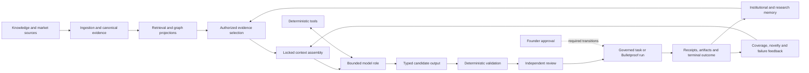
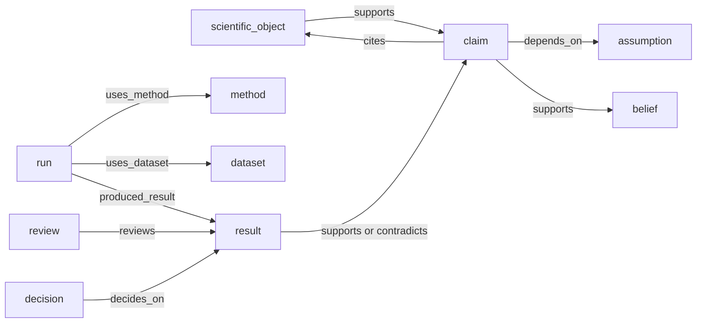
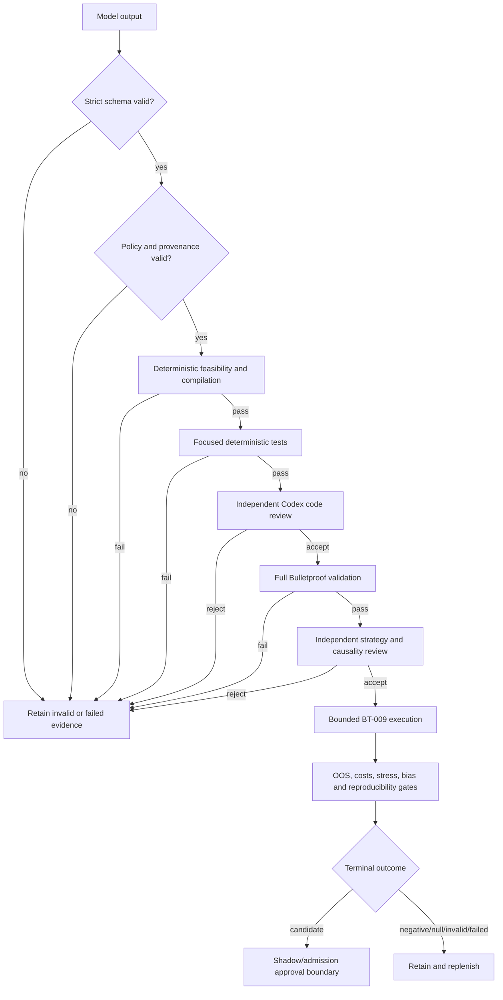
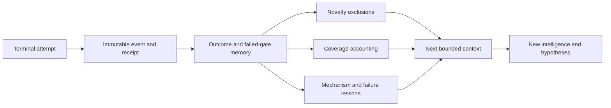

# 11. Cognitive Machinery of Invariance Research

**Targeted update, 2026-11-18:** [Chapter 12](12-requirements-recovery-and-current-certification.md)
updates source pins, recovery routing and current commissioning outcomes. The older
whole-system audit below is not a fresh health check of every cognitive service.

The durable method episode now has observed genuine bounded correction followed
by both independent acceptances. Its loop is deterministic diagnosis -> bounded
model correction -> native recheck -> separate LLM reviewers. It is not an
unbounded self-approving conversation. Engineering episodes preserve work and
diagnostics, with optional task-bound session continuity; reconstructed context
remains the default. Large accepted-method histories remain complete in checked
workspace evidence files while active science stays in bounded prompts. This
does not prove every model read every retained item. New review context remains
blocked; operator-assisted verdict publication and zero executed trials prevent
claiming an unattended cognitive loop through scientific results and memory.

## 11.1 Purpose and truth boundary

This chapter explains the as-built path by which Invariance selects evidence,
constructs context, invokes a model, uses tools, validates outputs, retains memory and
feeds results into later work. It is the system's cognitive map, not a claim that the
company has one unified artificial brain.

The machinery is hybrid:

- deterministic services establish identity, authorization, retrieval, graph
  traversal, schemas, arithmetic, task state and receipts;
- bounded language-model roles perform synthesis, hypothesis formation,
  representation design, code authoring, review and explanation;
- Bulletproof performs causal data materialization, execution, accounting and
  scientific measurement without delegating arithmetic truth to a model;
- independent evaluators and human approvals govern consequential transitions;
- immutable outcomes, including negative, invalid and failed outcomes, become inputs
  to later retrieval and novelty control.

The chapter is source-observed on 2026-11-09. The Book XI snapshot remains
2026-09-27 except where this chapter or Chapter 10 states a targeted later update.
Current runtime health can change after observation and must not be inferred from
source presence.

## 11.2 The brain is a governed loop, not a model

The model never receives the whole company. It receives a bounded context selected
for a purpose. Its output is data that must pass a schema and policy boundary. A model
response does not become evidence, an executable task, a scientific result or capital
authority merely because it is fluent.

## 11.3 Knowledge sources available to the machinery

| Source | How it enters | What a reasoning role may see | Authority and current limit |
|---|---|---|---|
| Research Bible and uploaded literature | Scientific ingestion, sanitization, edition and canonical-object publication | Authorized excerpts, identifiers, content digests, provenance and replay paths | Canonical evidence after admission; OCR or model transcription does not independently prove equation fidelity. |
| Prior claims, methods, assumptions, runs, results, reviews, decisions, beliefs and episodes | Canonical evidence API and institutional-memory projections | Retrieved objects and typed relations relevant to the question | Historical evidence only; status and provenance remain explicit. |
| Prior alpha attempts | Campaign attempts, BT-009 publications, Bulletproof memory and quantitative receipts | Recent questions, outcomes, failed gates, coverage counts and exact receipt digests | Positive, negative, null, invalid, inconclusive and failed paths are retained. A prior result does not grant promotion. |
| Binance and Bybit research lakes | Immutable lake manifest, catalog and DATA-002/003 admission receipts | Inventory, coverage, fields, membership, liquidity and admitted dataset metadata | Raw lake bytes are excluded from discovery prompts. Catalog visibility permits proposal, not execution; selected panels still require admission. |
| Market and execution observations | Surveillance, prospective monitoring, execution-degradation and portfolio-gap records | Sanitized observation summaries and typed receipts | Question seeds or operational evidence according to source class; never automatic scientific truth. |
| Founder conversation and researched ideas | Founder intake and conversation history | The exact request, conversation context, constraints and grounding supplied to the planner or research cycle | May initiate or constrain a proposal. It does not bypass feasibility, evidence or approval gates. |
| Mechanism primitive catalog | Deterministic catalog assembled for discovery | CSI, crowding, funding, basis, open-interest, liquidity and related mechanism metadata and contract digests | A vocabulary and prior-mechanism inventory, not evidence that a primitive predicts returns. |
| External public surveillance | RI-006/RI-017 bounded acquisition and publication | Sanitized title, provenance and deterministic assessment metadata | Untrusted question seeds only. Abstract bodies, social claims and model commentary are not canonical scientific claims. |

The approved external-source registry currently names:

1. arXiv `q-fin.ST` metadata and abstracts;
2. arXiv `stat.ML` and `cs.LG` metadata and abstracts;
3. the Jane Street public research feed;
4. the official Signals & Threads transcript index;
5. NeurIPS 2025 proceedings metadata and abstracts;
6. ICML 2025 PMLR proceedings metadata and abstracts;
7. one immutable-DID public Bluesky author feed;
8. Jane Street YouTube channel metadata and descriptions.

The connector does not retain YouTube captions or general video content. RI-017's
whole-registry production qualification remained open at its recorded validation
because some channels had only local read-only smoke evidence. The authoritative
registry is
`swarm-control-plane/backend/app/surveillance/approved_external_sources_v1.json`;
the security and evidence boundary is recorded in
`swarm-control-plane/docs/ri-017-validation.md`.

## 11.4 Canonical evidence and provenance

The canonical object kernel is the durable semantic substrate. Objects have an
immutable identity, content digest, project, access class, authority class, producer
identity and typed payload. The implemented payload vocabulary includes source,
edition, artifact, scientific object, claim, method, assumption, dataset, run, result,
review, decision, belief and episode. Results explicitly distinguish positive,
negative, null, invalid and inconclusive outcomes.

Canonical objects are not equivalent to files. A file can have several editions and
derived scientific objects. Provenance and lifecycle state determine which edition is
active. Lawfully deleted evidence returns a lifecycle dossier rather than silently
reappearing from a stale projection. Retrieval and graph indexes are derived state and
can be rebuilt; they are never the canonical authority.

Source references:

- `swarm-control-plane/backend/app/schemas/evidence.py`
- `swarm-control-plane/backend/app/models/evidence.py`
- `swarm-control-plane/backend/app/services/evidence.py`
- `swarm-control-plane/backend/app/services/lifecycle.py`

## 11.5 Retrieval: how evidence is found

The implemented hybrid retriever is deterministic. It projects each authorized
canonical object into normalized text, aliases, lexical terms, a local hashed vector
and graph-neighbor identifiers. Query-time selection uses four channels:

| Channel | Function |
|---|---|
| Exact | Matches object identity, aliases and normalized exact text anchors. |
| Lexical | Uses term overlap and PostgreSQL simple-text search for explicit language. |
| Vector | Compares deterministic hashed term vectors; this is not a hosted embedding model. |
| Graph | Expands from high-confidence seeds to authorized typed neighbors. |

Candidates are fused with reciprocal-rank fusion, calibrated against term and concept
overlap, then hydrated only after authorization. Each hit returns a canonical object
identifier, content digest and citation replay information. Low-confidence retrieval
can abstain rather than force a model answer.

```mermaid
flowchart TD
    Q[Question] --> A[Access and project filter]
    A --> X[Exact channel]
    A --> L[Lexical channel]
    A --> V[Hashed-vector channel]
    X --> F[Reciprocal-rank fusion]
    L --> F
    V --> F
    F --> G[Bounded graph-neighbor expansion]
    G --> C[Calibration and confidence]
    C -->|sufficient| H[Authorized hydration]
    C -->|insufficient| Z[Abstain]
    H --> P[Citation-ready context candidates]
```

Authoritative implementation:

- `swarm-control-plane/backend/app/services/retrieval.py::hybrid_search`
- `swarm-control-plane/backend/app/services/retrieval.py::score_channels`
- `swarm-control-plane/backend/app/services/retrieval.py::fuse_rankings`
- `swarm-control-plane/backend/app/services/retrieval.py::calibrated_rankings`

## 11.6 The typed knowledge graph

The graph is a rebuildable projection of active canonical evidence. Its implemented
predicates are `derived_from`, `supersedes`, `supports`, `contradicts`, `uses_method`,
`uses_dataset`, `produced_result`, `reviews`, `decides_on`,
`belongs_to_trial_family`, `depends_on` and `cites`.

Except for generic derivation and supersession, the service enforces type-compatible
edges. For example, a run can use a method or dataset and produce a result; a review
can review a claim, run or result; a claim can support a belief; and a decision can
decide on a result, claim or belief. Each edge binds provenance and an access class at
least as restrictive as its endpoints.

Queries support neighborhoods, paths and bounded subgraphs with direction, predicate,
object-type, project and as-of filters. Depth is capped at five and a request may
return at most 500 nodes. Pagination and truncation reasons are explicit. A graph node
contains a replay path back to its canonical evidence object.

The graph improves discovery and explanation; it does not infer a scientifically true
edge by proximity. Canonical edge registration, provenance and review establish the
relation. See `backend/app/schemas/graph.py` and
`backend/app/services/graph.py` in `swarm-control-plane`.

## 11.7 Evidence selection and context assembly

There are two related context paths.

### 11.7.1 Governed agent context

For tasks that require governed context, the orchestrator selects active canonical
evidence and creates a locked manifest. Every item binds:

- canonical object and content digests;
- selection reason and prompt position;
- sensitivity and expiry;
- citation replay path;
- known selected opposition.

Duplicate, non-contiguous, protected-without-authority, inactive, cross-project,
expired or over-budget packs fail closed. The leased worker writes the manifest with
mode `0600` outside the repository checkout. The exact rendered pack and manifest are
digest-bound and replayable.

Attempt working memory stays inside the isolated workspace. The control plane retains
only its digest, safe relative path, sensitivity, expiry and receipt digest. Completion,
failure or lease release marks the scratch receipt discarded while retaining canonical
evidence and the locked manifest.

Implementation: `backend/app/services/agent_context.py`; operating contract:
`docs/runbooks/agt-002-agent-context.md`.

### 11.7.2 Alpha-discovery context

The continuous research controller assembles a stage-specific bounded document from:

- retrieved Research Intelligence citations and query receipts;
- recent candidate questions and terminal research outcomes;
- coverage counts used to expose overused instruments, timeframes, basket sizes and
  transformations;
- sanitized external-surveillance seeds;
- a rotating exploration frontier;
- admitted dataset inventory and the immutable physical lake catalog;
- current portfolio gaps and execution degradation;
- mechanism primitives and mandate constraints;
- an optional founder research idea.

The discovery runtime is explicitly told that this JSON is untrusted evidence, not
instructions. Raw market bytes, secrets, plugins, apps, network access, order authority
and capital authority are absent.

Implementation: `backend/app/services/alpha_discovery.py::_bounded_context` and
`worker/src/swarm_worker/executors/alpha_discovery.py::_prompt`.

## 11.8 Inference and agent-specific cognition

The system does not use one general agent for every cognitive job. Each model role has
a different question, context and output contract.

| Role | Evidence and context | Cognitive job | Output | What it cannot do |
|---|---|---|---|---|
| Founder conversational planner | Founder message, thread history, specification guide and supplied grounding | Decide whether to answer, clarify or compile a proposal | Typed reasoning and proposal document | Execute, approve, deploy or trade |
| Research Intelligence director | Corpus citations, prior outcomes, observations, portfolio gaps and mandate | Synthesize mechanisms, contradictions and promising evidence combinations | Evidence-bound intelligence brief | Invent evidence, browse or self-approve |
| Senior quantitative researcher | Intelligence brief, exclusions, constraints and catalog | Form predictive, timed, falsifiable questions with nulls and bounded variants | Candidate hypothesis questions | Run outcomes or select by PnL |
| Data representation scientist | Frozen candidate, lake/catalog metadata and native strategy catalog | Choose a causal basket, clocks and ordered transformation graph before outcomes | One typed representation plan per candidate | Inspect targets, tune `d`, assets or timeframe on results |
| Strategy patch author (Codex default; optional Copilot) | Typed `StrategyIntent`, deterministic scaffold, exact allowed files and implementation instructions | Implement only unresolved native signal logic | Bounded repository patch and tool transcript | Exceed leased tools/scope, push, merge, approve or alter hypothesis |
| Codex correction pass | Failed focused checks and the bounded author workspace | Repair a semantically incomplete authored patch | Corrective patch | Expand contract or hide failures |
| Codex code reviewer | Patch, tests and engineering contract | Find implementation and contract defects independently of the author pass | Schema-bound review verdict | Scientific approval, merge or execution |
| Strategy-spec reviewer | Frozen card, specification and pinned implementation | Check implementation fidelity and required artifacts | Digest-bound verdict | Engineer or run the strategy |
| Causality/leakage reviewer | Timing, data lineage, representation and implementation | Check point-in-time semantics and leakage | Digest-bound verdict | Change the research question |
| Mission Control Research Copilot | Authorized hybrid retrieval, graph context pack and optional mathematical evidence | Answer a founder question with cited source claims and separated inference | Answer, claims, limitations and exact sources | Cite outside the pack, execute or approve |
| Ingestion recovery adviser | Bounded parser diagnostics and available deterministic recovery methods | Recommend the next recovery attempt | Advisory choice | Publish evidence or suppress scanner findings |

Research discovery and founder planning currently invoke `codex exec` with an
ephemeral read-only sandbox, network disabled and strict JSON output schemas. Strategy
authoring defaults to Codex with a bounded correction pass and separate independent
review. Copilot hybrid remains an optional configured route, not the current default.
Every provider output remains subordinate to the typed contract and deterministic
validators. The new deterministic correction scheduler selects review-rejected
methods for these existing cognitive roles; it does not reason or grant authority.

## 11.9 Prompt, tool and authority policy

Prompt bundles are governed inputs. AGT-004 binds provider, model, runtime, version,
template, instruction precedence, trust labels, tool and data allowlists, input/output
schemas, and injection, secret and authority policies. Required adversarial evaluation
categories include prompt injection, secret exfiltration, malformed output and
instruction collision.

Tools are capability-scoped rather than implicitly available:

- discovery roles have no browse, shell, code-write, order or capital tools;
- the Research Copilot receives a prepared context pack and no execution tools;
- the optional Copilot author may inspect and patch only the disposable checkout with
  `view`, `rg`, `glob` and `apply_patch`;
- deterministic cognitive tools calculate mean, sample standard deviation, Sharpe and
  maximum drawdown and return immutable receipts;
- Bulletproof owns resampling, feature materialization, walk-forward evaluation,
  costs, accounting and metrics;
- execution services use separately scoped venue, OMS and risk contracts.

Tool output cannot expand a task grant. Prompt text cannot grant a new machine, secret,
dataset, tool, approval, order or capital permission. See
`docs/runbooks/agt-004-prompt-policy-security.md` and
`backend/app/services/prompt_policy.py` in `swarm-control-plane`.

## 11.10 Validation: how cognition is prevented from becoming authority

Key controls are:

1. schema validation rejects undeclared or malformed fields;
2. exact object/digest pairs prevent citation substitution;
3. dataset and catalog receipts bind the physical data used;
4. representation is frozen before outcome evaluation;
5. equation-dependent work requires deterministic or genuinely independent assurance;
6. deterministic scaffolding and tests reduce the amount of model-authored code;
7. author and evaluator identities are separated;
8. runner-level validation checks the governed execution path, not only unit functions;
9. walk-forward, cost, stress, selection-bias and reproducibility gates determine the
   scientific result;
10. capital, order, promotion and shadow authority remain separate from research
    success.

An independently rejected patch is useful evidence. It is not silently repaired into
a pass or discarded from history.

## 11.11 Memory: what the system remembers

| Memory class | Durable contents | Lifetime and use |
|---|---|---|
| Canonical evidence | Sources, editions, artifacts, scientific objects, claims, methods, datasets, runs, results, reviews, decisions and beliefs | Institutional system of record; lifecycle governed |
| Retrieval projection | Search text, aliases, terms, hashed vectors and graph neighbors | Rebuildable derived state; never canonical authority |
| Knowledge graph projection | Typed nodes and provenance-bound edges | Rebuildable traversal and explanation structure |
| Locked context manifest | Exact objects, digests, order, opposition, purpose and replay paths supplied to one task | Retained for replay and audit |
| Attempt working memory | Scratch notes and intermediate files inside an isolated workspace | Discarded at terminal state; only receipt metadata persists |
| Research memory | Recent questions, instruments, timeframes, transformations, terminal outcomes, failed gates and receipts | Feeds novelty, coverage, exploration and failure avoidance |
| Bulletproof experiment memory | Frozen contracts, variants, datasets, decisions, fills, metrics, artifacts and terminal reports | Reproducibility, comparison and BT-009 publication |
| Operational memory | Tasks, leases, events, heartbeats, approvals, operation ledger and recovery receipts | Durable coordination and failure recovery |
| Conversation memory | Threads, turns, work events and compiled proposals | Founder continuity; not execution authority |
| Model credentials and caches | Provider authentication/runtime state | Operational state only; never research memory or evidence |

The system does **not** currently learn by updating model weights from its own results.
Its primary learning mechanism is institutional: record outcomes, retrieve them later,
change novelty and coverage, improve prompts or deterministic contracts through
versioned engineering, and measure whether later behavior improves. ML and RL are
separate governed experimental branches, not hidden online adaptation inside agents.

## 11.12 Feedback and replenishment

Terminal outcomes feed the next cycle in several ways:

- recent candidate questions become semantic novelty exclusions even when they never
  reached a backtest;
- instrument, timeframe, basket-size and transformation counts expose overuse;
- negative, invalid and failed outcomes contribute failed gates and exact receipts;
- exploration frontiers rotate across catalog-visible assets without forcing
  scientifically unjustified diversity;
- execution degradation and portfolio gaps can seed new questions;
- duplicates and exhausted queues trigger bounded replenishment rather than being
  treated as alpha failures;
- candidates that pass scientific gates stop automatic promotion at the separate
  shadow/admission boundary.

This is feedback, not proof of increasingly good investment judgment. The loop can
become better at avoiding repeated engineering and scientific mistakes while still
failing to find profitable alpha.

## 11.13 Representative cognitive trace

For an autonomous research question, the implemented intended path is:

1. The controller confirms an active mandate and immutable lake-catalog binding.
2. Hybrid retrieval gathers authorized evidence; sanitized external observations,
   prior outcomes, portfolio gaps and mechanism primitives are appended as typed
   context, not promoted to equal authority.
3. The Research Intelligence director emits cited mechanisms and contradictions.
4. The senior researcher converts defensible mechanisms into predictive, timed,
   falsifiable questions with a null and finite variant budget.
5. Deterministic validation rejects vague, duplicate, unsupported, unavailable or
   malformed candidates.
6. The representation scientist selects assets, roles, source and research clocks,
   transformations and rejected alternatives before seeing outcomes.
7. DATA-002/003 admits the exact selected panels; missing coverage terminates or
   replenishes the candidate without inventing data.
8. Native smoke/scientific feasibility and independent requirements review precede
   typed `StrategyIntent` and scaffolding. Rejections receive typed dispositions;
   eligible method corrections re-enter the proposal path within approved budgets.
9. Codex authors unresolved logic by default; focused tests run; Codex may correct a focused-test
   failure, then separately reviews the patch before full Bulletproof validation runs.
10. Independent strategy and causality evaluators compare the pinned code with the
    frozen hypothesis and representation.
11. BT-009 runs bounded variants with walk-forward evaluation, realistic costs, cost
    stress, selection-bias auditing and complete terminal logging.
12. Publication writes the terminal result to Hermes and Bulletproof memory.
13. Negative, invalid and failed results replenish the next cycle. A candidate reaching
    the shadow boundary waits for separately governed admission and capital remains
    unavailable.

## 11.14 Observability and proof

The cognitive path leaves artifacts at every meaningful boundary: retrieval query
receipts, corpus and context-pack digests, prompt/output files, model/provider
attestation, tool transcripts, task events, heartbeats, test logs, review receipts,
dataset and representation digests, Bulletproof artifacts and terminal publication
receipts. Mission Control can project these into conversations, research queues,
agent profiles, workflow state and backtest activity, but the UI is a projection; the
underlying receipt remains the proof.

Useful health questions are therefore concrete:

- Which authorized evidence objects entered this attempt?
- Which retrieval channels contributed each item?
- Which prompt bundle, provider, model and tool allowlist ran?
- Did the model abstain, fail schema validation or produce an accepted candidate?
- Which deterministic gates and independent evaluators ran?
- What exact dataset, representation, implementation and parameter grid were bound?
- Where is the terminal receipt and what authority does it explicitly deny?
- Did the result enter novelty and failure memory for the next cycle?

## 11.15 Current limitations and open qualifications

1. There is no singular global planner with complete company state. Coordination is a
   hybrid of deterministic controllers, task state machines, workers and specialized
   model calls.
2. Retrieval uses deterministic hashed vectors, not a semantically trained embedding
   service. This improves reproducibility and local operation but can miss paraphrases.
3. Graph relations are only as complete as canonical edge production. Missing edges
   are missing knowledge, not evidence that no relationship exists.
4. External surveillance is deliberately shallow. Several channels expose metadata,
   abstracts or descriptions rather than full text, audio or captions.
5. Whole-corpus equation fidelity is not inferred from OCR or model agreement. JIT
   assurance can qualify an exact equation, not retroactively certify every expression.
6. Model-based proposer and reviewer roles can share provider/model-family failure
   modes. Separate identities and contexts reduce correlation but do not create perfect
   epistemic independence.
7. Institutional feedback changes context and policy, not model weights. Claims of
   self-improving intelligence must be limited to measurable workflow behavior.
8. Codex-default and optional hybrid authoring depend on provider authentication,
   availability and quota. Capacity deferral is not a scientific retry. Optional
   fallback cannot turn a semantic failure into provider shopping. Typed recovery
   routing is deployed, but R15 still failed before engineering; successful general
   repair and progression are not established.
9. A successful cognitive path proves operational and scientific process behavior, not
   profitability or readiness for capital.

## 11.16 Executable source map

| Cognitive boundary | Authoritative source |
|---|---|
| Canonical evidence and lifecycle | `swarm-control-plane/backend/app/services/evidence.py`, `lifecycle.py` |
| Hybrid retrieval | `swarm-control-plane/backend/app/services/retrieval.py` |
| Typed graph and context packs | `swarm-control-plane/backend/app/services/graph.py` |
| Governed task context and working memory | `swarm-control-plane/backend/app/services/agent_context.py` |
| Prompt and model-output governance | `swarm-control-plane/backend/app/services/prompt_policy.py` |
| Research context and feedback assembly | `swarm-control-plane/backend/app/services/alpha_discovery.py` |
| Discovery inference runtime | `swarm-control-plane/worker/src/swarm_worker/executors/alpha_discovery.py` |
| Founder reasoning and proposal compilation | `swarm-control-plane/worker/src/swarm_worker/planner/engine.py` |
| Strategy authoring and code review | `swarm-control-plane/worker/src/swarm_worker/executors/engineering_mission.py` |
| Independent scientific review | `swarm-control-plane/worker/src/swarm_worker/executors/alpha_strategy_review.py` |
| Research Copilot | `swarm-control-plane/mission-control/src/hermes_mission_control/research_copilot.py` |
| External surveillance | `swarm-control-plane/worker/scripts/ri017_external_acquisition.py` and `backend/app/services/surveillance.py` |
| Alpha terminal publication | `swarm-control-plane/backend/app/services/alpha_publication.py` |
| Bulletproof execution and memory | `bulletproof_bt/src/bt`, `bulletproof_bt/orchestrator`, and governed run artifacts |
| Optional result interpretation | `bulletproof_bt/orchestrator/interpret_experiment_results.py` |

This chapter is the canonical orientation map for the current cognitive machinery.
Chapter 3 remains the agent catalog, Chapter 4 specifies Research Intelligence,
Chapter 5 specifies Bulletproof, Chapter 10 inventories model invocations, and the
implementation register preserves exact milestone pins and production receipts.
