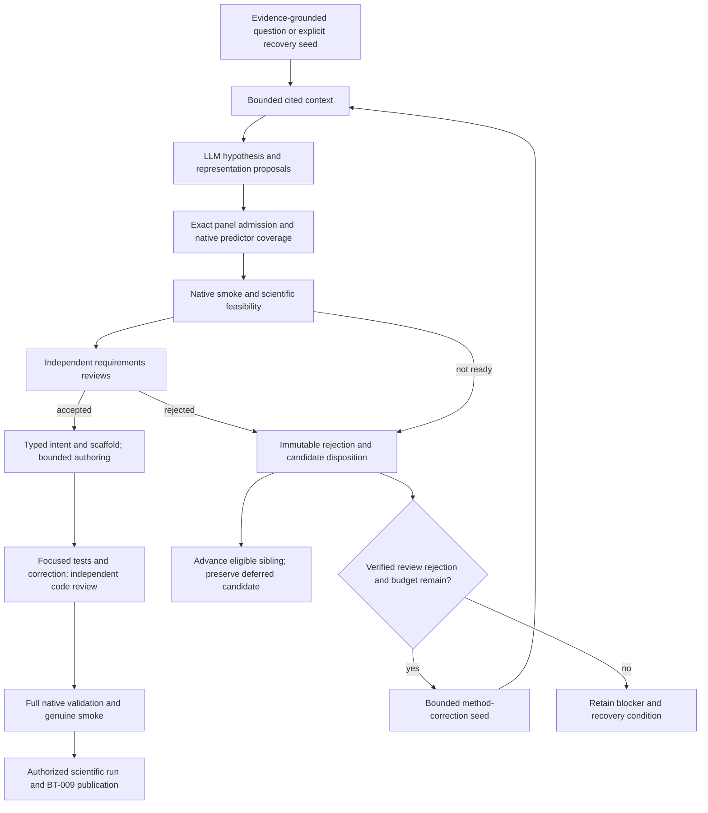

# 12. Requirements Recovery and Current Certification

**Targeted source and runtime audit:** 2026-11-16.
**Scope:** research discovery, requirements, authoring boundaries and bounded recovery.
This is not a new whole-company operational certification.

## Evidence and source pins

| Component | Pin or observation | What it establishes |
|---|---|---|
| Swarm Control Plane | `2e49cd7` on GitHub main | Bounded requirements-correction scheduler and typed dispositions, following immutable review recovery and native feasibility handoff fixes |
| Bulletproof BT | `72dbd592662dc1922e9c144ef69bc58ce5f45af1` on GitHub main | Current commissioned laboratory source; explicit log-level operators, lower-tail support semantics, research decision frame and outcome-tail boundaries |
| VM2 API and discovery/campaign directors | Image `sha256:505d9b7730ddb469742a7f297e8868f98f3c10b819fd16cd9435b64b2abd454a` | Matching deployed image; API health observed after rollout |
| Targeted backend regression suite | 377 tests passed before deployment | Dispositions, correction bounds, discovery, campaign, recovery, feasibility and requirements handoff; not a full cross-repository suite |
| R14 and R15 | Read-only canonical database queries on 2026-11-16 | Candidate and campaign outcomes below; no native trial or successful authoring claim |

Primary implementation references at the control-plane pin:

- [Correction scheduler](https://github.com/Chinedum-iwueke/swarm-control-plane/blob/2e49cd7/backend/app/services/alpha_requirements_correction.py): `queue_requirements_correction`, `correction_depth`.
- [Typed dispositions](https://github.com/Chinedum-iwueke/swarm-control-plane/blob/2e49cd7/backend/app/services/alpha_disposition.py): `RequirementsDisposition`, `disposition_for`, `retain_disposition`.
- [Immutable recovery](https://github.com/Chinedum-iwueke/swarm-control-plane/blob/2e49cd7/backend/app/services/alpha_candidate_recovery.py): `recovery_scope`, `method_revision_scope`, `validate_method_revision`, `matching_recovery`.
- [Requirements handoff](https://github.com/Chinedum-iwueke/swarm-control-plane/blob/2e49cd7/backend/app/services/alpha_requirements_handoff.py): `ensure_reviewed_requirements`, `hydrate_retained_rejection`, basis lineage.
- [Campaign transitions](https://github.com/Chinedum-iwueke/swarm-control-plane/blob/2e49cd7/backend/app/services/alpha_campaign.py): `_retain_pre_authoring_deferral`, `reconcile_campaign`.
- [Discovery scheduling](https://github.com/Chinedum-iwueke/swarm-control-plane/blob/2e49cd7/backend/app/services/alpha_discovery.py): `_next_founder_idea`, `reconcile_mandate`, retrieval rotation and empty-output handling.
- [Native validation contract](https://github.com/Chinedum-iwueke/bulletproof_bt/blob/72dbd592662dc1922e9c144ef69bc58ce5f45af1/docs/requirements-aware-validation.md).

## Current execution path

**Diagram XI-REC-001 - Requirements recovery, not guaranteed approval**

Edges describe implemented routing or guarded downstream contracts, not a claim that
R14/R15 reached every node. In particular, the correction scheduler selects verified
requirements-review rejections; it is not a general executor for every `repair`
disposition. Native-feasibility failures can be labelled repair without this scheduler
automatically creating their successor. That gap remains open.

## What the correction controller actually does

The controller is deterministic software, not an additional LLM agent. Under a current
mandate it examines up to 32 recent requirements publications from that mandate,
validates rejection custody and scientific non-exposure, and queues an internal
recovery seed after already queued founder ideas. Its actor is
`requirements-correction-controller`, not `founder-operator`.

The seed reuses the existing intelligence, hypothesis and representation workers.
Those model calls author proposals; existing admission, feasibility and independent
review judge them. The controller itself performs no inference, validation experiment,
approval or trade. It preserves exact candidate/rejection digests and parent lineage.

- At most two method-correction successors per persisted lineage.
- A completed or failed seed is not reissued for unchanged evidence in that mandate.
- Mandate validity, pause and ordinary cycle/hypothesis/trial budgets remain binding.
- Old candidates from another mandate require explicit recovery selection.
- The scientific question, clock, target, required panels and support minima remain
  guarded. Method corrections do not silently change the hypothesis or shrink support.
- A correction-budget stop requires diagnosis or new authority; it is not proof that
  the scientific idea was falsified. Automated architectural diagnosis is not complete.

## Typed dispositions and their limits

Every disposition carries a reason code, evidence digest, owner, recovery condition,
automatic-repair flag and `execution_authority=false`. Campaign terminal reasons and
deferral records carry these fields; scheduler/constraint events use deduplicated
`requirements_disposition_recorded` records. No new dedicated Mission Control panel
was delivered by this backend change.

| Disposition | Evidence/routing boundary | Owner and next condition |
|---|---|---|
| `repair` | Default for ordinary specification rejection or unclassified contract defects | Requirements producer; changed method plus deterministic checks and fresh review |
| `await_data` | Missing admitted predictor coverage or recognized native contiguous-history codes | Data admission; verified coverage or authorized window successor |
| `scientifically_infeasible` | Recognized native event-support failure under the frozen design | Senior researcher; reviewed redesign or new question, not weaker acceptance |
| `requirements_conflict` | Guarded attempt to reduce immutable support requirements | RI director; resolve through a reviewed successor, not an override |
| `requires_new_question` | Guarded scientific identity, clock or target change | Senior researcher; separately admitted question |
| `await_authority_or_capacity` | Recognized mandate/pause/correction-budget or capacity reason | Research operations; restore authority/capacity and recheck evidence |

This is not a complete semantic classifier of reviewer prose. The presence of words
such as "impossible" or "missing data" in a review does not establish one of the
stronger conclusions. Existing provider circuits enforce quota waits separately;
the disposition vocabulary does not prove every operational blocker has a unified UI
or an automatic remediation worker.

## R14 and R15: observed outcomes

| Mandate | Scope and identity | Observed terminal outcome |
|---|---|---|
| R14 | `7c3476a8-ceaf-4f52-8036-6caf76e44981`; digest `c37e8466eaee3f8143f2a5c40123c9851b82228dca5939c7dab2d94d0a5273b2` | Two candidates independently rejected before engineering; two zero-trial deferrals; campaign `f5644830-5d7a-4adb-82c1-712dedc5f439` completed without a candidate |
| R15 | `4c88c7c2-1fdc-4316-a0cb-3935e26bc986`; digest `77d7981ec60ed2991cb6dceb6f761ca8b18e442241db62d78d8e6d6c8c423926`; approved 2026-11-16 at 17:20:21 Stockholm time | Completed two recovery cycles and two hypotheses, zero trials; both campaigns completed without a candidate |

R15 explicitly recovered the BTC volume-acceleration and SPX price-volume questions
from R14, with two founder-queued method-correction seeds. This demonstrates the
explicit successor path, not automatic rejection-to-seed scheduling by the new
controller. One successor stopped at `resolve_native_requirements_feasibility`; the
other at `scientific_requirements_rejected`. Both retained `repair` dispositions.

SPX review found unresolved source-versus-bundle dataset indexes and observation
requirements larger than the available partitions: 10,000 required training
observations against 4,380 training bars, and 5,000 per held-out gate against 2,190
bars. It also rejected unsupported precision/dependence justifications. Coverage
does not establish point-in-time membership, observed liquidity support or power.
The increased support requirements are not a successful repair merely because they
preserve or exceed old minima. Deterministic upper-bound checks should catch this
before another paid review.

**Neither R14 nor R15 authored a successful strategy, started a scientific trial, or
published a new native terminal BT-009 result.** Their exhausted budgets must not be
rewritten or treated as active commissioning authority.

## Provider and laboratory changes since the older audit

Codex-only authoring is the default as of 2026-11-12. Copilot is an optional hybrid
route; the in-house Ollama adapter remains experimental. The persistent selector is
`SWARM_ENGINEERING_AUTHOR_PROVIDER` in the protected provider configuration. Codex
correction and independent review are separate calls, not author self-approval.
Historical Copilot rehearsal remains valid evidence only of that rehearsal.
See the [provider runbook](https://github.com/Chinedum-iwueke/swarm-control-plane/blob/2e49cd7/docs/alpha-013-copilot-hybrid-authoring.md)
and [billing/capacity lanes](https://github.com/Chinedum-iwueke/swarm-control-plane/blob/2e49cd7/docs/runbooks/openai-capacity-and-billing-lanes.md).
Available API-credit routing is not evidence that funded API execution was observed.

Discovery retrieval now rotates facets using prior mandates' query receipts instead
of restarting the same selection each one-cycle mandate. Empty hypothesis lists
terminate without a representation-model call. Nine changed citations were observed
in a bounded retrieval probe; citation variation is not a reasoning-quality score.

Bulletproof's recent revisions distinguish research decision frames from minute
execution rows, separate outcome-tail bars from fresh decisions, validate scientific
native results separately from trade-log holdout, and expose explicit `natural_log`
and `log1p` transformations. Strict lower-tail support uses its own nominal quantile
bound rather than upper-tail arithmetic. These source repairs do not certify every
producer-selected transformation or every future hypothesis.

## Certification still required

1. Correct dataset-index and observation-capacity contradictions before paid review.
2. Demonstrate automatic correction selection, changed valid output, fresh independent
   acceptance and safe engineering on genuinely different candidates.
3. Provide recovery for feasibility-only defects, not just review-rejected methods.
4. Observe genuine bounded smoke and one-year native BT-009 publication with artifacts
   and memory, then demonstrate budgeted next-cycle replenishment.
5. Exercise provider open/defer/probe/close behavior and diagnostic escalation under
   controlled conditions before claiming unattended recovery across all lanes.

Historical ALPHA-008 one-year negative receipts and other bounded pilots are not
revoked by these failures. They prove narrower earlier paths. They do not prove the
current general hypothesis-to-engineering pipeline is reliable for arbitrary inputs.

## Documentation audit coverage

The 2026-11-16 pass checked root navigation/context, all book indexes, Book XI chapters
and appendices, implementation/acceptance/reference/question registers, architecture
summaries and the implementation backlog for affected current-state claims. It
cross-checked recent control-plane/native code and the live R14/R15 records. It did
not requalify every service, every historical receipt, the entire corpus, model
reasoning quality, venue connectivity or capital execution.

Books I-X remain normative and dated source audits remain historical. Source PDFs,
the exact-text constitutional requirement ledger and generated research output are
not rewritten by this operational update. Corpus counts, agent counts, deployment
health and historical host roles elsewhere must be interpreted at their stated dates.
