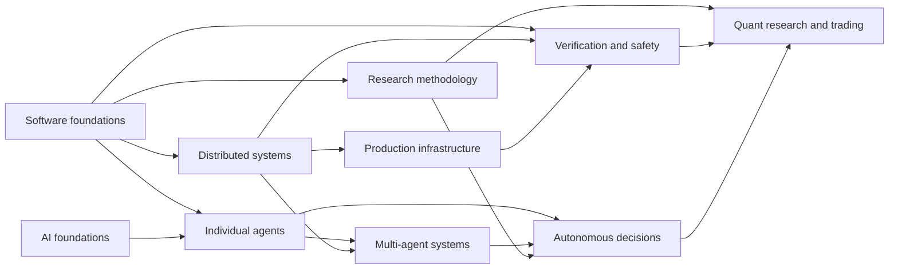

# Personal Knowledge Map

**Purpose:** Phase 3 of the Agentic Systems Mastery and Evolution Program 
**Assumption:** Current proficiency is unknown until demonstrated. Prior model-assisted
delivery proves that the system contains code; it does not prove independent mastery.

## How to use this map

Each domain identifies the real Invariance Research surfaces where the topic appears,
what must be understood, prerequisites, near-term and later priorities, exercises,
foundational references, and an objective test. Paths refer to the repositories named
in the [reconnaissance](../architecture/ARCHITECTURAL_RECONNAISSANCE_2026-10-25.md).

The terms **now** and **later** express learning dependency, not importance. “Later”
does not mean optional.

## A. Software engineering foundations

### Where it appears

- `swarm-control-plane/backend/app/models/task.py::Task`
- `swarm-control-plane/backend/app/services/tasks.py`
- `swarm-control-plane/worker/src/swarm_worker/daemon.py`
- `swarm-control-plane/worker/src/swarm_worker/service.py`
- Alembic migrations under `swarm-control-plane/backend/alembic/versions/`
- FastAPI route, schema, and service layers under `backend/app/`
- React/TypeScript Mission Control under `mission-control/`
- `bulletproof_bt/src/bt/core/engine.py::BacktestEngine`

### What you need to understand

Python object and type models; exceptions; iterators; resource management; async I/O;
processes versus threads; queues and synchronization; HTTP; SQL transactions and
indexes; schema migration; dependency injection; test doubles; property tests;
package management; Git; Linux process and filesystem semantics; TypeScript and
browser state for the operator surface.

### Prerequisites

Variables, control flow, functions, basic classes, command-line use, and elementary
data structures.

### Priority

**Now:** Python, SQL transactions, HTTP, testing, Git, Linux, async fundamentals, and
debugging. **Later:** performance profiling, advanced type systems, compiler
construction, and frontend architecture beyond operational needs.

### Exercises in the real system

1. Draw the call graph for one API request from route through service to transaction.
2. Write a small lease state machine without reading the current implementation, then
   compare it with `lease_next_task` and `reap_expired_leases`.
3. Add property tests to a toy task queue for duplicate delivery and lease expiry.
4. Explain one Alembic migration's upgrade, downgrade, locking, and rollback risk.
5. Reproduce a Mission Control projection from a fixture API payload.

### Foundations

- *Fluent Python*, Luciano Ramalho.
- *Effective Python*, Brett Slatkin.
- *Designing Data-Intensive Applications*, Martin Kleppmann.
- PostgreSQL documentation: transactions, MVCC, indexes, and locking.
- Python documentation: `asyncio`, typing, and context managers.
- *Software Engineering at Google*, Winters, Manshreck, and Wright.

### Mastery test

Implement and defend a durable bounded task queue with leasing, heartbeats,
idempotent completion, retry limits, tests, and a migration. Diagnose three injected
failures without model-written fixes.

## B. Artificial intelligence foundations

### Where it appears

- Role packages under `swarm-control-plane/worker/role-packages/`
- Conversation planner and reasoning services under `backend/app/services/`
- Research and representation executors under
  `worker/src/swarm_worker/executors/`
- Context-pack and retrieval services in the control plane
- Coding-agent invocation in `engineering_mission.py`

### What you need to understand

Tokens and context windows; transformer attention at a conceptual and mathematical
level; next-token inference; sampling; structured-output constraints; hallucination;
calibration limits; tool calling; prompt and context construction; embeddings;
retrieval; model selection; inference latency and cost; evaluation leakage; why a
model explanation is not independent verification.

### Prerequisites

Linear algebra, probability, derivatives, Python array operations, and basic machine
learning vocabulary.

### Priority

**Now:** inference limitations, tool use, structured outputs, retrieval, provenance,
and evaluation. **Later:** training internals, fine-tuning, interpretability research,
and distributed model training.

### Exercises in the real system

1. Capture the complete context for one research synthesis and label every source.
2. Give the same task to deterministic code, one model, and two role prompts; compare
   supported claims, latency, and cost.
3. Construct adversarial external content that tries to change tool instructions and
   verify containment in a mock environment.
4. Build a 30-question retrieval gold set and calculate recall and irrelevant-token
   ratio for two context builders.

### Foundations

- *Attention Is All You Need*, Vaswani et al.
- *Language Models are Few-Shot Learners*, Brown et al., read critically.
- *Retrieval-Augmented Generation for Knowledge-Intensive NLP Tasks*, Lewis et al.
- Official model-provider documentation for structured outputs and tool calling.
- NIST AI Risk Management Framework and OWASP guidance for LLM applications.

### Mastery test

Design an evaluated model-tool task with a typed output, a deterministic validator, a
prompt-injection test, a cost budget, and a baseline. Explain every failure category
without attributing intent or understanding the evidence does not support.

## C. Individual agent architecture

### Where it appears

- `WorkerDaemon.run` and `WorkerService.run_once`
- `AlphaDiscoveryExecutor`, `AlphaResearchExecutor`,
  `AlphaStrategyReviewExecutor`, and `EngineeringMissionExecutor`
- Agent charters, grants, packages, deployments, and workload identities
- `worker/role-packages/*/instructions.md`

### What you need to understand

Sense-decide-act loops; explicit state machines; tool selection; typed observations;
prompt policy versus executable policy; context assembly; memory access; termination;
budgeting; retry classification; reflection limits; capability security; and the
difference between an agent, a worker, an executor, and a scheduled function.

### Prerequisites

Domains A and B, finite-state machines, API contracts, and threat modeling basics.

### Priority

**Now:** execution loops, tools, state, termination, retry, and authority. **Later:**
adaptive tool policies and learned planners.

### Exercises in the real system

1. Annotate every branch of `WorkerService.run_once` with state, side effect, and
   recovery behavior.
2. Select one named agent and write an `AgentCapabilityContract` including its
   deterministic baseline and retirement condition.
3. Replace one toy “agent” with a function and compare correctness and complexity.
4. Create an infinite-loop and tool-failure fixture; prove bounded termination.

### Foundations

- *Artificial Intelligence: A Modern Approach*, Russell and Norvig, chapters on
  agents, search, planning, and uncertainty.
- ReAct: *Synergizing Reasoning and Acting in Language Models*, Yao et al.
- Statecharts: Harel's original paper and modern state-machine documentation.
- Capability-based security literature, beginning with object-capability concepts.

### Mastery test

Implement a framework-free agent loop with typed tools, explicit state, budget,
termination, durable attempt record, adversarial inputs, and tests. Then justify why
it should be an agent instead of a deterministic function.

## D. Multi-agent systems

### Where it appears

- Research director, senior researcher, representation agent, strategy engineer,
  causality reviewer, strategy reviewer, and capacity executors
- Review routing and profile independence in alpha campaign services
- Agent communication through durable task and artifact contracts

### What you need to understand

Decomposition; specialization; delegation; coordination; shared versus private state;
blackboards; hierarchy; choreography; consensus limits; conflict resolution;
independence; correlated error; communication cost; duplicate work; and when multiple
agents reduce reliability.

### Prerequisites

Domains B and C, graph theory, probability, experimental design, and distributed
systems basics.

### Priority

**Now:** explicit role boundaries, information flow, independent review, baselines,
and duplicate prevention. **Later:** market mechanisms, learned routing, emergent
coordination, and decentralized planning research.

### Exercises in the real system

1. Map the alpha loop as a directed graph and identify every shared-information edge.
2. Test whether removing one role changes verified completion on a fixed task set.
3. Measure reviewer agreement and investigate shared error sources.
4. Design a conflict record that retains two conclusions without prematurely forcing
   consensus.

### Foundations

- *Multiagent Systems*, Shoham and Leyton-Brown.
- *An Introduction to MultiAgent Systems*, Michael Wooldridge.
- Contract Net Protocol and blackboard-system literature.
- Research on debate and self-consistency, treated as empirical techniques rather
  than guarantees of truth.

### Mastery test

Run a controlled comparison of deterministic, single-agent, and multi-agent paths.
Defend the experimental controls and retire the multi-agent design if it does not
earn its coordination cost.

## E. Distributed systems

### Where it appears

- PostgreSQL task leasing and transaction boundaries
- Redis and API services on VM2
- VM1 workers and systemd units
- Mac Mission Control client/server
- Tailscale host connectivity
- Bulletproof scheduler and cross-repository publication

### What you need to understand

Processes and networks; partial failure; timeouts; retries; at-least-once delivery;
idempotency; transactions; isolation; leases; heartbeats; clock assumptions; outbox
patterns; event sourcing; consistency; replication; consensus boundaries; backpressure;
and distributed tracing.

### Prerequisites

Domain A, operating systems, networking, databases, and basic probability.

### Priority

**Now:** partial failure, idempotency, leases, transactions, backpressure, and traces.
**Later:** consensus implementation, large-scale stream processing, and multi-region
deployment.

### Exercises in the real system

1. Produce a happens-before diagram for lease, heartbeat, completion, and reaping.
2. Simulate duplicate publication and prove which database constraint prevents it.
3. Disconnect a test worker and predict every visible state before running the test.
4. Implement the transactional outbox pattern in a toy service and compare it with a
   direct API call inside a database transaction.

### Foundations

- *Designing Data-Intensive Applications*, Martin Kleppmann.
- *Distributed Systems*, Maarten van Steen and Andrew Tanenbaum.
- *In Search of an Understandable Consensus Algorithm*, Ongaro and Ousterhout.
- Martin Kleppmann's and Jepsen's material on distributed consistency and faults.

### Mastery test

Design and fault-test a two-worker durable workflow that tolerates duplicate delivery,
worker death, delayed messages, and restart while preserving one terminal result.

## F. Autonomous decision systems

### Where it appears

- Mandate-driven discovery and campaign replenishment
- Capacity and question schedulers
- Admission, risk-budget, and execution policy services
- Planned ML/RL roles in Books VI and XI

### What you need to understand

Feedback and control; observability and controllability; optimization objectives;
constraints; utility and value of information; uncertainty; exploration versus
exploitation; bandits; Markov decision processes; model-predictive control;
reinforcement learning; reward misspecification; and safe fallback policies.

### Prerequisites

Calculus, linear algebra, probability, statistics, optimization, and domains C-E.

### Priority

**Now:** feedback loops, constraints, uncertainty, value of information, and simple
bandits. **Later:** RL, partially observable models, learned resource allocation, and
adaptive execution policies.

### Exercises in the real system

1. Define the controlled variable, observation, actuator, disturbance, and safety
   constraint for campaign replenishment.
2. Compare FIFO with a simple value-of-information scheduler on recorded tasks.
3. Show how a poorly chosen reward could maximize backtest count while reducing
   scientific value.
4. Build an offline contextual-bandit simulation for task selection with a safe
   deterministic fallback.

### Foundations

- *Feedback Systems*, Astrom and Murray.
- *Convex Optimization*, Boyd and Vandenberghe.
- *Reinforcement Learning: An Introduction*, Sutton and Barto.
- *Algorithms for Decision Making*, Kochenderfer, Wheeler, and Wray.

### Mastery test

Specify and simulate a constrained scheduler under uncertain task value. Demonstrate
safe behavior when estimates are wrong and explain why online RL is not yet warranted.

## G. Production infrastructure

### Where it appears

- Docker Compose on VM2
- systemd services on VM1 and intended execution VPSs
- Tailscale networking
- Alembic migrations and PostgreSQL backups
- GitHub workflows, release branches, and deployment scripts
- Mission Control launch agent on Mac

### What you need to understand

Linux administration; process supervision; containers; networking; DNS; TLS; firewalls;
service discovery; configuration and secret management; immutable artifacts;
deployments; rollbacks; backups; capacity; metrics; logs; traces; and incident response.

### Prerequisites

Domains A and E, command line, networking fundamentals, and security basics.

### Priority

**Now:** systemd, containers, network paths, secrets, deploy/rollback, backup/restore,
and resource diagnosis. **Later:** cluster orchestration and multi-region architecture.

### Exercises in the real system

1. Reconstruct one deployed service from unit file to process, environment, network,
   database, logs, and health check.
2. Build a release manifest binding commits, images, migrations, and host roles.
3. Restore a scrubbed database backup into an isolated environment.
4. Run a staging game day and write the incident timeline.

### Foundations

- *Site Reliability Engineering*, Beyer et al.
- *The Linux Programming Interface*, Michael Kerrisk, selected chapters.
- Docker, systemd, PostgreSQL backup, and OpenTelemetry official documentation.
- *Release It!*, Michael Nygard.

### Mastery test

Deploy a non-capital staging stack from a versioned manifest, observe it, introduce a
failure, recover it within declared objectives, and produce an evidence-backed
postmortem.

## H. Verification and safety

### Where it appears

- Authority service, approval digests, charters, grants, and workload identities
- Independent strategy and causality reviewers
- Bulletproof scientific gates and producer receipts
- Demo certification, freeze, kill, and recovery workflows
- Security assurance workflows and repository tests

### What you need to understand

Invariants; contracts; static and dynamic validation; property and mutation testing;
formal methods basics; independent evaluation; simulation; fault injection; threat
modeling; least privilege; approval semantics; fail-safe defaults; recovery; and
safety cases.

### Prerequisites

Domains A, C, E, G, probability, and basic security.

### Priority

**Now:** invariants, property tests, threat modeling, permission boundaries, fault
injection, and approval meaning. **Later:** model checking, theorem proving, and
quantitative safety cases.

### Exercises in the real system

1. Convert five constitutional invariants into executable property tests.
2. Mutation-test strategy timing and prove the evaluator detects leakage.
3. Threat-model external research ingestion through privileged tool execution.
4. Design a kill drill that distinguishes stopping intake, draining work, freezing
   orders, and flattening positions.

### Foundations

- *The Art of Software Security Assessment*, Dowd, McDonald, and Schuh.
- *Property-Based Testing with PropEr, Erlang, and Elixir*, principles transferable to
  Python tools such as Hypothesis.
- Leslie Lamport's *Specifying Systems* and TLA+ materials.
- NIST Secure Software Development Framework.

### Mastery test

Write a small formal or executable state model for a consequential workflow, generate
fault sequences, identify an invariant violation, repair it, and show the counterexample
no longer occurs.

## I. Research methodology

### Where it appears

- Hypothesis cards, mandates, experiment families, and campaign records
- `StrategyIntent`, preregistration, bounded parameter grids, and walk-forward splits
- Independent review, negative-result retention, and BT-009 publication
- Planned orchestration benchmark suite under `evaluations/`

### What you need to understand

Falsifiability; operational definitions; experimental units; controls; confounding;
preregistration; sampling; statistical power; multiple testing; selection bias;
ablation; replication; effect size; uncertainty; causal inference; benchmark design;
and reproducible reporting.

### Prerequisites

Probability, statistics, Python data analysis, and critical reading.

### Priority

**Now:** hypotheses, baselines, controls, leakage, selection accounting,
reproducibility, and uncertainty. **Later:** advanced causal inference, sequential
testing, and meta-research.

### Exercises in the real system

1. Rewrite a vague market topic as a falsifiable card with timing and failure rules.
2. Audit one experiment family for its true number of attempted variants.
3. Design an ablation showing whether a specialized reviewer adds value.
4. Replicate a terminal negative result from immutable inputs.

### Foundations

- *The Design of Experiments*, R. A. Fisher, read with modern commentary.
- *Causal Inference: The Mixtape*, Scott Cunningham.
- *The Book of Why*, Pearl and Mackenzie, as an introduction.
- *Statistical Rethinking*, Richard McElreath.
- CONSORT-style reporting principles adapted to computational experiments.

### Mastery test

Preregister and run a controlled software-architecture experiment with a baseline,
power or sample rationale, immutable artifacts, failure criteria, and a conclusion no
stronger than the evidence.

## J. Quantitative-research and trading infrastructure

### Where it appears

- `bulletproof_bt/src/bt/data/resample.py::TimeframeResampler`
- `bulletproof_bt/src/bt/core/engine.py::BacktestEngine`
- strategy authoring and governance modules
- portfolio capacity, risk-budget, deterministic-risk, OMS, routing, telemetry, and
  venue certification services
- Books IV-VIII and their implementation references

### What you need to understand

Market data structure; event time versus processing time; OHLCV construction;
corporate/contract metadata; point-in-time universes; returns and stationarity;
fractional differentiation and its assumptions; feature timing; labels; transaction
costs; microstructure; walk-forward validation; portfolio construction; capacity;
risk; OMS semantics; reconciliation; and venue failure modes.

### Prerequisites

Statistics, time series, numerical Python, domains A, E, H, and I, plus basic finance.

### Priority

**Now:** point-in-time data, resampling, leakage, costs, backtest mechanics,
reproducibility, OMS idempotency, and risk isolation. **Later:** advanced portfolio
optimization, market impact, ML/RL, and live adaptive execution.

### Exercises in the real system

1. Prove with timestamps that a resampled feature uses only completed source bars.
2. Implement a naive backtest and enumerate how it differs from Bulletproof.
3. Reconcile an order/fill/position event history after duplicate and delayed events.
4. Compare a signal's gross result, realistic-cost result, and stressed-cost result.
5. Test fractional differentiation on a fixed dataset while measuring stationarity and
   retained memory; do not assume one transform is universally superior.

### Foundations

- *Advances in Financial Machine Learning*, Marcos Lopez de Prado, read critically
  and reproduce claims rather than treating them as authority.
- *Analysis of Financial Time Series*, Ruey Tsay.
- *Algorithmic Trading and DMA*, Barry Johnson.
- *Trading and Exchanges*, Larry Harris.
- Exchange API and instrument-rule documentation for the exact tested venue.

### Mastery test

Design, implement, and independently reproduce a point-in-time, cost-aware,
walk-forward experiment whose card, data representation, strategy semantics, logs,
and terminal receipt agree. Separately explain why this says nothing conclusive about
future profitability.

## Cross-domain dependency map

**Diagram MASTERY-001 — Knowledge-domain learning dependencies**

**Interpretation.** The map is a learning dependency, not a runtime architecture.
Reliable software, experimental method, and safety precede advanced autonomy. ML and
RL sit downstream of these foundations rather than substituting for them.
