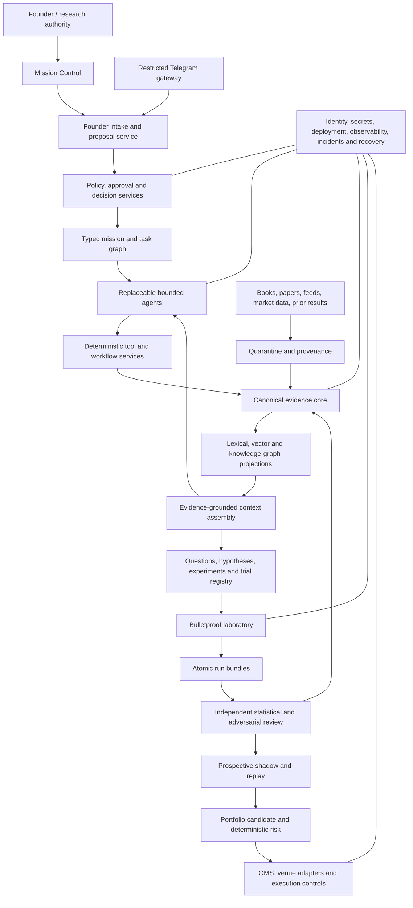
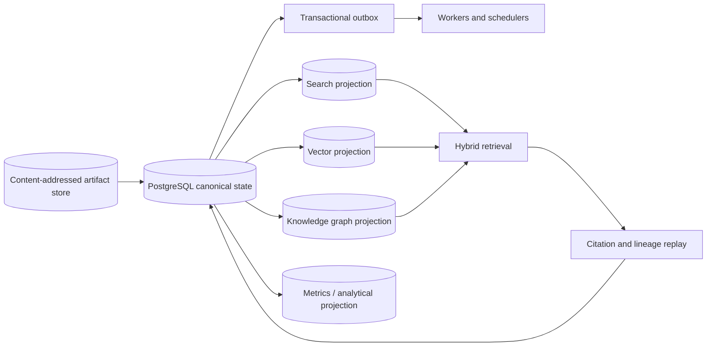
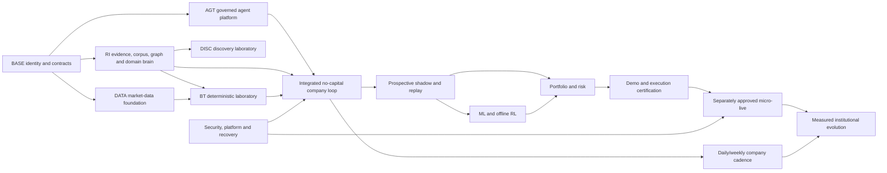

# Bible Capability Coverage and Complete Company Build Plan

**Status:** Coverage authority for implementation planning  
**Goal:** No capability promised by the ten-volume Bible remains merely aspirational,
implicitly bundled, or accepted without intended-environment evidence.

## 1. Completion contract

A working company is not established by completing documents or unit tests. Each
capability below must pass six gates:

1. **Contract:** canonical identities, schemas, events, states, authority and failure semantics.
2. **Implementation:** deterministic service or bounded agent, typed interfaces and migrations.
3. **Evidence:** positive, negative, authorization, idempotency, determinism, load, failure and recovery tests.
4. **Operation:** telemetry, SLO, alert, runbook, backup, restore, rollback and accountable owner.
5. **Integration:** an end-to-end dossier proves the capability inside the institutional loop.
6. **Qualification:** intended-environment evidence and an explicit acceptance decision with expiry.

No milestone may use “covered elsewhere” without naming the owning package. No agent
is a substitute for a missing deterministic service. No projection, graph, embedding,
cache or model output is canonical state.

`BASE-003` makes this contract machine-verifiable through the canonical
[requirement ledger](../requirements/README.md). It enumerates captured normative
statements and appendix contracts with stable source-derived IDs, owners, packages,
verification methods, dispositions and evidence rules. The chapter-level matrix in this
document remains the planning baseline; the ledger and CI validator detect drift and
orphaned coverage. Exact extraction is machine-assisted, so a domain review remains
mandatory before any requirement disposition changes from `planned`.

## 2. Target architecture

### Canonical and derived stores

PostgreSQL owns transactions and canonical metadata; the artifact store owns immutable
payloads; search, vectors, graphs and analytics are disposable, versioned projections.
This keeps the institutional brain useful without making a model or graph database the
authority.

## 3. Dependency-ordered delivery map

## 4. Engineering work packages

The existing `BASE-*`, `RI-001..006`, `OPS-001..003`, `BT-001..003`, `WS-001`,
`DISC-001`, `SHADOW-001`, `ML-001`, `PORT-001`, `LIVE-001` and `LLM-001` packets
remain valid. The packages below split missing or oversized scope into independently
provable increments. Each must be copied into the executable backlog before work starts.

### A. Research Intelligence and institutional memory

| Package | Deliverable | Acceptance boundary |
|---|---|---|
| RI-007 | Legacy inbox, prior-result and Bulletproof projection migration plus incremental sync | Every item reconciled; idempotent refresh; citation replay; restore proof |
| RI-008 | Typed knowledge/projection graph and deterministic cognitive tool registry | Rebuildable access-filtered graph; tool and path receipts replay |
| RI-009 | Domain curricula, corpus quality and institutional-brain evaluation | Held-out domain, contradiction, citation, abstention and calibration thresholds pass |
| RI-010 | Memory consolidation, decay, lawful deletion and supersession | Retention/deletion propagates to all projections without erasing audit lineage |
| RI-011 | Production-scale retrieval and model-independent reranking evaluation | Declared relevance/latency/SLO thresholds pass at representative corpus scale |

### Foundation assurance

| Package | Deliverable | Acceptance boundary |
|---|---|---|
| BASE-003 | Machine-verifiable Bible requirement ledger and CI coverage validator | Every normative requirement has a unique ID, owner, work package, test/evidence disposition and valid dependency |

### B. Governance and company operating system

| Package | Deliverable | Acceptance boundary |
|---|---|---|
| GOV-001 | Decision-rights, veto, delegation, exception and emergency policy engine | Separation-of-duty and revocation property tests pass |
| GOV-002 | Orthogonal lifecycle state machines for research, evidence, operations and capital | Invalid transitions impossible; every transition attributable and replayable |
| GOV-003 | Promotion, demotion, quarantine, retirement and reinstatement service | Consequence-specific approvals and rollback/expiry proven |
| GOV-004 | Immutable audit, policy versioning and compliance evidence export | Complete decision/action chain reconstructs from fresh client |
| CAD-001 | Event-driven daily, weekly, monthly and quarterly operating cadence | Missed, duplicate and delayed reviews reconcile without duplicate action |
| CAD-002 | Institutional scorecards, retrospectives and postmortem-to-policy loop | Metrics cannot self-authorize change; accepted learning has lineage |

### C. Agent platform and bounded digital workforce

| Package | Deliverable | Acceptance boundary |
|---|---|---|
| AGT-001 | Agent charter, role, capability, grant, conflict and revocation registry | Every task maps to an active least-privilege grant and accountable role |
| AGT-002 | Provenance-bearing context assembly, working memory and dossier service | Minimum sufficient context; contamination and protected-data tests pass |
| AGT-003 | Typed task graphs, messages, deliberation, budgets and termination | Dependency, cancellation, deadlock, runaway and correlated-failure tests pass |
| AGT-004 | Prompt/policy registry, injection defense and model-output validation | Prompt/version lineage and adversarial evaluation gate every release |
| AGT-005 | Agent benchmark, calibration, shadow evaluation and release scorecard | Role-specific reliability thresholds and rollback-to-prior package pass |
| AGT-006 | Independent evaluator routing and anti-collusion controls | Producer cannot select/impersonate evaluator; correlated-runtime risk visible |
| AGT-007 | Engineering, infrastructure, knowledge, research and production role catalog | Each deployed role has bounded workflows, permissions, SLO and replacement proof |
| AGT-008 | Evidence-governed improvement proposals and package promotion | Agents propose only; rehearsed evaluation and human policy govern promotion |
| LLM-001 | Provider-neutral frontier/open-weight runtime gateway after core completion | Shadow benchmarks prove workload-by-workload quality, security and fallback |

### D. Data and deterministic Bulletproof laboratory

| Package | Deliverable | Acceptance boundary |
|---|---|---|
| DATA-001 | Instrument master, calendars/clocks, venue identity and reference-data service | Point-in-time identity and corporate/venue change fixtures pass |
| DATA-002 | Immutable raw/curated market-data catalog and availability ledger | Gaps, duplicates, corrections, membership and lookahead tests pass |
| DATA-003 | Quality, lineage, entitlements, retention and lake observability | Read-only source policy, quality SLOs and recovery rehearsal pass |
| BT-001 | Full-suite and contract-drift closure | No unexplained collection or test failures |
| BT-002 | Immutable dataset/snapshot availability contract | Every run input is point-in-time and digest-bound |
| BT-003 | Atomic digest-finalized run bundle | Repeat/interruption/corruption/idempotency tests pass |
| BT-004 | Event-driven engine causality, accounting and deterministic state | Golden, differential, property and time-causality suites pass |
| BT-005 | Fill, fee, funding, borrow, benchmark and diagnostic models | Calibrated model assumptions are explicit and stressable |
| BT-006 | Experiment grid/orchestration, search ledger and resource budgets | Every evaluation is registered and charged to a search family |
| BT-007 | Representation, labels, features and fit-boundary contracts | Leakage and train/evaluation boundary tests pass |
| BT-008 | Laboratory API and RI publication integration | Registered trial to canonical run bundle replays end to end |

### E. Autonomous discovery laboratory

| Package | Deliverable | Acceptance boundary |
|---|---|---|
| DISC-001 | Evidence-grounded daily research director | Every question replays to evidence, gaps and budget |
| DISC-002 | Observation, opportunity and anomaly mapping | Anomaly is separated from opportunity; null controls pass |
| DISC-003 | Representation and factor experiment language | Search space is typed, causal-time safe and reproducible |
| DISC-004 | Random, structured, Bayesian and evolutionary search services | Search history complete; budget and stopping deterministic |
| DISC-005 | Symbolic/program search with complexity and semantic constraints | Generated programs are sandboxed, reproducible and search-accounted |
| DISC-006 | Mechanism, competing explanation and falsification service | Alternatives and decisive tests precede promotion |
| DISC-007 | Multiple-testing, selection-bias and research-overfitting auditor | Family-wise/FDR and deflated evidence reports bind to full search history |
| DISC-008 | Bounded autonomous research sessions and agenda optimization | Session terminates on budget/stop; negative and invalid outcomes retained |
| DISC-009 | Discovery portfolio and information-gain scheduler | Allocation is to inquiry only, never capital; diversity and duplication visible |

### F. Prospective evidence, ML and reinforcement learning

| Package | Deliverable | Acceptance boundary |
|---|---|---|
| SHADOW-001 | Immutable prospective journal and replay | Restart, time, duplicate, outage and parity tests pass |
| SHADOW-002 | Candidate monitoring, degradation, incident and re-evaluation | Decay cannot silently promote or continue a candidate |
| ML-001 | Feature/model/fit/calibration registry and reproducible training | Seed/environment/data lineage reproduces within declared tolerance |
| ML-002 | Causal split, label, feature and representation pipelines | Leakage, overlap, embargo and point-in-time tests pass |
| ML-003 | Supervised, unsupervised, regime and meta-labeling evaluation | Baselines, stability and conditional value gates pass |
| ML-004 | Calibration, uncertainty, conformal/abstention and interpretability | Miscalibration and shift trigger abstention/demotion |
| ML-005 | Cost, slippage, capacity and conditional execution models | Prospective calibration beats declared baselines without authority escalation |
| ML-006 | Drift, degradation, retraining proposal and model retirement | Retraining is a new registered trial, never silent mutation |
| RL-001 | Offline-RL dataset and policy-evaluation contract | Behavior policy, support, confounding and leakage audits pass |
| RL-002 | Conservative/off-policy evaluation and safe policy proposal | Stress and uncertainty bounds pass; output remains shadow-only |
| RL-003 | RL sizing/allocation/execution research sandbox | Hard deterministic risk wrapper dominates learned policy |

### G. Portfolio construction and deterministic risk

| Package | Deliverable | Acceptance boundary |
|---|---|---|
| PORT-001 | Versioned portfolio-candidate and forecast normalization | Inputs are eligible, calibrated, attributable and stale-safe |
| PORT-002 | Dependency, diversification and concentration service | State-dependent correlation and concentration stress tests pass |
| PORT-003 | Construction benchmark ladder and robust optimizer registry | Solver feasibility, rounding and deterministic fallback proven |
| PORT-004 | Turnover, transaction-cost, capacity and liquidity service | Capacity claims bind to execution evidence and uncertainty |
| RISK-001 | Drawdown, tail, scenario and reverse-stress engine | Path-dependent loss envelope and model-failure scenarios pass |
| RISK-002 | Leverage, margin, liquidation, funding and prop-rule engine | Venue/rule state machines and hard-limit property tests pass |
| RISK-003 | Dynamic risk budgets and regime-aware scaling | Uncertainty reduces risk; procyclicality guards pass |
| RISK-004 | Admission, allocation, scaling, demotion and retirement service | Separate authority, expiry, kill and rollback proven |
| RISK-005 | Real-time deterministic pre-trade and portfolio risk service | Fail-closed consistency, latency and degraded-mode SLOs pass |

### H. Market microstructure, OMS and execution

| Package | Deliverable | Acceptance boundary |
|---|---|---|
| EXEC-001 | Canonical market/order events, clocks and state reconstruction | Event ordering, clock drift and point-in-time reconstruction pass |
| EXEC-002 | LOB, trade formation, funding, basis, OI and liquidation models | Reconstruction limitations and source quality are explicit |
| EXEC-003 | Venue/instrument master and fragmentation/consolidation service | Cross-venue identity, comparability and routing constraints pass |
| EXEC-004 | OMS, idempotent order lifecycle, adapters and reconciliation | Disconnect, duplicate, partial fill, unknown order and restart tests pass |
| EXEC-005 | Queue, latency, impact, slippage and adverse-selection calibration | Replay-to-observed parity meets declared tolerances |
| EXEC-006 | Baseline execution algorithms and deterministic scheduler | Cost-risk evaluation and hard constraints pass |
| EXEC-007 | Pre-trade/runtime controls, freeze, kill and human recovery | Kill remains independent, tested and available under degradation |
| EXEC-008 | Venue adapter certification and demo parity dossier | No adapter reaches micro-live without environment-specific certification |
| EXEC-009 | Venue/strategy degradation and execution feedback loop | Alerts cause bounded demotion/review, not self-modifying execution |
| EXEC-010 | Asset-class expansion qualification | Each new market gets a separate mechanics/data/adapter/risk dossier |

### I. Product, Mission Control and founder operations

| Package | Deliverable | Acceptance boundary |
|---|---|---|
| UI-001 | Mission Control operating model and global state projections | Founder can distinguish proposal, approval, execution, evidence and incident state |
| UI-002 | Agent inspector with charter, responsibilities, grants and deployment health | Effective permissions and conflicts are visible, current and attributable |
| UI-003 | Research corpus, graph, dossier, trial and daily-agenda workbench | Source-to-question-to-result citation replay works from the UI |
| UI-004 | Approval center with digest diff, risk, expiry and safe deep links | One active notification per gate; stale approval cannot execute |
| UI-005 | Deployment, service, SLO, backup, incident and recovery console | Read-only by default; mutations use typed approvals and brokered runbooks |
| UI-006 | Accessible responsive desktop/Mac experience and operator usability | Critical workflows pass keyboard, accessibility and founder task testing |
| CHAN-001 | Restricted Telegram intake, approval and status channel | Plain English becomes proposals; secrets/sudo never enter chat |

### J. Platform, security and production operations

| Package | Deliverable | Acceptance boundary |
|---|---|---|
| OPS-001 | Durable approval outbox and readiness reconciliation | No missed lease window, duplicate flood or manual `once` requirement |
| OPS-002 | Four-domain plain-English intake pilots | Engineering, infrastructure, research and knowledge transcripts pass |
| OPS-004 | Fleet observability and founder alerting | VM1/VM2 resource and outage incidents are sustained-signal, deduplicated, independently observable and replayable |
| PLAT-001 | Service catalog, ownership, API/event compatibility and dependency inventory | Every runtime has owner, SLO, data class and recovery plan |
| PLAT-002 | Workload identity, RBAC/ABAC, secret issuance/rotation and break-glass | Least privilege, revocation, audit and rotation drills pass |
| PLAT-003 | Artifact/package supply chain, signing, SBOM and promotion | Only verified rehearsed artifacts can deploy |
| PLAT-004 | Deployment controller, environment manifests, canary and rollback | VM1-to-source-to-VM2/Mac provenance and rollback proven |
| PLAT-005 | Metrics, logs, traces, SLOs, alert routing and capacity telemetry | Actionable alerts and bounded-cardinality/no-secret tests pass |
| PLAT-006 | Incident command, evidence capture, postmortem and recovery actions | Simulated incidents close with attributable learning |
| PLAT-007 | Backup, restore, disaster recovery and off-host retention | Measured RPO/RTO on intended machines, including control plane and RI |
| PLAT-008 | VM2 application/database/container/certificate/DNS operational packages | Rehearsal, cutover, rollback, rotation and owner handoff pass |
| PLAT-009 | Cleanup, retention, workspace/artifact lifecycle and storage efficiency | Quotas and lawful retention prevent silent disk exhaustion |
| SEC-001 | Threat models and security test suites for services, agents, corpus and capital | High-risk paths have abuse cases, detection and containment evidence |
| SEC-002 | Host/container/network hardening and vulnerability management | Intended-machine baseline and patch/recovery process pass |
| OPS-003 | Runtime/vendor replacement and integrated disaster exercise | Replacement preserves canonical lineage and bounded operation |

### K. Integrated acceptance and controlled capital path

| Package | Deliverable | Acceptance boundary |
|---|---|---|
| WS-001 | No-capital walking skeleton | Evidence to decision loop replays, including negative and invalid paths |
| WS-002 | Whole-company degraded-mode and partial-publication compensation | No split-brain authority or orphan canonical state |
| DEMO-001 | Venue demo certification with production-like controls | Reconciliation, kill, restart and incident drills pass |
| LIVE-001 | Founder/risk-approved micro-live canary | Quantified loss envelope, expiry, independent kill and rollback pass |
| LIVE-002 | Evidence-gated scaling and multi-candidate production | Scaling requires prospective, portfolio, execution and operations dossiers |
| EVOLVE-001 | Schema/role/model migration and retirement | Old evidence replays after replacement; no history loss |
| EVOLVE-002 | Scientific throughput, calibration, reliability and safety scorecards | Optimization cannot reward volume, confidence theater or concealed negatives |

## 5. Bible-to-package traceability

| Bible authority | Complete implementation destination |
|---|---|
| Book I Ch. 1-5 | GOV-001/004, RI-001/004/010, CAD-002 |
| Book I Ch. 6-9 | DISC-002/003/006/007, BT-002/006/007, RI-008 |
| Book I Ch. 10-12 | PORT-001..004, ML-002..004, RISK-001..003 |
| Book I Ch. 13-16 and appendices | RI-010, CAD-002, EVOLVE-001/002, BASE-001/002/003 |
| Book II Ch. 1-5 and Appendix A | GOV-001/002/004, AGT-001/006, PLAT-002 |
| Book II Ch. 6-10 and Appendix B | DISC-001/008/009, BT-006, GOV-002/003, RISK-004 |
| Book II Ch. 11-17 | AGT-002..008, RI-011, WS-001/002, CAD-001/002 |
| Book III Ch. 1-5 and Appendix A | RI-001/004/007/010, BASE-002 |
| Book III Ch. 6-8 | RI-002/007/009 |
| Book III Ch. 9-11 and Appendix C | RI-003/004/011 |
| Book III Ch. 12-16 and Appendix B | RI-008/010, AGT-002, BT-008 |
| Book III Ch. 17-18 | RI-005/006/009/011, SEC-001, PLAT-005/007 |
| Book IV Ch. 1-5 | DISC-002/003/006/009 |
| Book IV Ch. 6-11 and Appendix A | DISC-003..006, AGT-004, LLM-001 |
| Book IV Ch. 12-17 and Appendices B/C | DISC-007..009, BT-006, GOV-003 |
| Book V Ch. 1-8 | BT-001/002/004/005, DATA-001..003 |
| Book V Ch. 9-15 and Appendices A/B/C | BT-003/006/007/008, RI-001/004 |
| Book V Ch. 16-17 and Appendices D/E | SHADOW-001/002, BT-001/002, DATA-003 |
| Book VI Ch. 1-7 and Appendix A | ML-001/002/003, BT-007 |
| Book VI Ch. 8-12 and Appendices B/C | ML-004/005/006, RI-004 |
| Book VI Ch. 13-16 | RL-001..003, ML-006, RISK-005 |
| Book VII Ch. 1-7 and Appendix A | PORT-001..004, RISK-001 |
| Book VII Ch. 8-12 and Appendices B/C | RISK-001..003/005 |
| Book VII Ch. 13-15 | RISK-004/005, LIVE-001/002 |
| Book VIII Ch. 1-6 | EXEC-001..003, DATA-001/002 |
| Book VIII Ch. 7-12 and Appendices A/B/C | EXEC-004..006/008, SHADOW-001, DEMO-001 |
| Book VIII Ch. 13-16 | EXEC-007/009/010, LIVE-001/002 |
| Book IX Ch. 1-9 and Appendices A/B | AGT-001/006/007, PLAT-002, GOV-001 |
| Book IX Ch. 10-14 and Appendix C | AGT-002..005, RI-008, SEC-001 |
| Book IX Ch. 15-17 | AGT-007/008, PLAT-004/005, EVOLVE-001/002 |
| Book X Ch. 1-7 | BASE-001/002, PLAT-001/003, DATA-001..003, RI-007 |
| Book X Ch. 8-13 | RI-001..011, BT-001..008, SHADOW-001, PORT/RISK/EXEC/LIVE |
| Book X Ch. 14-20 and appendices | BASE-003, PLAT-002..009, SEC-001/002, WS-001/002, EVOLVE-001/002 |

## 6. Release trains and assurance points

1. **Institutional brain:** RI-007..011 plus UI-003. It ends with the real corpus,
   Bulletproof projection, graph and domain evaluation, not fixture-only success.
2. **Reliable digital workforce:** OPS-001/002, GOV-001..004 and AGT-001..008.
   It ends with unattended bounded work, independent review and no approval races.
3. **Research factory:** DATA-001..003, BT-001..008, DISC-001..009 and WS-001.
   It ends with a complete no-capital loop and honest search accounting.
4. **Prospective intelligence:** SHADOW-001/002, ML-001..006 and RL-001..003.
   It ends with reproducible prospective evidence and shadow-only learned policies.
5. **Portfolio and execution:** PORT-001..004, RISK-001..005 and EXEC-001..010.
   It ends with certified demo behavior and deterministic risk dominance.
6. **Resilient company:** UI-001..006, PLAT-001..009, SEC-001/002 and CAD-001/002.
   It ends with observable intended-machine operation and tested recovery.
7. **Controlled capital:** DEMO-001 then separately approved LIVE-001/002. Capital
   remains unavailable until every prerequisite dossier is current.
8. **Evolution:** EVOLVE-001/002 and eventually LLM-001. It proves models, agents,
   schemas and vendors are replaceable without losing institutional memory.

## 7. Definition of an efficient working company

The company claim becomes supportable only when:

- a founder can submit plain English and receive a scoped, costed, approval-ready proposal;
- approved work proceeds without terminal babysitting and stops safely on uncertainty;
- every conclusion replays to sources, code, data, configuration, trials and reviews;
- the real corpus is synchronized, searchable, contradiction-aware and recoverable;
- daily questions come from governed evidence and gaps, not an unexplained prompt rotation;
- research search is fully accounted and negative/invalid outcomes compound knowledge;
- agents are least-privilege, evaluated, replaceable and unable to grant themselves authority;
- data, laboratory, ML/RL, portfolio, risk and execution stages have separate gates;
- production services have SLOs, alerts, backups, restores, rollbacks and incident owners;
- Mission Control shows truth, permissions, evidence, approvals, health and exceptions;
- capital mutation remains separately approved, limited, monitored and killable; and
- old evidence remains replayable after schema, agent, model, vendor or runtime replacement.

This plan assures feature coverage and verifiable completion criteria. It cannot assure
profitability, scientific truth, uninterrupted availability, or the absence of future
requirements; those remain measured claims governed by evidence and revision.
