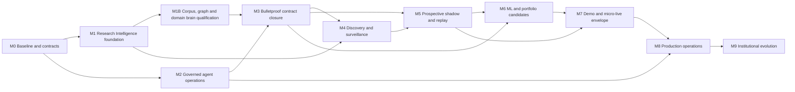

# Invariance Company Engineering Roadmap

**Status:** Dependency-ordered target plan
**Planning unit:** Evidence-gated capability, not calendar promise

**Coverage authority:** This roadmap defines the program-level sequence. The
[Bible Capability Coverage and Complete Company Build Plan](BIBLE_CAPABILITY_COVERAGE.md)
is the feature-level coverage map, and the
[Codex Implementation Backlog](CODEX_IMPLEMENTATION_BACKLOG.md) is the executable
queue. A program milestone is not complete while any required package in the coverage
map lacks its acceptance dossier or an explicit, reviewed deferral.

## Milestone contract

Every milestone below inherits these mandatory fields: canonical objects are versioned and digest-bound; APIs/events/artifacts are typed; secrets remain outside prompts/logs/commits; agents are replaceable and permission-bounded; external mutation requires separate authority; projections are rebuildable; tests include positive, negative, authorization, idempotency, recovery, and migration cases; observability covers latency, error, queue, staleness, and evidence publication; rollback preserves canonical history; completion requires a signed/digest-bound evidence dossier. “Unavailable after” is an explicit non-claim, not postponed documentation.

## Ten-volume requirement coverage

| Canonical volume | Primary implementation destinations |
|---|---|
| Book I — Doctrine | M0 authority invariants; M9 controlled institutional evolution |
| Book II — Hermes OS | M2 governed agent operations; walking-skeleton lifecycle |
| Book III — Research Intelligence | M1 complete foundation; M4 surveillance; M9 durable learning |
| Book IV — Discovery Laboratory | M4 governed discovery and search accounting |
| Book V — Bulletproof BT | M3 contract closure; M5 prospective/replay extensions |
| Book VI — Machine Learning | M6 reproducible feature/model/calibration services |
| Book VII — Portfolio and Risk | M6 portfolio candidates; M7 capital safety envelope |
| Book VIII — Microstructure and Execution | M5 replay; M7 venue certification and canaries |
| Book IX — Agent Architecture | M2 bounded roles; M8 resilient operations; M9 replaceability |
| Book X — Builder's Manual | M0 build contracts; M8 deployment/recovery; backlog task packets |

## Dependency map

## Programs and milestones

### M0 — Audited baseline and compatibility kernel

- **Objective/capability:** Convert present repositories into a controlled implementation baseline with stable identities, claim labels, compatibility rules, and acceptance evidence.
- **Requirements/reuse/gaps:** Books I, II, IX, X; reuse Hermes UUID/digests and Bulletproof schemas; close status ambiguity, environment drift, and undocumented ownership.
- **Affected surfaces:** All four repositories; schema registry, ADRs, CI, release manifests.
- **Objects/interfaces/data:** Schema version, component pin, environment manifest, capability status, evidence receipt; read-only inventories only.
- **Roles/boundaries/security:** Architecture owner, security reviewer, repository owners; no runtime authority changes.
- **Verification/recovery:** Link/schema/contract tests, secret scan, compatibility fixtures; revert additive schema release while retaining audit records.
- **Dependencies/parallelism:** Starts immediately; repository inventories parallelize, canonical identity decisions do not.
- **Exit evidence:** Reproducible baseline dossier and green compatibility suite.
- **Unavailable after:** Production readiness and profitability remain unclaimed.

### M1 — Complete Research Intelligence foundation

- **Objective/capability:** Deliver the complete architectural foundation in the [RI plan](RESEARCH_INTELLIGENCE_FOUNDATION.md), including recovery, scientific objects, hybrid retrieval, citation replay, contradictions, beliefs, protected evidence, evaluation, recovery, surveillance, and tool integration.
- **Requirements/reuse/gaps:** Books III-IV; reuse existing Hermes documents/chunks, registry lineage, domain profiles, memory bridge, and evaluation models through migrations; close the thin lexical/chunk implementation.
- **Affected surfaces:** Control plane, object storage, ingestion workers, Mission Control, Bulletproof publisher.
- **Objects/interfaces/data:** Source/edition/artifact/object/claim/method/assumption/dataset/run/decision/belief/episode schemas; ingestion and retrieval events; retained source artifacts.
- **Roles/boundaries/security:** Librarian, Canon Curator, Knowledge Evaluator, security reviewer; RI cannot approve research or promotion.
- **Verification/recovery:** Golden scientific documents, citation replay, injection/access tests, projection rebuild, backup/restore rehearsal, SLO dashboards.
- **Dependencies/parallelism:** M0; schema kernel precedes ingestion/projections, which then parallelize.
- **Exit evidence:** Minimum vertical-slice dossier specified in RI-F1 through RI-F9.
- **Unavailable after:** Corpus breadth and model quality continue growing; no capital path.

### M1B — Integrate and qualify the real institutional corpus

- **Objective/capability:** Reconcile the Mac research inbox, legacy Hermes records, imported prior results and the bounded Bulletproof memory projection into the canonical evidence core; add graph/cognitive projections and measurable domain grounding.
- **Requirements/reuse/gaps:** Book III Chapters 6-18; reuse RI-001..006 without treating fixture success as corpus migration evidence; close the broad-backfill, graph, deletion, domain-quality and production-scale retrieval gaps.
- **Affected surfaces:** Mac inbox, control plane, object storage, VM1 memory steward, Mission Control, retrieval and graph projections.
- **Objects/interfaces/data:** Corpus inventory, migration receipt, edition/duplicate decision, typed edge, projection manifest, curriculum, coverage/evaluation report.
- **Roles/boundaries/security:** Librarian publishes; Canon Curator resolves identity; evaluator qualifies retrieval; sources and models cannot grant authority.
- **Verification/recovery:** Idempotent sync, corruption/quarantine, exact replay, access inference, deletion propagation, projection rebuild, full restore and held-out domain evaluation.
- **Dependencies/parallelism:** RI-001..006; RI-007 precedes graph/domain qualification. Bulletproof source export may proceed read-only in parallel.
- **Exit evidence:** All eligible existing corpus items have explicit disposition and the domain brain passes declared citation, opposition, calibration and abstention thresholds.
- **Unavailable after:** Uploading more documents never by itself proves expertise or truth.

### M2 — Governed agent operations

- **Objective/capability:** Make plain-language intake, planning, approval, execution, notification, recovery, and audit reliable without terminal babysitting.
- **Requirements/reuse/gaps:** Books II and IX; reuse role packages, restricted workflows, worktrees, leases, Telegram, Mission Control, and supervisor; close notification floods, readiness races, attestation drift, and recovery ambiguity.
- **Affected surfaces:** Hermes API, worker/daemon, planner/supervisor, gateways, dashboards.
- **Objects/interfaces/data:** Proposal, plan, approval, task, lease, capability attestation, incident, recovery action, task dossier.
- **Roles/boundaries/security:** Founder intake planner proposes only; executor cannot expand scope; supervisor retries only approved categories; sudo passwords never traverse Telegram.
- **Verification/recovery:** Lifecycle ordering, stale lease, cancellation, deduplicated notification, chaos/restart and degraded-mode tests.
- **Dependencies/parallelism:** M0; can proceed beside M1 but dossier integration waits for M1.
- **Exit evidence:** Four plain-English pilots (engineering, infrastructure, research, knowledge) complete without manual terminal intervention except explicit approvals.
- **Unavailable after:** Broad arbitrary tasks remain prohibited.

### M3 — Bulletproof laboratory contract closure

- **Objective/capability:** Bind a registered experiment to immutable code/data/config, execute deterministically, finalize a validated run bundle, and publish it to RI.
- **Requirements/reuse/gaps:** Book V; reuse engines, artifacts, grids, truth checks, lake manifests, and Hermes registry; close Appendix E gaps.
- **Affected surfaces:** `bulletproof_bt`, Hermes producer APIs, RI publisher.
- **Objects/interfaces/data:** Dataset manifest, representation/fit artifact, experiment/run/attempt identity, search ledger, run bundle manifest and digest.
- **Roles/boundaries/security:** Laboratory owner produces; independent data/statistical reviewers validate; no promotion authority.
- **Verification/recovery:** Full collection closure, stratified suite, golden/differential/property tests, repeated run, interrupted finalization, corrupt artifact, lake availability fixtures.
- **Dependencies/parallelism:** M0-M2; upstream defect repair and bundle contract can parallelize after schema decisions.
- **Exit evidence:** Walking-skeleton positive-negative-invalid demonstration with publication receipts.
- **Unavailable after:** Tick/order-book fidelity, live venue certification, and portfolio eligibility.

### M4 — Governed discovery and scientific surveillance

- **Objective/capability:** Generate evidence-grounded questions from approved sources and institutional gaps, then account for novelty, duplication, contradictions, and search budget.
- **Requirements/reuse/gaps:** Book IV; reuse daily programs and RI Director; replace static round-robin mandates as the only source with governed candidate routing.
- **Affected surfaces:** RI surveillance, research programs, trial registry, Mission Control.
- **Objects/interfaces/data:** Surveillance item, technique brief, novelty report, contradiction alert, opportunity, question, search family/budget.
- **Roles/boundaries/security:** Director recommends; research authority admits; published technique is not adopted technique.
- **Verification/recovery:** Seeded novelty/duplicate/poisoned-source fixtures, scheduler idempotency, provenance replay, source correction/retraction handling.
- **Dependencies/parallelism:** M1 and M3.
- **Exit evidence:** One weekly surveillance cycle routes a cited question through the walking skeleton and preserves a negative result.
- **Unavailable after:** Autonomous research promotion.

### M5 — Prospective shadow and execution replay

- **Objective/capability:** Observe immutable candidates prospectively and replay orders/fills without capital mutation.
- **Requirements/reuse/gaps:** Books V and VIII; reuse execution events/adapters; add market journal, clock synchronization, replay parity, and environment separation.
- **Affected surfaces:** Bulletproof execution runtime, market-data service, RI, Hermes.
- **Objects/interfaces/data:** Candidate version, shadow observation, order intent, market event, replay fill, reconciliation, incident.
- **Roles/boundaries/security:** Shadow admission separate from research decision; credentials read-only where possible.
- **Verification/recovery:** Time/sequence/property tests, outage and duplicate-event injection, restart replay, cost/fill calibration reports.
- **Dependencies/parallelism:** M3-M4.
- **Exit evidence:** Multi-week or evidence-sufficient prospective dossier with replay and reconciliation.
- **Unavailable after:** Demo/live authority.

### M6 — Reproducible ML and portfolio-candidate services

- **Objective/capability:** Add versioned features/models/calibration/uncertainty and deterministic candidate aggregation without capital allocation.
- **Requirements/reuse/gaps:** Books VI-VII; reuse representation contracts and portfolio sleeves; add training lineage, leakage gates, portfolio dependency/capacity diagnostics.
- **Affected surfaces:** Feature/model registry, Bulletproof, portfolio/risk services, RI.
- **Objects/interfaces/data:** Feature set, fit, model, calibration, prediction, portfolio candidate, risk/capacity report.
- **Roles/boundaries/security:** Model research, independent validation, portfolio admission, and capital authority remain separate.
- **Verification/recovery:** Reproduction, leakage, shift, calibration, stress, concentration, and rollback-to-prior-model tests.
- **Dependencies/parallelism:** M3 and evidence from M5.
- **Exit evidence:** Reproducible model and portfolio-candidate dossiers rejected or admitted to shadow only.
- **Unavailable after:** Capital allocation.

### M7 — Demo and micro-live safety envelope

- **Objective/capability:** Introduce capital only after certified demo behavior, with hard limits, reconciliation, kill switches, and separately approved micro-live canaries.
- **Requirements/reuse/gaps:** Books VII-VIII; reuse execution adapters/safety gates; add venue certification and operational authority.
- **Affected surfaces:** Order/risk/portfolio services, secrets, monitoring, incident response.
- **Objects/interfaces/data:** Admission, allocation, execution policy, venue certification, canary approval, kill event, reconciliation.
- **Roles/boundaries/security:** Production and risk authorities independent of researchers/agents; external mutation always scoped and revocable.
- **Verification/recovery:** Sandbox/demo certification, forced disconnect, partial fill, stale data, limit breach, key rotation, kill and recovery drills.
- **Dependencies/parallelism:** M5-M6 and explicit human approval.
- **Exit evidence:** Demo dossier, then separately approved micro-live dossier within quantified loss envelope.
- **Unavailable after:** Broad production scaling.

### M8 — Production operations and company resilience

- **Objective/capability:** Operate approved services with observable SLOs, backups, restore, rollout, rollback, incident response, and bounded autonomous recovery.
- **Requirements/reuse/gaps:** Books IX-X; reuse VM2 brokered runbooks, service packages, Mission Control, and supervisor.
- **Affected surfaces:** VM2 production, control plane, application/database, workers, telemetry and backups.
- **Objects/interfaces/data:** Deployment, runbook package, change approval, backup, restore drill, incident, SLO and postmortem.
- **Roles/boundaries/security:** Deployment, infrastructure, security, monitoring, backup, and approval roles separated; least privilege and no chat-transmitted sudo credentials.
- **Verification/recovery:** VM2-parity rehearsals, canary/rollback, restore and disaster exercises, secret rotation, service degradation drills.
- **Dependencies/parallelism:** M2; capital services additionally require M7.
- **Exit evidence:** Quarterly-style recovery dossier and continuous SLO evidence.
- **Unavailable after:** Unbounded self-modification.

### M9 — Mature institutional evolution

- **Objective/capability:** Measure scientific throughput and safety, evolve schemas/models/roles compatibly, and retire weak capabilities without losing memory.
- **Requirements/reuse/gaps:** All books; reuse episodes, beliefs, metrics, ADRs, and release evidence.
- **Affected surfaces:** Institution-wide governance, evaluation, architecture and planning.
- **Objects/interfaces/data:** Capability evaluation, supersession, retirement, migration, institutional retrospective.
- **Roles/boundaries/security:** Agents may propose improvements; constitutional and capital authorities remain human-governed.
- **Verification/recovery:** Longitudinal evaluation, backward compatibility, replay of old evidence, model/vendor replacement drill.
- **Dependencies/parallelism:** Builds continuously after M1; production claim requires M8.
- **Exit evidence:** Demonstrated runtime/model replacement and schema migration without loss of evidence lineage.
- **Unavailable after:** Profit guarantees or autonomous constitutional authority.

## First implementation wave

Continue from completed `BASE-001`, `BASE-002`, and `RI-001..006` with `BASE-003`,
`RI-007`, `OPS-001`, `GOV-001`, `AGT-001`, `DATA-001`, and `BT-001` from the
[Codex backlog](CODEX_IMPLEMENTATION_BACKLOG.md). The real-corpus inventory and
approval-race reproduction may run in parallel; canonical schema, authority and
producer-contract decisions remain serialized.
