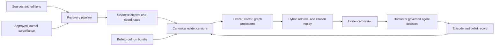

# Research Intelligence Foundation Plan

**Status:** Approved target architecture; implementation is partial
**Priority:** First foundation, alongside identity and governance
**Canonical authority:** Book III

Research Intelligence is durable evidence and institutional memory. It is not a model, a vector index, a promotion authority, or Bulletproof BT. PostgreSQL/object storage hold canonical records and artifacts; lexical, vector, and graph stores are rebuildable projections.

## Foundation contract

## Canonical identities and records

| Record | Minimum identity and lineage |
|---|---|
| Source/edition/artifact | Stable source ID, edition ID, artifact digest, origin, license/access class, acquisition and ingestion versions |
| Scientific object | Object ID, type, parent hierarchy, source coordinates, extraction method/confidence, artifact digest |
| Claim/method/assumption | Exact evidence spans, status, qualifiers, contradictions, supersession, authoring agent/tool |
| Dataset/snapshot | Source, schema, partition/content digests, availability policy, corrections, access class |
| Hypothesis/experiment/trial/run | Immutable specifications, family/search budget, implementation/data identities, attempt and environment |
| Result/review/decision/belief | Evidence digest, independent authorities, rationale, confidence, validity interval, supersession |
| Episode/memory | Task dossier, inputs, tools, outputs, failures, decisions, lessons, protected references |

## Early work packages

### RI-F1 — Identity and schema kernel

Introduce versioned schemas and migrations for every record above. Preserve existing Hermes UUIDs and digests through compatibility aliases rather than replacement. Reject duplicate identity, mutable digest fields, unknown schema versions, and authority conflation.

### RI-F2 — Recovery and ingestion

Build staged ingestion: quarantine, malware/type inspection, provenance capture, born-digital extraction, OCR/layout recovery, structural hierarchy, object extraction, validation, and publish. Preserve page images and coordinates. Tables, figures, equations, footnotes, and citations remain first-class objects with independent confidence. Failed or low-confidence recovery enters a remediation queue, never silent canonical text.

### RI-F3 — Retrieval and citation replay

Combine exact metadata filters, lexical ranking, embeddings, and graph expansion. Return evidence spans, source coordinates, edition, artifact digest, access decision, extraction confidence, retrieval version, and incompatibilities. Citation replay must reconstruct the cited page/object from the retained source artifact and detect stale projections.

### RI-F4 — Contradictions, negative results, and beliefs

Store disagreement rather than averaging it away. Beliefs are attributable, time-bounded conclusions linked to supporting and opposing evidence. Negative and invalid experiments remain retrievable. A belief update creates a new record and supersession edge; it does not rewrite history.

### RI-F5 — Dossiers and memory forms

Provide semantic, episodic, procedural, working, executive, and reflective views over canonical records. A task dossier freezes relevant evidence and permissions for an agent. Completion publishes an episode, tool evidence, decision, open questions, and lessons.

### RI-F6 — Security and permissions

Classify sources and objects; enforce tenant/project/role/purpose access at canonical reads and projection queries. Quarantine untrusted documents. Treat document instructions as data, not executable policy. Strip active content; scan archives; bound parsers; label model-generated text; prohibit secrets in prompts/artifacts; log access without logging protected content. Evaluate indirect prompt injection, poisoned citations, unauthorized cross-project retrieval, and exfiltration attempts.

### RI-F7 — Evaluation, observability, and recovery

Version fixtures for exact citation, table/equation/figure recovery, contradiction retrieval, negative-result recall, permissions, injection resistance, and cross-edition disambiguation. Define ingestion latency/error, retrieval relevance/citation fidelity, stale projection, queue depth, protected-access denial, backup age, restore point, and recovery time SLOs. Rebuild every projection from canonical evidence and prove restore from backup.

### RI-F8 — Surveillance and governed routing

Maintain approved source feeds for finance, trading, economics, ML, portfolio, risk, microstructure, and execution journals. Capture publication identity, retraction/correction state, access terms, novelty against internal memory, technique applicability, contradictions, and evidence quality. Produce technique briefs and alerts. Routing may propose a question or dossier; only research governance may admit it to a program or trial.

### RI-F9 — Deterministic-tool integration

Accept schema-validated, digest-finalized Bulletproof bundles; return immutable publication receipts. Expose evidence retrieval to bounded workers through typed APIs. Every model/runtime is replaceable. The service never interprets a backtest as strategy admission or capital authority.

## Minimum vertical slice acceptance

1. Ingest one Bible chapter, one scientific paper containing a table/equation/figure, one negative Bulletproof result, and one operational ADR.
2. Recover objects and exact coordinates; pass malware, prompt-injection, access, and confidence gates.
3. Retrieve each through hybrid search and replay every citation from the retained artifact.
4. Register a question, hypothesis, experiment, trial, run bundle, two independent reviews, and a decision.
5. Produce a dossier containing supporting, contradicting, and negative evidence.
6. Rebuild projections from canonical state and restore the canonical store in a rehearsal.
7. Demonstrate that an agent can use the dossier but cannot approve itself, mutate capital, or retrieve protected evidence.

Corpus population may continue incrementally after this slice. None of the architectural foundations above may be deferred behind shadow or live trading.
