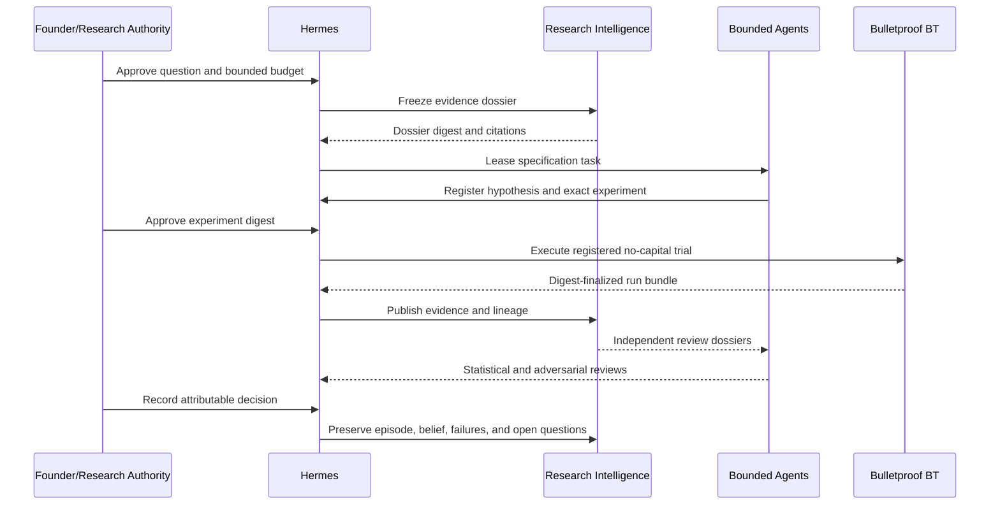

# Governed Research Company Walking Skeleton

**Purpose:** Earliest useful no-capital company loop
**Constraint:** Extend existing identities; do not create a parallel registry

## Slice contract

| Stage | Canonical input | Output evidence | Failure behavior |
|---|---|---|---|
| Evidence ingestion | Source artifact and access class | Source/edition/object identities and citation-replay receipt | Quarantine/remediation; no silent text |
| Question registration | Dossier digest and research budget | Question identity and provenance | Remain proposed |
| Hypothesis/experiment | Immutable specifications and search family | Approved manifest digest | Reject self-approval or budget ambiguity |
| Task assignment | Role package, machine, risk, workflow, lease | Auditable task events | Release/stop on policy or lease loss |
| Experiment | Exact data/code/config identities | Run bundle, truth report, attempt status | Preserve invalid/failed attempt |
| Publication | Validated bundle digest | RI publication receipt and searchable lineage | No partial canonical publish |
| Review | Frozen result dossier | Independent statistical and adversarial records | No decision until both exist |
| Decision | Exact result/review digests | Attributable decision and belief update | Evidence remains unpromoted |
| Episode | Complete lifecycle | Durable task/research memory | Recovery queue if publication incomplete |

## Acceptance demonstration

Use a small immutable public or synthetic dataset and a deliberately modest hypothesis. Run the loop twice: one valid negative result and one intentionally invalid causal/data fixture. The valid result must be reproducible and independently rejected or retained; the invalid result must be classified invalid rather than negative. Neither path may create orders, allocation eligibility, or live configuration.

The skeleton is complete only when a later task can retrieve the earlier question, citations, exact run, negative/invalid classification, reviews, decision, and rationale without consulting terminal history.
